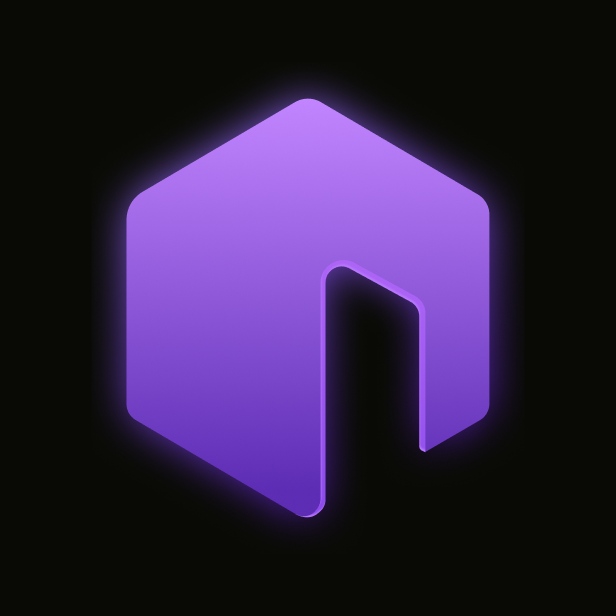
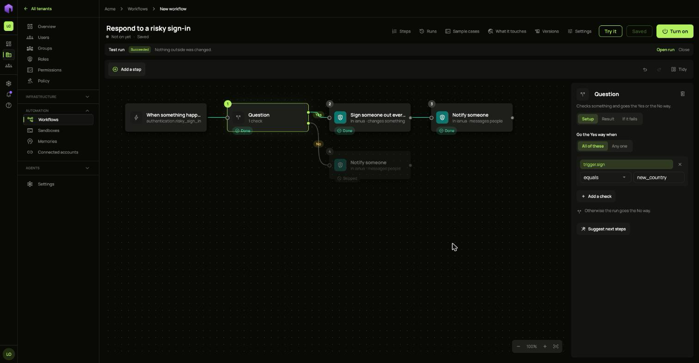
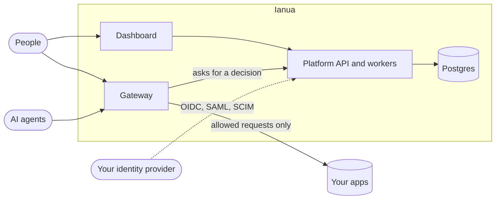

<div align="center">



# Ianua

### Identity, zero-trust access and governed AI agents, on your own infrastructure.

Single sign-on, one gateway in front of every app, and agents and workflows that can only do what a person allowed.

[](#license)
[](https://ianuaidp.github.io/ianua/)

[Documentation](https://ianuaidp.github.io/ianua/) · [Quick start](#quick-start) · [Guides](https://ianuaidp.github.io/ianua/guides/agents/create-an-agent/) · [Security](SECURITY.md) · [Contributing](CONTRIBUTING.md)



</div>

## Why Ianua

Most companies run one product to sign people in, another to guard internal apps, and nothing at all to limit what an AI agent may do. Ianua is one self-hosted platform for all three, with one policy model and one audit log.

It is a self-hosted alternative to Auth0, Okta, Keycloak and Pomerium, built for a world where AI agents need identities and limits of their own.

## Features

| | |
| :-- | :-- |
| **Sign-in** | Passwords, passkeys, multi-factor authentication, magic links, and single sign-on through OIDC and SAML. |
| **Identity provider** | OAuth 2 and OIDC for your own apps, SCIM and LDAP for directories, API keys for services. |
| **Zero-trust gateway** | One gateway in front of every app. It denies by default and records a decision for each request. |
| **AI agents** | Each agent has its own identity, delegated rights, spending caps and approvals, and reaches only what it was given. |
| **Workflows** | A visual builder with 27 outside services, code steps in sandboxes, and approvals by people. Each run acts with only the rights of the person it is for. |
| **Multi-tenant** | Organizations and tenants, roles and groups, and a full audit log. |

## Quick start

You need Docker and Node 20.9 or later.

```sh
git clone https://github.com/IanuaIDP/ianua.git
cd ianua
make start
```

This builds and starts the backend in Docker, then runs the dashboard at <http://app.localhost:3000>. The first build takes a while. It prints how to sign in, and caught mail is at <http://127.0.0.1:8025>. `make help` lists the other commands.

To install on a cluster, see [Install on Kubernetes](https://ianuaidp.github.io/ianua/start/install-on-kubernetes/).

## How it works



The **platform** manages organizations, tenants, users, federation, policy and workflows. The **gateway** ends live traffic, works out who is calling, asks for a policy decision, and forwards the request or refuses it. A missing or failed decision is a refusal.

Read [How it works](https://ianuaidp.github.io/ianua/start/how-it-works/) for the full picture.

## Project layout

| Path | What it holds |
| :-- | :-- |
| `crates/` | The backend, in Rust, built with Domain-Driven Design and ports and adapters. |
| `integrations/` | One crate for each outside service that workflows can use. |
| `dashboard/` | The web dashboard, in Next.js. |
| `deploy/` | Helm charts and Docker Compose files. |
| `docs/` | The documentation site. |

The backend needs Postgres, and runs on Docker or Kubernetes.

## Frequently asked questions

**Is Ianua open source?**
No. It is fair-code: the source is open to read and it is free to self-host for your own organization, but you may not sell it or host it for others without a commercial license.

**Can I sign my own customers in through it for free?**
Yes, as long as what your customers pay for is your product and not Ianua itself.

**How is it different from an identity provider alone?**
It also guards your apps with a gateway, and treats AI agents as identities with their own limits.

## Contributing

Read [CONTRIBUTING.md](CONTRIBUTING.md) before you start. [Development](https://ianuaidp.github.io/ianua/contributing/development/) covers building, testing and the Docker images. Please report security problems as described in [SECURITY.md](SECURITY.md), not in a public issue.

## License

Ianua is licensed under the [Ianua Source Use License](LICENSE). You may use, change and self-host it for your own organization, including to sign your customers in to your own products. You may not sell it or offer it to others as a hosted service without a commercial license. Third-party material is listed in [NOTICE](NOTICE).

<div align="center">
<sub>Made in Ukraine.</sub>
</div>
