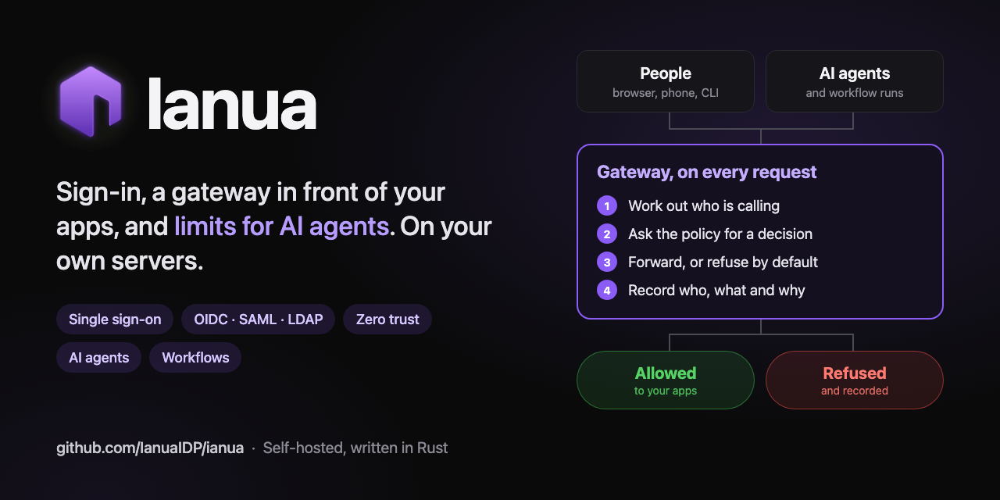
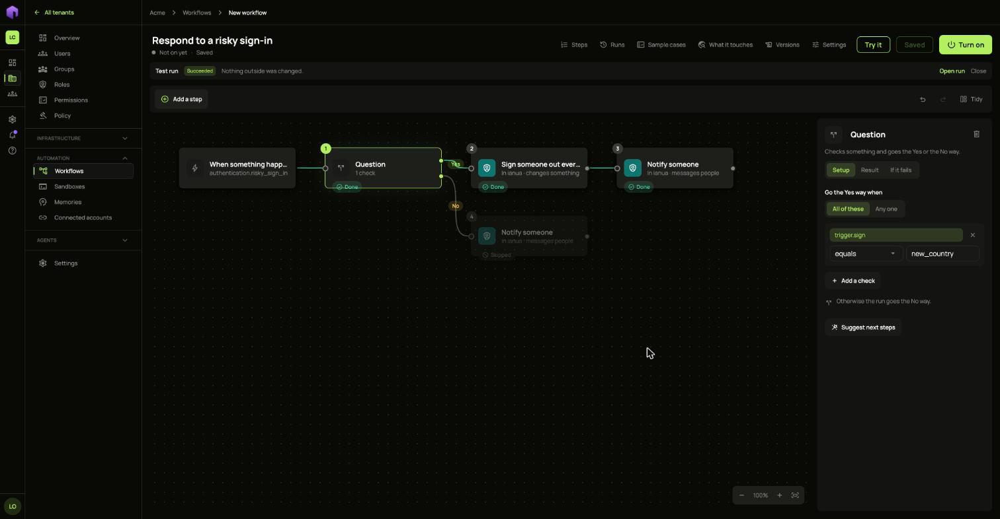
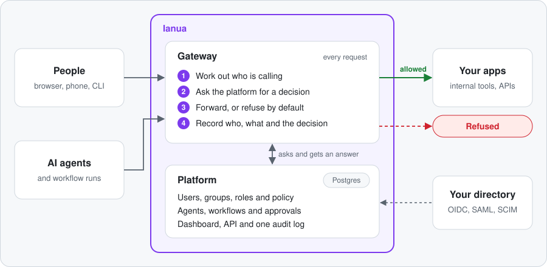

<div align="center">

[](https://github.com/IanuaIDP/ianua/actions/workflows/ci.yml)
[](https://github.com/IanuaIDP/ianua/actions/workflows/dashboard.yml)
[](https://ianuaidp.github.io/ianua/)
[](https://ianuaidp.github.io/ianua/contributing/development/#test-coverage)
<br>
[](rust-toolchain.toml)
[](dashboard/)
[](LICENSE)
[](https://github.com/IanuaIDP/ianua/commits/main)



[Documentation](https://ianuaidp.github.io/ianua/) ·
[Quick start](#quick-start) ·
[How it works](#how-it-works) ·
[Security](SECURITY.md) ·
[Contributing](CONTRIBUTING.md)

</div>

<br>



## What it is

Say your team uses an orders dashboard and a stock API that you built yourselves. A partner's system calls the API at night. Lately an AI assistant reads orders and drafts refunds.

Most teams cover this with an identity provider for sign-in, a proxy in front of the apps, and API keys for everything else. Each of those has its own list of users and its own log. The assistant usually runs on someone's personal token, so it can do anything that person can.

With Ianua, every caller goes through one gateway and one set of rules, and each request leaves one record. The assistant gets its own identity and only the part of your access you lend it. If the person who lent it leaves the company, the assistant is refused on its next request.

## How it works

<picture>
  <source media="(prefers-color-scheme: dark)" srcset=".github/readme/architecture-dark.svg">
  
</picture>

Ianua has two main parts.

The **gateway** takes every request. It works out who is calling, asks the platform whether they may, then forwards the request or refuses it. A missing answer, an error or a slow answer counts as a no. Identity headers sent by the caller are removed before the gateway adds its own.

The **platform** keeps the users, groups, roles, policy, agents and workflows in Postgres. The dashboard and the API both use it.

[How it works](https://ianuaidp.github.io/ianua/start/how-it-works/) in the docs follows one request through every step.

## Features

| | |
| :-- | :-- |
| Sign-in | Passwords, passkeys, authenticator apps, codes by mail or text, magic links. Single sign-on through your existing provider over OIDC or SAML. |
| Identity provider | OAuth 2 and OpenID Connect for your own apps, SCIM for user sync, an LDAP server for older tools, API keys for services. |
| Gateway | Sits in front of your apps and checks every request. Your app gets a signed statement of who is calling. If a check fails or cannot run, the request is refused. |
| Private networks | A small connector inside your network dials out to the gateway, so you do not have to open a port. |
| AI agents | Each agent has its own key pair and borrowed access that can only get narrower. Add a spending cap or a person's approval, or stop it in the middle of a task. |
| Workflows | A visual builder with 27 outside services such as GitHub, Slack and Jira, and code steps in locked-down sandboxes. A run can only do what its person may do. |
| Tenants | Organizations and tenants with their own users, roles, groups and audit log, kept apart from each other. |

## Status

Ianua is young. The code became public in November 2026 and there is no tagged release yet, so expect changes between commits. You can run it today with Docker Compose or on Kubernetes. If you plan to use it for something important, [open an issue](https://github.com/IanuaIDP/ianua/issues) first and tell us what you need.

## Quick start

You need Docker and Node 20.9 or later.

```sh
git clone https://github.com/IanuaIDP/ianua.git
cd ianua
make start
```

This builds the backend in Docker and starts the dashboard at <http://app.localhost:3000>. The first build takes a while. When it is done, it prints how to sign in. Mail sent by the platform is caught at <http://127.0.0.1:8025>. Run `make help` for the other commands.

To run it on a cluster, see [Install on Kubernetes](https://ianuaidp.github.io/ianua/start/install-on-kubernetes/).

### Put an app behind the gateway

Everything the dashboard does goes through the API. Here, `$T` is your tenant's address in the API and `auth` holds your session token. The [API quick start](https://ianuaidp.github.io/ianua/start/quickstart-api/) shows how to get both.

```sh
# A pipeline holds the checks. Every new one starts with "who is calling" and "are they allowed".
PIPELINE=$(curl "${auth[@]}" -X POST $T/pipelines -d '{"name":"Default"}' | jq -r .id)
curl "${auth[@]}" -X POST $T/pipelines/$PIPELINE/activate

# The service is where your app lives.
SERVICE=$(curl "${auth[@]}" -X POST $T/services -d '{"name":"hello", "upstream":{"url":"http://hello:80",
  "timeout_secs":30, "preserve_host":false, "expected_audience":{"pinned":"hello"}, "identity":"token"}}' | jq -r .id)

# The route says who may reach which path. Here only signed-in people get in.
curl "${auth[@]}" -X POST $T/routes -d "{\"name\":\"private\", \"path_pattern\":\"/private/*\", \"methods\":[\"Get\"],
  \"service_id\":\"$SERVICE\", \"pipeline_id\":\"$PIPELINE\", \"policy\":\"Authenticated\"}"
```

Now a request to `/private/` without a session gets `401`, and your app never sees it.

## How it is tested

Most of the work on Ianua goes into tests.

- More than 20,000 automated tests run on every change.
- End-to-end scenarios start the real platform and gateway behind TLS, with real mail. In one, a person signs up, an admin removes them, and their next request is refused.
- Gateway tests cover the requests that must fail, such as an expired token or a policy store that is down.
- Checked house rules hold the code to its design. For example, the domain code may not depend on the database.

## Compared with other tools

| If you use | It is good at | What Ianua adds |
| :-- | :-- | :-- |
| Keycloak, Auth0, Okta | Signing people in | A gateway that checks every request, and agents with limited, borrowed access |
| Pomerium, oauth2-proxy | Guarding internal apps | Its own identity provider, and the same rules for services and agents |
| Kong, Traefik, NGINX | Routing, load balancing, rate limits | Identity and policy built in rather than added as plugins, and a refusal whenever a check cannot run |
| Zapier, n8n, Make | Connecting apps with little effort | Runs that act with only the rights of the person they are for, approvals by people, and code in sandboxes, on your own servers |
| API keys, copied tokens | Being quick to set up | Knowing who allowed what, and stopping an agent mid-task |

If you only need single sign-on for software you buy, a hosted identity provider is less to run. If you want to connect thousands of apps, Zapier has far more than Ianua's 27. Ianua fits best when you have your own apps and APIs, and people, services and agents all call them. The docs have a [longer comparison](https://ianuaidp.github.io/ianua/start/the-problem/).

## Project layout

| Path | What is in it |
| :-- | :-- |
| `crates/` | The backend and gateway, in Rust |
| `integrations/` | One crate for each outside service workflows can use |
| `dashboard/` | The web dashboard, in Next.js |
| `deploy/` | Helm charts and Docker Compose files |
| `docs/` | The documentation site |

## License

Ianua is source available under the [Ianua Source Use License](LICENSE). It is not an open source license.

You may read, change and self-host it for your own organization. That includes signing your own customers in to your own products. You may not sell Ianua itself or host it for others without a commercial license. Third-party material is listed in [NOTICE](NOTICE).

## Contributing and security

Read [CONTRIBUTING.md](CONTRIBUTING.md) before you open a pull request. [Development](https://ianuaidp.github.io/ianua/contributing/development/) covers building, testing and the Docker images.

Found a security problem? Please report it privately as described in [SECURITY.md](SECURITY.md), not in a public issue.

<br>

<div align="center">
<sub>Built by Maurice Schilpp in Ukraine and Giorgi Zoidze in Georgia.</sub>
</div>
