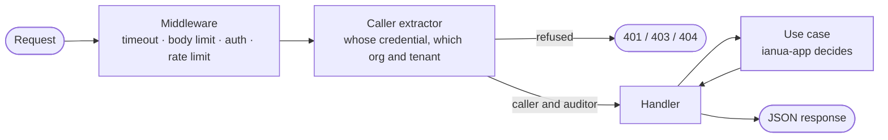

`ianua-api` is the HTTP API that the dashboard, your scripts and other identity systems talk to. It is built on [axum](https://github.com/tokio-rs/axum).

It is an adapter like the ones in [infrastructure](/ianua/architecture/infrastructure/), but it faces the other way: instead of filling a port, it calls use cases. Its work splits in two:

- **The API says who is calling.** Extractors work out the caller from the credential and the path, and refuse a request that names somewhere the credential does not belong.
- **The application decides what they may do.** No extractor, middleware or handler checks a permission, a role or a limit. The use case asks the domain, from the stored records.

So the same rules hold for the LDAP server and the SCIM endpoints, which call the same use cases.

## A request's way through



Every request on the public listener goes through the same middleware, set up once in `router.rs`:

- an access log line for every request. It records the path but never the query string, so a token passed in a URL is not written to the log,
- `Cache-Control: no-store` on every answer that does not set its own,
- the security headers on every answer that does not set its own, errors and caught panics included: `Strict-Transport-Security` for two years with subdomains, `X-Content-Type-Options: nosniff`, `X-Frame-Options: DENY` and `Referrer-Policy: no-referrer`,
- a timeout, 30 seconds by default, so a stuck request cannot hold its connection for ever,
- at most 500 requests handled at once by default, and request bodies of at most 1 MB,
- a body answered before it was read, as when the auth layer or a rate limit refuses the request, has what is left of it read and thrown away before the answer goes out, up to 16 MB and for at most two seconds, so a body refused for its size is read to its end too. So the caller, or the proxy in front, gets the refusal rather than a connection closed while the body was still arriving,
- the **auth layer**, which reads the bearer token from the `Authorization` header and works out who is calling. If the store behind it cannot answer, the request gets **503**, never an anonymous pass,
- the **rate limit** for the caller: their tenant's budget, their organization's for a member, their own for an operator. Sign-in endpoints also have a limit per address, and sensitive actions such as changing a password a limit per user,
- one **unit of work** for each request that changes something (`POST`, `PUT`, `PATCH`, `DELETE`): its writes and its audit records are committed together, and all dropped if ianua itself failed the request with a 500.

## Who is calling: the caller extractors

A handler names the kind of caller it serves as an argument. The extractors live in `extractors/callers.rs`:

| Extractor | Who it is |
| --- | --- |
| `TenantCaller` | Someone acting in the tenant the path names: one of its users, a member of its organization, or an operator acting as a user through an impersonation grant. |
| `OrgMember` | A member of the organization the path names, acting on it. |
| `Operator` | An operator, acting on the platform with their own key. |
| `Visitor` | Someone nobody has identified yet, such as a person signing in or following an emailed link. |

Each one hands the handler the app's caller and a `RequestAuditor` already holding who is calling and from which address. Before that, `TenantCaller`:

1. takes the caller the auth layer resolved, or refuses with **401**,
2. finds the organization and tenant from `{org_slug}` and `{tenant_slug}` in the path. One that does not exist, or a tenant the organization does not hold, answers **404**. A suspended, archived or deleted tenant answers **403**,
3. checks that the credential belongs there: a tenant user's session or key only in its own tenant, a member's only in their own organization. An operator's own key does not act inside a tenant. Any of these answers **403**,
4. marks a tenant API key, or a member's session or key, as used, at most once per interval rather than on every request, so a session stays alive while in use and a key shows when it was last used,
5. if the request names a support impersonation in the `ianua-support-impersonation` header, asks the app to act as that person, and refuses if the app refuses.

Whether this caller may do what the request asks is not checked here. A convention test, `the_api_checks_no_right` in `crates/ianua-audit/src/conventions/api/`, fails the build if a handler, extractor, middleware or route file names a right check.

## The handler

A handler only orchestrates: extractors in, the use case call, a response type out. Registering a user:

```rust
/// crates/ianua-api/src/handlers/identity/users.rs
pub async fn register_user(
    State(identity): State<IdentityState>,
    State(limits): State<DomainLimits>,
    tenant: TenantCaller,
    Path(path): Path<TenantPath>,
    Json(body): Json<RegisterUserBody>,
) -> Result<Created<RegisterUserResponse>, ApiError> {
    let new_user = body.new_user(&limits.display_name, path.link_scope())?;
    let registered = identity
        .users
        .register
        .execute(&tenant.caller, &tenant.auditor, new_user)
        .await?;
    Ok(Created(registered.into()))
}
```

Everything else has its own place:

| What | Where |
| --- | --- |
| Reading a request: paths, filters, sort orders, headers, JSON bodies | `extractors/` |
| Request and response bodies, and turning them into domain values and back | `dto/<context>/` |
| How the HTTP layer behaves: listeners, rates, browsers, live streams | `state/http.rs` |
| Paths and their place in the OpenAPI document | `routes/<context>.rs` |
| Handlers, one file per area | `handlers/<context>/` |

The request body is a plain struct, `RegisterUserBody`, and the response is another, `RegisterUserResponse`. These are **DTOs** (data transfer objects): they exist only in this crate, they carry `serde` and OpenAPI attributes, and they are turned into domain types at the edge. The body checks its own values:

```rust
/// crates/ianua-api/src/dto/identity/users.rs
pub fn new_user(self, limits: &DisplayNameLimits, scope: LinkScope) -> Result<New, ApiError> {
    let roles = self.requested_roles()?;
    Ok(New {
        email: Email::new(self.email).map_err(ApiError::validation)?,
        display_name: DisplayName::new(self.display_name, limits)
            .map_err(ApiError::validation)?,
        // …
    })
}
```

Turning the use case's answer back into JSON is a `From` conversion in the same module. The domain never derives `Serialize` or `Deserialize` to suit the API, so changing the JSON never changes a rule.

Every time the API writes or reads in JSON is RFC 3339, such as `2026-11-02T01:40:00.032635Z`, so a time one answer gives can be sent straight back as a filter, such as an audit log's `since`.

The API's convention checks in `crates/ianua-audit/src/conventions/api/` hold this shape: a handler file holds only handlers, every handler is routed and documented, every app context has its routes and its part of the document, and every JSON body, query string and form is taken through the API's own `extractors::json::Json`, `extractors::query::Query` and `extractors::form::Form`, never the framework's own.

## Errors

A use case's `AppError` becomes a status code and a JSON body in one place:

```rust
/// crates/ianua-api/src/error/mod.rs
pub(crate) fn status_and_code(err: &AppError) -> (StatusCode, ErrorCode) {
    match err {
        AppError::Domain(_) => (StatusCode::UNPROCESSABLE_ENTITY, ErrorCode::DomainError),
        AppError::NotFound(_) => (StatusCode::NOT_FOUND, ErrorCode::NotFound),
        AppError::Forbidden(_) => (StatusCode::FORBIDDEN, ErrorCode::Forbidden),
        AppError::Conflict(_) => (StatusCode::CONFLICT, ErrorCode::Conflict),
        AppError::Unauthenticated => (StatusCode::UNAUTHORIZED, ErrorCode::Unauthenticated),
        // …
        AppError::Internal(_) => (StatusCode::INTERNAL_SERVER_ERROR, ErrorCode::InternalError),
        AppError::Upstream(_) => (StatusCode::BAD_GATEWAY, ErrorCode::UpstreamFailed),
    }
}
```

Every error body has the same shape: a fixed `error` code a program can match on, and a `message` for people. The kind of error is already in the code, so the message is only what went wrong, as a sentence:

```json
{ "error": "conflict", "message": "Email already registered" }
```

An internal error is logged with its full cause, but the caller only gets `"An internal error occurred"`. The details are added to the response only when the server runs in development mode.

### Messages in the caller's language

Most refusals carry a message key and the values the sentence was filled with. The body names both, so a client can show the message in its own words:

```json
{
  "error": "conflict",
  "message": "Cannot move a route from \"active\" to \"draft\"",
  "key": "routing-cannot-move-a-route-from-to",
  "params": { "from": "\"active\"", "to": "\"draft\"" }
}
```

The server also words the message itself. It reads `Accept-Language` and answers in the first language asked for that it ships: German, Spanish, French, Japanese, Georgian, Ukrainian or Simplified Chinese. With `Accept-Language: de`, the same refusal comes back with a German `message`, and the same `error`, `key`, `params` and status. With no header, English, or a language it does not ship, the message is English. A refusal that has no key, such as words passed on from an outside library, is always English and has no `key` or `params`. Such answers carry `Vary: Accept-Language`.

A refusal is keyed in the code with `message!`, which builds the English message and gives it its key. The translation happens later, when the API answers:

```rust
DomainError::invalid(message!(
    "routing-cannot-move-a-route-from-to",
    format!("cannot move a route from {from:?} to {to:?}")
))
```

Each field of the `format!` becomes a value under its name; an unnamed field is `arg0`, `arg1` and so on. The keys and the translations come from `crates/ianua-translate/catalog.json`, which writes the Fluent files in `crates/ianua-infra/locales/` (see the translate tool's README).

A JSON body the API cannot take gets the same shape before any use case runs. Every handler reads its body through `extractors::json::Json`, which answers:

| Status | `error` | When |
| --- | --- | --- |
| **400** | `malformed_body` | The body is not JSON that can be read, such as JSON cut off half way. |
| **415** | `unsupported_media_type` | The body was sent without `Content-Type: application/json`. |
| **413** | `body_too_large` | The body is larger than the listener takes. |
| **422** | `invalid_body` | The body is JSON, but not the shape the endpoint takes: a field missing, of the wrong type, or not one it knows. |

A form (`application/x-www-form-urlencoded`, as browsers and identity providers post it) is read through `extractors::form::Form` and answered with the same codes: `400` when it cannot be read, `415` when it was not sent as a form, `413` when it is too large, and `422` `invalid_body` when it is not the shape the endpoint takes.

A query string is read through `extractors::query::Query`. One that is not the shape the endpoint takes, such as `?limit=many` or a parameter named twice, is answered **422** with `invalid_query`. A query that reads but asks for something refused, such as a page size of 500, is answered `422` with `domain_error` and says what is wrong.

The message is a fixed sentence for each. The parser's own words quote the body or the query back, and it may hold a password or a code, so they are never sent or logged.

The SCIM endpoints and the OAuth endpoints use the same use cases but answer in their own protocol's error format, always in English: an OAuth `error_description` may hold only plain ASCII.

## Lists

Every list pages by cursor, never by offset, so reading page 1,000 costs
the same as reading page 1:

- Send `limit`, from 1 to 100, default 20. A limit outside that range is
  refused with **422**, not quietly changed.
- Each page answers `{items, next_cursor, limit}`. To read on, send
  `after` set to the `next_cursor` you got. On the last page `next_cursor`
  is `null`.
- A cursor is opaque. It belongs to the `sort` it was made with: sent with
  another sort, or not one the list made, it is refused with **422**.
- Lists answer no total, since counting a large table is as slow as
  reading it. A screen that shows a number asks a count of its own.

SCIM lists are the one exception: they keep `startIndex` and
`totalResults`, as the SCIM standard requires.

## Two listeners

The API serves two listeners:

- **The public one**, which the ingress routes to: everything the dashboard and your scripts call, plus `/health`, which answers `ok` while the server is up and asks nothing else.
- **The internal one**, which no ingress routes to: the probes `/health/live` and `/health/ready`, the gateway's sign-in relay (`/internal/app-sign-in`, see [Gateway](/ianua/architecture/gateway/#sign-in-addresses-on-an-apps-domain)), its questions about agent approvals (`/internal/agent-approvals`: hold an action for a person, or spend an approval once; sealed under a key of that channel alone, and every failure answered as a refusal) and `/metrics`. On both channels the API seals its answer as well, under the channel's key and bound to the question's nonce, in the `x-ianua-seal` header; the gateway takes no answer without it, so anyone else on the internal network who answers in the API's place is refused. The metrics say how the process runs, so nobody outside the deployment can read its traffic and load.

`/health/live` answers `ok` while the process runs. `/health/ready` asks the database, the message bus and the cache, and answers **200** when all of them answer and **503** when one does not, or when they take longer than 5 seconds. It never says which one failed: an orchestrator's probe carries no credentials, so that detail goes only to the logs. Both are on the internal listener only. On the public one, anyone could make the platform ask all three as often as they liked, and learn which one is down.

## The API contract

Each handler carries a `#[utoipa::path]` attribute and its doc comment, and from these the OpenAPI document is generated. With `ENABLE_API_DOCS=true`, the server publishes it at `/api/v1/docs` (Swagger UI) and `/api/v1/reference`.

The document is also kept as a snapshot beside the code, in `tests/contract/public.json`, with the internal listener's own document in `tests/contract/internal.json`. Every client reads it: the dashboard, SDKs, people calling the API by hand. So a renamed field, a dropped enum value or a moved route fails `tests/contract.rs`, even when every other test still passes. Once the change is reviewed, the snapshot is written again:

```bash
IANUA_WRITE_SNAPSHOTS=1 cargo nextest run -p ianua-api --test contract
```

A domain rename that would change the JSON shows up as a change to this file, not as a broken client.

Enums the domain owns are described with every value they take, not as a bare string. The values come from serializing each variant, in `dto/schemas.rs`, so the document never disagrees with the JSON. The variants are listed through an exhaustive `match`, so a variant the domain adds stops the build until it is documented. Ids are described as UUIDs.

## `ApiState`

`ApiState` holds one group of use cases per app context, such as `IdentityState`, and each handler takes only its own (`State<IdentityState>`). The groups and their builders live in `ianua-assembly`, a crate of their own below the API, the LDAP directory and the worker, so each takes its use cases from the same place and none borrows another's. The server hands the API a `Deps`: the adapter behind every port, the settings the use cases are built with, and the HTTP layer's own settings. `state::build` asks the assembly for every group. The API crate never picks an adapter itself, so it does not depend on `ianua-infra` at all.

Use cases nobody calls over HTTP, such as sweeps and event-driven jobs, are not in `ApiState`. They are for the [server](/ianua/architecture/server/)'s worker to wire.

## Testing the API

API tests build the real router over the application's in-memory fakes and call it without opening a port, using `axum-test`. The tests in `tests/api/callers.rs`, for instance, show that a credential acts only where it belongs:

```rust
/// crates/ianua-api/tests/api/callers.rs
/// An operator's own key acts on the platform, not inside a tenant: that
/// takes an impersonation grant.
#[tokio::test]
async fn an_operator_key_does_not_act_inside_a_tenant() {
    let response = server()
        .get(&tenant_inbox(ORG, TENANT))
        .authorization_bearer(OPERATOR)
        .await;

    response.assert_status(StatusCode::FORBIDDEN);
}
```

The end-to-end scenarios in `ianua-scenarios` then run whole flows against the real server, started from its settings behind a TLS ingress, over a real Postgres, cache and bus.
