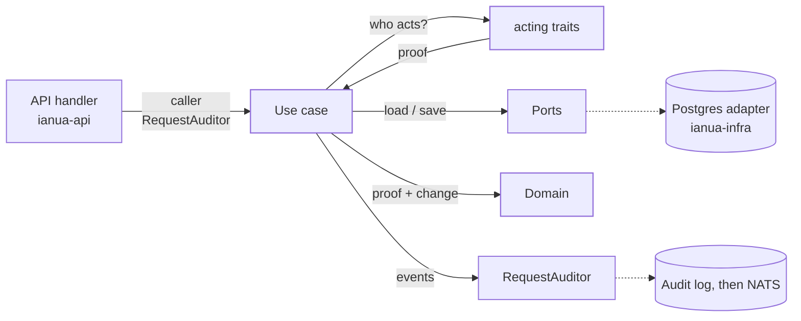
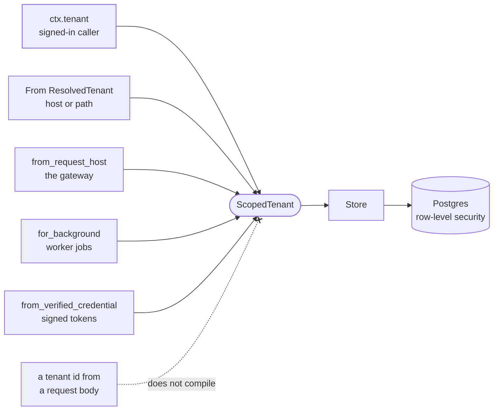

`ianua-app` is where actions happen. Everything a person or a process can do, such as create a consumer, lock an account, publish a route or carry out an erasure request, is one **use case**: a struct with one `execute` method. It finds out who is acting, loads what it needs, lets the [domain](/ianua/architecture/domain/) decide, saves the result and records what happened.

It depends on `ianua-domain` and on nothing outside it. It never names Postgres, HTTP, NATS or Redis. What it needs from them it describes as **ports**, and the [infrastructure](/ianua/architecture/infrastructure/) layer fills them.

## What is in the crate

```rust
/// crates/ianua-app/src/lib.rs
pub mod acting;
pub mod auditor;
pub mod context;
pub mod email;
pub mod error;
pub mod input;
pub mod listing;
pub mod ports;
pub mod services;
pub mod tenancy;
#[cfg(any(test, feature = "test-support"))]
pub mod test_support;
pub mod use_case;
pub mod use_cases;
```

| Folder or file | What it holds |
| --- | --- |
| `context/` | Who is calling: one caller type per kind of caller. |
| `acting/` | The traits a use case asks for a proof of who is acting, and the resolvers that answer them. |
| `use_case.rs` | The `Command` and `Query` traits every use case implements. |
| `use_cases/` | The use cases, one folder per context and topic folders inside it, such as `authorization/groups/`. |
| `ports/` | The traits the application needs filled from outside. |
| `tenancy.rs` | `ScopedTenant`, the only tenant a tenant-scoped store accepts. |
| `auditor.rs` | `RequestAuditor`, the only way a use case records events. |
| `services/` | Rules and steps several use cases share. |
| `listing/` | Paging and ordering for list queries. |
| `input/` | Partial updates, and checks on tokens, codes and passwords before anything is hashed or looked up. |
| `email/` | What an emailed link or address is worth: where a link belongs, asking for another one, a link refused. |
| `error.rs` | `AppError`. |
| `test_support/` | In-memory fakes of every port, and helpers for tests. |

Here is how one request passes through:



The solid arrows are calls the use case makes; the dotted ones are what sits behind a port, which the use case never sees.

## Who acts

### Callers

The API layer, the LDAP server and the gateway build a **caller** for every request and hand it to the use case. Each kind of caller has its own type in `context/`:

| Caller | Who it is |
| --- | --- |
| `CallerContext` | Someone acting inside a tenant: a tenant user, an organization member, an operator through an impersonation grant, or a tenant admin acting as one of the tenant's people for support. |
| `OrgCaller` | A member acting on their organization. |
| `OperatorCaller` | An operator acting on the platform with their own key. |
| `ConsumerCaller` | A consumer, known only by the credential it came with. |
| `ScimCaller` | A directory calling a tenant's SCIM endpoint with its bearer token. |
| `AgentAssertion` | What an agent presents to act in its own name. |

A caller says who someone claims to be and which credential they came with. It claims no permission:

```rust
/// crates/ianua-app/src/context/tenant.rs
pub enum Credential {
    TenantSession(SessionId),
    TenantApiKey(ApiKeyId),
    DirectoryBind(DirectoryBound),
    OrgSession(SessionId),
    OrgApiKey(OrgApiKeyId),
    OperatorKey(KeyPrefix),
    Impersonation {
        key: KeyPrefix,
        grant: ImpersonationGrantId,
        user: UserId,
    },
    SupportImpersonation {
        session: SessionId,
        impersonation: SupportImpersonationId,
        user: UserId,
    },
}
```

The credential names a stored record and nothing more. What that record lets its holder do is worked out from the record.

Flows that run before anyone has signed in, or with no request at all, take the tenant itself as their caller (a `ScopedTenant`, see below), or `()` for public flows.

### The `acting` traits

Every change in the domain takes a proof of who is making it, such as a `TenantAuthority`. Only the domain can make one, from stored records. A use case gets one by asking a trait in `acting/`:

```rust
/// crates/ianua-app/src/acting/mod.rs
#[async_trait]
pub trait TenantAuthorities: Send + Sync {
    /// What `caller` holds in their tenant now.
    async fn authority(&self, caller: &CallerContext) -> Result<TenantAuthority, AppError>;

    /// The person signed in to `caller`'s own tenant session, with their
    /// account, while the session check admits it.
    async fn signed_in(&self, caller: &CallerContext) -> Result<SignedInAccount, AppError>;

    // …
}
```

There is one trait per kind of caller: `TenantAuthorities`, `OrgActors`, `OperatorAuthorities`, `ConsumerAuthorities`, `ScimAuthorities`, `AgentActors`, and `DirectoryAuthorities` for LDAP binds. In production each is answered by a resolver beside it (`TenantActing`, `OrgActing` and so on). The resolver loads the session, key, bind or token the caller came with, runs the domain's own checks on it, and returns what the domain made of it. A session counts only while the domain's session check admits it, and a key only for what its maker holds now.

Use cases never build a proof and never check a permission by hand, for two reasons:

- **One copy of the rule.** What someone may do is decided in the domain, once. A use case that compared permissions itself would be a second copy, and sooner or later the two would disagree.
- **Forgetting is not possible.** A domain change needs the proof as an argument. A use case that never asked who is acting has nothing to pass, and does not compile.

A use case takes the trait, not the resolver, so its tests can say what a caller holds.

## The shape of a use case

The shape is set by two traits in `use_case.rs`:

```rust
/// crates/ianua-app/src/use_case.rs
pub trait Command {
    type Caller: ?Sized;
    type Input;
    type Output;

    fn execute(
        &self,
        caller: &Self::Caller,
        auditor: &RequestAuditor,
        input: Self::Input,
    ) -> impl Future<Output = Self::Output> + Send;
}

pub trait Query {
    type Caller: ?Sized;
    type Input;
    type Output;

    fn execute(
        &self,
        caller: &Self::Caller,
        input: Self::Input,
    ) -> impl Future<Output = Self::Output> + Send;
}
```

- A **`Command`** changes something and leaves an audit record, so it receives the request's `RequestAuditor`.
- A **`Query`** only reads, and receives no auditor.

One operation is one use case with one `execute`, in a file of its own. If the same operation works for different kinds of owner, the owner goes in the input as an enum. Inputs are owned values, already parsed into domain types.

Each use case gets its ports in a `*Ports` struct when it is built, and the request's details as arguments when it runs. Settings such as lifetimes come in the same way, as values passed to the constructor; the [server](/ianua/architecture/server/) reads the [configuration](/ianua/reference/configuration/) and hands them over.

Creating a consumer, slightly shortened:

```rust
/// crates/ianua-app/src/use_cases/consumers/create.rs
#[derive(ianua_macros::Fakes)]
pub struct CreatePorts {
    pub consumer_store: Arc<dyn ConsumerStore>,
    pub limit_enforcer: Arc<dyn LimitEnforcer>,
    pub issuers: TenantIssuers,
    pub tenant_authorities: Arc<dyn TenantAuthorities>,
    pub key_generator: Arc<dyn ConsumerKeyGenerator>,
}

impl Command for CreateUseCase {
    type Caller = CallerContext;
    type Input = CreateRequest;
    type Output = Result<CreateResult, AppError>;

    async fn execute(
        &self,
        ctx: &CallerContext,
        auditor: &RequestAuditor,
        request: CreateRequest,
    ) -> Result<CreateResult, AppError> {
        let (mut consumer, api_key) = self.new_consumer(ctx, request).await?;
        // … check the tenant's consumer limit
        let tenant = ctx.tenant();

        self.ports
            .consumer_store
            .save(&tenant, &consumer)
            .await
            .or_internal()?;

        auditor
            .dispatch_by(
                &consumer.created_by().clone(),
                consumer.take_events(&tenant),
            )
            .await
            .or_internal()?;

        Ok(CreateResult {
            consumer_id: *consumer.id(),
            api_key,
        })
    }
}
```

Callers name it `consumers::CreateUseCase`: the folder says what it is about, and the type says what it does (see [Names](#names) below).

`new_consumer` asks `tenant_authorities` for the caller's `TenantAuthority` and hands it to the domain, which decides. An API key is made by `key_generator`, never sent by the caller, and only its prefix and digest go into the consumer:

```rust
/// crates/ianua-app/src/use_cases/consumers/create.rs
let authority = self.ports.tenant_authorities.authority(ctx).await?;
let tenant_issuer = self.ports.issuers.of(&ctx.tenant_id()).await?;
let issued = request
    .credential
    .issued(self.ports.key_generator.as_ref())
    .await?;
// …
Consumer::create(params, &tenant_issuer, &ConsumerControl::new(&authority))
    .map_err(AppError::from_domain)
```

The order is the same in almost every command:

1. **Find out who acts**, through `acting`.
2. **Load** what the action is about, and return early if it is missing.
3. **Let the domain decide**, passing it the proof.
4. **Save** through the ports.
5. **Record** what happened, by taking the events the aggregate raised and handing them to the `RequestAuditor`.

Saving comes before recording. A new consumer can sign in as soon as it is saved, so the record of its creation is written right after, and a failed audit write fails the request.

A use case never builds an event itself. The aggregate raised it when it changed (see [Domain events](/ianua/architecture/domain/#domain-events)), and the use case only takes it out with `take_events` once the save went through.

Below the `impl`, a use case file keeps its free functions in a fixed order: `ensure_*` checks first, then other helpers. Lookups that several use cases in one folder share live in that folder's `lookup.rs`.

### Names

The folders and names are chosen so a path reads as one phrase:

- **A file never repeats its folder.** `consumers/create.rs`, never `consumers/create_consumer.rs`; `tenant/lifecycle/archive.rs`, never `archive_tenant.rs`. The name of the folder above counts too.
- **A use case type never repeats its folder's word.** Callers write the folder, so the type is `consumers::CreateUseCase` with `CreatePorts` and `CreateRequest`, and the users list is `users::ListUseCase`. `ListUsersUseCase` would say "users" twice.
- **Crowded folders are split into topic folders.** Past about twelve files, a folder groups them: `identity/users/` holds `joining/`, `records/`, `standing/`, `sessions/` and `credentials/`. A topic folder is private and its parent re-exports what is in it, so callers still write `users::ListSessionsUseCase`.
- **Modules are named by their full path.** Imports start at `crate::`, never climb with `super::`. A test module's `use super::*;` is the only exception: it means the file it tests.

A name that has to keep its folder's word, because the short one is a keyword, is taken, or means another type, is listed in the convention test with its reason.

### Recording what happened

Use cases never write to the audit log or publish events themselves. They hand their events to the `RequestAuditor`:

```rust
/// crates/ianua-app/src/auditor.rs
pub struct RequestAuditor {
    sink: Arc<dyn EventDispatcher>,
    ctx: AuditContext,
}

impl RequestAuditor {
    pub async fn dispatch(&self, events: &[DomainEvent]) -> Result<(), DomainError> {
        self.sink.dispatch(events, &self.ctx).await
    }

    pub async fn dispatch_by(
        &self,
        actor: &ActorRef,
        events: Vec<DomainEvent>,
    ) -> Result<(), DomainError> { /* … each event names `actor`, then dispatch */ }
}
```

The auditor is built once per request, already holding who is calling, from which address, for which tenant. The use case only passes the events, so it cannot forget the caller or record the wrong one. `dispatch_by` names the person who made the change on each event, as creating a consumer does with the consumer's creator. Work with no caller, such as a scheduled job, uses `RequestAuditor::system`.

The `EventDispatcher` port promises one thing about failure: if the audit record cannot be written, `dispatch` returns an error and the action fails. A failure to broadcast the event to other processes does not fail it. How the records and events travel on is the [infrastructure](/ianua/architecture/infrastructure/events/)'s job.

For a request that changes something (`POST`, `PUT`, `PATCH` or `DELETE`), the API runs the use case in one unit of work, so its writes and its audit records are committed together, or all dropped if ianua itself failed the request. Work outside a request, such as a sweep or a reaction to an event, wraps each change and its audit record with `services::kept_together`, so the two are kept or dropped together.

## Ports

A port is a trait the application writes for itself, saying what it needs and nothing about how it is done. Storing users is one:

```rust
/// crates/ianua-app/src/ports/identity/users.rs
#[async_trait]
pub trait UserStore: Send + Sync + TenantScoped {
    async fn find_by_id(
        &self,
        tenant_id: &ScopedTenant,
        id: &UserId,
    ) -> Result<Option<User<ResolvedTenant>>, DomainError>;

    async fn email_exists(
        &self,
        tenant_id: &ScopedTenant,
        email: &Email,
    ) -> Result<bool, DomainError>;

    // …
}
```

### How they are grouped

`ports/` has one module per context. A context with several topics is a folder with one file per topic, which its `mod.rs` re-exports, so a use case still imports `crate::ports::identity::UserStore`:

```rust
/// crates/ianua-app/src/ports/identity/mod.rs
mod attributes;
mod exports;
mod impersonations;
mod invitations;
mod privacy;
mod tokens;
mod users;

pub use attributes::*;
pub use exports::*;
// …
pub use users::*;
```

For example, `ports/authorization/` holds `groups.rs`, `policies.rs`, `roles.rs`, `access_requests.rs`, `access_reviews.rs` and a few more. Smaller contexts, such as `branding.rs` or `webhooks.rs`, stay one file.

Two modules belong to no context:

- **`ports/shared/`**: ports many contexts use, such as the `EventDispatcher`, the `SessionStore` and outgoing mail.
- **`ports/runtime/`**: ports for running the service rather than any one context: caching, the fleet, observability, metrics export, readiness probes, secure randomness, secrets and units of work.

### Tenant-scoped and cross-tenant

A port whose data belongs to one tenant extends the marker trait `TenantScoped`, and every one of its methods takes a `&ScopedTenant` first, as `UserStore` does above.

A few jobs need to look across tenants. They get ports of their own, named for it and not `TenantScoped`:

```rust
/// crates/ianua-app/src/ports/crypto.rs
/// Not [`TenantScoped`]: the sweeps that revoke keys after their grace and
/// rotate them by age run with nobody asking, over every tenant's keys.
#[async_trait]
pub trait CrossTenantKeySets: Send + Sync {
    async fn tenants_with_rotated_keys(&self) -> Result<Vec<TenantId>, DomainError>;
    // …
}
```

The others are `CrossTenantUserChecker`, `CrossTenantApiKeyStore`, `CrossTenantDeviceAuthStore`, `CrossTenantDomainStore` and `CrossTenantCertificateStore`. Keeping them separate means a use case that can see across tenants says so in its `*Ports` struct, and a tenant-scoped store cannot be used that way by accident. Control-plane stores such as `TenantStore` and `OrganizationStore` have no tenant dimension and are not `TenantScoped` either.

### Typed values only

Ports take and return domain types and fail with `DomainError`. They take typed ids, hashes and keys, never a bare `Uuid` or a `&str` for a hash, prefix or token. A `sqlx::Error` or an HTTP status never comes through a port: the adapter turns those into `DomainError::Infrastructure` before they leave. A port also owns the types it carries and never borrows one from a use case.

## Which tenant: `ScopedTenant`

A tenant-scoped store will not take a bare `TenantId`. It takes a `ScopedTenant`, and every way to get one names where the tenant came from:

```rust
/// crates/ianua-app/src/tenancy.rs
pub struct ScopedTenant(TenantId);

impl ScopedTenant {
    /// The tenant the request resolved for its caller.
    pub(crate) fn from_resolved_caller(tenant_id: TenantId) -> Self { /* … */ }

    /// The tenant a request's host resolved to in a routing table the control
    /// plane published.
    pub fn from_request_host(tenant_id: TenantId) -> Self { /* … */ }

    /// A tenant named by work that runs outside any request.
    pub fn for_background(tenant_id: TenantId) -> Self { /* … */ }

    /// The tenant named inside a credential this platform signed.
    pub fn from_verified_credential(tenant_id: TenantId) -> Self { /* … */ }

    /// A tenant the use case resolved from the tenant registry itself.
    pub(crate) fn from_registry(tenant: &Tenant) -> Self { /* … */ }
}

impl From<&ResolvedTenant> for ScopedTenant { /* … */ }
```



A use case usually gets one from its caller: `ctx.tenant()` returns the tenant the request was resolved to for its signed-in caller, as in `consumer_store.save(&ctx.tenant(), &consumer)` above. A flow with no host or path to resolve, such as a sign-in naming its tenant by slug, loads the tenant itself, checks it belongs where the request says, and scopes it with `from_registry`. Tests use `ScopedTenant::for_test`, which exists only with the `test-support` feature.

So a tenant id read from a request body or a message cannot reach a store by accident: the code compiles only once it has gone through one of these named calls, and each is easy to find in review. Postgres row-level security enforces the same boundary again underneath.

## Services

A service is code that several use cases share. They live in `services/`, grouped by area: `authentication/` (the sign-in gate, password rules, fresh proof, a second factor), `authorization/` (starting roles, handing roles out, revoking grants), `identity/`, `agents/`, `branding/`, `messaging/`, `routing/`, `signals/` and `limits/`. A few stand alone: `issuers.rs` works out the issuer a tenant's own tokens carry, `kept_together.rs` keeps a change and its record together outside a request, `sealing.rs` seals a credential a caller typed as soon as it arrives, and `lookup.rs` holds lookups needed across folders.

A service is added when a second use case needs the same steps, instead of copying them. A lookup used by one folder stays in that folder's `lookup.rs`; once another folder needs it, it moves to `services/lookup.rs`:

```rust
/// crates/ianua-app/src/services/lookup.rs
pub(crate) async fn existing_tenant(
    store: &dyn TenantStore,
    tenant_id: &TenantId,
) -> Result<Tenant, AppError> {
    store
        .find_by_id(tenant_id)
        .await
        .or_internal()?
        .or_not_found("tenant not found")
}
```

Services do not decide permissions. They load, combine and save, and leave the rules to the domain like any use case.

## Errors

Use cases fail with `AppError`, which says what went wrong in terms a caller can act on, not how it was stored. The main variants:

| Variant | Meaning |
| --- | --- |
| `Domain` | A domain rule refused it, such as an invalid value or a status change that is not allowed. |
| `NotFound` | The thing does not exist, or the caller may not know it does. |
| `Forbidden` | The caller is not allowed. |
| `Conflict` | It already exists, such as a name that is taken. |
| `Unauthenticated` | Nobody is signed in, or the session or key no longer counts. |
| `StepUpRequired` | The action needs a stronger sign-in first. |
| `LinkExpired` | An emailed link ran out of time; the caller can be offered another. |
| `TooManyRequests` | Something the caller may use is exhausted for now; try again later. |
| `TenantUnavailable` | The tenant is suspended, archived or deleted, so nothing is done in its name. |
| `Internal` | Something underneath failed. The details go to the log; the caller is only told that something went wrong. |
| `Upstream` | An outside service the caller configured, such as a model provider, failed or could not be reached. |

`AppError::from_domain` keeps the meaning of a domain error: a domain `Forbidden` stays `Forbidden`, and `Infrastructure` becomes `Internal`. The API layer turns each variant into an HTTP status; the LDAP server and the SCIM endpoints turn them into their own protocol's errors.

## Testing use cases

Use-case tests use no database, no async runtime and no mocking library. Every port has an in-memory fake in `test_support/`, laid out in the same folders as the ports. Other crates can use them through the `test-support` feature.

### Fakes

Each fake implements `Fake`, which gives its neutral double: an empty store, a check that passes, a sender that only records. `#[derive(ianua_macros::Fakes)]` on a `*Ports` struct generates a test-only `fakes()` that fills every port with its neutral double. A test names the ports it is about and takes the rest:

```rust
/// crates/ianua-app/src/use_cases/consumers/create.rs
fn holding(store: Arc<FakeConsumerStore>, held: &[SystemPermission]) -> CreateUseCase {
    CreateUseCase::new(CreatePorts {
        consumer_store: store,
        tenant_authorities: Arc::new(FakeTenantAuthorities::holding(held)),
        ..CreatePorts::fakes()
    })
}
```

Adding a port to a use case leaves its existing tests compiling, since they already end in `..Ports::fakes()`.

The fakes for `acting`, in `test_support/acting.rs`, answer with what the test says someone holds: `FakeTenantAuthorities::holding(&[...])` for a caller with those permissions, or `FakeTenantAuthorities::refusing(Refusal::SignedOut)` for one whose session no longer counts. The domain still makes the decision. The fake only stands in for the stored records.

### Refusal tests

Most tests show something being refused, and say so in a doc comment that starts with `Stops:`:

```rust
/// crates/ianua-app/src/use_cases/consumers/create.rs
/// Stops: Sam may only view consumers. He creates one to get a key of
/// his own. He is refused and nothing is kept or recorded.
#[test]
fn a_caller_without_the_create_right_is_refused() {
    let store = Arc::new(FakeConsumerStore::empty());
    let viewer = [SystemPermission::Consumers(ConsumersAction::View)];

    let (result, audit) = run(&holding(store.clone(), &viewer), request());

    assert!(matches!(result, Err(AppError::Forbidden(_))));
    assert_eq!(store.count(), 0);
    assert!(audit.records.lock().unwrap().is_empty());
}
```

Every test has a doc comment in plain words saying what it shows, so the tests read as a list of what the use case does and what it stops. The test runs the future with `test_support::block_on`, because nothing in it waits on real input or output.

A use case that checks a limit before creating something has a test where the limit refuses. It builds the use case with `limit_enforcer: Arc::new(RejectingLimitEnforcer)` and checks that nothing was kept or recorded.

## Convention tests

`crates/ianua-audit/src/conventions/app/` reads the application crate's source and fails when a file drifts from the design. `ianua-audit check app` runs these checks, `ianua-audit check` every layer's, and the workspace test run runs them as tests of the audit tool. Each check also runs over a file that breaks it on purpose, so a check that stops looking fails too.

**Who acts** (`mod.rs`):

- A use case file holds one `Command` or `Query`.
- No use case takes a bare id (`UserId`, `TenantId`, `ActorRef` and the like) as its caller. An id is the caller's word, not a proof.
- Only `acting/` and its test fakes build a proof of who acts.
- Use cases ask `acting` through its traits, never through a resolver such as `TenantActing`.
- A proof that skips its records, `assumed`, appears only in test support.
- No use case checks a permission by hand.
- Ports take typed values, report `DomainError` rather than `AppError`, and never take a type from a use case.

**Shape** (`shape.rs`):

- Free functions sit below the use case, `ensure_*` checks before other helpers.
- A command dispatches no audit record before its first save or delete.
- Every `*Ports` struct derives `Fakes`.
- Every kind of limited resource is checked by some use case, and every use case that checks a limit has a test where it refuses.

**Security** (`security.rs`):

- A right is checked before a load it does not need, so a caller without the right cannot learn whether the record exists.
- A command that takes the auditor records through it; a save is followed by taking the events the aggregate raised.
- A store that takes a `ScopedTenant` extends `TenantScoped` or is named `CrossTenant*`, and every method of a `TenantScoped` store takes the tenant first.

**Events** (`events.rs`): no use case builds an event, whether written out as a struct, made by a `*_event` function, or wrapped by hand into a `DomainEvent`. Events come only from the domain.

**Names** (`naming.rs`): the rules under [Names](#names). No file repeats its folder's name or the one above it; no `UseCase`, `Ports` or `Request` type repeats its folder's word; no path climbs with `super::`.

**Style** (`style.rs`), the same rules the domain checks for itself:

- No comment inside a function body, and no `if` directly inside another.
- Every `allow` or `expect` says why.
- No adapter library (`sqlx`, `axum`, `tokio`, `reqwest`, `redis` and others) in the app's source: one it needs goes behind a port.
- One test module per file, at its end; no em dashes; no file over 550 lines of code before its tests.
- Imports name their source from `crate::`, sit at the top, and take only what the file uses.
- No function takes a `bool`.
- Every test has a doc comment saying what it shows.

**Code written once** (`duplicates.rs`): two functions with the same body, or two helpers of the same name written almost alike, fail the build. One of them belongs in a shared place, usually a service. A copy that must stay is listed with its reason.

These rules are tests because ianua is open to contributors. Someone new to the code, or an AI assistant helping them, gets a failing test with the rule in its message instead of waiting for a reviewer to notice. [Why domain-driven design](/ianua/architecture/why-this-design/) explains the choices behind them.
