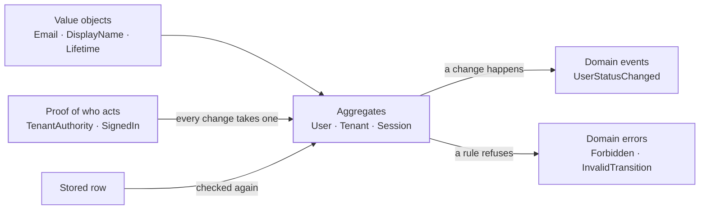
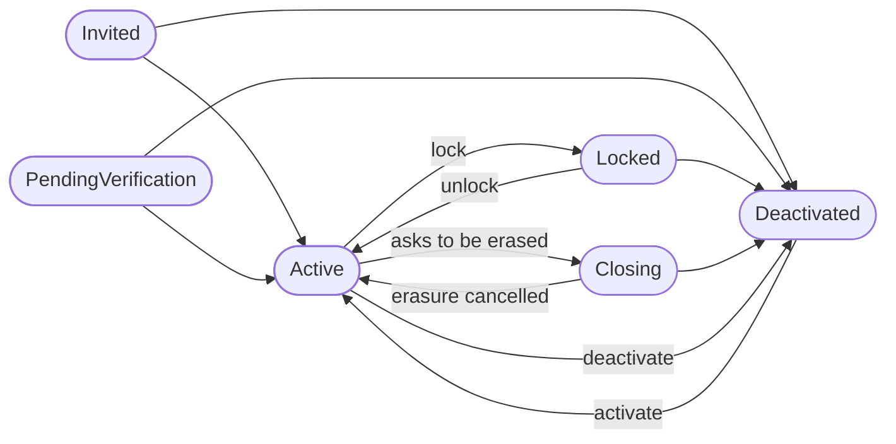

`ianua-domain` holds the rules of the system: what a user, a tenant, a route or an agent is, what may happen to it, and who may make it happen. It is plain Rust. It has no database driver, no web framework, no async runtime and no network code, so every rule in it runs with nothing else running.

Every other crate depends on it; it depends on none of them.

It is built from a few kinds of thing, each covered below:



## Contexts in layers

The domain is split into 24 **contexts**, one per part of the system: identity, authentication, authorization, tenant, routing, agents and so on. Each has its own page under [Domain contexts](/ianua/domain-contexts/activity/).

The contexts sit in layers, and a context uses only the ones below it:

| Layer | Contexts |
|---|---|
| 1 | activity, audit, crypto, data classification, identity, metrics, scheduling, signals |
| 2 | authentication |
| 3 | authorization |
| 4 | tenant |
| 5 | consumers |
| 6 | branding, federation, messaging, OAuth, operator, routing |
| 7 | organization |
| 8 | agents, notifications |
| 9 | proxy, webhooks, workflows |

Dependencies point one way only. So a lower context sometimes needs an answer only a higher one has. Identity needs to know whether the person acting may shut an account out, but what a person holds is worked out in authorization, which sits above it.

The lower context then names the rule as a trait, and the higher one answers it:

```rust
/// crates/ianua-domain/src/domains/identity/account/control.rs
pub trait AccountControlCheck: Sealed {
    fn ensure_allowed(&self, account: &UserId, action: AccountAction) -> Result<(), DomainError>;
}
```

Authorization's `AccountControl` implements it. The trait is sealed: `Sealed` lives in a module private to the crate, so nothing outside `ianua-domain` can implement the rule with an answer that always agrees.

Each context is a folder under `src/domains/`, with topic folders inside it, such as `identity/account/` or `identity/account/user/`. A file name never repeats the name of its folder or the folder above it, so a path reads as one phrase. Modules are named by their full `crate::` path, never by climbing with `super::`. Shared value types sit in `src/types/`; the id types are grouped by topic in `src/types/id/`, such as `people/`, `tenancy/` and `access/`. The domain's convention tests check the file names and the import paths.

## Value objects

Anything with a meaning gets its own type, even when it is "just" a string or a number underneath: an email address, a display name, a tenant slug, a user id, a lifetime. Each one checks itself when it is made, and has no way to be made without that check:

```rust
/// crates/ianua-domain/src/types/naming/display_name.rs
pub struct DisplayName(String);

impl DisplayName {
    pub fn new(
        value: impl Into<String>,
        limits: &DisplayNameLimits,
    ) -> Result<Self, ValidationError> {
        let value = value.into();

        Validator::new("display_name", &value)
            .not_blank()
            .char_length(limits.min_length..=limits.max_length)
            .no_control_chars()
            .no_invisible_chars()
            .validate_first()?;

        Ok(Self(value))
    }
}
```

The field is private, so the only way to get a `DisplayName` is through `new`. Code that holds one never needs to check it again, and a function that takes a `DisplayName` cannot be handed a blank string, a line break or a hidden character by mistake. Ids work the same way: a `UserId` and a `TenantId` are both UUIDs underneath, but passing one where the other is expected does not compile.

The same goes for choices. Where a field could be a `bool` or an `Option`, it is usually an enum that names each case, so a reader sees `Reauthentication::Forced` instead of `true`, and an unset value cannot pass for a harmless one. Durations that something lives for are a `Lifetime`, which is never zero and has an upper bound, so nothing can be issued already expired.

Values that must never print, such as a private key or a generated password, are a `Secret`. Its `Debug` says only that it exists, and the only way to its value is a method called `expose`, which stands out wherever it is used.

## Aggregates

An aggregate is a thing with a life of its own, like a user, a tenant or a session, together with the rules about how it may change. Its fields are private, and every change goes through a method that keeps it valid.

A user's status is a good example. The allowed moves are written down once, in the domain:

```rust
/// crates/ianua-domain/src/domains/identity/account/user_status.rs
pub fn allowed_transitions(&self) -> &'static [UserStatus] {
    match self {
        Self::Invited | Self::PendingVerification | Self::Locked => {
            &[Self::Active, Self::Deactivated]
        }
        Self::Active => &[Self::Locked, Self::Deactivated, Self::Closing],
        Self::Deactivated => &[Self::Active],
        Self::Closing => &[Self::Active, Self::Deactivated],
    }
}
```

Drawn out, that is:



The user only changes status through methods that consult this table:

```rust
/// crates/ianua-domain/src/domains/identity/account/user/mod.rs
pub fn lock(&mut self, control: &impl AccountControlCheck) -> Result<UserStatus, DomainError> {
    let from = self.status;
    let moved = self.shut_out(UserStatus::Locked, control)?;
    self.status_moved(from);
    Ok(moved)
}

/// crates/ianua-domain/src/domains/identity/account/user/directory.rs
pub(super) fn shut_out(
    &mut self,
    target: UserStatus,
    control: &impl AccountControlCheck,
) -> Result<UserStatus, DomainError> {
    control.ensure_allowed(&self.id, AccountAction::ShutOut)?;
    self.apply_transition(target).map_err(DomainError::from)
}
```

`status_moved` records the change as an event on the user, as described under [Domain events](#domain-events) below.

So "a closing account cannot be locked" is not a check someone has to remember in every handler. Neither is "only someone allowed to shut this account out may lock it". It is a fact about `User`, and there is no code path around it: the dashboard, the API, SCIM and LDAP all end up calling the same `lock`, `unlock` or `deactivate`.

## Who is acting

Every creation and every change of something stored names who makes it. It does that by taking a **proof**, never a bare id. The few changes that take none are steps a proof already covered, such as spending a one-time code someone was mailed.

| Proof | What it stands for |
|---|---|
| `TenantAuthority` | A person acting in one tenant, with everything they hold there now |
| `SignedIn` | A person's own finished sign-in, for acting on their own account |
| A context's control, such as `RoutingControl` | A `TenantAuthority`, checked for the right that context needs |
| `OrgControl` | A member of an organization, acting through their own checked session or an API key they made |
| `ActedBy::Platform` | The platform's own work, such as provisioning a tenant |

A proof is worked out from records, never from what a request says. A `TenantAuthority` is made only by authorization, from the tenant's roles, groups and break-glass grants for the account that signed in, or by the organization for one of its members, from their grants for that tenant. Its fields are private, so no caller adds a right to it. A request that names someone else's id, or claims a right, has nothing to build a proof from.

So the rule "Sam may only view routes" holds wherever a route changes, because the change will not run without a `RoutingControl` that holds the right, and Sam's does not.

## Coming back from the database

An aggregate built from scratch starts in a valid state: `User::register` makes an account waiting for its address to be confirmed, `User::invite` makes an invited one. Loading an existing one goes through a plain `Row` struct and `reconstitute`, and the rules are checked again on the way in:

```rust
let user = User::reconstitute(UserRow { id, email, display_name, status, /* … */ })?;
```

`reconstitute` can refuse. It checks every rule the aggregate keeps between its fields, so a row that contradicts itself is never loaded:

```rust
/// crates/ianua-domain/src/domains/identity/account/row_rules.rs
RowCheck::of("user")
    .holds(
        joined_only_once_admitted(row),
        "a join date that does not fit its status",
    )
    .holds(
        !waits_on_a_proven_address(row),
        "waiting on an address it has already proven",
    )
    // …
    .finish()?;
ensure_in_time_order(row)
```

The time checks then refuse a user that says it changed, signed in or joined before it was created.

A refused row is reported as `Infrastructure`, not `Validation`: no code path could have written it, so the stored data is at fault, not the caller. The reason is fixed text and never the stored value, so nothing from the row reaches a log line. The row is never repaired quietly either.

Only repositories in the infrastructure layer call `reconstitute`. Everything else gets a `User` through the rules.

## Scope in the types

ianua has two planes: the **tenants**, with their users and everything they run, and the **organization** that manages them, with its own members. A tenant's stored things carry a type parameter saying so: `User<T>`, `Session<T>`, `Role<T>`, `Route<T>`, where `T: TenantScope`. The organization's own things, such as a member or a member's session, are types of their own.

Some records belong to both planes, such as a second factor or a remembered device. Those carry the plane they were made for, so `MfaEnrollment<ResolvedTenant>` and `MfaEnrollment<ResolvedOrganization>` are different types.

The types keep the planes apart: a tenant record cannot be used where an organization one is expected. At runtime every tenant is the same type, `ResolvedTenant`, so the types do not tell one tenant from another. That is enforced one layer up, by the `ScopedTenant` handle described on the [Application](/ianua/architecture/application/) page, and underneath everything by row-level security in Postgres.

## Domain events

When something happens that others may care about, the domain describes it as an **event**: `UserStatusChanged`, `RouteCreated`, `TenantStatusChanged`. An event is a plain struct with what happened and when, and it knows how to describe itself for the audit log:

```rust
/// crates/ianua-domain/src/shared/events/event.rs
pub trait DomainEventCore: Send + Sync {
    fn event_type(&self) -> EventType;
    fn occurred_at(&self) -> OffsetDateTime;
    fn payload(&self) -> EventData;
}
```

The payload is `EventData`, a plain key and value map, so the domain needs no JSON library. It records stable names, never debug output.

An aggregate **raises its own events**, in the same step as the change. Locking a user raises `UserStatusChanged`; pausing a topic raises `TopicPaused`. The events wait on the aggregate until the application has saved it and takes them out:

```rust
/// crates/ianua-domain/src/shared/events/raised.rs
pub trait Raises {
    fn take_events(&mut self, saved_for: &impl SavedFor) -> Vec<DomainEvent>;
}
```

A tenant aggregate does not hold its tenant, so the tenant it was saved for is stamped on every event as it is taken out. A record can never name a tenant other than the one the change was written to. A refused change raises nothing, and an aggregate dropped without being saved drops what it raised, so nothing is recorded that did not happen.

A few events have no aggregate to raise them, such as a threat the gateway sees in traffic, or a member signing in when nothing they hold changes. Those are built by a short list of named functions, each with its reason. A convention test (`crates/ianua-audit/src/conventions/domain/observations.rs`) fails the build if any other function builds a whole event.

The domain only describes and raises events. Recording and publishing them is the application's and the infrastructure's job.

## Errors

Domain errors are about the domain, never about storage or transport:

| Error | Meaning |
|---|---|
| `NotFound` | Nothing by that id in the tenant |
| `Validation` | Input broke a rule |
| `Conflict` | A uniqueness rule, such as a second account with the same address |
| `Unauthorized` | Who is calling could not be proven |
| `Forbidden` | The caller is known but may not do this |
| `InvalidTransition` | A status move the state machine does not allow |
| `TenantSuspended` | Everything in a suspended tenant is refused |
| `Infrastructure` | Something outside the domain failed, or a stored row is broken |

The words of every refusal are made safe before anyone sees them. A message often names what the caller sent, such as an address, so it is cut to a fixed length and every character that could start a new log line or drive a terminal is replaced.
