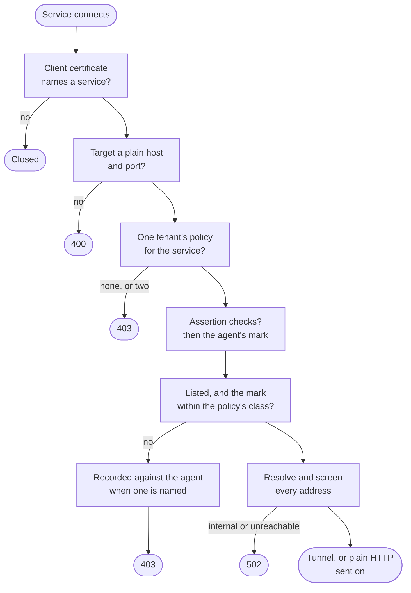

A service an agent may call could be made to fetch anything, and the request would leave from the service, not the agent. So the services agents reach have no route out of their network but `ianua-egress`. It lets each outgoing connection go only to a host and port the service's egress policy lists, and refuses everything else.

## Who is asking

Each service connects over TLS with a client certificate chaining to the authorities in `EGRESS_CLIENT_CA_FILE`, such as the SPIRE trust bundle. A service without one is refused at the handshake. The certificate names the service: by its SPIFFE ID when it carries exactly one, otherwise by `sha256:` and the certificate's fingerprint.

The certificate says nothing of a tenant, so the gateway finds the egress policies written for that name in every tenant, wherever each tenant's data lives. One claim decides. A service no tenant claims reaches nothing, and so does one two tenants claim: if Mallory's tenant wrote a policy for the SPIFFE ID of Ann's fetch service, listing her own host, neither list applies.

## What happens to one connection

The fetch service, handling a request of Sam's agent, asks for `CONNECT api.github.com:443`.

1. **The target** is read strictly: the authority of a `CONNECT`, or the host, port and path of a plain HTTP request in absolute form (`GET http://example.org/a`). The host must read as a domain name. An internal address, a wildcard, user info, a bracketed address or HTTPS in the clear names no target and is refused with `400`. HTTPS goes through `CONNECT`, and the gateway never sees inside.
2. **The policy** for the service decides. The host and port must be listed by exact name.
3. **The agent behind the call.** The gateway signs an assertion onto every request it forwards (`X-Ianua-Assertion`). A service that passes it on lets the egress gateway check it against the tenant's own assertion keys, and when it names an agent, hold the agent's data mark to the policy's class: an agent that read restricted records cannot have the service send them out under a policy cleared for internal data. A call with no assertion, or one that does not check, could be any agent's, so it is let out only under a policy that lets out the most sensitive data. A mark that cannot be read counts as the most sensitive.
4. **A refusal an agent caused** is recorded as `agents.egress_denied` against that agent, in the tenant whose policy refused it, through the data plane's sealed inbox. The worker moves it onto the audit trail, and the drift monitor holds it against the agent. A record that cannot be written refuses the connection too.
5. **The destination** is resolved by the gateway itself, so services need no DNS. Every address it resolves to is screened: public addresses only, unless `EGRESS_PRIVATE_NETWORKS` lists internal ones. A listed host whose name was pointed at the cloud's metadata address reaches nothing.
6. **Out.** A `CONNECT` gets `200` and a tunnel carrying bytes both ways unread. A plain HTTP request is sent on in origin form, without the assertion, the service's proxy headers and every header that concerns one hop.

A decision that fails or does not come within `EGRESS_DECISION_TIMEOUT_SECONDS`, such as when the database cannot be reached, refuses with `503`. The gateway never lets traffic out to keep it flowing.

Every decision is logged with the service, the target, the tenant and the policy that decided, the agent held to it, and the reason. The assertion is never logged.

## Layers

| Layer | What it holds |
| --- | --- |
| Domain, `routing::egress` | The policy and its decision, the strict target, and the rule that a service claimed twice gets neither claim. |
| Application, `routing::egress` | `DecideUseCase`, which finds the one claim, reads the assertion and the mark, decides, and records a refusal an agent caused through `RecordEgressDenialUseCase`. The ports `CrossTenantEgressPolicies` and `AssertionVerifier`, beside `AgentExposureGate`. |
| Infrastructure | `PgCrossTenantEgressPolicies`, `Pkcs8AssertionVerifier`, `PgAgentExposureGate`, and the inbox's `InboxEventDispatcher`, all under the data plane's database role. |
| `ianua-egress` | The settings, the adapters built from them, the TLS listener, the dialling, the tunnels and the health listener. |

## Limits

At most `EGRESS_MAX_CONNECTIONS` connections are held and `EGRESS_MAX_TUNNELS` tunnels open; one more connection is closed and one more tunnel answered `503`. The handshake, each request's head, the decision, connecting, a plain HTTP exchange and a tunnel's silence each have a time limit. `/health/ready` on `EGRESS_STATUS_LISTEN` answers `503` while the tenants' database routes cannot be read again.

## Starting it

The binary reads its settings, reads every tenant's database route, sets up its TLS and serves until `SIGTERM`. A test or a scenario starts the same gateway with `ianua_egress::serving(&env, &shutdown)`, which answers with the addresses it listens on. Every setting is in the [configuration reference](/ianua/reference/configuration/#egress-gateway).

On Kubernetes the Helm chart runs it wherever agents run, and a network policy lets only services labelled `ianua.io/agent-upstream: "true"` reach it; each sets its `HTTPS_PROXY` and `HTTP_PROXY` to it. With Docker Compose, `--profile agents` starts it.
