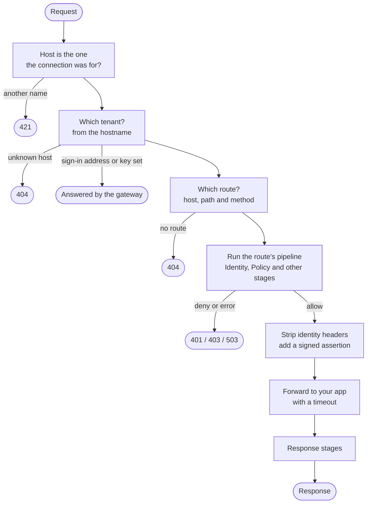
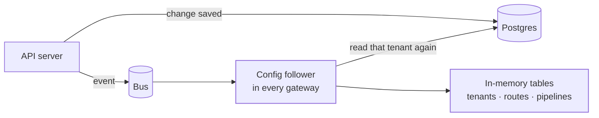

`ianua-zero` is the gateway: the process your users and agents actually talk to when they reach one of your apps. It finds out which tenant and route a request is for, runs that route's **pipeline** (who is calling, are they allowed), and then forwards the request or turns it away.

It is an adapter, like the API. It does not contain its own rules about who may do what: it builds a request context, hands it to the `EvaluatePipelineUseCase` in [ianua-app](/ianua/architecture/application/), and carries out the answer.

Two more programs work beside it, each a crate of its own that shares no process with the gateway:

| Program | What it does |
| --- | --- |
| [`ianua-runner`](/ianua/architecture/runner/) | Sits beside an AI agent's sandbox and holds its key, so the agent never sees it. It attaches the agent's token and a proof made with its key to each request on its way to the gateway. |
| [`ianua-egress`](/ianua/architecture/egress/) | The only way out for the services agents can reach. It lets each outgoing connection go only where the service's egress policy lists. |

The rest of this page is about `ianua-zero`.

## Starting

`ianua-zero` reads its settings once (see [Gateway settings](/ianua/reference/configuration/#gateway)) and refuses to start on any it cannot use, or on a secret only the control plane holds. Then it builds everything it runs on, once:

- its database pools, signed in as its own role, `ianua_gateway`, which reads the configuration it serves and writes only its request records, its stream records, its event inbox and when it last saw each connector,
- the keys it may hold, all made from `HMAC_SECRET`, never the control plane's `EVENT_SIGNING_SECRET`,
- the bus and the cache every gateway shares,
- every store it reads and every use case it asks: who the caller is, what the route and the tenant's policy allow, whether an agent's action may go ahead, whether a device passes, the assertion's signature,
- the five groups of pipeline stages and the dispatcher that runs them.

It then starts what runs beside the requests: the follower that fills its tables, the listeners of TCP and UDP routes, the health checks of backends, the name lookups of services found by DNS, and the batches that write request records. A batch the database could not take is held, up to 32,768 records, and written once it can; past that the oldest are given up and counted in the log and the dropped-records metric, and so is whatever is still held when the gateway stops. Last it opens its listeners: the public one, the status one (`GATEWAY_STATUS_LISTEN`), and, where set, the ACME, runner and connector ones.

Until the follower has read every tenant once, every host is unknown and `/health/ready` on the status listener answers `503`, so no traffic is sent to a gateway that would refuse it all.

## A request's way through



Each step returns early when it refuses, so the path that forwards a request is the one left at the end.

## Which tenant

The tenant comes from the hostname the request was sent to, and from nothing else: not from a token, a cookie or a custom header. The gateway keeps a table of every hostname it serves, each one mapped to a tenant, and the request is answered with **404** if its host is not in the table. A client that sends some other tenant's hostname only reaches that tenant's routes, behind that tenant's pipelines, which is what anybody visiting that address gets.

The id that comes out of the table becomes a `ScopedTenant` through `ScopedTenant::from_request_host`, so everything after this step, including every store call, is bound to that tenant.

## Deny by default

The pipeline is evaluated by a use case in `ianua-app`, and it refuses unless something has positively allowed the request:

```rust
/// crates/ianua-app/src/use_cases/proxy/evaluate_pipeline.rs
fn ensure_active(pipeline: &Pipeline<ResolvedTenant>) -> Result<(), AppError> {
    if !pipeline.status().is_active() {
        return Err(AppError::Forbidden(
            "the pipeline is not active, so traffic is denied".to_owned(),
        ));
    }
    Ok(())
}

fn ensure_mandatory_stages(stages: &[&StageConfig]) -> Result<(), AppError> {
    let runs = |mandatory: MandatoryStage| stages.iter().any(|stage| mandatory.is(stage.kind()));
    if !runs(MandatoryStage::Identity) || !runs(MandatoryStage::Policy) {
        return Err(AppError::Forbidden(
            "the Identity or Policy stage does not run, so traffic is denied".to_owned(),
        ));
    }
    Ok(())
}
```

It also refuses a request context that names a tenant other than the one the request resolved to.

The same holds everywhere around it:

- a pipeline that is missing, paused or has no **Identity** and **Policy** stages refuses everything, with **503**,
- a stage that fails, rather than answering, stops the request with an error; it is never forwarded,
- a stage that can't do its job refuses: signing with no key to sign with, or masking an answer it can't read,
- a pipeline that takes longer than 10 seconds refuses the request,
- the gateway never "fails open" to keep traffic flowing.

**Identity** and **Policy** are separate stages on purpose. Identity checks the credential (a bearer token, a session cookie, an API key or a client certificate) and records who is calling. Policy then checks the route's rules against that caller, and after them the tenant's active authorization policy. See **Roles, permissions and policies**.

A JWT is refused unless:

- its algorithm is one of `RS256`, `ES256` or `EdDSA`, so `alg: none` and shared-secret algorithms never get through,
- it is signed by one of the tenant's own keys, of the type that algorithm needs, so the token cannot choose a weaker way to be checked,
- it has an expiry that has not passed, and its `nbf` and `iat`, when present, are not in the future (all with one minute of leeway for clock drift),
- it names the audience of the service the route forwards to, so a token issued for one app cannot be used on another. A route that requires sign-in must be served by a service with an audience; the dashboard and API refuse to save one that isn't, and the gateway refuses every token on such a route anyway. On a public route whose service has no audience, a token is ignored and the request goes through anonymously,
- its issuer matches the tenant's, where one is set.

An agent's task token names the tenant's own issuer as its `iss`, the same one the tenant's other tokens carry, and the gateway refuses a task token whose issuer is not the tenant's. It follows the same audience rule. It always names the tenant's agent audience (`ianua:{tenant id}`), plus the audience of each app its delegation lists under **Apps**. So an agent reaches an app only if it was given that app when it was granted access, or if the app's service uses the agent audience itself. The audience alone is not enough: a task token that names no permission and no MCP tool reaches no route, not even one that asks only for a signed-in caller, and is refused as `nothing_delegated`. A token bound to a key works only beside a fresh proof made with the key the agent signed in with to mint it, and stops working once that key is revoked. A bound token that arrives with no proof, or with a proof made by another key, is a copy in hands that don't hold the agent's key: the gateway refuses it and records it in the tenant's audit trail as an attack on that agent, at most once an hour per agent, saying how many attempts the record stands for. A proof that is merely out of date may be the agent's own clock, so it is refused without a record.

The proof names the address the request was sent to, scheme included. On the runner listener (`GATEWAY_RUNNER_LISTEN`) and the public listener it starts with `https://`. The runner listener serves TLS with a certificate of the internal authority, which runners trust alone for it. It asks no client certificate, since every request carries the agent's proof. Outside production it may serve plain HTTP, and then the address starts with `http://`, as the runner sent it. A proof made for one listener is refused on the other.

A workflow's Protected apps step calls an app as the person its run acts for. Just before the call, the worker makes a run pass: a token signed with the tenant's key and typed as a pass, naming the person, the route and the call, and lapsing after a minute. The call goes to the workflow listener (`GATEWAY_WORKFLOW_LISTEN`), over mutual TLS: the listener serves a certificate of the internal authority `ianua internal-pki` issues, and completes a handshake only with a client holding a certificate of the same authority, the worker's. Plain HTTP is taken outside production only. There the bearer token is read as a pass and nothing else, and its tenant and route come from the pass, checked under the tenant's keys before anything of the tenant runs. No host picks the route. The request must fit the named route's methods, conditions and path, or it is not found. It never falls through to another route. Then the pass is taken only while the route is open to workflows, and the person must still be able to sign in. The route's pipeline and policy decide as they would for that person, holding what they hold now, with no sign-in strength claimed for them. The pass is stripped before the request is forwarded, like every credential. On the public listener a pass is refused, as no access token. An organization member has no account a route's policy names, so a run acting for one is refused before any call.

A Protected data step reaches a stream route the same way. Its worker sends one `CONNECT` to the workflow listener with its pass in `Proxy-Authorization`. The gateway takes the pass only for the stream route it names, while that route is open to workflows. A pass made for a route opens no stream route, and one made for a stream route opens no route. The stream route's access decides for the run's person as it does for a person through the signed-in tunnel. Only then is the backend dialled and the `200` sent, and the connection is spliced like any stream. It closes when the pass lapses, a minute after it was made, or when a check finds the person no longer let in. It leaves one stream record. At most 64 such connections are open at once.

A pipeline can add further stages: rate limits, a web application firewall, CORS, geo-fencing, step-up authentication, response redaction and more. Each one lives in `src/pipeline/stages/`.

## Sign-in addresses on an app's domain

A service can ask the gateway to answer sign-in addresses on its app's own domain, such as `/.ianua/login` or `/login` (see [Sign people in on your app's domain](/ianua/guides/apps/sign-in-on-your-app/)). Those requests are answered before any route is matched and never reach the app.

The gateway still decides nothing about them itself. It checks that a page on the same domain sent the request, counts it against a limit per address, and passes it to the API server's **relay listener** (`RELAY_PORT`), which no ingress routes to. The relay listener serves mutual TLS: it completes a handshake only with a client holding a certificate of the internal authority `ianua internal-pki` issues, the gateway's. Plain HTTP is taken outside production only. Each request is sealed by the gateway, carries a timestamp and a single-use nonce, and is refused if the seal does not verify, the timestamp is too far off, or the nonce was spent before. The API runs the same sign-in, second-factor, sign-up and sign-out use cases as the dashboard, and answers with plain values. The answer is sealed too, under the same key and bound to the request's nonce, and the gateway refuses the sign-in on any answer without that seal, so nobody else on the internal network can answer in the API's place or hand back the answer to an earlier request. The gateway then decides which cookies the browser gets.

Loading a sign-in address under the prefix asks the API for that action's page. The API draws it from the [page templates](/ianua/architecture/infrastructure/pages/) as plain HTML with the tenant's branding, and the gateway serves it with a content security policy that forbids framing and runs no script, with one exception. The login page may run the passkey script, which the gateway serves itself at `/.ianua/passkey.js`. The policy allows that one script by its full address on the host. It never allows inline scripts, `eval` or any other script the app serves. A page that can't be shown answers its status and never redirects, so a refused page can't send the browser round in a loop.

Each mailed link lands on an address of its own: verifying an address at `/.ianua/verify`, confirming a sign-in at `/.ianua/confirm-sign-in`, resetting a password at `/.ianua/reset-password` and changing one at `/.ianua/change-password`. The address decides what a link does. The cookies the browser holds never do. A confirm link opened in a browser that doesn't hold that sign-in is refused, never read as verifying the address.

A service that accepts the sign-in with a cookie of its own gets that cookie through a **hop**. The code a hop carries works only in the browser that signed in, so a hop link sent to someone else can't sign their browser in as the sender:

1. Signing in sends the browser to the other host's hop address, with no code.
2. That host keeps a random value in a `__Host-ianua_hop` cookie of its own. It then sends the browser back to the owner's host with the value's digest.
3. The owner's host reads the browser's session cookie there and asks the API for a code bound to that digest.
4. The browser lands on the other host with the code. The gateway relays the code with the digest of the value this browser holds. The API sets the session only if the two match, and only once.

On the way back in, the session cookie carries an app session token: a JWT of its own type, never accepted as a bearer token. The identity stage accepts it only on the domain it was minted for, only for routes of the service whose sign-in opened it (or a service that chose to accept that one), and only while its session is still live. That last check is cached for at most five seconds, so a sign-out takes effect almost at once. The token also names the trusted device the session was signed in from, when it was, as `did`, which a device posture stage reads when no device certificate names the device.

When the person ticks **Remember this device** on the second-factor page, the gateway makes a fresh 32-byte secret and sends it with the code. Once the API has remembered the device, the gateway keeps the secret in the host's `__Host-ianua_device` cookie (`Secure`, `HttpOnly`, `SameSite=Lax`, a year), and sends it with every later sign-in and password change on that host. It never sends an old cookie's secret to be remembered again. Like every platform cookie, it is stripped from what is forwarded and never logged. The API binds the device's digest to the host, so the cookie counts on that host alone.

## Error pages

When the gateway refuses a request, or cannot carry it, the answer depends on who asked. The `Accept` header decides:

- A browser, which prefers `text/html`, gets a page a person can read. It names the status, says in plain words what went wrong and what to do, and shows a reference, the request's correlation id. It wears the tenant's logo and colours when the host's tenant is known, and the platform's otherwise.
- Anything else, such as a script or `curl`, gets a small JSON body: `{"error": "forbidden", "reference": "..."}`.

The status is the same either way. Both answers are never cached and never sniffed as another type. The page runs no script: it is served under a content security policy that allows none, and it cannot be framed. If the page cannot be drawn, the browser gets the JSON body instead, and the request stays refused.

The answer never says why the request was refused. The reason goes to the request's record, which an administrator finds by the reference. The pages are drawn from template files, described on the [Pages](/ianua/architecture/infrastructure/pages/) page.

| Kind | Status | Code |
| --- | --- | --- |
| Not signed in | 401 | `unauthenticated` |
| Forbidden | 403 | `forbidden` |
| Not found | 404 | `not_found` |
| Too large | 413 | `content_too_large` |
| Misdirected | 421 | `misdirected_request` |
| Too many requests | 429 | `too_many_requests` |
| The app is not answering | 502 | `bad_gateway` |
| Unavailable | 503 | `unavailable` |
| The app took too long | 504 | `gateway_timeout` |
| Bad request | 400 | `bad_request` |

## What your app receives

Before the request is forwarded, the gateway removes every header a client could use to pretend to be someone. Which headers those are is one rule in the domain, so the gateway and the tenant's own header transforms cannot disagree:

```rust
/// crates/ianua-domain/src/shared/web/proxy_headers.rs
const PROXY_OWNED_PREFIXES: [&str; 2] = ["x-forwarded-", "x-ianua-"];

pub fn is_proxy_owned(name: &str) -> bool {
    let name = header_spelling(name);
    CLIENT_ADDRESS_HEADERS.contains(&name.as_str())
        || OVERRIDE_HEADERS.contains(&name.as_str())
        || PROXY_OWNED_PREFIXES
            .iter()
            .any(|prefix| name.starts_with(prefix))
}
```

That covers every `X-Forwarded-*` and `X-Ianua-*` header, headers that claim the client's address (`X-Real-IP`, `True-Client-IP` and others), and headers some frameworks read as the real method, path or host (`X-HTTP-Method-Override`, `X-Original-URL` and others). Names are compared without regard to case and with `_` read as `-`, since CGI-style servers turn `X_Forwarded_User` into the same name. No tenant transform may write one of these headers either.

It also removes the credential the caller signed in with (the `Authorization` header, the session cookie), so your app cannot replay it against other routes.

Then it adds `X-Ianua-Assertion`: a JWT valid for 30 seconds, signed with the tenant's assertion key, saying who the caller is and what roles and permissions they hold. A plain `X-User-Id: alice` from the client never reaches your app, and a forged assertion fails the signature check. If the tenant has no assertion key that signs, or signing fails, the request is refused rather than forwarded without one.

### Checking an assertion in your app

The assertion is signed with keys of its own, never the tenant's token signing keys. The gateway faces the internet, so its database role cannot read the private half of a signing key: a gateway that was broken into cannot mint access tokens in the tenant's name. Each tenant gets ES256 assertion key pairs instead, made with the tenant, rotated every 30 days, and kept published for a day after they stop signing. A tenant made before assertion keys existed gets its first one from the same daily sweep that rotates them. Each key made, rotated or retired is written to the tenant's audit trail by the platform, as `crypto.assertion_key_created`, `crypto.assertion_key_rotated` or `crypto.assertion_key_retired`, and nobody is notified of it. The worst a broken-into gateway could do with them is forge an assertion for traffic it already carries.

The gateway keeps the opened key in memory for up to a minute, so it does not read and unseal it on every request. A rotation is not announced to it: it may sign with the old key for that minute, and your app still accepts it, since the old key stays published for a day.

The same keys sign the **Request signing** and **Response signing** stages. Their signatures are typed `ianua-signature+jwt` and are checked against the same key set, in the same way as an assertion.

The public halves are a JWK Set of their own, apart from the tenant's JWKS, at `/.well-known/ianua-assertion-keys.json` on your app's host and from the API at:

```
GET /api/v1/organizations/{org}/tenants/{tenant}/.well-known/ianua-assertion-keys.json
```

To accept a request, your app checks the assertion like this:

1. The header's `typ` is `ianua-assertion+jwt`. An access token (`at+jwt`) is never an assertion, and an assertion is never accepted as an access token.
2. The `kid` names a key in the assertion key set, and the signature verifies with it using `ES256`, the algorithm the key names. Never use the algorithm the token's header claims, and refuse `none`. When the `kid` is unknown, fetch the set again once: the key may have just rotated.
3. `iss` is the tenant's issuer, and `aud` is your service's id.
4. `exp`, `nbf` and `iat` hold, with a small allowance for clock drift.

Do not check assertions against `/.well-known/jwks.json`: those keys sign the tenant's tokens, and none of them signs an assertion.

The claims say who made the request:

| Claim | What it holds |
|---|---|
| `sub` | Who the request is for: the person, whom an agent acts for, or the consumer |
| `kind` | `user`, `agent` or `consumer` |
| `act` | For an agent, the agent itself |
| `obo` | For an agent, whom it acts for, typed: `tenant_user:…` or `agent:…` |
| `jti` | For an agent, the delegation its authority comes from |
| `tid`, `cid` | The tenant, and the request's correlation id |
| `roles`, `permissions` | What the caller holds now |

## Forwarding

Every call to your app has a timeout: the service's own for the first byte, and `GATEWAY_RESPONSE_DEADLINE_SECONDS` for the whole answer, so a hung app cannot hold a connection for ever. A long-lived answer, such as server-sent events, is held to how long it may send nothing instead. Around that sit health checks, load balancing across a service's addresses and a circuit breaker per address, in `src/forward/`. A failed request is not retried.

Every address the gateway connects to is screened against the networks the operator allowed, after its name is resolved: forwarded requests, health probes, addresses found through DNS discovery, and TCP and UDP routes alike.

Request bodies are not read into memory to make a decision. The pipeline decides on the method, path, headers and credentials; the body is streamed through. Where a stage does need to look at the body, such as the web application firewall, it reads a capped prefix and streams the rest.

An answer streams back to the client untouched unless the route has a response stage. Then the gateway reads it up to the largest cap its stages ask for, and refuses a longer one. Each stage sees as much as its own cap and is told when that isn't the whole answer. The canary scan withholds an answer it couldn't read to the end, since the rest could carry a planted token.

A WebSocket or other switched connection is decided at its handshake, like any request, and then carries bytes the gateway does not read. It closes when either side ends it, when it sits idle past `GATEWAY_TUNNEL_IDLE_SECONDS`, when `GATEWAY_TUNNEL_MAX_LIFETIME_SECONDS` runs out, when the credential it opened with expires, and when a check finds its caller no longer allowed. For an agent the check is whether it may still act and its delegation stands. For a person it is the same check as a new request: the person must still be able to sign in, the session or grant their credential came from must still stand, and the route, read as stored now, and the tenant's policy must still let them through. So suspending Pat, ending her session or taking her out of the route's group closes her open connection within one `GATEWAY_TUNNEL_RECHECK_SECONDS`. A consumer is held to the same check, so disabling a partner, or taking the right from its roles, closes its open connection the same way. The check runs on `GATEWAY_TUNNEL_RECHECK_SECONDS` for at most `GATEWAY_TUNNEL_RECHECK_TIMEOUT_SECONDS`. A check that fails or does not answer in time closes the connection, and a connection is never left open because nobody could be asked. Only so many connections are open at once, so the checks are bounded with them; each holds the credential in memory for these checks and it is never logged or recorded.

A service that presents a client certificate to its backend gets its private key opened when the gateway reads the tenant's configuration, sealed for that one service. A key that doesn't open, or isn't a private key, leaves the service without a connection pool, so its routes are refused rather than calling the backend without the certificate.

## Connectors

A service reached through a tenant's [connector](/ianua/concepts/connectors/) gets a connection pool like any other. Its backends' addresses, TLS, load balancing, health checks and upgrades all work as usual. What changes is how a connection is opened: instead of dialling the backend, the gateway opens a stream down a link the connector holds, and the connector dials the backend from inside its network. In `src/connectors/`:

- **The listener** (`GATEWAY_CONNECTOR_LISTEN`) takes a link only over mutual TLS, with a certificate the connector authority signed and HTTP/2. The certificate names one tenant and one connector. That tenant's tables must hold that connector, not revoked, enrolled with the same key, or the link is closed before any HTTP/2 frame is read. The gateway is the HTTP/2 client on the link and pings it to notice a dead one.
- **The links** are kept per tenant and connector, bounded per connector and for the whole gateway. A link whose connection ends is dropped at once. When the follower reads a tenant again, every link its connectors no longer admit is closed, so a revocation ends a live link as soon as the change is heard. Withdrawing a tenant closes all of its links.
- **Opening a connection** first checks that the backend is inside the connector's scope, then sends `CONNECT host:port` down a link in turn, held to `GATEWAY_CONNECTOR_OPEN_TIMEOUT_SECONDS` and to the streams one link may carry. The connector checks the target against its own allow list too. The operator's `UPSTREAM_NETWORKS` do not apply: the connector's scope does instead.

No link open answers `503`, a link full answers `503`, and a link that drops while a request is on it answers `502`. The handler does nothing different for these services: client identity headers are stripped and the assertion is signed as for any upstream. When a link opens, and every `GATEWAY_CONNECTOR_SIGHTING_SECONDS` while it stays open, the gateway notes the connector as seen.

## Every request is recorded

Each request produces one structured record: tenant, route, caller (and the agent and delegation, for agent traffic), the outcome, how long it took, and a correlation id. Tokens, cookies and session ids are never part of it. When the gateway closes a connection a request switched because its caller's access ended, a check of it failed or the credential ran out, the request's record gains `closed`: the reason `access_ended`, `check_failed` or `credential_expired`, and when. A connection closed by either side, left idle or past its lifetime gains nothing.

## Staying up to date without asking

The gateway never calls the API server while it handles a request. It keeps the tenants, routes and pipelines it needs in memory, and reloads them when it is told something changed:



The event only says *what* changed; the gateway always reads the new state from Postgres, so an event that arrives twice or out of order does no harm. The events are sealed with a key the gateway never holds, so it cannot tell a real one from a forged one: it takes each only as a reason to read again, and nothing it serves changes on an event's word alone. A changed tenant that cannot be read again stops being served until it can. A missed stretch of events, or a lost bus, makes it read everything again, and it does so every `GATEWAY_RELOAD_SECONDS` too. Each gateway instance does this independently, so you can run as many as you like.

## Testing the gateway

The gateway's tests are mostly of two kinds:

- **Stage tests**, for each stage on its own: given this request context, does it allow or refuse? These are plain functions, so most need no network at all.
- **Scenarios** in `ianua-scenarios`, under its `gateway` and `agents` targets, which start the real platform and gateway against a real Postgres and send real HTTP requests through it. They include cases that must always be refused, such as an expired token, a token for another audience and another agent's token.
