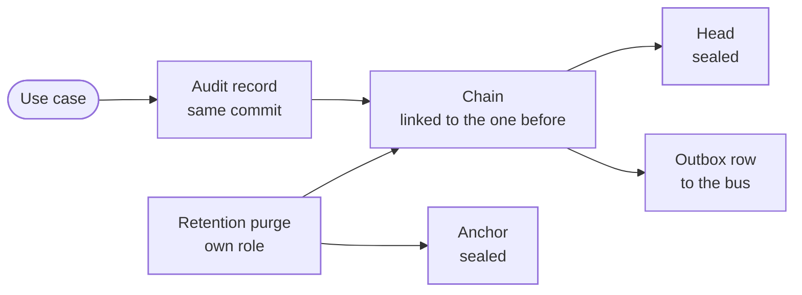

Every change a use case makes is recorded in the audit trail, in the same unit of work as the change. If the record cannot be written, the change fails. The trail lives in the tenant's own database, beside its rows, and its locks and seals are in `src/postgres/foundation/audit_chain.rs`.

## The chain

A tenant's audit records are linked like a chain: each record's hash covers the record before it, `entry_hash = SHA256(prev_hash || record)`, per tenant, in the database the tenant lives in. Editing, removing or reordering any record breaks every link after it.

- **One writer at a time.** Records are linked under the tenant's chain lock, a transaction-level advisory lock made from the tenant's id, the same in every database, held until the transaction ends. Two appends never link to the same record.
- **The head is sealed.** The newest link is kept as the chain's head, sealed with an HMAC under a key derived from `EVENT_SIGNING_SECRET`, the control plane's own root, which the gateway never holds. It is sealed in the transaction that adds the records, so cutting off the most recent records is caught too.
- **The chain is walked.** The walk rehashes a bounded stretch at a time and checks the head at the end. A worker sweep walks every chain on a schedule and records its verdict, sealed like the head.

## Nobody changes a record

The trail is append-only. A record can be read and added, and never changed. The database itself refuses it, through policies and grants, not triggers:

- The app's own role, `ianua_app`, has no `UPDATE`, `DELETE` or `TRUNCATE` on the audit records, so whoever holds it cannot remove a record, whatever the session sets.
- Only the retention purge can remove one. It connects as a role of its own, `ianua_audit_purge`, the only role with `DELETE` on `audit_records`, and its policy holds it to one tenant per transaction. That role can do nothing else: it reads and removes audit records, reads and writes the chains' anchors, and reads which tenants live in a schema of their own.
- The gateway's role, `ianua_gateway`, holds nothing on the audit records, the chains' heads or the outbox.
- A tenant's own schema gives each role the same grants.

## The gateway's events

The gateway never writes the trail. The head is sealed with the control plane's root, which the gateway never holds, so the few events the gateway raises (an agent's action allowed or denied, egress denied, a honeypot hit, automation caught, a canary token presented or leaking) wait in its inbox, `gateway_events`, each sealed with the data plane's key. The worker checks each one's seal and type, appends it to the trail like any other record and removes it from the inbox in one transaction; one that does not hold is removed and logged, never appended. See [the gateway's inbox](/ianua/architecture/infrastructure/events/#the-gateways-inbox).

## Retention

The purge removes only the oldest stretch of a tenant's chain, under the tenant's purge lock, a second advisory lock that keeps two purges, and a purge and a move of the trail, apart. It keeps the hash of the last record removed as the chain's anchor, sealed like the head, so a purge never reads as a break.

The head, the anchor and the sweep's verdict are each sealed under a key of their own, so a seal of one kind never passes as another.

## Moving with the tenant

When a tenant gets a schema of its own, its trail so far is copied in under its purge lock and then its chain lock, so the chain goes on there from the record it ended on. The platform keeps its copy, which nothing reads or purges while the tenant lives apart.

When the tenant is torn down, its trail comes back to the platform database before its schema goes, so the chain still verifies and its retention still runs. Leaving a schema starts by taking every write in it away from ianua's role, so a node that has not heard of the move yet fails its write instead of losing it with the schema. A copy made again never brings back records the tenant's retention already purged.

The organization's audit log, exports and activity calendar include these retained records after the tenant is deleted, for readers who reach every tenant; a member's grants go when the tenant does. Filtering the log by that tenant still finds its records for such a reader; naming a tenant the reader does not reach, or another organization's, reads as a tenant with no records. Deleting a tenant removes its operational data, not the organization's ability to review its retained history.

## From the trail to the bus

Beside each record, in the same transaction, a row is added to the outbox. The relay publishes it on the message bus once the change commits, and the worker reads the record back from the trail before it acts on it. The trail is the record; the event on the bus is only its pointer. See [Events](/ianua/architecture/infrastructure/events/).
