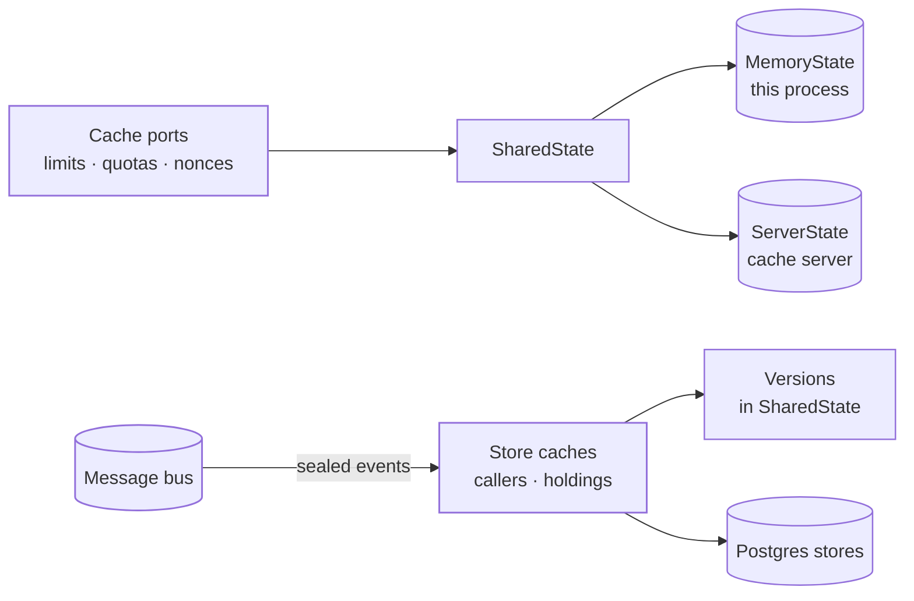

The cache folder, `src/cache/`, holds the short-lived state the platform counts and claims with. Nothing kept here is a record: every entry lapses with the window it was counted for. Its adapters start with `Cache`.

## Shared state

Each port here is written once, over one small trait, `SharedState`: a counter in a window, a set of distinct members, a claim made once, a value swapped in one step, a key forgotten so its count starts again, and a log of recent entries. Every key carries its use and, for tenant data, its tenant, so two uses or two tenants never share a key. Where the state lives is the composition root's choice:

| State | Where it lives | Used for |
| --- | --- | --- |
| `MemoryState` | This process, spread over shards each behind its own lock, held only for the step itself and never across an await. Each shard holds at most its share of the cap; past it, lapsed entries go, and when none has lapsed the new key is refused, so a flood of new keys cannot grow the process. | What each node counts on its own, such as the API rate limit; a deployment of one node; tests |
| `ServerState` | A cache server every node reaches: any server that speaks the Redis wire protocol, such as Valkey, KeyDB or Redis. | What must hold across the fleet: quotas, budgets, the failure counts and lockouts, single-use nonces |

On the server, every step a port needs done at once is one command or one script the server runs whole, so two nodes never see half of it, and every call has a deadline: a cache that hangs fails the call, it never holds a request.

### One cache server for several deployments

On the server every key starts with the deployment's [namespace](/ianua/reference/configuration/#namespace), set with `NAMESPACE`: `ianua:rate:tenant:{tenant_id}` by default, `staging:rate:tenant:{tenant_id}` with `NAMESPACE=staging`. Two deployments with different namespaces can share one cache server: neither reads the other's rate limits, sign-in pressure, nonces, store cache versions or fleet counters.

The code writes every key without the namespace (`rate:tenant:{tenant_id}`), and `ServerState` alone puts it in front of each key it sends, so no key reaches the server without it. A conventions test fails the build on a key written with the namespace in it anywhere else. State in this process holds one deployment's keys only, so it takes no namespace.

## What is kept

| File | What it counts or claims |
| --- | --- |
| `throttles.rs` | The API's per-minute budget, simple LDAP binds per tenant, one mailed link per address and purpose, and the resends and verification requests a person or a receiver may ask for. A count that cannot be read refuses. |
| `counters.rs` | Each consumer's quota per period, each delegation's request budget, and the gateway's fleet-wide counters and single-use claims. The quota refuses when the count cannot be read. The budget and fleet counters answer nothing instead: their callers count on their own node, so a cache that is down narrows enforcement to one node at a time and never removes it. |
| `attempts.rs` | Failed passwords per account and network, and per account across every network, each lapsing with the lockout's window, and each network's lockout of an account until it ends. A lockout starts the network's count again. The set of networks that failed on an account, lapsing with the window, and the account's mark of being under attack, kept until the attack ends and set in one step so one sign-in records it. A count, lockout or mark that cannot be read refuses the sign-in. |
| `flood.rs` | Failed password sign-ins per tenant and per organization, over a sliding window made by weighing two fixed ones, so a flood straddling a window's edge counts as one; and the pressure each was last seen under. |
| `puzzles.rs` | The platform's own sign-in challenge, below. |
| `ledgers.rs` | The nonces of sealed requests between the gateway and the API, spent once, and the recent agent touches on each path that the convergence check looks back over. |
| `alerts.rs` | The throttle on security alerts: the first of a kind is told, then at most one a window, each saying how many came since the last. An attack on an agent is held back per agent and kind of attack. |

## The sign-in puzzle

While sign-in is under pressure, a browser solves a proof-of-work puzzle before it may sign in, so a flood costs its sender CPU for every attempt. It is the default; Cloudflare Turnstile takes its place when its secret is set.

- **Made only here.** A puzzle is a payload sealed with an HMAC under a key the control plane's root derives for puzzles alone: when it stops counting, how hard it is, a random nonce, and a digest of the address that asked for it. Nobody without the key can make one, change its difficulty or move it to another address.
- **Solved in the browser.** The browser looks for a counter whose SHA-256 with the puzzle starts with that many zero bits, and sends back `<puzzle>.<counter>`.
- **Cheap to check.** Checking costs one HMAC and one SHA-256, whatever was sent: the proof's length is bounded before anything is read.
- **Spent once.** A solved puzzle is spent in the state every node shares, so it lets one sign-in through and no other. A puzzle easier than the current setting fails.

`CacheChallengeIssuer` sets puzzles and `CacheChallengeVerifier` checks them, both over one `Puzzles`.

## Store caches

Two store reads run on every request and cost far more than a trip to the cache server: the caller a bearer resolves to (`CacheTokenLookup`), and what decides one person's holdings (`CacheAccessRecordStore`). Each node keeps copies of them in memory, in front of the Postgres stores and behind the same ports.

- **Kept under a version.** Every copy is kept under its tenant's (or organization's, or the platform's) version, a word held in shared state. A version is a fresh unique word, never a count, so a cache server that restarts can never bring back a version old entries were kept under. A node reads the version before the store.
- **Never past a credential's end.** A caller found through any key with an end, or through a session, is not served from a copy once that end comes: the store is asked, and it answers no one. A session's end here is its absolute end, since its idle timeout is checked against a fresh read of the session on every request. The gateway's copies of live app sessions (`CacheAppSessionCheck`) stop at the earlier of the session's absolute end and the moment its idle timeout runs out from its last use. Reaching that moment only asks the store again, so a session still in use goes on.
- **Dropped by events.** Any event that changes what a copy was worked out from writes a new version, so every node stops reading the old copies at once. Which caches an event touches is decided in one `match` over every event type, with no catch-all, so a new event does not build until someone decides.
- **Dropped after the commit.** The node that made a change drops its own copies once its unit of work has settled, never while it is still writing, so a request reading in between cannot keep the old rows under the fresh version. Every other node drops them when the event reaches it on the bus, and only events with a valid seal count. A sealed event of a type this node does not know, as a newer node may raise, touches every cache of its owner.
- **Bounded and short-lived.** Every copy lapses after a short lifetime anyway. A credential that stops answering is never kept, and when the cache server cannot be reached, the store answers and nothing is kept. Deleting a tenant drops all of its copies.
- **Fresh copies.** A cached holding is handed out as a fresh copy, rebuilt through the domain's `reconstitute`, so the domain checks it as it checks a row read from the store.

Tenants, sessions and users are not copied: each is one quick read, and sessions and users carry the revocation itself.
