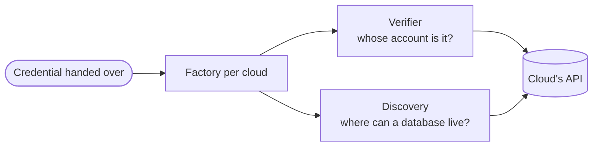

`src/cloud/` reaches a customer's own cloud account: it proves the credential they handed us opens the account it claims to, and lists the places in it a database could live.

- **One factory per cloud.** Each builds its verifier and its discovery over one shared client, so a network found in one cloud is never paired with another cloud's credential. The clouds this deployment drives are configured at start and answered from memory.
- **Over HTTP.** Every cloud is called over its HTTP API: a cloud's own hosts through the fixed client, a customer's Kubernetes API server through the screened one. An endpoint setting can send every service of a cloud to one address, such as a stand-in or a private gateway.
- **Bounded.** Each call is held to a few seconds, each whole check to a little more, and each answer to a size. XML answers pass the depth check in [Reading input](/ianua/architecture/infrastructure/reading/) first.
- **Whose fault.** A refusal by the cloud of the customer's credential is theirs to fix and reads as forbidden, with a reason they can act on. A Kubernetes address nobody can reach is theirs too: it is refused with the reason, and the connection waits to be proved again. Anything else, our own credentials refused, a cloud that fails or does not answer, is ours, so a customer is never sent to rebuild a role because our egress or our keys failed.
- **Nothing leaks.** An error names the status a cloud answered with, never its body, and a failed send loses its URL. An access token is a secret from the moment it is read, sent only in a bearer header.

## The clouds

| Cloud | Reached with | Account proved by | Where a database can live |
| --- | --- | --- | --- |
| AWS | The role the customer made for us, assumed with the platform's own keys under the external id in its trust policy, for fifteen minutes | Asking STS whose account it is | The account's RDS subnet groups that RDS can use |
| Azure | The service principal they handed us, exchanged at Microsoft's sign-in endpoint for a token | The first enabled subscription the principal sees | The subnets of the subscription's virtual networks in the region |
| Google Cloud | A service account key, which signs an assertion exchanged at Google's own token endpoint, whatever the uploaded file said | Reading its project | The VPC networks with a subnetwork in the region |
| DigitalOcean | A personal access token | Reading the account, which also says whether it may still create anything | The VPCs of a region, in the datacentres the platform maps its regions to; a region with no datacentre is refused |
| Kubernetes | A service account token, at the API server they named, with their CA as the one root trusted | Reaching the API server | |

AWS calls are query API `POST`s signed with SigV4; the external id and every key travel only in the signed body or headers, never in a URL.

The role a customer makes in AWS comes from the CloudFormation template kept beside the AWS adapter, `src/cloud/aws/ianua-connect.yaml`. It is built into the server, which serves it to anyone at `/.well-known/ianua/aws-connect.yaml`. It holds no secret: the customer fills in the platform's account id and the external id. The role it makes trusts only that account, and only with that external id.
