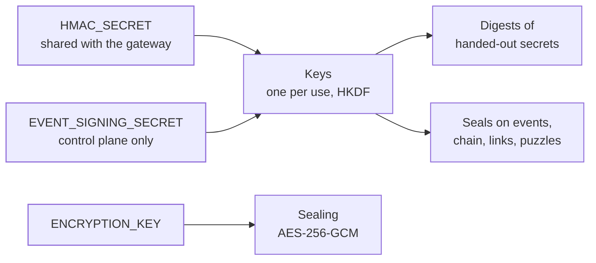

`src/crypto/` holds what the platform keeps secret and how it proves things. Nothing here holds a connection or calls out.

## Keys

Two root secrets are configured, each 32 bytes:

- **`HMAC_SECRET`**, shared with the gateway: the digests of handed-out secrets and the checks the data plane makes.
- **`EVENT_SIGNING_SECRET`**, the control plane's own, which the gateway never holds: the seals on events and live updates, the audit chain's head, anchor and verdict, receipts, the passkey ceremony, file links, SAML pairwise ids and the sign-in puzzles.

Every key is derived from one of them for one use, through HKDF-SHA256 under a fixed label (`keys.rs`). A key that hashes API keys never also hashes recovery codes: a digest leaked from one table matches nothing in another, and the root never touches data itself.

## Sealing secrets at rest

Every secret kept at rest, such as an authenticator seed, a webhook signing secret, a mail provider password or a cloud credential, is sealed with AES-256-GCM under `ENCRYPTION_KEY`, with keys that can be rotated (`sealing.rs`).

- A sealed value reads `s2.<key id>.<nonce and ciphertext>`. A fresh 96-bit nonce is drawn for every seal.
- The seal covers the secret and the place it is kept: whose it is (a tenant, an organization or the platform), the field it is kept in, and the row that holds it, each written with its length before it.
- A sealed value copied into another row, another field or another tenant's tables does not open there; the platform refuses it as a damaged row instead of using it.

## Secrets handed out once

API keys, client secrets, codes, bearer tokens and signing secrets are made in `issued/`:

- Every secret is 256 bits from the operating system's generator, written in lowercase base32 after a short prefix that says what it is (`ik_live_`, `oak_`, `opk_`, `rt_`, `cs_`, `whsec_`), so a leaked one is recognised by a scanner.
- A secret is kept only as its **keyed digest**: an HMAC-SHA256 under the key of its use. A copied table cannot be searched offline for tokens, not even six-digit codes. Two digests compare in constant time.
- A bearer's shape says what it is, so a request pays for one lookup, never all of them. A bearer of no known shape, or longer than any the platform hands out, is refused unread.
- The few secrets that what uses them needs whole (the keys webhook deliveries, pushes and notification posts are signed with, the external id that guards a cloud role, an agent's attested nonces) are handed out to be **sealed** instead of digested.

## Passwords

Passwords are hashed with Argon2id, written in the PHC string format (`passwords.rs`). A hash names its algorithm and settings, so one made with weaker settings, or brought over by an import in bcrypt, scrypt or PBKDF2-SHA256, still checks its password and is replaced the first time a sign-in proves it. One naming more work than a check may spend is refused before any of that work is done. How many hashes run at once on a node is capped in [Runtime](/ianua/architecture/infrastructure/runtime/).

## Signed tokens

`jws/` and `tokens/` hold the JSON Web Signatures and the tokens built on them.

- **Keys.** RSA (PKCS#1 v1.5 with SHA-256, at least 2048 bits), ECDSA on P-256 with SHA-256, and Ed25519. A key from outside, such as a cluster's, may also be ECDSA on P-384 or P-521: the platform checks those and never signs with them. RSA is held by aws-lc-rs, which signs in constant time.
- **The key picks the algorithm.** A token is checked with the algorithm of the key it is checked against: a header naming another algorithm, `none` among them, is refused before any signature is checked, so a token can never choose how it is verified.
- **Times.** A token is refused once its `exp` has passed, before its `nbf`, or when its `iat` lies ahead, each by more than one allowed clock skew.
- **The tokens.** The tenant's access tokens and ID token hints; client assertions (`private_key_jwt`) checked against the client's registered or published keys; DPoP proofs, checked against the key in their own header; an agent's self-signed assertion, at most five minutes long; task tokens, one shape both the issuer and the readers use; app session tokens typed so no access token check takes one for a bearer; and message provenance, sealed with the tenant's key.
- **JSON Web Keys.** Only RSA, EC on P-256 and Ed25519 as OKP are read; a key of any other kind, or one with a private part, is refused rather than guessed at.

## One-time codes

Time-based one-time codes (`totp.rs`, RFC 6238): 160-bit seeds, six digits, 30-second steps, HMAC-SHA1, as every authenticator app reads them. The step a code was typed in and the one on each side are tried one at a time, so the step a code matched is known and a step once accepted can be refused. The enrollment link is written here too, its names percent-encoded.

## Certificates

`certificates/` reads PEM text in a way that always ends, so one broken certificate a tenant pastes never holds a worker; reads the chain a tenant uploads for its domain, checking the private key's public half matches the leaf without keeping the key; and holds the authority that signs the client certificates LDAP binds with. That authority never sees a private key: the caller sends a signing request, and whatever names and usages it asks for are dropped.

## Plain hashes

`hashes.rs` holds the unkeyed hashes protocols ask for: the PKCE challenge (RFC 7636), the `at_hash` of an access token, and the SHA-256 a message's provenance is bound to.

## The AWS signer

`sigv4.rs` is the one AWS Signature Version 4 signer every call to an AWS-style API is made with: AWS itself (STS, EC2, RDS, SES) and every S3-compatible store. A request is written out in one canonical form, hashed, and signed with a key derived for one day, one region and one service.
