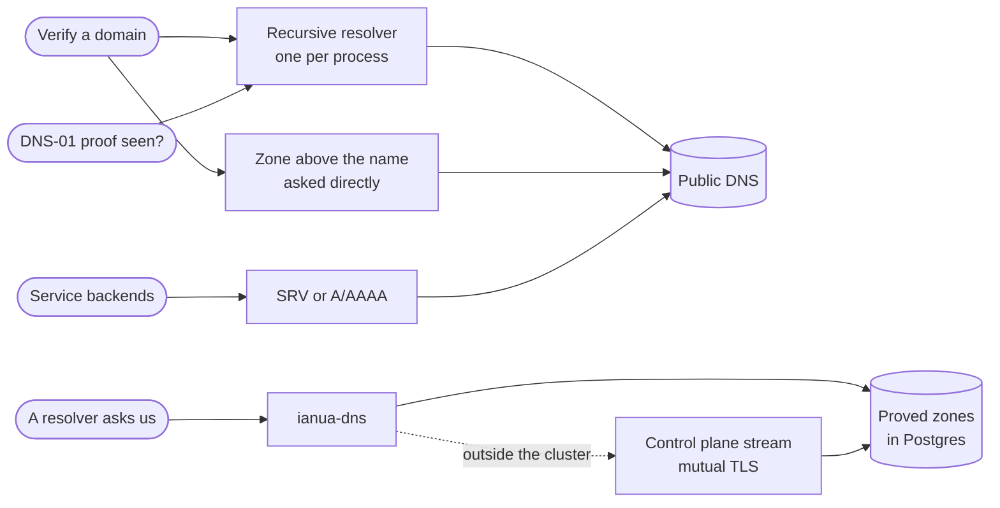

DNS shows up in three places. `ianua-dns` is the nameserver that answers for the hostnames tenants delegate to us. `src/dns/` in the infra crate only asks the world: whether a proof is published, and where a service's backends are. The zones themselves are kept in Postgres, in `postgres/domain/zones.rs`.

## The nameserver

Acme delegates `auth.acme.com` to us with one `NS` record at its own provider. From then on `ianua-dns` answers for that name: the records Acme writes inside it, and the two kinds the platform keeps (the address the gateway listens on, and the `_acme-challenge` text a certificate authority asks for).

**What it answers is the domain's decision.** The app's `LoadCatalogUseCase` reads the proved zones through the `DnsZoneReader` port, each with the tenant holding it and its proof, and the domain's `ZoneCatalog` keeps the ones that answer. The Postgres reader leaves unproved zones in the database and loads at most 100,000 zones; a load past that serves the first 100,000 by tenant and name and logs an error:

- **Only proved zones answer.** Acme deletes its registration but leaves the delegation in place. Eve registers the name. Until she proves it, which the old delegation never lets her do, every query for it is refused, so she cannot answer for Acme's name and get a certificate for it.
- **Nested zones.** When two tenants' proved zones sit one inside the other, the outer one answers. One tenant's zones nest freely, and the deeper one answers.
- **A name in no zone is refused**, never answered as not existing. We cannot say whether a name outside our zones exists, and a made-up `NXDOMAIN` would be cached.
- **Never `ANY`, never a zone transfer, never recursion.** `ANY` is the one small question with a large answer that amplification attacks are built from, a transfer would hand anyone every delegated hostname, and recursing would make us an open resolver.

**How it runs.** The binary is a composition root over `ianua-boot`: it reads its settings, takes UDP and TCP on `DNS_BIND`, fills its catalog from the database as its own role or from the control plane's stream, and answers until SIGTERM or Ctrl-C. Its parts:

| File | What it holds |
| --- | --- |
| `config.rs` | The settings, read through `ianua-boot` (see [Nameserver](/ianua/reference/configuration/#nameserver)), and which source the zones come from. |
| `catalog.rs` | The catalog the listeners answer from, swapped whole on each load, and the loop that loads it from the database. |
| `follow.rs` | Following the control plane's stream, for a nameserver outside the cluster. |
| `listen.rs` | The UDP and TCP listeners. |
| `wire.rs` | The only code that knows the DNS packet format. |
| `lib.rs` | `run`, the binary's entry, and `serving`, the same start under a stop the caller holds, for tests that ask real questions. |

- **Its own role.** In the cluster it signs in as `ianua_nameserver`, which reads the zones, their records and of each claim only who holds it and whether it was proved. It writes nothing and reads no other table, so a nameserver that is taken over gives away public DNS data and no more.
- **Both ports or nothing.** It takes UDP and TCP before it answers anything, and a port it cannot take stops the start. A resolver comes back over TCP when an answer does not fit, so a nameserver with UDP alone fails now and then on the larger answers. On Ubuntu, `systemd-resolved` holds port 53 and must give it up first.
- **Refused until loaded.** The listeners start on an empty catalog and refuse every query until the first load. A resolver retries a refusal.
- **Loaded whole, every `DNS_REFRESH_SECONDS`.** A load that fails keeps the catalog loaded before it, and the next load is tried sooner, doubling the wait up to the refresh interval. Zones a few seconds old still answer correctly, where an emptied catalog would refuse every delegated name at once.
- **Small answers over UDP.** An answer past 512 bytes, or the size a resolver offers up to 1232, is cut short with the truncation flag, which sends the resolver to TCP.
- **Bounded.** A UDP packet is read into a fixed buffer, a TCP message may be at most 8 KiB, a TCP connection lives at most five seconds, and at most 256 are served at once. A packet that is not a query gets no reply, so a forged sender address draws no traffic.

## Nameservers outside the cluster

A nameserver on a host of its own cannot reach Postgres, and holds no login for it. It follows a zone stream from the control plane over mutual TLS instead, picked by `CONTROL_PLANE_ENDPOINT` (see [Nameserver](/ianua/reference/configuration/#nameserver)). `follow.rs` is that side; the control plane's side is `ianua-grpc`, opened by the server on API nodes when `GRPC_LISTEN` is set, and the contract between them is `ianua-proto`.

- **Settled at the control plane.** The stream reads the zones through the same `DnsZoneReader` and sends only what the domain's `served_zones` keeps, so a nameserver outside never answers for an unproved zone either. It sends the whole catalog first, and again whenever it changes, read every two seconds.
- **Both ends checked against one private authority.** `ianua link-pki` makes it: the authority, the listener's certificate and one client certificate per nameserver. A caller with no certificate, or one from any other authority, never completes the handshake; a nameserver that cannot check the control plane's certificate takes nothing from it. A server certificate cannot be used as a client one, so a nameserver taken over cannot pose as the control plane.
- **Bounded.** At most 16 streams are open at once, a handshake must finish within 5 seconds, a call must start answering within 10, a connection is pinged every 30 seconds and dropped when a ping goes unanswered for 10. A stop ends every open stream, so it is not held by streams that never end on their own.
- **Keeps the last zones.** Every catalog is swapped in whole. A stream that ends, a control plane that is down, or a catalog that does not read keeps the zones held, and the link is tried again after a second, doubling up to a minute; a link that handed over a catalog starts the wait over.
- **Reports in.** After each catalog the nameserver reports the contract revision it was built against and what it serves. Whichever side is behind says so in its own log.

## The resolver

One resolver is built for the whole process and shared by the API and the worker. It reads a name's records through recursive resolvers, for the checks that prove a tenant controls a domain, and for the provisioner waiting to see a DNS-01 proof.

- **Bounded.** Each lookup is held to a whole bound, retries included, so a name server that hangs answers as an error within seconds.
- **Not cached.** A tenant who just wrote the record presses verify again and is asked afresh, and a record taken away stops proving anything at once.
- **An empty answer is an answer.** A name with no such record answers `false`; only a resolver that cannot be reached is an error.
- **A delegation is read from the zone above.** A recursive resolver would ask the delegated zone itself for its `NS` records, and for a name delegated to us that zone is ours: it would answer with whoever registered the name last, and before the proof it answers nothing at all. So the resolver only finds the closest zone above the name and its servers' addresses, then asks those servers directly, without recursion, over UDP and again over TCP when the answer was cut short. Their referral is what the parent's operator wrote. An answer counts only from the address asked and with the question's own id. A server that refuses or stays silent is passed over for the next; when none answers, the check is an error, "not known" rather than "not proved".
- **Delegation counts only the name's own records.** A name that is an alias holds no `NS` records of its own, so the name servers of the alias's target, which whoever owns that target writes, prove nothing about it.

## Service discovery

A route can name its backends by DNS (`discovery.rs`):

- **`SRV` records** serve a registry that publishes a port and a weight per target.
- **`A` and `AAAA` records** serve a Kubernetes headless service, whose port is the one the service's own upstream URL names.

A name with no records is an answer with no backends: a deployment scaled to zero reads that way, and the gateway then refuses the route. A resolver that cannot be reached, or does not answer in time, is an error.
