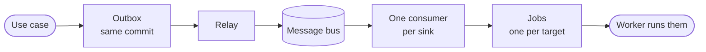

The application's rule is fixed: if a change's audit record cannot be written, the change fails; if the event cannot be broadcast, the change stands and the event goes out later. The outbox (`src/outbox/`) and the message bus (`src/bus/`) make that hold through a crash, a restart and a bus that is down.

## The outbox and the relay

1. The audit trail writes each event's audit record inside the request's unit of work. In the same transaction it adds a row to the **outbox**, `event_outbox` (or `platform_event_outbox` for organization and platform events), that points at the record. The change, its record and its outbox row are committed or dropped together.
2. The **relay**, `OutboxRelay`, reads the outbox a bounded batch at a time, on the platform database and on each database of its own, and publishes every event on the message bus under the id of its audit record. It deletes the rows the bus took, and stops at the first event the bus refuses, so the rest wait for the next pass. A bus that is down delays events; it never loses one.
3. Rows are taken with `FOR UPDATE SKIP LOCKED`, so two relays running at once never publish the same rows. The bus keeps one copy of an id published twice, so a pass cut short and run again sends nothing twice.

The outbox row also carries the **chain depth**: how many workflow runs deep the event was raised. It travels sealed with the event, so a workflow that triggers itself is stopped by the loop guard even after the event crossed the bus.

## The gateway's inbox

The gateway raises a few events of its own: an agent's action allowed or denied, egress denied, a honeypot hit, automation caught, a canary token presented, a canary token leaking from an upstream, a session frozen or ended because its use stopped looking like its holder. The list is kept in one place, `raised_by_the_data_plane`, which the seal check, the inbox and the table's check all follow. It never writes the trail or the outbox: the trail's head is sealed with the control plane's root and the outbox is relayed under the control plane's seal, so anything the gateway wrote there would go out vouched for by a key it never holds. Its events wait in an inbox instead (`src/inbox/`).

1. In the gateway, the app's `EventDispatcher` port is filled by `InboxEventDispatcher`. It refuses any event but those types, with nothing written, seals each one with the data plane's seal (`EventSeal::data_plane`) on the subject the relay would publish it on, and adds it to the tenant's `gateway_events` in the request's unit of work. The table's check holds the same types, and the gateway's role may only add rows to it. The gateway also applies the event to its own store caches at once, so a session it just froze stops answering as live here without waiting for the event to come back over the bus.
2. The worker runs `InboxDrain`, as it runs the relay. It takes the oldest events with `FOR UPDATE SKIP LOCKED`, checks each one's seal and type again, appends those that hold through the trail, where each gets its chain link and its outbox row, and removes every event it took, all in one transaction. An event whose seal or type does not hold is removed, logged and counted, never appended.
3. A pass that fails to append rolls back whole, so its events wait for the next pass: none is lost and none is appended twice. Two drains at once take different events.

From there a gateway event travels like any other, sealed by the control plane's relay.

## The message bus

Every bus-shaped adapter is written once over one trait, `Bus`, so where the bus lives is the composition root's choice:

| Bus | Where it lives | Used for |
| --- | --- | --- |
| `MemoryBus` | This process. Events are kept in order up to a set number, an id published twice is kept once, and live updates go through a bounded channel per subject. | A deployment of one node, development, tests |
| `ServerBus` | A bus server every node reaches: any server that speaks the NATS protocol with its persistent streams. Events go to one stream, `ianua-events`, holding every `ianua.tenant.>`, `ianua.org.>` and `ianua.platform.>` subject, kept for a week and a few gigabytes at most, oldest first. | Every deployment of more than one node |

The protocol client is the only part of the crate that knows which protocol is spoken. Folders and types are named by role (`bus/`, `Bus…`), never by the product.

### Subjects

Each event is published on a subject that names its scope and type, such as `ianua.tenant.{tenant_id}.identity.user_status_changed`, so a consumer subscribes to exactly what it needs. Organization events use `ianua.org.{org_id}.…` and platform events `ianua.platform.…`. Ids are written in their simple form, without hyphens. An event travels as an `EventEnvelope`: the audit record it was kept as, written as JSON.

### One bus server for several deployments

The `ianua` at the start of every name is the deployment's [namespace](/ianua/reference/configuration/#namespace), set with `NAMESPACE`. With `NAMESPACE=staging`, events go on `staging.tenant.{tenant_id}.…` into the stream `staging-events`, messages into `staging-messages` and `staging-dead-letters`, and live updates and the gateways' blocked addresses on `staging.…` subjects too. The worker's consumers live inside the deployment's own streams, so a staging worker never takes a production event. So staging and production can share one bus server.

The code writes every name without the namespace (`tenant.{tenant_id}.…`), and `ServerBus` alone puts it in front on the way out and takes it off on the way in, so no name reaches the server without it. A conventions test fails the build on a subject or stream written with the namespace in it anywhere else. The seal covers the subject as the code writes it, so give each deployment its own `EVENT_SIGNING_SECRET` too.

### Seals

The worker acts on what it reads from the bus (a `tenant.deleted` event tears a tenant down), so every event is sealed: the relay puts an HMAC of the subject and the payload in the `Ianua-Event-Seal` header, and a consumer checks it with `EventCheck` before it acts. There are two seals. The control plane's comes from a root secret the gateway is never given, and holds for any event. The gateway's holds only for the few events the gateway raises (agent actions allowed or denied, egress denied, honeypot hits, automation caught, canary tokens presented or leaking), so a compromised gateway cannot forge a `tenant.deleted`.

## The worker's consumers

Each consumer reads its own **durable share** of the stream: every event handed to one worker until it is settled, handed again after a wait if that worker stops. A consumer settles each event one of three ways: done, tried again after a delay, or set aside.

`HeardEvents` turns what a consumer was handed into the event it records:

- Nothing is read before the seal holds, and the envelope must name the very subject the seal covers, so the gateway's seal on its own few events never vouches for another.
- A tenant's event is read back whole from the trail by its record's id. The trail is the record and the envelope only its pointer. A record gone by retention is done with.
- Organization and platform events are read from the envelope.

The consumers, each under a stable share name:

| Consumer | Hears | Does |
| --- | --- | --- |
| Notifications | Tenant, organization and platform events | Fans each event out to the people who should hear it |
| Webhooks, signals, back-channel logout, audit streams, message pushes | Tenant events | Plans one job per target, keyed by the event and the target |
| Workflow starts | Tenant events | Starts the workflows the event triggers |
| Tenant setup and teardown | `tenant.provisioned`, `tenant.deleted` | Begins the steps |
| Agent drift, convergence, egress denials | The gateway's agent events | Judges the agent, and may revoke or suspend under `Enforce` |
| Workflow run settlements | `agents.run_finished` | Settles a finished agent run on its workflow step |

An event handed out twice queues nothing twice: jobs are keyed by event and target, and the agent checks note each event in the same unit of work as what they change. An event whose last delivery fails is set aside with an error that names its subject. What the consumers start runs as [jobs](/ianua/architecture/infrastructure/jobs/).

## Live updates

Live updates for the dashboard (notifications, workflow progress, a tenant's setup step by step, decided proxy requests and agent messages) are broadcast on the bus under `ianua.realtime.` (the namespace, then `realtime.`), one subject for each operator, member, tenant user and dashboard, and kept nowhere. A dashboard subject is taken only when it names one exact subject: an empty segment, a space or a wildcard is refused, so a subscriber never listens to more than it should. An update that does not read back is dropped.

Updates are sealed the same way by the service that sent them, and a dashboard only shows an update whose seal holds. The gateway's key vouches only for the requests it decided; every other update needs the control plane's key. Access to the bus alone is not enough to show anyone a fake notification.

## The agent message plane

The agent message plane, `MessagePlane`, runs on the bus server alone; `BusMessagePublisher`, `BusMessageConsumer` and `BusDeadLetters` share it, one for each port. On a bus in this process, `NoMessagePublisher`, `NoMessageConsumer` and `NoDeadLetters` refuse every message rather than take it and lose it.

- **Subjects.** Messages are kept in their own stream, `ianua-messages`, under `ianua.msg.{tenant_id}.{topic}.{type}`, the topic's dots written as underscores so it stays one segment, a message without a type under `_`, a segment no type can be, so one wildcard covers a topic.
- **Consumers.** A subscription's filter becomes the subjects its consumer reads, so the bus server itself hands out only the types the filter lets through. Each subscription reads through a durable consumer named after its tenant and a digest of the name it was given, so one tenant never reaches another's consumer by naming it. The subscriptions of one consumer group on a topic share one consumer, so each message goes to one of them.
- **Receipts.** A delivery's receipt is sealed for its tenant and consumer, so a receipt that was forged, altered or made for another consumer is refused.
- **Headers.** The headers the plane keeps for itself (the server's, a dead letter's count, the message's type) cannot be set by a publisher and are not handed to a reader.
- **Dead letters.** A message set aside is copied into the dead-letter stream before its delivery ends. A replayed one goes to its own consumer alone, with its delivery count starting over.
- **Retention.** Topics share the stream, so a topic's limit is applied on every read, from the rule as stored now (`bus/server/messaging/retention.rs`). A count limit trims the topic before the read. A delivery past an age limit is never handed out, and it and everything older on the topic are removed for every reader. A push also rechecks the age just before it posts. Changing a rule first removes what the old rule no longer kept. The stream's own limit of 7 days is the longest anything stays.

## Readiness

The bus and the cache each answer the process's readiness check, so a node that cannot reach them is taken out of rotation instead of failing requests.
