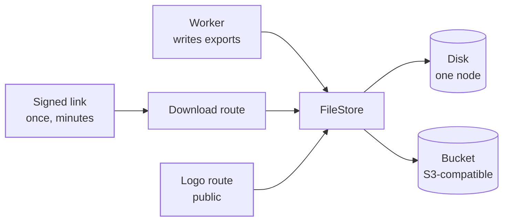

The platform's files (tenants' logos, audit log exports and people's data exports) go through one `FileStore`, in `src/files/`. With one node it is a folder on disk. With more than one node it is an S3-compatible bucket. Its adapters start with `File`.

## Names

A name is made by the platform from what a file holds and the ids it belongs to, never from anything a person typed: a fixed folder for its kind, then hex ids, the tenant's first where the file is a tenant's, and a fixed last word, `<kind>/<ids>/<word>`. A tenant's files of each kind sit under one folder, so they go together when the tenant does. No name can climb out of its folder.

## The two stores

**On disk (`DiskFileStore`).** Each file sits in a folder of its own, so removing a file removes everything an attempt at it left. A file is written to a part with a random name, flushed to the disk, and renamed over the file's own name, so it appears whole or not at all.

**In a bucket (`ObjectFileStore`).** AWS S3, Cloudflare R2, MinIO, DigitalOcean Spaces, Backblaze B2, Wasabi, or Google Cloud Storage through its XML API with an HMAC key.

- **A file appears whole or not at all.** A small file goes up in one request. A larger one goes up in parts of 8 MiB and appears only when the last part is in. An upload that fails or is dropped is cancelled. If a crash leaves one behind, the next attempt at the same file cancels it.
- **Reading streams.** A file is read as it arrives, through a channel of a few chunks, so a slow reader slows the download instead of the body piling up in memory. A body longer than the store said, or cut short, ends in an error rather than a file that quietly differs.
- **Every call is signed and has a time limit.** Calls are signed with AWS Signature Version 4 for the configured region and go through the platform's fixed client. A call waits at most 30 seconds for an answer; a download may take 10 minutes. An error names the store's status and code, never a key or the secret.
- **HTTPS only.** The endpoint is HTTPS; plain HTTP is taken only for a store on this machine's own loopback, such as a local MinIO in development.
- **Removing a folder.** Each page of a listing is removed in one batch delete. A store without batch deletes, such as Google Cloud Storage's XML API, has its objects removed one at a time, a few at once.
- **Clean up unfinished uploads.** Give the bucket a lifecycle rule that cancels unfinished uploads after a day. MinIO does this on its own.

## Exports

**Audit log exports** are written a page at a time by the worker. A CSV file opens with its header and holds one row per record; a JSON file is one array of records. Neither is in the store until the last page is written, so a link never opens half an export, and a try that fails is written again from the start.

**People's data exports** are one JSON file: an object with the export's own details and one member per section the request names. The audit trail's records, the person's activity, their sign-ins and the notices sent to them are written a keyset page at a time, so a long history never sits in memory. No section writes a secret: a passkey by its name and dates, never its key; a session by where and when it began, never its token; a second factor by its method, never its secret or codes.

**Cells that would run.** A CSV cell a spreadsheet would run as a formula, such as an address typed as `=HYPERLINK(..)` into a failed sign-in, is written with a leading `'`, so opening the file runs nothing.

## Download links

Exports are downloaded through links the platform signs (`FileLinks`), at `/api/v1/files/download/{token}`:

- A link carries which file it opens, when it stops working and a random nonce, sealed with an HMAC under a key the control plane's root derives for file links alone. It names no person and carries no secret of the caller.
- It works for a few minutes, never past the export's window, and for one download: opening it checks the seal and the time, then spends the nonce in the ledger every node shares.
- A forged, changed, expired or used link, one moved to another tenant, and one whose file is gone all answer `404` alike, so a link says nothing about which files exist.
- The file is streamed with its type and length, never read whole into memory.

## Logos

A tenant's logo is kept under a name made from the tenant's id and served publicly at `/api/v1/files/logos/{key}`, from a host that serves no page of the platform's own. The image is checked again from its own bytes each time it is served, so the content type a browser is given always names what the bytes are, and a file changed on disk is refused rather than served. It is served with a long cache lifetime, `nosniff` and a sandbox content security policy.

## When a tenant goes

A deleted tenant's logo and its people's data exports are removed by its teardown. Its audit log exports stay; they are kept and removed with the trail they copy.

## Log shipping to a bucket

A tenant's log target can be an S3-compatible bucket too. Each batch becomes one new object under `ianua/<year>/<month>/<day>/`, signed with the tenant's access key for the region the target names. The region is always given, never guessed from the endpoint's host, because only AWS puts its region there. Use `auto` for Cloudflare R2 and Google Cloud Storage. See [Outbound HTTP](/ianua/architecture/infrastructure/http/#log-shipping-and-audit-streams).
