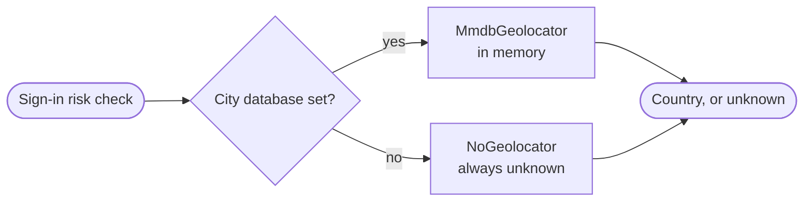

`src/geo/` says where an address is, for the sign-in risk checks such as a sign-in from a new country.

- **`MmdbGeolocator`** reads a city database in the MaxMind DB format (GeoLite2 City, GeoIP2 City, or any database of that shape) that the server names. Nothing goes out over the network: the whole file is read into memory once and every lookup is a walk of its tree.
- **Unknown, never a guess.** An address the database does not place, places without coordinates, or places in no country the standard lists is answered as unknown. A made-up location at the equator would read as a journey to the risk checks.
- **`NoGeolocator`** answers on a deployment that names no city database: every address is unknown, so the checks that read a country read none.
