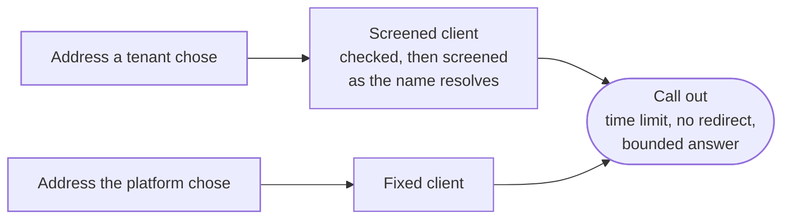

`src/http/` holds the clients every call out of the deployment is made with, and the adapters that call out over HTTP. Its adapters start with `Http`.

## The two clients

A webhook target, a model provider's endpoint and an identity provider's token endpoint are all instructions to make a request from inside the deployment's network. Screening a URL only when it is registered catches an IP written out, but a name is resolved later, and whoever controls it can point it inward.

- **The screened client** (`client::screened`) is for every address a tenant chose. The address is checked before the call, and every name is screened again as it resolves, so a name that resolves inside the deployment is never reached.
- **The fixed client** (`client::fixed`) is for every address the platform chose: a provider's own host, the platform's object store.

Either way:

- each call has its own time limit;
- no redirect is followed;
- an answer that is read is read within a size limit;
- an error names the status it ended on, never the address, the body or a credential. A Slack hook or a collector keeps its key in the path, so an error never carries the URL.

A refused address is the caller's to fix and reads as a validation error. Everything else is the network's.

## Deliveries

Posts that carry something that happened to an endpoint a tenant or an organization registered (`deliveries/`). Each is screened when its host resolves, held to its own time, and judged by the status of the answer alone: what an endpoint says back is never read.

| Delivery | What it posts |
| --- | --- |
| Webhooks | One body per event, the same for every subscription: the audit record it was kept as, its type, time, tenant and details, a field whose name marks a secret left out. Each try ends at the shorter of the subscription's policy and `OUTBOUND_DELIVERY_TIMEOUT_SECONDS`. |
| Security Event Tokens | A token the tenant's key already signed, pushed to a receiver's endpoint (RFC 8935), with the receiver's own `Authorization` header when it asked for one. |
| Push subscriptions | One agent message to a subscription's endpoint, in the shape a pulled message has, given up at the subscription's acknowledgement deadline. |
| Notifications | A notification to an organization's Slack channel, Teams channel or webhook. A Slack or Teams address is the key to its channel, so it is kept sealed and opened only for the post. |

**Signatures.** Webhook deliveries, pushes and notification posts are signed as Standard Webhooks lays them out: one `v1,<base64 HMAC-SHA256>` entry per secret that still signs, over the id, the send time and the body joined by dots. A receiver checks each the same way, with an off-the-shelf library.

## Log shipping and audit streams

`logs/` sends records to a tenant's own tools.

- **Request records** from the tenant's gateway go to its log destination in batches: a collector that takes `POST`ed JSON lines or OpenTelemetry logs, an S3-compatible bucket (one object per batch, signed with the tenant's key for the region it named), or Datadog's log intake. A record never carries a token, a header or a body.
- **Audit records** go one at a time along a tenant's streams: a Splunk event collector, Datadog, a syslog collector over TLS (RFC 5425), or any HTTPS endpoint. Every destination gets the same object, so a team moving from one SIEM to another searches the same fields.

A collector, an endpoint, a bucket and a syslog host are addresses the tenant chose, so each goes through the screened client; the syslog sender resolves the host itself and dials only addresses the deployment may reach. Datadog's intake is the site's own host, so it goes through the fixed client. Every credential is opened from its sealed copy for one send.

## Model calls

`models/` makes an agent's model call to the provider its tenant connected, in that provider's own format: Anthropic's Messages API, OpenAI's Chat Completions, or a self-hosted server that speaks Chat Completions, such as vLLM or Ollama.

- The address is screened like every tenant address, and the key is sent only in the header the provider documents.
- The answer is read up to 1 MiB, and a provider's error text is never passed on.
- An answer the model did not finish is never used, and the tokens a provider billed count toward the run's spend even when the answer cannot be used.

## Tools and device posture

- **Tools** (`tools.rs`): an agent's tool call, made through the zero-trust gateway with the run's task token, so the gateway judges it like any other request. The tool's path is filled from the arguments, the rest sent as the query or the JSON body.
- **Device posture** (`posture.rs`): the device service the deployment names, an MDM or an endpoint agent's server, asked about one device while a request waits, so the call is held to a couple of seconds and its answer to a few kilobytes. It is asked by the trusted device the session was signed in from (`device_id`) or by the fingerprint of the device certificate the connection presented (`certificate_fingerprint`), never about a device nothing names. Asked about a session's device, a report naming another device is refused. A deployment with no device service answers every question with an error, so a posture rule refuses as unavailable.

## The runner's calls to the API

`runner.rs` holds what the [runner](/ianua/architecture/runner/) beside an agent's sandbox asks the API, through the fixed client, each answer read within 64 KiB:

- **Attesting** (`HttpRunnerKeys`): a key pair made in memory, a challenge asked for, the public half enrolled with the SVID and its signature over the binding. The key is held until halfway to its end, and only one attestation runs at a time.
- **Exchanging** (`HttpRunnerTokens`): an assertion the key signs exchanged for a task token, one bound to the key for the gateway and one bearer token for the message relay. A token is exchanged again a little before its end, when the key changed, or once the gateway refused it.

A refusal from the API is an `Unauthorized` error, and anything else that fails an infrastructure error. Neither names the key, the token or the SVID.

## Calls a sign-in makes

`sign_in/` holds the calls out a sign-in makes:

| Call | What it does |
| --- | --- |
| Breach check | Asks the Have I Been Pwned range service whether a new password appears in known breaches, sending only the first five hex characters of its SHA-1. The answer is padded, so neither the password, its full hash nor the size of the answer gives anything away. The service's address is `PASSWORD_BREACH_URL`, so a deployment can use a mirror of its own. |
| Challenge | Checks a Cloudflare Turnstile proof with its `siteverify`, held to a few seconds. A provider that fails, answers late or says its own secret is wrong is an error, never a pass. |
| Back-channel logout | Posts the signed logout token to an app's back-channel address (OpenID Connect Back-Channel Logout 1.0), each post held to five seconds so one app that hangs does not hold up the others. |
| OpenID Connect | Signs a person in through a provider a tenant set up: the redirect, the code exchanged for an ID token, and that token checked. A provider's discovery document and keys are fetched once an hour per issuer, every answer read within a size limit. |
| Client keys | Reads the keys a `private_key_jwt` client publishes at its `jwks_uri`, over `https` only, kept for a while per address. |
