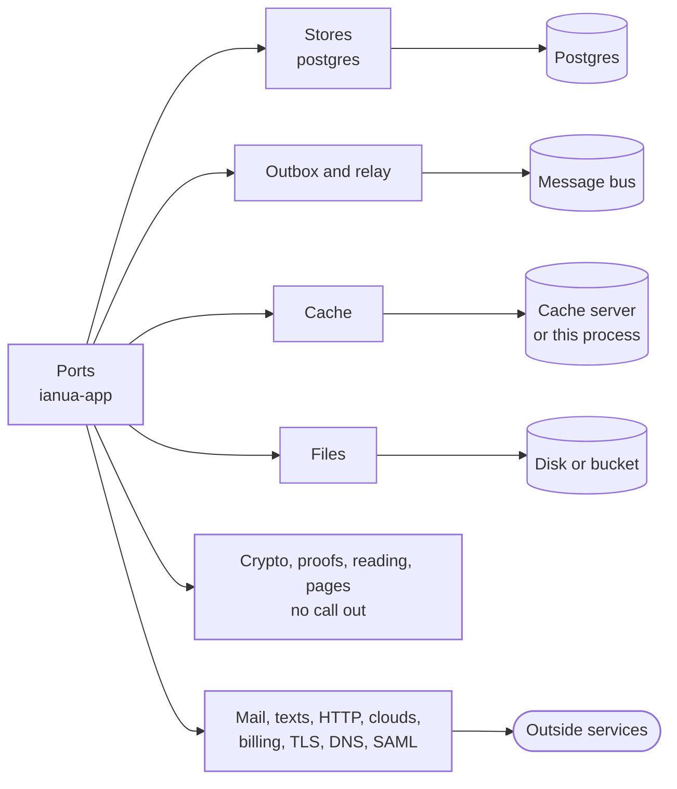

`ianua-infra` is where ianua meets the outside world. Every port the [application](/ianua/architecture/application/) declares is implemented here, by an **adapter**: a `UserStore` backed by Postgres, an `EventDispatcher` that writes the audit log and publishes on the message bus, a `PasswordHasher` that uses Argon2id.

This is the only layer that names `sqlx`, `async-nats`, `redis` or `reqwest`. None of their types leave it: an adapter turns their errors into `DomainError::Infrastructure` and their rows into domain types before returning.

## Names

Adapters are named by their role and the port they fill, never by the product behind them, so the product can change: `PgUserStore`, `CacheTokenLookup`, `BusMessagePublisher`, `FileLogoStore`. The folder says which: everything in `postgres/` starts with `Pg`, in `cache/` with `Cache`, in `bus/` with `Bus`, in `files/` with `File`, in `http/` with `Http`, in `runtime/` with `Local`. A stand-in for a provider a deployment did not set up is named `No` and its port, such as `NoGeolocator` or `NoPaymentProvider`, and refuses or answers "unknown" rather than pretending. A convention test holds every adapter to these names.

## The components

### Storage and events

| Component | Folder | What it does |
| --- | --- | --- |
| [Postgres](/ianua/architecture/infrastructure/postgres/) | `postgres/`, `migrations/`, `queries/` | The stores, the foundation every store stands on, row-level security on every call, tenants in databases of their own, and the writes that race. |
| [Audit trail](/ianua/architecture/infrastructure/audit-trail/) | `postgres/foundation/audit_chain.rs` | Records kept append-only, linked into a chain per tenant, sealed, purged by retention and moved with the tenant. |
| [Events](/ianua/architecture/infrastructure/events/) | `outbox/`, `inbox/`, `bus/` | From a use case to the worker through the outbox, the relay and the message bus, sealed on the way; the gateway's inbox; live updates and the agent message plane. |
| [Jobs and sweeps](/ianua/architecture/infrastructure/jobs/) | `postgres/scheduling/` | The job queue kept beside the changes that ask for jobs, the worker's five lanes, sweeps run once across every worker, leases, and tenant setup and teardown. |
| [Cache](/ianua/architecture/infrastructure/cache/) | `cache/` | Limits, quotas, nonces and the sign-in puzzle, in this process or on a cache server, and the read-through copies of the hottest store reads. |
| [Files](/ianua/architecture/infrastructure/files/) | `files/` | Logos, audit log exports and data exports, on disk or in a bucket, handed out through single-use signed links. |

### Keys, proofs and reading input

These make no call out and hold no connection.

| Component | Folder | What it does |
| --- | --- | --- |
| [Cryptography](/ianua/architecture/infrastructure/crypto/) | `crypto/` | The two root secrets and the keys derived from them, sealing at rest, digests of handed-out secrets, passwords, signed tokens, one-time codes, certificates and the AWS signer. |
| [Proofs](/ianua/architecture/infrastructure/proofs/) | `proofs/` | Platform attestation for agents, and passkeys for people. |
| [Reading input](/ianua/architecture/infrastructure/reading/) | `reading/`, `css/`, `bundled/` | GraphQL cost, agent messages, declared purposes and XML depth, a tenant's CSS made safe, and the lists that ship inside the build. |
| [Pages](/ianua/architecture/infrastructure/pages/) | `pages/` | The sign-in pages and error pages the gateway shows a browser, drawn from template files with every value escaped and no script. |
| [Geolocation](/ianua/architecture/infrastructure/geo/) | `geo/` | Where an address is, from a local city database, or never known. |
| [Runtime](/ianua/architecture/infrastructure/runtime/) | `runtime/` | The job timer, the cap on password hashes, time zones and the process's own metrics. |

### Calls out

Every call out has its own time limit, follows no redirect and reads its answer within a size limit. An address a tenant chose is screened before the call and again when its name resolves; an address the platform chose goes through the fixed client.

| Component | Folder | What it does |
| --- | --- | --- |
| [Outbound HTTP](/ianua/architecture/infrastructure/http/) | `http/` | The two clients, webhook and other deliveries, log shipping and audit streams, model calls, tools, device posture and the calls a sign-in makes. |
| [Integrations](/ianua/architecture/infrastructure/integrations/) | `integrations/` | What a workflow's action steps call. |
| [Mail](/ianua/architecture/infrastructure/mail/) | `mail/` | Queued with the change, rendered, and delivered through SMTP or a provider's API; or no mail server at all. |
| [SMS](/ianua/architecture/infrastructure/sms/) | `sms/` | Second-factor codes texted through the platform's Twilio account. |
| [Certificates](/ianua/architecture/infrastructure/tls/) | `tls/` | Certificates for tenants' hostnames from an ACME authority, proved over HTTP-01 or DNS-01. |
| [DNS](/ianua/architecture/infrastructure/dns/) | `dns/` | Proving control of a domain, seeing a DNS-01 proof, and finding a service's backends. |
| [SAML](/ianua/architecture/infrastructure/saml/) | `saml/` | SAML both ways, as a service provider and as a tenant's identity provider. |
| [Cloud accounts](/ianua/architecture/infrastructure/cloud/) | `cloud/` | A customer's own AWS, Azure, Google Cloud, DigitalOcean or Kubernetes account, proved and searched. |
| [Billing](/ianua/architecture/infrastructure/billing/) | `billing/` | Stripe, or no provider on a deployment that bills nobody. |

## Testing adapters

Adapters are tested against the real thing, never a fake: a store test runs real SQL against a real Postgres.

At the start of a test run, one Postgres container is started and every migration is applied once, into a template database. Each test then gets its own copy of that template, through `TestDb`, connected as the app's own role, so row-level security holds the test exactly as it holds a deployment. Copying a template is much faster than migrating, so the tests run in parallel without seeing each other's data. The cache server, the bus server and the object store are each tested against one container started for the test run; each object store test makes a bucket of its own.

A test arranges its rows through the real stores, starting from the default rows in `test_support/rows/`. The one exception is a test that needs a row no store would write, such as a damaged one, to show it is refused; it writes that row with `TestDb::tamper`, which names what it does.

The convention tests and the plan test that keep the stores honest are described on the [Postgres](/ianua/architecture/infrastructure/postgres/#tests) page.
