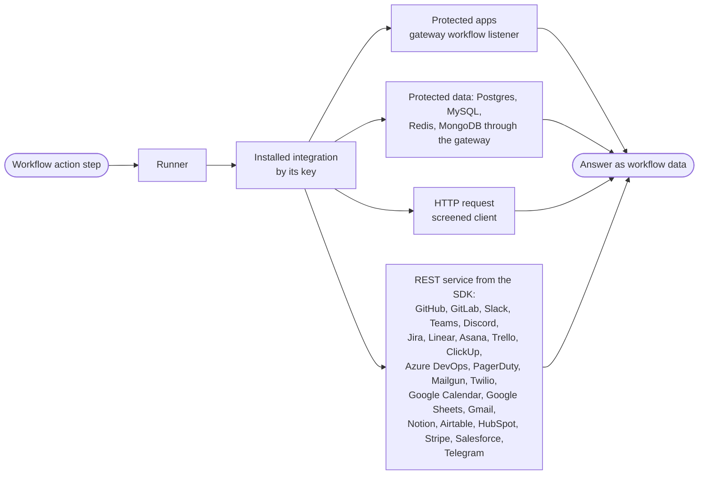
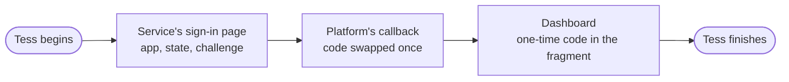

`src/integrations/` in the infra crate holds the set of integrations installed in this deployment, the catalog of what they offer, the runner that makes one call through them, and the verifier that checks an account's credential. The outside services are crates of their own under `integrations/` at the top of the repository, beside `crates/`, built on the integrations' SDK in `integrations/core`.

- **The domain knows only operations.** Every integration follows one contract, `Integration`, in the `ianua-integration` crate: its profile, the operations it declares, a guide for each, checking an account's credential, and the call. The domain checks a step against the operation alone. The installed set and the catalog of what it offers are answered from memory.
- **A service is described, not written.** The SDK's `rest` module makes a whole integration, `RestService`, from a description: a profile, a table of steps, how an account reaches the service, the headers every call carries, the request that proves a credential, and how the service says yes. Each step is written once: its verb and path, its inputs with where they go (the path, the query or the body) and what kind of value each takes, fixed values, whether the body is a JSON object, a JSON Patch or a form, its kind of action, and what it gives back. A step's inputs are checked before its account is used, so a step that cannot be sent never reaches the service. The spec the domain checks, the guide the builder reads and the request itself are all made from that one description, so they cannot disagree.
- **Every integration presents itself.** Its profile gives a title, a description, an icon name, such as `github`, its own picture, and a brand colour dark enough that a white logo on it stays readable. The picture is the integration's `assets/icon.svg`, built into the integration, so nothing else needs to know what the service looks like. The platform's own steps (HTTP request, memory, Protected apps and the company steps) carry no picture: the dashboard draws them. It may hold only shapes: the `svg` element, a title, groups and the basic shapes, with only the attributes that place and paint them. A script, an event handler, a link, a style, an embedded page or picture, or a document type is refused, and the integration does not start. `GET /api/v1/files/integrations/{key}/picture.svg` serves it to anyone, as `image/svg+xml` with `nosniff` and a `default-src 'none'; sandbox` content security policy, kept for an hour; each integration in `GET .../workflows/integrations` names that address as `picture`, which is `null` for the platform's own steps. Each step's guide gives a title, what it does, what each input means, and the values it gives back at their paths in the step's output, such as `json.number`. A guide only explains, so rewording one never changes a published workflow. The platform refuses to start with an integration whose guides are not one per step, each naming exactly the inputs it takes. Both are served by `GET .../workflows/integrations` and `GET .../workflows/operations`.
- **Forms and previews are written in Rust.** Each input in a step table says how the builder asks for it, with the SDK's `form` module: `Field::asked_with` picks a block such as `Ask::LongText`, `Ask::Choices` or `Ask::Picker`, and `example` and `more_options` add a hint or fold it away. A picker names a read of the same integration that fills it, such as GitHub's `list-labels`, and the input it depends on. An input with `Place::Form` is asked in the form only to narrow a picker, is always optional, and is never sent to the service. GitHub picks repositories, labels and branches, Slack channels, Jira the transitions of the chosen issue, and Google Calendar calendars. A service's `previews` table says which inputs fill an issue, a chat message, an email, a text message or a calendar event. A Protected apps or Protected data step asks for its `route` with `Ask::AppPicker` or `Ask::DataPicker`, which the dashboard fills from `GET .../workflows/apps` or `GET .../workflows/data`, through no account. The checks refuse a picker filled by anything but a read, a route list on anything but the route of a step reaching that kind as the run's person, a required input folded away, and a preview naming an input the step does not take. `POST .../workflows/operations/{integration}/{operation}/inputs/{input}/choices` fills a picker through an account the caller owns or may manage.
- **A credential is tried before it is kept.** Connecting an account, or replacing its credential, asks the service first: GitHub whose token it is, Slack whether its token is live, Jira who the account is, Azure DevOps for one project, Mailgun for the account's domains (or, for a key limited to one domain, with an empty message it refuses), Twilio for one of the account's messages, and Google, once the grant is exchanged for a token, for one calendar. A refused credential is a `422`, and a service that cannot be asked within `INTEGRATION_TIMEOUT_SECONDS` is a `502`; neither keeps anything. A `203`, which Azure DevOps answers with a sign-in page for a token it does not know, is never taken as success. The HTTP request integration has no service of its own to ask and keeps the credential unchecked. The right to connect, or being the account's owner, is checked before the service is asked.
- **A token stays with its service.** A GitHub or Slack account holds its token alone, sent only to `GITHUB_API_URL` or `SLACK_API_URL`. An Azure DevOps account holds its organization and token, sent only to `AZURE_DEVOPS_API_URL` with the organization's name after it. A Jira account names its own site, and its token is only sent to an `https` site `JIRA_SITES` allows, every Jira Cloud site by default. A Mailgun account holds its API key alone, or with the region it is in, `us` or `eu`, and the domain when the key may only send from that domain; the key is sent as the password of the user `api` only to its region's address, `MAILGUN_API_URL` or `MAILGUN_EU_API_URL`. A Twilio account holds its SID and auth token, or adds an API key and its secret, sent only to `TWILIO_API_URL` under the account's own SID. A Google Calendar account holds an OAuth client and a refresh grant: before each call the grant is sent only to `GOOGLE_TOKEN_URL` and exchanged for a token lasting an hour, and only that token goes to `GOOGLE_CALENDAR_API_URL`. A grant the token address refuses fails the step; a token address that is busy or cannot be reached turns it away. A step names a repository, a channel, a project or a path inside them, never an address, and every part is checked and escaped into the path. No redirect is followed. An HTTP account's token is bound to one origin and sent nowhere else.
- **Answers become data.** An answer is read into workflow data: its status, its body as text, and the body as values when it is JSON a workflow can hold. A busy service turns the call away, so it may be tried again; any other refusal fails it, as the service may have acted. Slack answers a refused call with success and `"ok": false`, so its answers are read for that flag: a refusal fails the step, and being rate limited turns it away.
- **Checked against what each service publishes.** Each service's tests hold its steps to the SDK's rules: a key used once, every input explained, every path input placed, no body on a read, something given back. GitHub, GitLab, Slack, Teams, Discord, Jira, Asana, Trello, ClickUp, PagerDuty, Stripe, Mailgun and Twilio are also checked against the service's own published API description, through an extract kept with the crate: every step must call an endpoint the service has, send only parameters and form fields it knows and always those it requires, and promise only outputs and statuses its answer carries. A nested body name such as Asana's `data.name` is checked part by part. Google publishes Calendar, Sheets and Gmail as discovery documents, so their steps are checked against the OpenAPI conversions APIs.guru makes of them. Linear publishes a GraphQL schema rather than a REST description, and Notion, Airtable, HubSpot, Salesforce and Telegram publish none a test can read, so their steps are checked by the SDK's rules alone. Microsoft no longer publishes one for Azure DevOps, whose steps follow its REST reference for version 7.1.
- **One crate per service.** Each depends on the domain and `ianua-integration` alone, never on the database or each other. The server installs each one its build includes, by the `github`, `slack`, `jira`, `azure-devops`, `mailgun`, `twilio`, `google-calendar`, `google-sheets`, `gmail`, `gitlab`, `linear`, `asana`, `trello`, `clickup`, `teams`, `discord`, `pagerduty`, `notion`, `airtable`, `hubspot`, `stripe`, `salesforce` and `telegram` features, on by default. Each new service's address is a setting named after it, such as `GITLAB_API_URL`, with its public API as the default, and its ceiling `GITLAB_DATA_CEILING`. `integrations/README.md` shows how to add a step or a service, and how to refresh an API description's extract.

A delete, configure or undeclared step is high risk, so a workflow is only published with an approval right before it.

## Protected apps

Protected apps (`apps`) is built in beside the HTTP request step. It calls an app behind the gateway as the person the run acts for, never through an account. Its steps are `get`, `post`, `put`, `patch` and `delete`. Each takes the `route` to call, by id, and a `path` on it starting with one `/`. It also takes `headers`, and a `body` for the methods that carry one. A read reads, a delete deletes, and a write is undeclared, so it needs an approval before it.

- **Only routes opened to workflows.** Every route starts closed. Someone who may change routing opens it with `POST .../routes/{id}/open-to-workflows`, recorded as `routing.route_opened_to_workflows`. `close-to-workflows` closes it again. `GET .../workflows/apps` lists the active routes that are open, for anyone who may view workflows.
- **A pass for each call.** An operation acting as the run's person must require a `route` input, or the integration is refused. Just before each call, the worker makes a pass for that call, the run's person and the named route, signed with the tenant's key, lapsing after a minute. If the step names no route by id, it fails. If no pass can be made, the call is turned away and tried again later, as nothing was sent. A run acting for an organization member is refused.
- **Sent only to the gateway.** The call goes to `GATEWAY_WORKFLOW_URL` alone, carrying the pass as its bearer token. A path that leads anywhere else is refused before anything is sent, such as `//evil.example` or a full address. The gateway finds the route by the pass and asks the route's own policy of the person. A refusal there fails the step.

## Memory

The built-in `memory` integration declares `remember` and `find-similar`, each naming one of the tenant's memories by its `memory` input, asked with `Ask::MemoryPicker` (block `memory_picker`, filled from `GET .../memories`), and its `text`; a search also takes a `count`. Its operations need `AccountNeed::TenantMemory`, and the platform runs them itself rather than calling the integration: the worker checks the memory is still the tenant's and active and the text within its clearance, turns the text into a vector through the memory's embedding model (`HttpEmbedder`, OpenAI's `POST {base}/embeddings`, to a tenant's provider through the screened client or to `EMBEDDING_URL`), and keeps or searches it in the vector store (`PgMemoryEntries` on pgvector, or `VectorMemoryEntries` on a Qdrant-protocol server at `VECTOR_STORE_URL`). An endpoint or store that does not answer turns the call away to be tried again, since nothing was kept; a memory gone, waiting to be deleted, full or refusing the data fails it.

## Protected data

Protected data reaches a company's own system behind a stream route, such as its Postgres database, as the person the run acts for. Each kind of system is an integration crate of its own under `integrations/`: `postgres`, `mysql`, `redis` and `mongodb`. The platform opens each connection at the gateway and hands the integration an opener with the login the stream route keeps, through the SDK's `data` module and `Integration::call_through`. One call opens at most 8 connections. An integration never decides who may connect. A client that dials an address itself, as MySQL's and MongoDB's do, dials a door on the worker's own loopback address, which carries each connection through the gateway and closes with the call.

- **Only stream routes opened to workflows.** Every stream route starts closed. Someone who may change routing opens it with `POST .../stream-routes/{id}/open-to-workflows` and a `login_user` and `login_password`. That is recorded as `routing.stream_route_opened_to_workflows`, naming the user and whether TLS is required, never the password.
- **TLS to the database itself.** The login says how the connection is protected, from the worker to the database, so neither the network nor the gateway reads it. `tls` is `required` unless `off` is chosen by name. The database's certificate must chain to `tls_authority`, a PEM, or to the public roots when it is left out, and must be for `tls_server_name`, or for the one host every backend shares when it is left out. Backends on different hosts need the name, and `off` beside an authority or a name is refused. A database without the TLS asked for is refused, never spoken to in the clear. Redis and MongoDB start TLS from the first byte, so the SDK lays it over the connection itself. Postgres and MySQL start it inside their own protocol, so their clients do it with the login's check. MySQL's client adds the authority to the public roots rather than trusting it alone, and checks the name either way. Only a stream route that lets people in can be opened. `close-to-workflows` closes it and forgets the login. `GET .../workflows/data` lists the active stream routes that are open, for anyone who may view workflows.
- **The login stays out of the gateway's reach.** The password is sealed for its stream route and kept in a table of its own, which the gateway's database role is never granted. The route itself only says whether it is open.
- **A pass for each call.** Just before each call, the worker makes a pass for that call, the run's person and the named stream route, and opens the stored password. It dials `GATEWAY_WORKFLOW_URL` and sends one `CONNECT` with the pass in `Proxy-Authorization`. The gateway names the person, asks the stream route's access of them, dials its backend, and answers `200`. From then on the connection is the database's. A route closed, missing or disabled fails the step without sending anything.
- **Postgres.** The `postgres` integration's `query` and `execute` each take the `route`, one SQL `statement`, its `parameters` in order, and the `database`, the login's own name by default. A query also takes a `row_limit`, at most 1,000 rows. A query runs in a read-only transaction rolled back once its rows are read, so Postgres refuses any change. An execute is committed only when it succeeds. Values are bound to the types the database asks for, never pasted into the statement. A type a step cannot send or read is refused with the cast that would make it one. Each statement is held to `WORKFLOW_HTTP_TIMEOUT_SECONDS` inside the database, and the rows count as `WORKFLOW_HTTP_DATA_CEILING`. Rows stream, so no more than one row past the limit is read. The server installs it with the `postgres` feature, on by default, while `GATEWAY_WORKFLOW_URL` is set.
- **MySQL.** The `mysql` integration's `query` and `execute` take the same inputs as Postgres's, each value written as `?`. A query runs in a read-only transaction, so MySQL refuses any change, and is held to `WORKFLOW_HTTP_TIMEOUT_SECONDS` inside the database. An execute is committed only when it succeeds. Rows are read one at a time, at most 1,000. Bytes that are not text are refused with the way round, such as `HEX(column)`. Server feature `mysql`.
- **Redis.** The `redis` integration's `read` and `write` take the `route`, a `command`, its `arguments` in order, and the `database` number. It signs in with Redis's access lists. A read takes only commands that read, such as `GET`, `MGET` or `HGETALL`. A write takes any command the login may run. Neither runs a command that changes the connection itself, such as `AUTH`, `SELECT` or `SUBSCRIBE`. Each answer is awaited at most `WORKFLOW_HTTP_TIMEOUT_SECONDS`. Server feature `redis`.
- **MongoDB.** The `mongodb` integration offers `find` and `aggregate`, which read, and `insert`, `update` and `delete`, which write. Each takes the `route`, the `database` and the `collection`; filters, sorts, pipelines, updates and documents are MongoDB's extended JSON, given as text since its operators begin with `$`. Documents read come back as plain values: an id as its hex text, a moment as RFC 3339 text. An aggregate refuses `$out` and `$merge`. A read returns at most 1,000 documents, held to `WORKFLOW_HTTP_TIMEOUT_SECONDS` inside the database. The login is a user kept in the `admin` database. Server feature `mongodb`.

## Connecting by signing in

When the deployment has registered an app with a service, such as GitHub's OAuth app through `GITHUB_CLIENT_ID`, people connect an account by signing in there instead of pasting a credential. `GET .../workflows/integrations` says which integrations offer it.

- **Begin.** `POST .../workflows/accounts/connections` names the integration, the account's name, its sharing and operations. It answers the address to send the browser to: the service's sign-in page with the app's id, a random `state` and the `S256` challenge of a verifier the platform keeps. The verifier never leaves the platform. A sign-in not finished within ten minutes runs out, and a sweep forgets it.
- **The service answers.** Every service sends the browser back to one callback, `/api/v1/integrations/callback` under `APP_BASE_URL`. The `state` finds the sign-in, and the code is swapped once, with the verifier and the app's secret, at the service's token address. The browser goes on to the dashboard with the connection and a one-time code after the `#`, so neither reaches a log.
- **Finish.** Only the person who began, still allowed to connect accounts, finishes it with `POST .../workflows/accounts/connections/{id}/finish` and the code. The credential the service issued is tried before it is kept, as a pasted one is.

## Starting on a service's events

A workflow's trigger may name an event an integration's service sends, such as an issue opened at GitHub, with the account to watch through and the event's filters. `GET .../workflows/events` lists each event with what its filters mean and the values it gives the workflow.

- **Publishing registers it.** Publishing the version registers the trigger at the service through the account, such as a webhook on the repository. Each registration gets its own address, `/api/v1/integrations/events/{id}`, and its own secret, which the service signs with. The registration is kept as waiting before the service is called, so a service that checks the address during that call finds it. If the service refuses, the waiting registration goes with the publish; if the publish never comes back, a sweep forgets it within the hour. A registration the service lets lapse is renewed by a sweep before it does. Archiving the version removes it.
- **A delivery is proven first.** Nobody signs in to deliver, so the signature is checked before anything else is read. An unknown registration and a forged or unsigned delivery get the same `401`. Only the values the event describes reach the workflow, and the run starts for the version's publisher as a webhook's would.
- **Once per delivery.** A service sends a delivery again when it is unsure it arrived. The platform remembers each delivery that started a run for a week, so a resent one is taken and starts nothing.

### A service that checks the address

A service may ask the platform to prove it holds an address, and is answered, while the registration is waiting or live. A service may also hand over the secret its deliveries will be proven with, either in that check or once in its answer to the registration. That secret is sealed in place of the one the platform made. It is taken only while the registration is waiting, and only the first one, so nobody who learns the address of a live registration can replace what proves it.

### One address per account

Some services have one address per account rather than one per workflow. Every workflow on that account shares one channel, at `/api/v1/integrations/events/channels/{id}`. A delivery there is proven once, then read for each workflow waiting on the account. Nothing is read until the channel is live.

A channel gets ready in one of three ways, depending on the service:

- **Registered.** The platform registers it with a call when the first workflow on the account is published. A sweep renews one that lapses, and closes one that no workflow has used for an hour. If the service stays out of reach, the sweep stops asking after a week and forgets the channel.
- **Pasted key.** The account's owner gives the service the address and pastes in the service's key, which must be at least 16 characters: `POST .../workflows/accounts/{account_id}/event-channel/key`.
- **Token from the service.** The service sends a token to the address. The account's owner reads it with `POST .../event-channel/token`, which is on the record, pastes it back at the service, then says so with `POST .../event-channel/confirm`. A newer token replaces one not yet confirmed. After confirmation none is taken.

`GET .../workflows/accounts/{account_id}/event-channel` gives the address to hand the service and what the channel is waiting for. A channel set up by hand stays when its last workflow leaves service, so its owner need not do it again.

A service whose deliveries only announce a change has what changed read from its history through the account. The platform keeps its place in that history for each channel, and moves it only once every start from what it read has been kept. If the service is out of reach, the delivery is answered `502` so it is sent again.

## GitHub events

Every event takes `repository` as `owner/name`, registered as a webhook there through the account's token. GitHub's webhooks do not lapse.

| Event | Other filters | Values it gives |
| --- | --- | --- |
| `issue-opened` | none | `repository.full_name`, `issue.number`, `issue.title`, `issue.body`, `issue.html_url`, `issue.user.login` |
| `pull-request-opened` | none | `repository.full_name`, `pull_request.number`, `.title`, `.body`, `.html_url`, `.user.login`, `.head.ref`, `.base.ref` |
| `pushed` | optional `branch` | `repository.full_name`, `ref`, `after`, `pusher.name`, `head_commit.message` |

A step reads them under `trigger`, such as `trigger.issue.number`. A GitHub account connected by signing in asks for the `repo` and `admin:repo_hook` scopes.

## Slack events

Slack sends every event of the platform's Slack app, from every workspace that installed it, to one address, `/api/v1/integrations/slack/events`, signed with the app's signing secret (`SLACK_SIGNING_SECRET`). A delivery more than five minutes old or signed otherwise is refused. One that passes goes to the registrations of the workspace it names, and each reads it again. Slack's request to prove the platform holds the address is answered.

| Event | Filters | Values it gives |
| --- | --- | --- |
| `message-posted` | `channel`, by its id such as `C0123ABCD` | `team_id`, `event.channel`, `event.user`, `event.text`, `event.ts`, `event.thread_ts` |

Publishing learns the account's workspace and has its bot join the channel, since Slack sends a bot only the messages of channels it is in. A private channel the bot cannot join refuses the publication with Slack's reason. Nothing is registered at Slack itself, so archiving removes nothing there, and the bot stays in the channel for other workflows. Edits, joins and messages posted by any bot start nothing, so a workflow answering in the channel it watches never starts itself. A Slack account connected by signing in asks for the bot scopes every step needs, plus `channels:history` and `channels:join` for events.

## Google Calendar events

| Event | Filters | Values it gives |
| --- | --- | --- |
| `calendar-changed` | `calendar`, such as `primary` or the calendar's address | `calendar`, `message_number` |

Publishing opens a watch channel on the calendar through the account's grant, with the registration's secret as the channel's token. Google sends no signature: it sends that token back on every notification, and one without it is refused. A notification says only that the calendar changed, never which event, so a workflow lists the events it needs. Google's first message on a new channel starts nothing. A channel lasts about a week and is never extended, so a sweep opens a new one before it lapses and stops the old; whatever an old channel still sends is skipped. Archiving stops the channel. A Google account connected by signing in is granted the calendar scope and keeps the platform's client beside its grant, in the shape a pasted account has.

## Grants that change on every use

Atlassian and Microsoft hand back a new refresh token every time a grant is exchanged, and retire the old one. So a Jira or Azure DevOps account that signed in keeps whatever the service hands back: after a workflow step's call, after the credential is tried when it is connected or replaced, and after every call that registers, renews or removes a registration, even one that then fails. Each replacement is sealed for the account and recorded as `workflows.account_credential_renewed`, which colleagues are not notified of. Within one registration, a call after the one that replaced the grant uses the replacement.

The short-lived token is kept beside the grant and reused until a minute before it runs out; a token whose service does not say how long it lasts is kept for ten minutes. Once a token has less than two minutes left, the platform exchanges the grant before the next call, one exchange per account at a time across every API node and worker. A workflow step, a picker, a code push and a registration all go through this. A second call at that moment waits up to ten seconds, then uses the new token without exchanging again. If it cannot get its turn it is turned away and tried again, and no second exchange is made. A turn whose holder died runs out by itself.

## Proof by the address

Mailgun signs with a key only its control panel shows, Twilio with the account's primary auth token, which an account holding an API key does not hold, and Jira and Azure DevOps with secrets of the platform's app that tie a delivery to no registration. For these four, each registration's address carries the registration's own secret, and a delivery to an address without it is refused with the same `401` as a forged one.

## Jira events

| Event | Filters | Values it gives |
| --- | --- | --- |
| `issue-created` | `project`, by its key such as `OPS` | `issue.key`, `issue.fields.summary`, `issue.fields.issuetype.name`, `issue.fields.status.name`, `issue.fields.project.key` |
| `issue-updated` | `project` | the same |

Only an account that signed in through the platform's Atlassian app may register Jira webhooks; one holding an API token is refused with Jira's reason. Signing in asks for the site, such as `acme.atlassian.net`, and keeps that site's cloud id, refusing a site the grant does not reach; calls then go through Atlassian's gateway (`JIRA_GATEWAY_URL`). A webhook lapses after thirty days, so the sweep refreshes it before then; archiving deletes it. Jira keeps at most five webhooks per app, person and site.

## Azure DevOps events

| Event | Filters | Values it gives |
| --- | --- | --- |
| `work-item-created` | `project`, by its name | `work_item.id`, `.title`, `.type`, `.state`, `.project`, `.url` |

Publishing looks the project up and subscribes a service hook to it through the account; archiving deletes the subscription. Azure DevOps names fields with dots, such as `System.Title`, so they reach the workflow under the plain names above. Signing in goes through Microsoft Entra with a work or school account and asks for the organization, which the account keeps beside its grant.

## Mailgun events

| Event | Filters | Values it gives |
| --- | --- | --- |
| `message-delivered` | `domain` | `event-data.recipient`, `event-data.message.headers.message-id`, `event-data.message.headers.subject`, `event-data.timestamp` |
| `message-failed` | `domain` | the same, and `event-data.reason`, `event-data.delivery-status.description` |
| `message-opened` | `domain` | the same as delivered |

A failure counts only when Mailgun stops trying; a temporary one starts nothing. Publishing adds the registration's address as a webhook of the domain for that event; archiving removes only that address, leaving the domain's other webhooks. A key that may only send from one domain cannot add webhooks and is refused.

## Twilio events

| Event | Filters | Values it gives |
| --- | --- | --- |
| `text-received` | `number`, with its country code such as `+15551234567` | `from`, `to`, `body`, `message_sid` |

A number sends the texts it receives to one address. Publishing points the number at the registration's address; a number that already sends its texts somewhere else, or to a Twilio application, is refused rather than taken over. Archiving clears the number's address only while it is still the registration's. Accounts holding an API key may use it too.

## GitHub

Every operation but `list-repositories` takes `repository` as `owner/name`; `issue` is an issue's or pull request's number. The builder picks a repository from `list-repositories`, labels from `list-labels` and branches from `list-branches`.

| Operation | Other inputs | Kind |
| --- | --- | --- |
| `list-issues` | optional `state`, `labels`, `limit` | read |
| `get-issue` | `issue` | read |
| `create-issue` | `title`, optional `body`, `labels`, `assignees` | write |
| `update-issue` | `issue`, optional `title`, `body` | write |
| `close-issue` | `issue`, optional `reason` | write |
| `reopen-issue` | `issue` | write |
| `comment-on-issue` | `issue`, `body` | communicate |
| `delete-comment` | `comment` | delete |
| `add-labels` | `issue`, `labels` | write |
| `remove-label` | `issue`, `label` | write |
| `add-assignees` | `issue`, `assignees` | write |
| `get-pull-request` | `issue` | read |
| `create-pull-request` | `title`, `head`, `base`, optional `body`, `draft` | write |
| `merge-pull-request` | `issue`, optional `method`, `commit_title` | write |
| `request-reviewers` | `issue`, `reviewers` | communicate |
| `get-repository` | none | read |
| `get-file` | `path`, optional `ref` | read |
| `get-commit` | `ref` | read |
| `put-file` | `path`, `message`, `content` (base64), optional `branch`, `replaces` | write |
| `create-release` | `tag`, optional `name`, `body`, `draft`, `prerelease` | write |
| `delete-branch` | `branch` | delete |
| `run-workflow` | `workflow`, `ref`, optional `inputs` | undeclared |
| `list-repositories` | optional `limit`, and no `repository` | read |
| `list-labels` | optional `limit` | read |
| `list-branches` | optional `limit` | read |

## Slack

`channel` is a channel's id; `message` is a message's id, its `ts`.

| Operation | Inputs | Kind |
| --- | --- | --- |
| `post-message` | `channel`, `text`, optional `thread` | communicate |
| `post-ephemeral` | `channel`, `user`, `text`, optional `thread` | communicate |
| `schedule-message` | `channel`, `text`, `post_at`, optional `thread` | communicate |
| `update-message` | `channel`, `message`, `text` | write |
| `delete-message` | `channel`, `message` | delete |
| `get-permalink` | `channel`, `message` | read |
| `add-reaction` | `channel`, `message`, `emoji` | communicate |
| `find-user-by-email` | `email` | read |
| `get-user` | `user` | read |
| `list-channels` | optional `types`, `exclude_archived`, `limit` | read |
| `get-channel-history` | `channel`, optional `limit`, `oldest` | read |
| `create-channel` | `name`, optional `private` | write |
| `invite-to-channel` | `channel`, `users` | write |
| `set-channel-topic` | `channel`, `topic` | write |
| `archive-channel` | `channel` | configure |
| `open-direct-message` | `users` | write |

## Jira

`issue` is an issue's key, such as `OPS-42`, or its id.

| Operation | Inputs | Kind |
| --- | --- | --- |
| `create-issue` | `project`, `type`, `summary`, optional `description`, `labels`, `assignee` | write |
| `get-issue` | `issue`, optional `fields` | read |
| `update-issue` | `issue`, optional `summary`, `description`, `labels` | write |
| `delete-issue` | `issue` | delete |
| `comment-on-issue` | `issue`, `body` | communicate |
| `list-transitions` | `issue` | read |
| `transition-issue` | `issue`, `transition` | write |
| `assign-issue` | `issue`, `assignee` | write |
| `search-issues` | `jql`, optional `limit`, `fields` | read |
| `find-user` | `query` | read |

## Azure DevOps

Every operation takes `project` as a project's name or id.

| Operation | Other inputs | Kind |
| --- | --- | --- |
| `create-work-item` | `type`, `title`, optional `description`, `assigned_to`, `tags`, `area`, `iteration` | write |
| `get-work-item` | `id` | read |
| `update-work-item` | `id`, optional `title`, `description`, `state`, `assigned_to`, `tags` | write |
| `comment-on-work-item` | `id`, `text` | communicate |
| `query-work-items` | `query` | read |
| `delete-work-item` | `id` | delete |
| `run-pipeline` | `pipeline`, optional `branch`, `parameters` | undeclared |
| `get-pipeline-run` | `pipeline`, `run` | read |
| `create-pull-request` | `repository`, `source`, `target`, `title`, optional `description`, `draft` | write |
| `get-pull-request` | `repository`, `pull_request` | read |

## Mailgun

`domain` is one of the account's sending domains, such as `mail.acme.test`; `list` is a mailing list's address. Calls go as forms, a list as its name repeated.

| Operation | Inputs | Kind |
| --- | --- | --- |
| `send-message` | `domain`, `from`, `to`, `subject`, optional `cc`, `bcc`, `text`, `html`, `template`, `template_values`, `tags`, `deliver_at` | communicate |
| `list-events` | `domain`, optional `event`, `recipient`, `message`, `since`, `most` | read |
| `get-bounce` | `domain`, `address` | read |
| `remove-bounce` | `domain`, `address` | delete |
| `add-unsubscribe` | `domain`, `address`, optional `tag` | write |
| `remove-unsubscribe` | `domain`, `address` | delete |
| `add-list-member` | `list`, `address`, optional `name`, `values`, `subscribed`, `update` | write |
| `update-list-member` | `list`, `member`, optional `name`, `values`, `subscribed` | write |
| `remove-list-member` | `list`, `member` | delete |
| `list-list-members` | `list`, optional `subscribed`, `most` | read |

An account holds its key alone for the US region, or `{"key", "region"}` with `us` or `eu`. A key that may only send from one domain adds `"domain"`; only `send-message` works through it. Connecting an account's key lists the account's domains. Connecting a key limited to one domain sends a message from that domain naming nobody: Mailgun takes the key, then refuses the message for its missing fields, so nothing is mailed.

## Twilio

`message` and `call` are SIDs, such as an earlier step's `json.sid`. Numbers are written like `+15551234567`, or `whatsapp:+15551234567` for WhatsApp. Calls go as forms to the account's own place.

| Operation | Inputs | Kind |
| --- | --- | --- |
| `send-message` | `to`, optional `from`, `messaging_service`, `body`, `media`, `template`, `template_values` | communicate |
| `schedule-message` | `to`, `messaging_service`, `send_at`, optional `body`, `media` | communicate |
| `cancel-message` | `message` | write |
| `get-message` | `message` | read |
| `list-messages` | optional `to`, `from`, `sent_on`, `most` | read |
| `delete-message` | `message` | delete |
| `start-call` | `to`, `from`, `twiml`, optional `time_limit` | undeclared |
| `end-call` | `call` | write |
| `get-call` | `call` | read |
| `list-calls` | optional `to`, `from`, `state`, `most` | read |
| `list-numbers` | optional `number`, `name`, `most` | read |

## Google Calendar

`calendar` is `primary` for the account's own calendar, or a calendar's address. Times are written with their offset, such as `2026-11-03T09:00:00+01:00`. `notify` says who Google mails about a change: `all`, `externalOnly` or `none`, the default.

| Operation | Inputs | Kind |
| --- | --- | --- |
| `list-calendars` | optional `most` | read |
| `create-calendar` | `summary`, optional `description`, `time_zone` | write |
| `find-free-busy` | `from`, `until`, `calendars`, optional `time_zone` | read |
| `list-events` | `calendar`, optional `from`, `until`, `search`, `most` | read |
| `get-event` | `calendar`, `event` | read |
| `create-event` | `calendar`, `summary`, `start`, `end`, optional `description`, `location`, `attendees`, `notify` | communicate |
| `quick-add-event` | `calendar`, `text` | write |
| `update-event` | `calendar`, `event`, optional `summary`, `start`, `end`, `description`, `location`, `attendees`, `notify` | communicate |
| `move-event` | `calendar`, `event`, `destination`, optional `notify` | write |
| `delete-event` | `calendar`, `event`, optional `notify` | delete |

## Google Sheets

`spreadsheet` is a spreadsheet's id, from its address. A range is written as Sheets writes it, such as `Sheet1!A1:C10`. `rows` is a list of rows, each a list of values. `input` says how written values are read: `RAW` keeps them as given, `USER_ENTERED` reads them as if typed in, so a value starting with `=` runs as a formula. It has no default, so the builder chooses it on purpose. Sheets sends no events of its own.

| Operation | Inputs | Kind |
| --- | --- | --- |
| `list-sheets` | `spreadsheet` | read |
| `add-tab` | `spreadsheet`, `title` | write |
| `create-spreadsheet` | `title`, optional `locale`, `time_zone` | write |
| `read-range` | `spreadsheet`, `range`, optional `rendering` | read |
| `read-ranges` | `spreadsheet`, `ranges`, optional `rendering` | read |
| `append-rows` | `spreadsheet`, `sheet`, `rows`, `input`, optional `insert` | write |
| `update-range` | `spreadsheet`, `range`, `rows`, `input` | write |
| `update-ranges` | `spreadsheet`, `ranges`, `input` | write |
| `clear-range` | `spreadsheet`, `range` | delete |

## Gmail

Every step acts on the account's own mailbox. A Gmail account holds an OAuth client and a refresh grant, exchanged at `GOOGLE_TOKEN_URL` for a token before each call, and only that token goes to `GMAIL_API_URL`. `search` takes Gmail's own search words, such as `from:bob@acme.test is:unread`. An email is sent as one whole message: its recipients and subject become headers, and a header holding a line break is refused before anything is sent, so a subject can never add a recipient. Moving a message to the trash is a write, since Gmail keeps it there for 30 days. Gmail tells of new mail through Google Cloud Pub/Sub rather than an address, so it starts no workflows.

| Operation | Inputs | Kind |
| --- | --- | --- |
| `search-messages` | optional `search`, `limit` | read |
| `get-message` | `message` | read |
| `send-message` | `to`, `subject`, `text`, optional `cc`, `bcc`, `thread` | communicate |
| `change-labels` | `message`, optional `add`, `remove` | write |
| `trash-message` | `message` | write |
| `search-threads` | optional `search`, `limit` | read |
| `get-thread` | `thread` | read |
| `list-labels` | none | read |
| `create-label` | `name` | write |

## Notion

A Notion account holds an integration's secret, sent as a bearer token only to `NOTION_API_URL`, with the API version `2025-09-03` named on every call. Notion sees only the pages and databases a workspace shared with that integration. From that version a database holds one or more data sources, and its pages live in those: Ann's Tasks database has one, so its picker shows one entry, while a database split into Bugs and Requests shows two. Older versions refuse to query or add to a database once it holds more than one. Properties, filters, blocks and rich text are written as Notion writes them. Notion publishes no OpenAPI description, so its steps follow its API reference. Its webhooks are set up in an integration's settings page, not through the API, so it starts no workflows.

| Operation | Inputs | Kind |
| --- | --- | --- |
| `search` | `kind` (`page` or `data_source`), optional `words`, `limit` | read |
| `list-data-sources` | optional `limit` | read |
| `get-page` | `page` | read |
| `create-page` | `data_source`, `properties`, optional `blocks` | write |
| `update-page` | `page`, `properties` | write |
| `trash-page` | `page` | write |
| `query-data-source` | `data_source`, optional `filter`, `sorts`, `limit` | read |
| `get-data-source` | `data_source` | read |
| `list-blocks` | `block`, optional `limit` | read |
| `append-blocks` | `block`, `blocks` | write |
| `comment-on-page` | `page`, `text` | communicate |
| `list-users` | optional `limit` | read |

## Airtable

An Airtable account holds a personal access token, sent as a bearer token only to `AIRTABLE_API_URL`, reaching only the bases it was granted. `base` and `table` are picked from what the token reaches; `fields` are written by name. `formula` is an Airtable formula, such as `{Status} = 'Open'`. Airtable publishes no OpenAPI description, and its webhooks only say that something changed, so it starts no workflows.

| Operation | Inputs | Kind |
| --- | --- | --- |
| `list-bases` | none | read |
| `list-tables` | `base` | read |
| `list-records` | `base`, `table`, optional `formula`, `view`, `limit` | read |
| `get-record` | `base`, `table`, `record` | read |
| `create-record` | `base`, `table`, `fields`, optional `convert` | write |
| `update-record` | `base`, `table`, `record`, `fields`, optional `convert` | write |
| `delete-record` | `base`, `table`, `record` | delete |

## HubSpot

A HubSpot account holds a private app's access token, sent as a bearer token only to `HUBSPOT_API_URL`. `properties` are written by their internal names, such as `email` or `dealstage`. HubSpot's API descriptions are not published at an address a test can read, so its steps follow its CRM v3 reference. Its webhooks are set up in an app's settings, so it starts no workflows.

| Operation | Inputs | Kind |
| --- | --- | --- |
| `search-contacts` | `words`, optional `limit` | read |
| `get-contact` | `contact`, optional `properties` | read |
| `create-contact` | `properties` | write |
| `update-contact` | `contact`, `properties` | write |
| `search-companies` | `words`, optional `limit` | read |
| `create-company` | `properties` | write |
| `search-deals` | `words`, optional `limit` | read |
| `create-deal` | `properties` | write |
| `update-deal` | `deal`, `properties`, optional `owner` | write |
| `list-owners` | optional `email` | read |

## Stripe

A Stripe account holds a secret or restricted key, sent as a bearer token only to `STRIPE_API_URL`, every call pinned to the API version the steps were checked against. Bodies are forms, and amounts are in the smallest unit of the currency, such as `500` for 5.00. Refunding, sending an invoice and cancelling a subscription are financial, so a workflow needs an approval right before them. Stripe chooses each webhook's secret itself, which registrations cannot keep yet, so it starts no workflows.

| Operation | Inputs | Kind |
| --- | --- | --- |
| `list-customers` | optional `email`, `limit` | read |
| `get-customer` | `customer` | read |
| `create-customer` | optional `email`, `name`, `description`, `phone` | write |
| `update-customer` | `customer`, optional `email`, `name`, `description` | write |
| `list-payments` | optional `customer`, `limit` | read |
| `get-payment` | `payment` | read |
| `refund-payment` | `payment`, optional `amount`, `reason` | financial |
| `list-invoices` | optional `customer`, `state`, `limit` | read |
| `send-invoice` | `invoice` | financial |
| `list-subscriptions` | optional `customer`, `state`, `limit` | read |
| `cancel-subscription` | `subscription` | financial |

## Salesforce

A Salesforce account names its company's own domain, such as `https://acme.my.salesforce.com`, and holds a connected app's client and refresh grant. The domain must be `https` and one `SALESFORCE_SITES` allows, every `*.my.salesforce.com` by default, or the step fails before anything is sent. Before each call the grant goes only to `SALESFORCE_TOKEN_URL` and is exchanged for a token, and only that token goes to the domain's REST API, version 62.0. `fields` are written by API name and sent as the record itself. A deleted record goes to the recycle bin, which only an administrator can restore from, so deleting is high risk. Salesforce publishes no OpenAPI description outside an org, and its outbound messages are set up inside the org, so it starts no workflows.

| Operation | Inputs | Kind |
| --- | --- | --- |
| `query` | `soql` | read |
| `get-record` | `object`, `record`, optional `only` | read |
| `create-record` | `object`, `fields` | write |
| `update-record` | `object`, `record`, `fields` | write |
| `delete-record` | `object`, `record` | delete |
| `list-objects` | none | read |
| `create-lead` | `last_name`, `company`, optional `first_name`, `email`, `phone`, `source` | write |
| `create-task` | `subject`, optional `owner`, `person`, `about`, `due`, `notes` | write |
| `create-case` | `subject`, optional `description`, `contact`, `priority` | write |

## Telegram

A Telegram account holds a bot's token, which the Bot API takes as part of the address, `bot<token>/<method>`, under `TELEGRAM_API_URL`, and no header carries it. The token may hold only letters, digits, `:`, `_` and `-`, so it is always one part of the address. `chat` is a chat's id, such as `-1001234567890`, or a public channel's `@name`. Telegram publishes no OpenAPI description, and a bot has one webhook for everything it hears, so it starts no workflows.

| Operation | Inputs | Kind |
| --- | --- | --- |
| `send-message` | `chat`, `text`, optional `format`, `silent` | communicate |
| `send-photo` | `chat`, `photo`, optional `caption`, `format` | communicate |
| `forward-message` | `chat`, `from`, `message` | communicate |
| `edit-message` | `chat`, `message`, `text`, optional `format` | write |
| `pin-message` | `chat`, `message`, optional `silent` | write |
| `delete-message` | `chat`, `message` | delete |
| `get-chat` | `chat` | read |
| `count-members` | `chat` | read |

## GitLab

`project` is a project's id or its full path, such as `acme/web`, placed as one part of the address. A GitLab account holds a token, sent only to `GITLAB_API_URL`, GitLab.com by default or a company's own GitLab. When the deployment registered an application at GitLab (`GITLAB_CLIENT_ID`), people may sign in instead: the account keeps the grant, and the two-hour token it is exchanged for is kept and reused until a minute before it runs out, so two steps at once never spend the same refresh token. The file steps are what sandbox code is imported from and pushed to.

| Operation | Inputs | Kind |
| --- | --- | --- |
| `list-issues` | `project`, optional `state`, `labels`, `search`, `limit` | read |
| `get-issue` | `project`, `issue` | read |
| `create-issue` | `project`, `title`, optional `description`, `labels`, `confidential`, `due_date` | write |
| `update-issue` | `project`, `issue`, optional `title`, `description` | write |
| `close-issue` | `project`, `issue` | write |
| `reopen-issue` | `project`, `issue` | write |
| `comment-on-issue` | `project`, `issue`, `body`, optional `internal` | communicate |
| `add-labels` | `project`, `issue`, `labels` | write |
| `list-merge-requests` | `project`, optional `state`, `labels`, `target_branch`, `limit` | read |
| `get-merge-request` | `project`, `merge_request` | read |
| `create-merge-request` | `project`, `title`, `source_branch`, `target_branch`, optional `description`, `labels`, `remove_source_branch`, `squash` | write |
| `merge-merge-request` | `project`, `merge_request`, optional `squash`, `remove_source_branch`, `merge_commit_message`, `auto_merge` | write |
| `list-projects` | optional `search`, `limit` | read |
| `list-labels` | `project`, optional `search`, `limit` | read |
| `list-branches` | `project`, optional `search`, `limit` | read |
| `run-pipeline` | `project`, `ref`, optional `variables`, `inputs` | undeclared |
| `delete-branch` | `project`, `branch` | delete |
| `get-commit` | `project`, `ref` | read |
| `get-file` | `project`, `path`, `ref` | read |
| `create-file` | `project`, `path`, `branch`, `content` (base64), `message` | write |
| `update-file` | `project`, `path`, `branch`, `content` (base64), `message` | write |

## GitLab events

A webhook on the project, checked by the token GitLab sends back in `X-Gitlab-Token`.

| Event | Filters | Values it gives |
| --- | --- | --- |
| `issue-opened` | `project` | `object_attributes.title`, `object_attributes.url`, `user.username` |
| `merge-request-opened` | `project` | the same, for the merge request |
| `merge-request-merged` | `project` | the same |
| `pipeline-finished` | `project`, optional `branch` | `object_attributes.id`, `.sha`, `.duration`, `.url`, `user.username` |

## Linear

`issue` is an issue's id or its key, such as `ENG-42`. Linear answers through GraphQL: a refusal in its `errors` list fails the step, and being rate limited turns it away.

| Operation | Inputs | Kind |
| --- | --- | --- |
| `get-issue` | `issue` | read |
| `search-issues` | `term`, optional `team`, `limit` | read |
| `create-issue` | `team`, `title`, optional `description`, `state`, `labels`, `priority`, `assignee`, `project`, `due_date` | write |
| `update-issue` | `issue`, optional `title`, `description`, `priority`, `labels`, `due_date` | write |
| `move-issue` | `issue`, `team`, `state` | write |
| `assign-issue` | `issue`, `assignee` | write |
| `comment-on-issue` | `issue`, `body` | communicate |
| `archive-issue` | `issue` | write |
| `list-teams` | optional `limit` | read |
| `list-states` | `team`, optional `limit` | read |
| `list-labels` | `team`, optional `limit` | read |
| `list-projects` | optional `limit` | read |
| `list-users` | optional `limit` | read |

## Linear events

| Event | Filters | Values it gives |
| --- | --- | --- |
| `issue-created` | `team` | `data.id`, `data.title`, `data.state.name`, `data.team.key`, `data.assignee.name`, `url`, `actor.name` |
| `issue-updated` | `team` | the same, as the issue is now |

## Asana

`task` and `project` are their ids.

| Operation | Inputs | Kind |
| --- | --- | --- |
| `list-workspaces` | none | read |
| `list-projects` | optional `workspace` | read |
| `list-sections` | `project` | read |
| `list-users` | optional `workspace` | read |
| `add-task-to-project` | `task`, `project`, optional `section` | write |
| `create-task` | `workspace`, `name`, optional `notes`, `assignee`, `projects`, `due_on` | write |
| `get-task` | `task` | read |
| `update-task` | `task`, optional `name`, `notes`, `assignee`, `due_on` | write |
| `complete-task` | `task` | write |
| `reopen-task` | `task` | write |
| `comment-on-task` | `task`, `text` | communicate |
| `delete-task` | `task` | delete |
| `search-tasks` | `workspace`, optional `text`, `assignee`, `projects`, `completed`, `sort_by`, `limit` | read |

## Trello

A Trello account holds its key and token together, sent in one header only to `TRELLO_API_URL`. `card`, `list` and `board` are their ids. When Ann adds a card or a label, the form first asks her board, so the pickers offer that board's lists, labels and members; the board is asked in the form only and never sent, since Trello needs only what is picked.

| Operation | Inputs | Kind |
| --- | --- | --- |
| `list-boards` | none | read |
| `list-lists` | `board` | read |
| `list-labels` | `board`, optional `limit` | read |
| `list-members` | `board` | read |
| `get-card` | `card` | read |
| `create-card` | `list`, `name`, optional `board` (form only), `description`, `due`, `position`, `labels`, `members` | write |
| `update-card` | `card`, optional `name`, `description`, `due`, `due_complete` | write |
| `move-card` | `card`, `board`, `list`, optional `position` | write |
| `archive-card` | `card` | write |
| `delete-card` | `card` | delete |
| `comment-on-card` | `card`, `text` | communicate |
| `add-label` | `card`, `label` | write |

## Trello events

A webhook on the board. Trello asks the address with a `HEAD` request before it takes the webhook, while the registration is still being made, so every event address answers `HEAD` with `200`, alike for every address.

| Event | Filters | Values it gives |
| --- | --- | --- |
| `card-created` | `board` | `action.data.card.id`, `.card.name`, `.list.name`, `.board.name`, `action.memberCreator.fullName` |
| `card-moved` | `board` | the same, with the lists it moved between |
| `card-commented` | `board` | `action.data.card.id`, `.card.name`, `action.data.text`, `action.memberCreator.fullName` |

## ClickUp

`list`, `task`, `space` and `folder` are their ids. A step on a list also asks the workspace, space and folder in the form only and never sends them, so the pickers narrow down to that folder's lists. A list outside any folder is not offered and is typed by its id. A new task's assignees are picked from the list's people.

| Operation | Inputs | Kind |
| --- | --- | --- |
| `list-workspaces` | none | read |
| `list-spaces` | `workspace` | read |
| `list-folders` | `space` | read |
| `list-lists` | `folder` | read |
| `list-folderless-lists` | `space` | read |
| `get-list` | `list` | read |
| `list-members` | `list` | read |
| `create-task` | `list`, `name`, optional `description`, `status`, `priority`, `tags`, `assignees`, `due_date` | write |
| `get-task` | `task` | read |
| `update-task` | `task`, optional `name`, `description`, `priority`, `add_assignees`, `remove_assignees`, `due_date` | write |
| `set-task-status` | `task`, `status` | write |
| `add-tag-to-task` | `task`, `tag` | write |
| `comment-on-task` | `task`, `text`, optional `assignee` | communicate |
| `delete-task` | `task` | delete |

## Microsoft Teams

Through Microsoft Graph. A Teams account holds an OAuth client and a refresh grant: before each call the grant is sent only to `MICROSOFT_TOKEN_URL` and exchanged for a token, and only that token goes to `TEAMS_API_URL`. `format` is `text`, the default, or `html`. Teams sends no events here yet.

| Operation | Inputs | Kind |
| --- | --- | --- |
| `list-teams` | none | read |
| `list-members` | `team` | read |
| `list-channels` | `team` | read |
| `create-channel` | `team`, `name`, optional `description` | configure |
| `archive-channel` | `team`, `channel`, optional `read_only_files` | configure |
| `delete-channel` | `team`, `channel` | delete |
| `list-channel-messages` | `team`, `channel`, optional `limit` | read |
| `post-message` | `team`, `channel`, `text`, optional `subject`, `format` | communicate |
| `reply-to-message` | `team`, `channel`, `message`, `text`, optional `format` | communicate |
| `list-chats` | optional `limit` | read |
| `send-chat-message` | `chat`, `text`, optional `format` | communicate |

## Discord

A Discord account holds a bot's token, sent only to `DISCORD_API_URL`. `channel`, `message`, `server` and `role` are their ids. Every message step's form also asks an optional `server`, in the form only and never sent, so the channel picker offers that server's channels. A post that leaves out `mentions` pings no one, even when its text holds `@everyone`; `mentions` names which may ping: `users`, `roles` or `everyone`. Discord sends a bot's events over a connection the bot keeps open, not to an address, so it starts no workflows.

| Operation | Inputs | Kind |
| --- | --- | --- |
| `post-message` | `channel`, `content`, optional `reply_to`, `mentions` | communicate |
| `edit-message` | `channel`, `message`, `content` | write |
| `delete-message` | `channel`, `message` | delete |
| `add-reaction` | `channel`, `message`, `emoji` | write |
| `start-thread` | `channel`, `message`, `name`, optional `archive_after` | write |
| `list-messages` | `channel`, optional `limit`, `before` | read |
| `list-servers` | optional `limit` | read |
| `list-channels` | `server` | read |
| `list-roles` | `server` | read |
| `add-role` | `server`, `member`, `role` | admin |

## PagerDuty

A PagerDuty account holds an API token, sent only to `PAGERDUTY_API_URL`. A user's token acts as that person. PagerDuty takes a change from an account-wide key only on behalf of one of its users, so such an account holds `{"token", "from"}`: Ann's account keeps the key with `ann@acme.test`, and every call says in `From` that it acts for her. An account-wide key held alone can only read.

| Operation | Inputs | Kind |
| --- | --- | --- |
| `list-incidents` | optional `statuses`, `services`, `urgencies`, `users`, `limit` | read |
| `get-incident` | `incident` | read |
| `create-incident` | `service`, `title`, optional `urgency`, `details`, `incident_key` | communicate |
| `acknowledge-incident` | `incident` | write |
| `resolve-incident` | `incident`, optional `resolution` | write |
| `snooze-incident` | `incident`, `duration` | write |
| `add-note` | `incident`, `content` | write |
| `list-services` | optional `search`, `limit` | read |
| `list-escalation-policies` | optional `search`, `limit` | read |
| `list-users` | optional `search`, `limit` | read |
| `list-on-call` | optional `escalation_policies`, `users`, `limit` | read |

## PagerDuty events

A webhook subscription for the service, checked by a header carrying the registration's secret.

| Event | Filters | Values it gives |
| --- | --- | --- |
| `incident-triggered` | `service` | `data.id`, `data.number`, `data.title`, `data.status`, `data.urgency`, `data.html_url`, `data.service.id`, `data.service.summary`, `agent.summary` |
| `incident-acknowledged` | `service` | the same |
| `incident-resolved` | `service` | the same |
