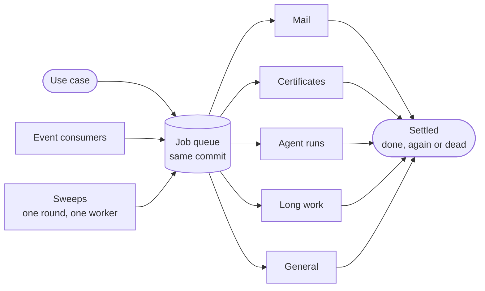
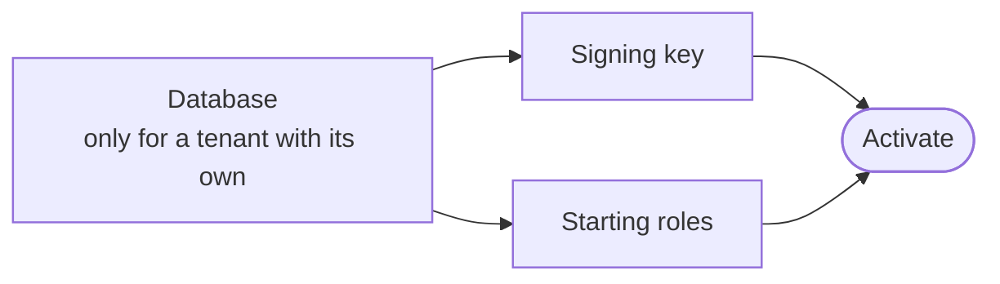
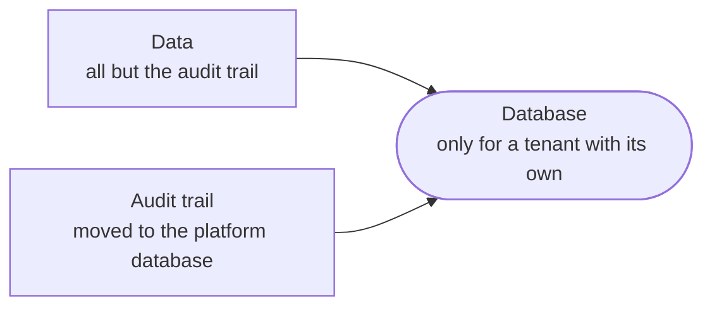

Everything the platform does after a request has answered runs in the worker, as a **job** or a **sweep**. Their stores are in `src/postgres/scheduling/`; the worker that runs them is in `ianua-server` (see [Server](/ianua/architecture/server/)). There is no in-memory queue.



## The job queue

- **Kept with the change.** A job is queued through the store call of the running unit of work, in the database of the change that asked for it: a tenant's jobs wherever the tenant lives, the jobs of no tenant in the platform database. A change that rolls back leaves no job; one that commits never loses its job.
- **One live job per piece of work.** A key keeps one live job per piece of work, so an event handed out twice, or a sweep run twice, queues it once.
- **Claimed under a lease.** A claim works one database at a time, each in a transaction of its own. It first gives up the lane's jobs whose holder stopped, then locks the due pending jobs, oldest first and at most so many of one tenant's, marks them running and holds them until the lease runs out. Locked rows are skipped by every other claim, so no two workers take one job. Each claim starts from another database, so none waits behind the others. Every call answers within five seconds or fails.
- **Settled once.** A job is settled only by the attempt that claimed it, so a worker that was slow and lost its lease cannot settle it again.
- **Tried again, then dead.** A failed job goes back to pending after the backoff (`JOB_RETRY_BACKOFF_SECONDS`) or the delay its handler asked for. After its last try it ends dead, kept where an operator lists it. A job's status is never stored as "failed": it is pending again or dead in one step.

## Lanes

The worker runs five lanes, so a slow kind of work never holds up another:

| Lane | Runs | Timeout |
| --- | --- | --- |
| Mail | `mail.send` | `JOB_TIMEOUT_SECONDS` |
| Certificates | `domain.provision_tls` | `JOB_TLS_TIMEOUT_SECONDS`, longer than the wait for a DNS proof |
| Agent runs | `agents.drive_run` | The run's lease, worked out from its steps |
| Long work | Tenant setup and teardown steps, clones, imports, audit log exports, sandbox package bundles (`sandbox.build`), code step runs (`workflow.run_code`) | `JOB_LONG_TIMEOUT_SECONDS` |
| General | Everything else: webhooks, signals, back-channel logout, audit streams, message pushes, notification posts, workflow drives and starts, and loop passes taken in or stopped | `JOB_TIMEOUT_SECONDS` |

Each lane claims as many due jobs as it runs at once, no more of one tenant's than its share, runs them together, each held to its timeout, and settles each before it claims again. A round lasts as long as its slowest job, which is why a job that takes minutes has a lane of its own. A lane that found nothing waits for the poll interval. A claimed job is held for its lane's longest timeout and a margin, so a job that ran out of time is settled before another worker may take it, and a job whose worker died is taken again once that hold has passed.

The worker refuses to start when a queued job type has no handler, or two.

## Sweeps

A sweep is work the platform does on a schedule: purging expired records, rotating keys, renewing certificates, ending lapsed trials, expiring invitations and exports, firing scheduled workflows, and the rest. The app fixes each sweep's period, so every worker agrees on it.

- **One round, one worker.** Each worker asks on every tick which sweeps' rounds have come. A claim is a row in the platform database, first insert wins, so a round goes to one worker however many tick, and a worker that restarts within a round does not run it again. Claims older than a week are removed as new ones are made.
- **Held to its period.** Each run is held to its sweep's period, so it never reaches into the next round. A sweep still running here when its next round comes lets that round go: every sweep looks at what is due now, so the next round picks up what this one left.
- **Reconcile.** A reconcile sweep hands out again the work stuck in a state that is not final: agent runs no worker drives, clones left copying, and tenant setups and teardowns that never began or stalled. Each read spans every tenant and is held to ten seconds. It queues their jobs again and never records an event a second time, so the audit trail stays true. A setup or teardown that failed waits for an operator.

## Leases

A lease keeps one worker driving each agent run and each workflow execution. It lives in the platform database whichever database the run lives in. A worker holds a lease under its own id until a moment it names, and extends it while it works. A lease that ran out was left by a worker that stopped, and the next worker that asks takes it over in the same statement, so two never both win it.

## Tenant setup and teardown

Setting up a new tenant takes several steps, and so does tearing down a deleted one. Each step waits for the steps it needs. The domain holds the plan and what is done (the `TenantSetup` and `TenantTeardown` aggregates, both built on one step plan in `shared/model/steps.rs`), and the application runs each step. The code that runs a step as a job, tries it again and fails the run after the last try is shared by both (`use_cases/scheduling/steps.rs`). The infrastructure only keeps each run and carries its steps as jobs. This is not the [workflows](/ianua/domain-contexts/workflows/) a tenant designs for its agents and integrations: those are a feature of the product, kept by their own stores.

The setup:



```rust
/// crates/ianua-domain/src/domains/tenant/setup.rs
let after = match step {
    SetupStep::Database => Vec::new(),
    SetupStep::SigningKey | SetupStep::StartingRoles => database.clone(),
    SetupStep::Activate => before_activation.clone(),
};
```

- **It starts on `tenant.provisioned`.** The setup is saved and each step that can start is queued as a `tenant.setup_step` job.
- **Each step is one job.** Slow work, such as making the database or the key, runs first. Then one unit of work marks the step done, saves the setup, queues the steps now ready and sends the events.
- **A failed step is tried again** by the job queue, up to its attempts. After the last one the setup is marked failed, with the step and the reason.
- **The setup lives in the platform database**, in `tenant_setups`, since it runs before a tenant with its own database has that database.
- **Progress goes to the dashboard live**, one message per finished step.

The teardown starts on `tenant.deleted` and runs as `tenant.teardown_step` jobs the same way:



- **The audit trail is kept.** A tenant with its own database has its trail moved to the platform database before that database goes. See [Audit trail](/ianua/architecture/infrastructure/audit-trail/#moving-with-the-tenant).
- **The teardown lives in the platform database**, in `tenant_teardowns`, since it outlives the tenant's own database.
- **Nothing is left half torn down.** If the deletion was never heard, or a step's job was lost, the reconcile sweep begins the teardown or queues its ready steps again. It never records the deletion a second time.
- **Making and removing a schema.** A tenant that asked for a schema of its own gets one, made and migrated by the database's owner. Its trail so far is copied in and the schema registered in one transaction under the chain lock, then every node is told. On teardown its trail comes back and the schema is forgotten in one transaction, then the schema is dropped. A tenant that asked for an instance or a cluster of its own needs a host this deployment does not make yet, so its database step fails and stays on record.
- **Removing a tenant's data.** Every table with a `tenant_id` column is found in the database's catalog, so a table added later is never forgotten. The trail, the platform's records of the tenant and its queued jobs are left. Tables are emptied in the order their links allow, in one transaction per database. Its files go too; see [Files](/ianua/architecture/infrastructure/files/).

The [configuration reference](/ianua/reference/configuration/#worker) lists the worker's settings.
