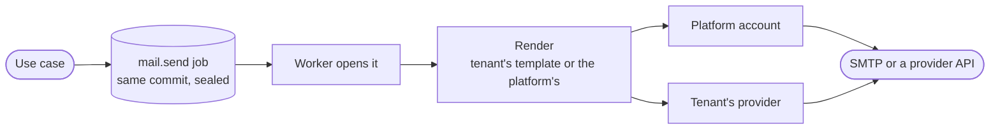

`src/mail/` queues, renders and delivers mail. A mail is never sent from a request: it is a `mail.send` job, kept exactly when the change that asked for it commits, and delivered by the worker.

## Queued with the change

A change that rolls back takes its mail with it, and one that commits never loses its mail: the job is in the same transaction as the change, in the database the change was written to. Its payload is sealed, since the values carry live sign-in and reset links, and read back through the domain's own checks.

The worker's mail lane delivers it, tries it again on the queue's backoff when the provider fails, and gives it up as dead after its last try (`MAIL_DELIVERY_ATTEMPTS`), where it is recorded as undelivered with the reason.

## Rendering

- **Whose template.** The subject, the HTML body and the text body each come from the tenant's own part when it wrote one, else from the platform's, kept as files under `templates/mail/`.
- **Values are data.** The template engine never reads a value as template code, so `{{ 7 * 7 }}` in a name is sent as written, and every value in an HTML body is escaped, so markup in a name is shown, not run. An undefined value fails the render rather than leaving a gap.
- **Names filled once.** The tenant's and its organization's names are filled in by the worker, once, so no use case can leave them out.
- **The logo.** Mail clients strip embedded images, so the platform's logo is fetched by address. It is `templates/mail/assets/email-logo.png`, built into the server and served at `/email-logo.png`, kept for a week. `EMAIL_LOGO_URL` tells mail where to find it.
- **Previews.** A tenant's template can be previewed filled with obvious samples and a link to a host that never resolves, so a preview never carries a link that works.

## Delivery

| Provider | How |
| --- | --- |
| SMTP | Over TLS, within a time limit. A tenant's server is a name the tenant chose, so it is resolved again on every delivery and only an address the deployment may reach is dialled; the certificate is still checked against the name. |
| SendGrid | One JSON request, the key as a bearer token. |
| Postmark | One JSON request, the server token in its own header, on the transactional stream. |
| Mailgun | A form posted to the sending domain, in the account's region. |
| Amazon SES | Its v2 API, signed with AWS Signature Version 4. |

The providers' hosts are the platform's choice, so each API is called through the fixed client, never following a redirect and held to the delivery's timeout. A provider that refuses a mail is answered by its status alone: what it wrote back may repeat the mail or the key, so it is never read into an error or a log. A tenant's credentials are opened from their sealed form for one delivery and dropped after it.

**Who it is from.** A tenant's own name is shown only beside the tenant's own address. Under the platform's address, a name such as "Your bank" would borrow the platform's standing.

## Codes and exports

- **Second-factor codes by mail** are queued in the sign-in's own unit of work, in the person's language. A code to be texted is refused here: texts go out through [SMS](/ianua/architecture/infrastructure/sms/).
- **A data export ready** mail says until when the copy can be downloaded, and holds no link that downloads it.

## A deployment with no mail server

A deployment may run with no mail server: `EMAIL_PROVIDER=none`. Then nothing that can only finish by mail is offered: a sign-in from a new device asks the person to set up an authenticator app instead of confirming by email, and the flows that would wait for a mail are refused with a clear reason. The [configuration reference](/ianua/reference/configuration/) lists what such a deployment cannot offer.
