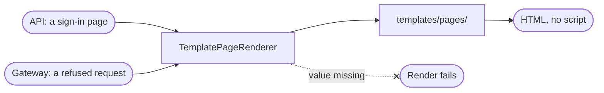

`src/pages/` draws the pages the gateway shows a person in a browser: the sign-in pages on an app's own domain, and the page for a request the gateway refused or could not carry. `TemplatePageRenderer` fills the application's `PageRenderer` port. It makes no call out and holds no connection.

## Templates

The pages are files under `templates/pages/`, built into the binary:

| File | What it draws |
| --- | --- |
| `layout.html` | The frame every page shares: the card, the colours, the logo. |
| `sign_in/*.html` | One page per sign-in step: log in, sign up, the second factor, forgot password, reset password, change password. `parts.html` holds the fields, the button and the notes. |
| `error.html` | The error page: the status, a title, one line of what to do, and the request's reference. |
| `error_texts.html` | The title and the line for each kind of error. |

The application decides what a page says and offers. The templates hold the words.

## The rules

The engine and its rules are the same as for [mail](/ianua/architecture/infrastructure/mail/):

- Every value is escaped, so markup in a workspace's name is shown as text.
- A value is never read as template code. `{{ 7 * 7 }}` in a name shows as written.
- A value the template needs and was not given fails the render. Nothing goes out with a gap.
- No template holds a script. The login page only names the gateway's passkey script by its address, `/.ianua/passkey.js`. The gateway serves that file itself, and the login page's policy allows it alone. Every other page runs no script.

The tenant's colours reach the CSS only as checked hex colours, so nothing else can be written into the style element. Button text is dark or light, whichever reads better on the tenant's colour. The tenant's own CSS is the sanitized form, with every `<` escaped for CSS, so it cannot close its style element. Without a tenant look, a page wears the platform's colours.

An error page never says why a request was refused. It shows the kind of trouble and the request's reference, which an administrator can look up in the logs.
