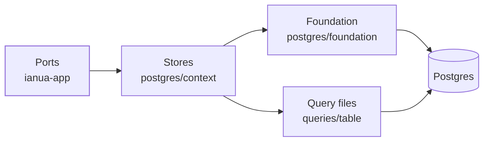
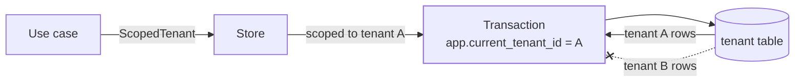

Every tenant's records are kept in Postgres. The stores of each context sit in `src/postgres/<context>/`, in a folder named after the app's ports of that context. What every store stands on is in `src/postgres/foundation/`.



## The foundation

| File | What it does |
| --- | --- |
| `unit.rs` | The unit of work, and the one way a store reaches the database: `scoped`. |
| `security.rs` | Which rows a connection may see, set by row-level security at the start of every call. |
| `pool.rs` | Where a tenant's rows live: the platform database, or one of its own. |
| `roles.rs` | The roles the platform connects as: the owner for migrations, `ianua_app` for the app, `ianua_audit_purge` for the retention purge, `ianua_gateway` for the gateway, `ianua_nameserver` for the nameservers. |
| `migrations.rs` | The schema, brought up to date at start from the files in `migrations/`. A migration already applied that has since changed stops the start. |
| `paging/` | Keyset paging, filters shaped as trees, and SCIM's one list by position. |
| `stored.rs` | Choices stored as words, each with one table of its words, so writing and reading can never disagree. |
| `envelope.rs` | Values made of many parts, kept as one JSON column in a versioned envelope. |
| `errors.rs` | What a database failure means to the domain. |
| `audit_chain.rs` | The locks and seals that keep a tenant's [audit chain](/ianua/architecture/infrastructure/audit-trail/) whole. |
| `leases.rs` | The leases that keep one worker driving each agent run and workflow execution. |
| `tenant_databases/` | A tenant's own schema made and dropped, its trail handed in and back, and its rows removed. |

## Stores

A store implements one port, and only does persistence. Each one has the same three parts, so a store written later reads like the first:

```
postgres/tenant/
  tenants.rs          PgTenantStore: the port's methods, a few lines each
  tenants/record.rs   the row as read and as written, and the mapping
  tenants/words.rs    the words each choice is stored as
queries/tenants/      by_ids.sql, by_slug_in_organization.sql, save.sql, …
```

**The SQL lives in files.** Each query is a `.sql` file the store names with `sqlx::query_file_as!`, which checks the SQL, the column names and their types against the real schema when the code is compiled:

```rust
/// crates/ianua-infra/src/postgres/tenant/tenants.rs
async fn records_of(
    connection: &mut PgConnection,
    ids: &[Uuid],
) -> Result<Vec<TenantRecord>, sqlx::Error> {
    sqlx::query_file_as!(TenantRecord, "queries/tenants/by_ids.sql", ids)
        .fetch_all(connection)
        .await
}
```

**The mapping lives in one place.** `record.rs` turns the record into the aggregate through the `reconstitute` door the [domain](/ianua/architecture/domain/#coming-back-from-the-database) keeps for this, and turns the aggregate into the columns it is written to:

```rust
/// crates/ianua-infra/src/postgres/tenant/tenants/record.rs
Tenant::reconstitute(TenantRow {
    id: TenantId::from_uuid(self.id),
    slug: TENANT.value("slug", TenantSlug::new(self.slug, &limits.slug))?,
    status: TENANT.choice(&self.status)?,
    compliance: COMPLIANCE.open(self.compliance)?,
    // …
})
```

`reconstitute` checks the row against the aggregate's rules and can refuse it. A stored value that no longer passes its own rules, or a word ianua never wrote, comes back as `DomainError::Infrastructure` too. The caller did nothing wrong; the stored data is damaged, and saying "invalid input" would point at the wrong person. A damaged row is refused, never repaired.

**Every column is written and read back.** The compiler holds the record to the aggregate: the record must fill every field of the row, and a field nothing uses is dead code. What it cannot see is the SQL. A house rule in `ianua-audit` reads the migrations and every query, in its file or built in a store's code, and refuses a column a query writes and no query reads back, one queries read and nothing writes (unless its default fills it), and one no query names. A column kept only for an operator reading the table says why in a comment on its definition: `-- not read by the app: <why>`. Pat adds "remind at" to a pending sign-in and writes it in the save query but forgets the select: the build names the column and the query that writes it. `ianua-audit fields <table>` shows each column of a table with the record field it is read into and the queries that write and read it.

A count kept beside rows it counts is read back and checked against them. An import of accounts keeps how many records it was sent, so an import whose record rows went missing is refused as damaged instead of read back shorter.

**Plain values are columns; a value made of many parts is one JSON column.** It is stored as `{"v": 1, "value": …}`, with the shape it was written in. A test pins the shape each column writes today, so when the domain changes how it writes a value, that test fails, the column's shape goes up, and a step that reads the old shape is added.

**A list reads ids first.** The paging helper builds the one query written at run time: the ids of one page, seeking past the cursor on an index, never by `OFFSET`. The rows of those ids are then read with the same checked query that reads one row, so every row is read and mapped the same way. A filter a caller builds, such as a SCIM directory's `userName sw "ann" or externalId eq "42"`, is built as plain data first and only then written out as SQL: every condition is text the store chose from a closed list, and every value is bound. SCIM is the one list read by position, as its standard asks, with the start capped so no request makes Postgres read and throw away more than that many rows.

**Derived data is never stored twice.** The tenants an organization holds are counted from the tenants table, by one checked query each time they are asked for, not kept on the organization's row.

**Database errors are read by their constraint.** Every Postgres error reaches the domain as `DomainError::Infrastructure`, with the error kept as its cause. The few a store turns into a refusal, such as a name already taken, are read by the constraint's name, never by the text of the message.

## Row-level security on every call

A store never holds a connection. Every call goes through `scoped`, which joins the request's unit of work or opens a short transaction of its own, and sets which rows the transaction may see before the store's query runs:

```rust
/// crates/ianua-infra/src/postgres/organization/tenant_access/tenant_grants.rs
scoped(&self.databases, RowScope::Tenant(*tenant_id), async |connection| {
    sqlx::query_file_as!(GrantRecord, "queries/org_tenant_grants/of_member_in_tenant.sql", …)
        .fetch_all(connection)
        .await
})
```

A unit started inside a running one is nested: it writes after savepoints of its own and, when it fails on any error, its writes are undone alone while the outer unit goes on. Work kept together inside a request is all or nothing whatever the request answers. Nested units of one task run one after another or one inside another; one started beside another, or a store call beside a running nested unit, is refused. A store taking a transaction-level lock takes it through `scoped_holding`, and the unit commits that transaction after the ones holding the writes it guards, so a waiter on the lock always sees them, across a tenant's own database too.

Each tenant table has a row-level security policy that shows a row only when its `tenant_id` is the tenant the transaction was given, or when the transaction was opened for platform work that spans tenants on purpose. The setting is made inside the transaction and lapses with it, so a pooled connection never carries one tenant's scope to the next borrower. The queries still write `tenant_id = $2`, but if one ever forgets, Postgres refuses the other tenants' rows anyway.



The policies do not apply to a superuser or to a table's owner, so the app has a role of its own, `ianua_app`, made by `ensure_roles`: it owns nothing and cannot bypass row-level security. The retention purge has a second role, `ianua_audit_purge`, made by the same call. The gateway, which faces the internet, has a third, `ianua_gateway`, made where a gateway is deployed: it reads the configuration it serves, the public half of the signing keys and, of each remembered device, only whose it is and whether it is still trusted (never the digest of its secret), adds its request and stream records and the events of its [inbox](/ianua/architecture/infrastructure/events/#the-gateways-inbox), and changes only the few columns its checks mark (when an app session was last used, an approval spent, an agent's exposure raised). It holds nothing on the audit trail or the outbox and changes no configuration. The nameservers, which answer anyone over UDP, have a fourth, `ianua_nameserver`, made where they are deployed: it reads the zones tenants delegated to us, their records, and of each claim on a name only who holds it and whether it was proved. It writes nothing and reads no other table. A tenant's own schema gives each role what it holds in the platform's tables; the zones live in the platform's database alone. Migrations run as the owner; the store tests connect as `ianua_app`, the purge's tests as `ianua_audit_purge`, the gateway's as `ianua_gateway`, and the zone reader's as `ianua_nameserver`.

**No logic lives in the database.** No migration makes a function, a procedure, a trigger or a rule, and a convention test fails the build if one does. Each policy writes its check out in full. Everything else is plain SQL run from Rust, in one transaction where it must be atomic.

## Tenants in databases of their own

`Databases` knows which database each tenant's rows live in. Most tenants live in the platform database. For now the one database of its own the platform builds is a schema of the platform's database, named after the tenant and recorded in `tenant_databases`. Every node loads those routes at start, follows the word another node broadcasts when one changes, and reloads them now and then.

A schema of its own has its name fixed in the connection settings, with `public` after it for the extensions such as `pg_trgm`, never set per call, so a reused connection cannot point at the previous tenant's schema. Making a schema and running the migrations in it is the owner's work; the app's role only reads and writes its rows. The trail reads the registry before it adds a record in the platform database, so a node that has not heard of a move yet is refused instead of splitting the tenant's chain.

A value that belongs to the whole deployment, not to one tenant, is claimed in the platform database whichever database the tenant lives in: the port a stream route listens on, and the hostname a tenant registers. A unique index on the tenants' own rows could not keep it unique, since a tenant with a database of its own keeps them there. The claim on a hostname is also where the questions asked with no tenant in hand start: the proxy and the sweeps read the claim, then the registration from the tenant's database. The certificates a domain serves are kept beside its claim, so a domain handed to another tenant keeps them. Sweeps that read every tenant's rows run one query on the platform database and one on each database of its own.

When a tenant is deleted, every table with a `tenant_id` column is found in the database's catalog, so a table added later is never forgotten. The trail, the platform's records of the tenant and its queued jobs are left. Tables are emptied in the order their links allow, in one transaction per database.

## Writes that race

A check and the write it allows run in the request's unit of work, and where two requests at once could both pass the check, under a lock that holds until the unit commits:

- **Hostnames.** Claiming a hostname takes a lock on its registrable domain, which every name that can overlap it shares, so `acme.com` and `login.acme.com` claimed at the same moment are checked one after the other and exactly one wins. Whether another tenant's claim still holds its name is read from the claim itself: when it was made, whether it is proved, and when its proof was lost.
- **Who holds what.** A grant checked against the tenant's separation-of-duties rules, a group move checked for loops, and a change that could take away the last administrator first hold the tenant's grants, and read them after.
- **Counts.** A count taken before a creation holds the tenant's counts, so two creations at the same moment are counted one after the other.
- **Agents and running workflows.** They are saved only over the version they were read at, and every save moves the version on. A save that lost the race is refused with `409 Conflict`, so a fleet stop, a containment or an approval is never undone by an older copy.
- **Workloads.** One workload identity is bound to one agent, held by a key in `agent_workloads`.
- **Holds that ran out.** A role or group place whose end has come counts as held by nobody, even before the sweep clears it. Given again, the old hold is cleared first and its end recorded as the sweep records it, and the sweep only removes a hold still run out, so each end is recorded once.
- **Events acted on once.** A worker check that reacts to an event, such as the agent drift check, notes the event in the same unit of work as everything it changes, so an event the bus hands out twice is judged once.

## Tests

Store tests run real SQL against a real Postgres, connected as `ianua_app`, so row-level security holds the test exactly as it holds a deployment. See [Testing adapters](/ianua/architecture/infrastructure/#testing-adapters).

Two more kinds of test keep the stores honest:

- **Convention tests** read the source and the migrations: every tenant table is under row-level security, no migration keeps logic in the database, every table has a primary key, the migrations run in one sequence, every query names its columns and pages by key, no SQL is written inside a store, every query file is used, every store keeps its mapping in `record.rs`, and every JSON column has its shape pinned.
- **The plan test** asks Postgres how it would run every query file, with whole-table scans made a last resort. A query that still reads a whole table has no index it can use, and the test names the query and the table.
- **The schema check** (`ianua-schema check`) builds a database from `migrations/` and one from `schema/`, the database as it should be, and fails when they differ, for the platform and for a tenant's own database. A released migration, recorded in `released-migrations.lock`, is never edited or removed. See [Changing the database schema](/ianua/contributing/changing-the-schema/).
