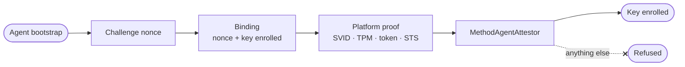

`src/proofs/` checks the proofs a caller presents of what it is: a workload agent's platform attestation, and a person's passkey. Each adapter checks one kind of proof against what the deployment trusts, with the algorithm taken from the trusted key and never from the proof, and refuses anything missing, unreadable or failing. Names lead with the platform or standard the proof follows.

## Platform attestation

An agent proves where it runs without a stored secret. Each attestor checks one method and refuses every other, and `MethodAgentAttestor` hands a presentation to the one registered for its method, refusing a method nobody registered.

**The binding.** A token or a quote proves where it was made, not who presents it. Whoever sees one before it is used could present it with a key of their own and be enrolled in the workload's place. So the value a proof must carry is not the nonce alone but the **binding** of the platform's challenge nonce and the key being enrolled. Every method checks for that binding.

| Method | Proof | Taken when |
| --- | --- | --- |
| SPIFFE | An X.509-SVID, leaf first | The leaf names exactly one well-formed `spiffe://` id, is no certificate authority, and chains to the trust domain's bundle. |
| TPM 2.0 | A quote signed by the chip's attestation key, with its certificate chain | The chain holds to an anchor the deployment trusts and the quote carries the binding. |
| GCP | An instance identity token, requested with `format=full` and the binding as its audience | It is signed RS256 by a key Google publishes, whatever its header says, and is from Google. |
| Workload tokens | A JWT from a Kubernetes cluster, GitHub Actions or another trusted OIDC issuer | Its audience is the binding in lower-case hex and nothing else, and it is signed by the issuer's published keys, including ECDSA on P-384 and P-521. |
| AWS IAM | An `sts:GetCallerIdentity` request the workload signed with its role, as HashiCorp Vault's AWS method proves it | The request is one worth sending (its scope, signed headers and date), it is sent to an allow-listed STS endpoint through the fixed client, and AWS answers with the role's ARN. The platform never sees the role's secret key. |

**Certificates** an attestation presents are held to their validity and chained link by link to the anchors the deployment trusts. Every certificate past the leaf must be an authority allowed to sign at its depth, and one carrying a critical extension nobody checks is refused.

**Published keys** are read for each issuer once and kept for a while: from an address the platform configured, such as Google's, or from a trusted issuer's OpenID Connect discovery document, whose `issuer` must be exactly the issuer it was read for.

**Signatures** are checked by the scheme the key gives: a P-256 key checks ECDSA with SHA-256, an RSA key PKCS#1 v1.5 with SHA-256, an Ed25519 key its own signatures. A key of any other kind, or an RSA key under 2048 bits, checks nothing.

**A service's name.** The egress gateway names the service behind a verified client certificate the way an SVID is read: its one SPIFFE ID, or else `sha256:` and the certificate's fingerprint (`service_named_by`).

## The runner's own proofs

`runner.rs` holds the proofs the [runner](/ianua/architecture/runner/) beside an agent's sandbox makes, the other side of the checks above.

- **A proof of possession** (`JwsRunnerProofs`) for each request to the gateway, typed `dpop+jwt`, carrying the key's public half, the method, the address the gateway sees, a fresh id and the hash of the token it is sent with. It checks with the same `DPoP` reading the gateway uses.
- **The assertion** a task token is exchanged with, naming the agent as issuer and subject and the token endpoint as audience, good for a minute and checked as the exchange checks it.
- **The SVID's signature** over an attestation's binding: DER for a P-256 key, the raw 64 bytes for Ed25519, as the SPIFFE attestor reads it.
- **A mounted key** (`MountedRunnerKeys`), refused at start unless it is a P-256 or Ed25519 key: the platform's own RSA keys never make a proof.

## Passkeys

Passkeys are checked through WebAuthn by `webauthn-rs` (`passkeys/`).

- **Two halves.** A started ceremony comes back in two halves kept apart: the options the browser needs, and the state its answer is checked against, which never leaves the server.
- **A sealed state.** The state is sealed with an HMAC under a key derived for this use alone, over the ceremony's kind and the state, so only a state this server made, for that kind of ceremony, is ever used. Whoever could hand one in could otherwise pick what their own answer is checked by.
- **A decoy for unknown addresses.** A sign-in challenge for an address with no passkey lists one credential id worked out from the address under a key only the server holds. The same address gets the same id every time, as a real account would, so the challenge says nothing about which addresses have accounts.
