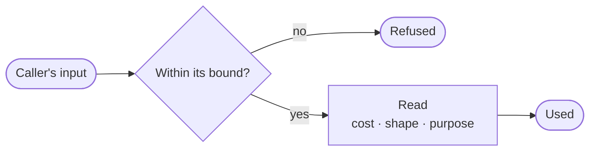

Three folders read things the platform did not write, and make no call out to do it: `src/reading/`, `src/css/` and `src/bundled/`.

## Every reader is bounded

Each reads a tenant's or a caller's input, so each is bounded: a body past its size, a query nested past what the parser may recurse, a schema reaching outside itself, or a purpose the embeddings service does not read in time is refused, never passed through unread.

## What is read

| File | What it reads |
| --- | --- |
| `graphql.rs` | A GraphQL request body, into the depth, cost and fingerprint the gateway's rules work on. Anything but one query, a batch included, is refused: costing is the whole control, and a body the gateway cannot cost must not pass uncosted. |
| `messages.rs` | An agent message, held to its topic's JSON Schema and rewritten to one canonical form: keys sorted, no insignificant whitespace, numbers as parsed, so two messages that mean the same leave as the same bytes. The schema is the tenant's, so it is compiled offline: a reference to anything outside the schema fails to compile rather than making the platform reach out. |
| `intent/` | What an agent's declared purpose allows. A statement such as "read the orders ledger and email a summary" is turned into the action classes it implies, and the requested capabilities narrowed to what those classes can use. It runs once, when the grant is made. |
| `xml.rs` | How deep an XML document nests, read from its raw text before any parser sees it, since a parser that descends one call per level can be taken down by a document nested deep enough. Every SAML message and every cloud answer in XML passes here first. |

**Reading a purpose.** With an embeddings endpoint set up, the compiler reads a statement by meaning: it asks for vectors of the statement and of example phrasings of each action class in one call, and takes every class whose closest example is near enough. Without one, it reads keywords, counting a keyword only as a whole word or one of its plain forms ("deleted", "notifies", "dropping"), never inside another word, so "already" never reads as reading and "william" never as administering. Nor does it count one where one of the two words before it turns it around, so "never delete" never reads as deleting. Either way a statement only ever reads as less than it says, never more, and one no class reaches gets read-only access. Each statement is fingerprinted with a 256-bit SimHash, so a drift monitor can tell a reworded purpose from a new one.

## A tenant's CSS

`css/` makes a tenant's custom CSS safe to place in a page (`AllowListCssSanitizer`). The stylesheet is read the way a browser reads it, tokens first and rules from them, both following the CSS Syntax Module Level 3, and written back through an allow-list.

- **Nothing is copied.** Each kept selector, property and value is written again from its tokens, so a comment, an escape, a string, an at-rule or a `url()` is never written at all: there is no way to spell one that survives.
- **Brackets match by kind.** Blocks are matched by their own kind of bracket, as a browser matches them, so a stray `}` inside a function or a string cannot end a rule early.
- **No recursion.** A stylesheet nested a thousand blocks deep is read like any other.

## Lists in the build

`bundled/` holds reference lists that ship inside the binary. Each answers from memory, so a check makes no call out and cannot hang; a newer list arrives with a newer build.

- **Common passwords** (`BundledCommonPasswordList`): about 38,000 passwords a new password may not be, read once into a set and compared case-folded.
- **Sites** (`BundledSiteRules`): which hosts are on one site, by the public suffix list. A name the list cannot place is on no site, so two such names are never taken for one site.
