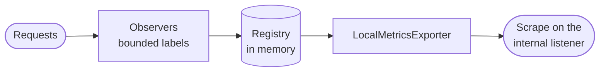

`src/runtime/` holds what runs inside one process. Its adapters start with `Local`.

| Adapter | What it does |
| --- | --- |
| `LocalJobTimer` | The timer a job is bounded by: the process's own clock. |
| `LocalSignInPause` | The wait a password check is held to while its account is guessed at from many networks: the process's own clock. The domain caps the wait at 3 seconds. |
| `LocalPasswordHashPermits` | The cap on password hashes running at once on this node: a bounded semaphore sized from the deployment's settings. A sign-in waits a short, fixed bound for a place and is then answered busy, so no queue of waiting sign-ins builds up behind it. |
| `LocalTimeZones` | The wall clock in a tenant's time zone, read from the time zone rules bundled into the binary, so a zone means the same on every node whatever the host has installed. |
| `LocalRequestObserver` | Proxied requests: `ianua_proxy_requests_total` by tenant, route, method, status class and outcome; a latency histogram by tenant and route; and refusals by the check that refused them. |
| `LocalServedRequestObserver` | The API's own requests: `ianua_api_requests_total` by route template, method and status class, and their latency. |
| `LocalMetricsExporter` | Writes the registry out in the Prometheus text format for the scrape on the internal listener. Nothing is pushed anywhere and nothing is called out, so a scrape can neither slow a request nor fail one. |

## Bounded labels

A metrics store is brought down by its number of series long before it is brought down by volume, and a label value a client can choose is a series a client can open. The rules are in one place, `series.rs`:

- an unknown method becomes `other`;
- a status becomes its class;
- no user, raw path, client address or denial reason is ever a label;
- past a cap of label combinations, traffic is counted under one `overflow` series, so totals stay right.
