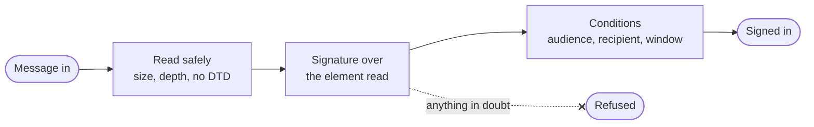

`src/saml/` speaks SAML both ways: as a connection's **service provider**, checking the answers its identity provider sends and writing the requests and metadata it sends; and as a tenant's **identity provider**, signing and sealing assertions for its apps and reading what those apps send.

## What is signed is what is read

Every message is read from its parsed tree, by namespace and name, and its signature checked over the very element read, so a signed element cannot be wrapped, moved or copied beside a forged one. Anything in doubt is refused.

- **Reading safely.** A message is decoded within a size and parsed with no DTD and a bound on its nodes and depth, after its raw text was checked for depth ([Reading input](/ianua/architecture/infrastructure/reading/)). One holding comments or processing instructions, or naming one `ID` twice, is refused. Elements are found by namespace and name, never by name alone.
- **Signatures.** A signature is taken only as a direct child of the element it signs, referring to that element by its own `ID`, with exactly the transforms SAML signs with (enveloped, then exclusive canonicalization). The digest is computed over that very element in the parsed tree, its signature left out by node, never by searching the text.
- **Algorithms from a list.** RSA with SHA-256 or SHA-512, ECDSA on P-256 with SHA-256, and Ed25519; SHA-1 is refused everywhere. A key comes from a certificate the connection or the app registered, never from the message.

## As a service provider

- **Requests** go out by HTTP-Redirect, signed on the query when the connection says so, each with a fresh random id that also rides along as the `RelayState`.
- **Metadata** asks for signed assertions and lists only the ciphers the platform opens sealed assertions with.
- **A provider's metadata** is fetched from the address an admin chose through the screened client, held to a few seconds and a megabyte, and refreshed by a sweep every six hours. One reader serves the API and the worker: it looks names up through the resolvers `DNS_RESOLVERS` names, or the host's, and trusts `SAML_METADATA_CA_FILE` instead of the public roots when that is set.
- **An answer** is refused unless it holds: posted where it arrived, answering the request sent, carrying exactly one assertion in the one place a response carries it, covered by a signature from a certificate the connection takes. The assertion's own audience, recipient and answered request bind it: the response around it may be unsigned, so its `Destination` and `InResponseTo` bind nothing.
- **Sealed assertions** (XML Encryption) are opened with aws-lc-rs. The content is AES-GCM, so a changed ciphertext fails to open; AES-CBC is refused, since its padding errors let an attacker decrypt a captured assertion piece by piece. The content key travels sealed with RSA-OAEP.

## As an identity provider

- **Signing.** Documents are signed with the tenant's key, an enveloped signature on the root right after its `Issuer`, naming the key by its id. The key itself is published in the metadata, never sent along.
- **Certificates.** The signing certificate is self-signed by the tenant's key under a serial number taken from the key, so metadata fetched twice names one certificate.
- **Name ids.** The pairwise id is an HMAC-SHA256 of the app's id and the account's id under a key the control plane's root derives for this use alone: the same for one person at one app every time, unlinkable across apps, and needing no table. The transient id is fresh at every sign-in.
- **Messages from apps.** An app's sign-in request and single logout messages are read by the binding they came on: a signature inside the XML for a posted form, on the query for a redirect, where the signed text is the parameters exactly as they travelled. A signature that does not verify is refused outright.
