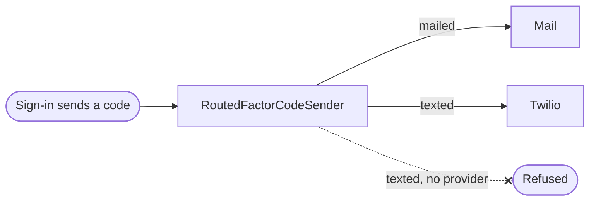

`src/sms/` texts second-factor codes to the number a factor was set up with, through the platform's own provider account. The provider is the platform's, named in configuration; no tenant chooses one of its own.

## One sender

`RoutedFactorCodeSender` is the one sender the sign-in holds: a mailed code goes to the mail sender and a texted code to the text sender. A deployment with no text provider set up has no text sender, so a code to be texted is refused rather than reported as sent, and a texted factor cannot be set up or offered.

## Twilio

Codes go out through Twilio's Programmable Messaging API, one call per code: `POST https://api.twilio.com/2010-04-01/Accounts/{AccountSid}/Messages.json`, form encoded, with `To`, `Body`, and either `From` (a number the account holds) or `MessagingServiceSid`. The account signs in with its auth token or with an API key.

- The call waits at most five seconds and never follows a redirect.
- A refusal is judged by its status alone; what Twilio wrote back is never read.
- No code, phone number or credential is logged or written into an error.

The settings are `TWILIO_*`, listed in the [configuration reference](/ianua/reference/configuration/). A partial set, or two ways to sign in, is refused at start.
