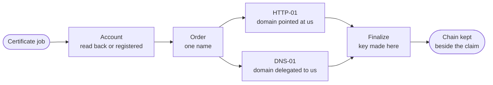

`src/tls/` gets TLS certificates for the hostnames tenants bring. The worker orders them as `domain.provision_tls` jobs on a lane of its own, and renews them before they run out.

## Where certificates come from

| Setting | Certificates |
| --- | --- |
| `ACME_DIRECTORY_URL` | Ordered from that ACME authority, such as Let's Encrypt. |
| `TLS_TERMINATED_UPSTREAM=true` | Signed by the platform itself, because a load balancer in front of the gateway holds the real certificates and browsers never see these. |
| Neither, in development | Signed by the platform itself, so the TLS path works end to end where no authority can reach the machine. Browsers warn on these. |
| Neither, in production | Custom domains require uploaded certificates. Platform addresses stay off unless the operator supplies a wildcard for the flat shape. |

Both settings at once are refused too: certificates are either ordered here or met in front of the gateway.

## An order

`AcmeTlsProvisioner` places one order per certificate:

1. **The account** held with the authority is read back, or registered and kept when there is none. Authorities rate-limit registration, so a process registering afresh on every start would work until it restarted often enough to be refused.
2. **The order** is placed for the custom name, or for a platform root and its wildcard together.
3. **Each authorization is proved** the way the domain is reached (below).
4. **The order is finalized** with a key made here, and the chain collected.
5. **Every proof published is withdrawn**, whatever the order did.

Each call to the authority is held to a time, each poll to a time, and the whole order to a few minutes, so a stalled authority never holds the certificate job for ever. The ACME client reaches the authority over the platform's fixed client, rather than the library's own unbounded one.

## Proving control

| Proof | Used for | How |
| --- | --- | --- |
| HTTP-01 | A domain the tenant points at us | A token at a well-known URL on the hostname itself, so only what already serves the hostname, the gateway, can answer. It reads the challenge from the same store the provisioner writes, so it is visible at once. It cannot prove a wildcard. |
| DNS-01 | A domain delegated to us | A token in the hostname's DNS, written into the zone of the tenant that registered that hostname and nowhere else. The provisioner waits, bounded by `ACME_DNS_PROPAGATION_TIMEOUT_SECONDS`, until a resolver sees it, since asking the authority to check a proof that is not there yet spends one of a few validation attempts. |

DNS-01 proofs are added and withdrawn one value at a time under a lock on the zone, so two orders proving one name keep each other's proof. A wildcard's proof goes into its parent's zone, which the same tenant must hold.

The certificate job's timeout, `JOB_TLS_TIMEOUT_SECONDS`, must be longer than that DNS wait; a worker refuses to start otherwise.

Nested platform certificates use DNS-01 through the bundled authoritative nameserver. The worker keeps separate leased orders for the random root and, when enabled, the readable root. It renews them before expiry and keeps the current certificate while a renewal is pending. Proof values expire and are removed individually, so the root and wildcard authorizations can coexist. Disabled readable names and closed tenants are excluded from the DNS and certificate catalogs immediately on their next refresh.

Self-hosted flat addresses use one operator-managed wildcard instead. The bundled nameserver is optional and off by default. A private ACME authority supports nested addresses through `ACME_DIRECTORY_URL` when it can reach the delegated nameserver.

## Uploaded certificates

A tenant may upload its own certificate chain for a domain instead. It is read in [Cryptography](/ianua/architecture/infrastructure/crypto/#certificates): the private key is read only to check it matches the leaf, and is kept nowhere.
