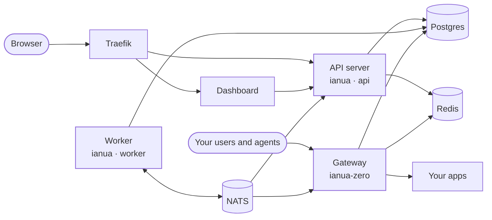
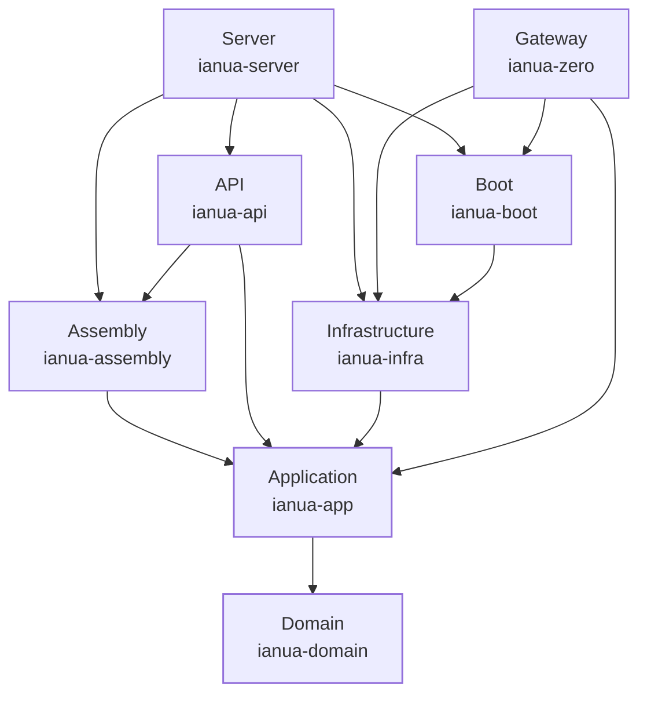

This section explains how ianua is built. This page gives the whole picture; each page after it takes one layer of the code and shows what lives there, with real examples from the source.

## What runs

An installation is a small number of processes around one Postgres database.

| Process | What it does |
| --- | --- |
| **API server** (`ianua`, `MODE=api`) | Everything the dashboard and your scripts call: sign-in, users, tenants, routes, agents, the OAuth and OIDC endpoints, SAML, SCIM. Also serves the LDAP directory when it is enabled. |
| **Worker** (`ianua`, `MODE=worker`) | Work that should not hold up a request: relaying events to NATS, sending email and webhooks, setting tenants up and tearing them down, renewing certificates, checking domains, carrying out erasure requests, verifying the audit chain, and driving agent runs. Its jobs are queued in Postgres. |
| **Gateway** (`ianua-zero`) | Sits in front of your apps. Works out which tenant a request is for from its hostname, runs that tenant's pipeline (who is calling, are they allowed), and forwards the request or turns it away. |
| **Dashboard** | The web interface. It only talks to the API; it has no database access of its own. |
| **Postgres** | Everything ianua keeps: users, tenants, routes, keys, the audit log. |
| **NATS** | Carries events between the processes, so a change made through the API reaches the gateway and the worker within moments. |
| **Redis** | The cache every node shares: rate limit counts, agent budgets, cache versions and spent sign-in puzzles. A single `MODE=all` server may keep them in its own memory instead; once the API and the worker run apart, or share NATS, the server needs it. |
| **Traefik** | Terminates HTTPS and routes the dashboard and API hostnames. Not part of ianua itself. |

For a small installation, `MODE=all` runs the API server and the worker in one process, which is what the Docker Compose setup does. On Kubernetes they run as separate deployments, so each can be scaled on its own.

If you run AI agents, two more processes join in: **[`ianua-runner`](/ianua/architecture/runner/)**, which sits beside an agent's sandbox holding its key so the agent never sees it, and **[`ianua-egress`](/ianua/architecture/egress/)**, which lets the services agents call reach only what their egress policy lists.

## How a change reaches the gateway

The gateway does not ask the API server anything while it handles a request. It keeps what it needs in memory and is told when something changes:

1. An administrator changes a route in the dashboard.
2. The API server saves the change in Postgres, with its event in the same commit. The worker relays the event to NATS.
3. Every gateway instance receives the event and reloads that tenant's routes and pipelines from Postgres.

The request path never waits on the API server, and a change takes effect within moments on every gateway, without a restart.

## The layers

The code is a Rust workspace built in layers, following domain-driven design and the "ports and adapters" (hexagonal) style. One rule holds it together: **dependencies only point inwards.** The domain knows nothing about the application, the application knows nothing about Postgres or HTTP, and every adapter talks only to the layer inside it.

| Layer | Crate | What it holds | Read more |
| --- | --- | --- | --- |
| Domain | `ianua-domain` | The rules: what a user, tenant, route or agent is, and what may happen to it. No database, network or framework code. | [Domain](/ianua/architecture/domain/) |
| Application | `ianua-app` | One use case per action, and the **ports**: the interfaces a use case needs filled from outside. | [Application](/ianua/architecture/application/) |
| Infrastructure | `ianua-infra` | The adapters behind the ports: Postgres, NATS, Redis, email, cryptography, the job queue. | [Infrastructure](/ianua/architecture/infrastructure/) |
| Assembly | `ianua-assembly` | Every use case, built from the adapters the server hands in: the groups the API serves, the LDAP directory's writes and the worker's company actions, so every caller takes them from one place. | [Server](/ianua/architecture/server/) |
| API | `ianua-api` | The HTTP API: handlers, request and response types, and the extractors that say who is calling. What they may do is the application's to decide. | [API](/ianua/architecture/api/) |
| Gateway | `ianua-zero` | The data plane in front of your apps. A binary of its own, with its own small composition root. | [Gateway](/ianua/architecture/gateway/) |
| Runner | `ianua-runner` | Beside an agent's sandbox: holds the agent's key and sends its requests on with a token and a proof. Only a composition root and its listener. | [Runner](/ianua/architecture/runner/) |
| Egress | `ianua-egress` | The only way out for the services agents call: one policy per service, a refusal held against the agent behind it. Only a composition root and its listeners. | [Egress](/ianua/architecture/egress/) |
| Server | `ianua-server` | The composition root of the `ianua` binary: builds every adapter, hands them to the API and the worker, and starts the right process. | [Server](/ianua/architecture/server/) |
| Boot | `ianua-boot` | What every composition root starts from: the settings readers, the logs, the stop signal, and the readers of the database, keys, bus, cache and files, split by role so the gateway never reads the control plane's key. | [Server](/ianua/architecture/server/#configuration) |

A few smaller crates sit beside these: `ianua-ldap` serves the LDAP directory over the same use cases as the HTTP API, `ianua-grpc` and `ianua-proto` are the gRPC face of the control plane and its contract with the data planes, `ianua-dns` answers for the nameservers a tenant delegates a hostname to, `ianua-macros` derives the test fakes of every use case's ports (Rust builds a derive macro only in a crate of its own), `ianua-audit` reads the source and reports where its layers are not connected, and `ianua-scenarios` holds the end-to-end scenarios.

The infrastructure, the server and the gateway are being rebuilt on the current domain, application and API. Their pages say what carries over and what the plan is.
