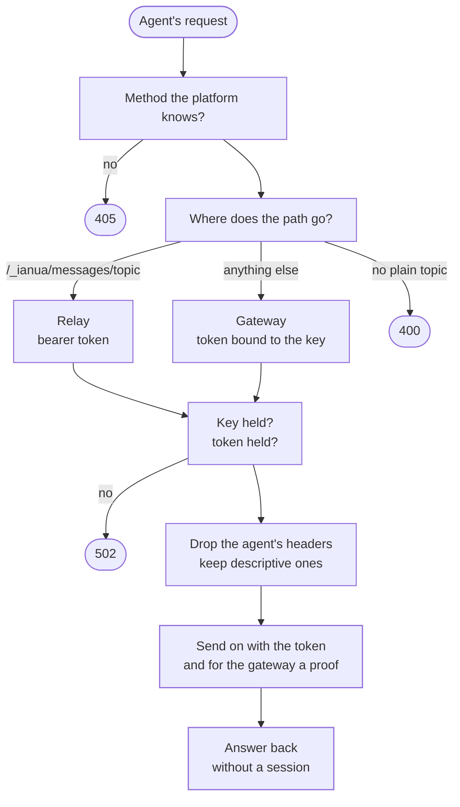

`ianua-runner` is the only way out of an agent's sandbox. The agent runs where nothing routes anywhere but its runner. The runner holds the agent's key and its task tokens, so the agent holds nothing worth taking: no token to copy, no key to steal, no cookie to replay.

One runner serves one agent. A workload that attested for one agent is never let attest for another, so the platform always knows which runner made a call.

## What happens to one request

Ann's agent asks its runner for `GET /reports?month=1`.

1. **The method** must be one the platform knows. `TRACE`, `CONNECT` and anything else are refused with `405`.
2. **The destination.** A path under `/_ianua/messages/` goes to the message relay on the API, for the topic it names. The topic must be a plain topic name, such as `orders.created`: `../../signup` would walk the address out of the relay to another endpoint, so it is refused with `400` before any token is asked for. Every other path goes to the gateway, on the tenant's host.
3. **The key and the token.** The gateway takes a token bound to the agent's key, and every request to it carries a proof of possession (`DPoP`) made for that request alone: its method, the address the gateway sees and the token's hash. A token copied off the wire is worth nothing without the key. The relay has no request a proof could name, so it takes a bearer token. When neither can be had, the request is refused with `502` and nothing leaves.
4. **The headers.** Only descriptive headers cross, on an allowlist: `Content-Type`, `Accept`, `Range`, `Idempotency-Key`, `traceparent` and a few more. The agent's `Authorization`, cookies, a `DPoP` of its own and any header claiming who it is stay behind.
5. **The answer** comes back streamed, without `Set-Cookie`: a session the agent kept would be a credential inside the sandbox.

When the gateway answers `401`, as when Ann revokes the delegation, the runner drops that token and exchanges a new one for the next request, rather than keep sending one that no longer counts.

## Where the key comes from

`RUNNER_IDENTITY` picks one of two:

- **`spiffe`**, the default. The runner makes a key pair in its own memory, asks the API for a challenge, and enrols the public half by attesting its workload: it signs the binding of the platform's nonce and that key with its SPIFFE SVID's key. The binding is what makes a seen SVID worthless to anyone else: a proof made for one key is refused for any other. The key is attested again halfway to its end, and never touches the disk.
- **`key`**, for clusters without SPIRE. A key enrolled on the agent's credential is mounted into the runner. Whoever holds that file can act as the agent from anywhere, so prefer attesting.

Task tokens are exchanged with an assertion the key signs, which lives a minute. A token is exchanged again a fifth of its life early, at most a minute early, and at once when the key changed.

## Layers

| Layer | What it holds |
| --- | --- |
| Domain, `agents::runner` | Where a path goes, which headers cross and which stay behind, what a proof names, when a key and a token are renewed. |
| Application, `agents::runner` | `CredentialUseCase`, what one request carries, and `ForgetUseCase`, dropping a refused token. The ports `RunnerKeys`, `RunnerTokens` and `RunnerProofs`. |
| Infrastructure | `HttpRunnerKeys` (attesting over the API), `MountedRunnerKeys`, `HttpRunnerTokens` (the exchange) and `JwsRunnerProofs` (the proofs). |
| `ianua-runner` | The settings, the adapters built from them, and the listener. |

## Limits

Every request is held to `RUNNER_REQUEST_TIMEOUT_SECONDS`, its answer streamed to the end included, and every attestation and exchange to `RUNNER_CALL_TIMEOUT_SECONDS`. At most `RUNNER_MAX_IN_FLIGHT` requests run at once; one more is answered `503`. At most `RUNNER_MAX_CONNECTIONS` connections are held; one more is closed. The agent's request heads must arrive within `RUNNER_HEADER_TIMEOUT_SECONDS`.

The runner holds no secret of the platform's: no database login, no root and no sealing key. It refuses to start with one, so a runner taken over gives away the one agent it serves and nothing else.

## Starting it

The binary reads its settings, sets up the logs and serves until `SIGTERM`. A test or a scenario starts the same runner in its own process with `ianua_runner::serving(&env, &shutdown)`, which answers with the address it listens on. Every setting is in the [configuration reference](/ianua/reference/configuration/#agent-runner).

On Kubernetes the Helm chart runs each agent listed under `agentSandboxes.agents` in a pod of its own, with its runner in another, and network policies that let the agent reach only its runner and the runner reach only the gateway's runner listener and the API. With Docker Compose, `--profile agents` starts one runner with a mounted key.
