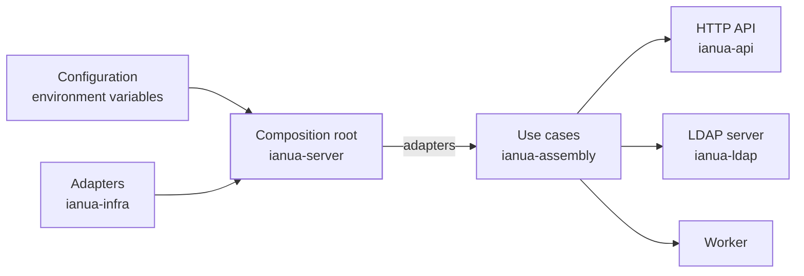

`ianua-server` is the only crate that knows every other one. It is the **composition root**: it reads the configuration, builds each adapter from [infrastructure](/ianua/architecture/infrastructure/), and hands them to the [API](/ianua/architecture/api/), the LDAP directory and the worker, which build the [use cases](/ianua/architecture/application/) from them. Then it starts the process.

Nothing else is allowed to do this. The API crate never builds a Postgres store, and a use case never picks its own adapters. So to find out which implementation of a port is used in production, there is one place to look.

## One binary, several commands

The `ianua` binary runs one command, read from its command line. With none it serves.

| Command | What it does |
| --- | --- |
| `ianua` or `ianua serve` | Serves the API, runs the worker, or both, as `MODE` says, until it is stopped. |
| `ianua migrate` | Brings the schema up to date as the database owner, makes the app's and the audit purge's roles with their grants, the gateway's where `GATEWAY_DATABASE_URL` is set and the nameservers' where `NAMESERVER_DATABASE_URL` is, brings every tenant's own schema up to date, and exits. It reads only the database and logging settings. |
| `ianua install` | Makes a self-hosted installation's organization, its first tenant and its owner from the `INSTALL_*` settings, and exits. It prints a one-time setup token that confirms the owner's address. Refused unless `DEPLOYMENT=self_hosted`. It alone reads `INSTALL_*`; every other command refuses them, so the owner's first password never stays in a server's environment. |
| `ianua operator create --email <address>` | Makes the platform's first operator, signing in with that address and the password `OPERATOR_PASSWORD` holds, and exits. |
| `ianua demo` | Seeds a demonstration organization through the use cases, and exits. The owner's sign-in sets up an authenticator app, whose link the first run prints once. Refused when `APP_ENV` is production. |
| `ianua link-pki --server-name <host> --nameservers <ns1,ns2> --out <folder>` | Issues the private authority, the listener's certificate and one client certificate per nameserver for the link the nameservers outside the cluster follow the zones on, writes them to the folder with the keys readable by their owner alone, prints the settings each end takes, and exits. It reads no setting and builds no platform, and refuses to write over any file, since a new authority would leave every certificate issued under the old one unaccepted. |

The one-off commands build the platform as a server would, do their one task, and stop. Each runs again safely: once what it makes exists, it changes nothing and says so. Installing is an explicit step, never a side effect of the first start.

`MODE` picks what `serve` runs:

| `MODE` | What it runs |
| --- | --- |
| `api` | The public API, the internal listener, the relay listener the gateway asks on `RELAY_PORT` over mutual TLS, and the LDAP directory when `LDAP_BIND_ADDR` is set. |
| `worker` | The worker, and the internal listener for its probes and metrics. |
| `all` | Both in one process. The default, and what the Docker Compose setup uses. |

Running the API and the worker as separate deployments lets you scale each on its own: more API servers for more sign-ins, without also multiplying the background work. A split deployment needs a bus and a cache every node shares (`BUS_URL` and `CACHE_URL`); the server refuses to start one without them.

Every node opens the internal listener on `INTERNAL_PORT`. It answers `GET /health/live`, `GET /health/ready` and the Prometheus metrics at `GET /metrics`, and every node's probes and scrape go there. The public listener serves neither probe, only a `GET /health` that asks no dependency. Ready answers `200` while the database, the bus and the cache all answer.

## Starting up

When the server starts, it:

1. **Reads every setting and checks them together.** A wrong value, a missing one, or two that contradict each other stop it here, with a message naming the setting. The [configuration reference](/ianua/reference/configuration/#start-up-checks) lists the checks.
2. **Logs the names of the settings that were set.** Never their values.
3. **Migrates, or waits.** A process holding the database owner's login (`MIGRATION_DATABASE_URL`: a worker, or one of the one-off commands) brings the schema up to date first, under the migrations' lock. An API node never holds that login, and waits until the schema is current instead.
4. **Checks the audit log is sealed.** In production it refuses to start if the app's role could change or remove an audit record, unless `AUDIT_REQUIRE_SEALED=false` says so on purpose.
5. **Builds the rest of the shared core**, once: the keys, the bus, the cache, the store caches, the file store, the metrics and the providers outside the deployment, such as mail.
6. **Starts what every node runs**: the follower that drops store cache entries other nodes' events changed, and the one keeping this node's routes to tenants' own databases.
7. **Starts the halves `MODE` names**: the API's listeners and the LDAP directory, then the worker. A half that cannot start stops what started before it.

Each check fails loudly at start-up rather than quietly at the first request.

## The worker

The worker runs work that should not hold up a request. Every part of it is safe to run on as many workers as the deployment has, and to stop at any moment.

- **The job processor** runs five lanes, each claiming its own due jobs from the queue in Postgres: mail, certificate orders, agent runs, long work (tenants' setup and teardown, clones, user imports and audit log exports), and every other job. A slow kind of work never holds up another. A claimed job is held for its lane's longest timeout and a margin, so a job whose worker died is taken again once that hold has passed.
- **The sweep scheduler** asks every `WORKER_SWEEP_TICK_SECONDS` which sweeps' rounds have come. Each round is claimed once in the database, so one worker runs it however many tick. How often each sweep runs is fixed by the app, not a setting.
- **The outbox relay** publishes every recorded event on the bus once its change committed, and removes those the bus took. A bus that is down delays events and loses none.
- **The inbox drain** moves the events the gateway kept in its inbox onto the audit trail. It checks each one's seal against the data plane's key and its type against the few the gateway may raise, appends those that hold and removes every one it took, in one transaction. One that does not hold is dropped and logged, never appended.
- **The event consumers** each read their own share of the events on the bus and turn each event into the jobs it means, one per target. A job is keyed by the event and its target, so an event handed out twice queues nothing twice.

The [configuration reference](/ianua/reference/configuration/#worker) lists the worker's settings.

## Stopping

`SIGTERM` or `Ctrl-C` stops the process. Every task the server spawns goes through one stop signal: listeners take no new connections and finish the requests in flight, loops finish the job in hand, and the process waits for them for `SHUTDOWN_GRACE_SECONDS`.

## Wiring

Building a use case is plain Rust: fill its `*Ports` struct with adapters and call `new`. There is no dependency-injection container and no runtime lookup. If a port is not filled, the code does not compile.

The server builds the adapters once, one field per port in `ianua_assembly::deps::Adapters`, with the settings the use cases are built with, in `src/assembly/`, from the shared core in `src/platform/`. `ianua-assembly` builds every use case from them: the API holds its groups, the LDAP directory takes its writes, and the worker takes the actions a workflow's company steps are made through, so a use case is built the same way for every caller. The API adds only its HTTP settings, in `src/api/`; the worker builds its own handlers from the same core in `src/worker/`. Nothing in a process builds a second pool, cache or bus connection of its own, since two in one process would each see half of what happens.

`ianua-audit` reads the source and reports where the layers are not connected: a port nobody implements, an adapter nobody uses, an event nobody hears. It also writes the [domain rules](/ianua/reference/rules/) page from the code.

## Configuration

All settings come from environment variables, read once at start-up by `src/config/`. Each area (the database, the keys, mail, sign-in, the worker and so on) reads its own settings, every reader naming the variable it reads. No setting is read anywhere else. A setting with a wrong value stops the process with a message naming it, instead of being ignored, and no message ever repeats a secret.

The parts both composition roots share live in a small crate of their own, `ianua-boot`: the `Env` readers and their errors, the environment kind, the logs, the one stop signal (`Shutdown`), and the readers of the database, the keys, the bus, the cache and the files. Those readers are split by role, so the gateway reads `HMAC_SECRET` and the sealing keys without ever reading `EVENT_SIGNING_SECRET`, and each process names the database role it signs in as. The server's own areas stay in `src/config/`.

The [configuration reference](/ianua/reference/configuration/) lists every variable and its default.

## The gateway's own root

The gateway, `ianua-zero`, is a separate binary with its own small composition root in `crates/ianua-zero/src/main.rs`. It builds only what the data plane needs: the tenant and route tables, the pipeline stages, and its own connection to Postgres. It is being rebuilt too.
