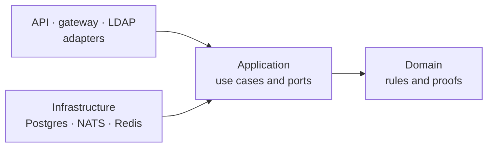
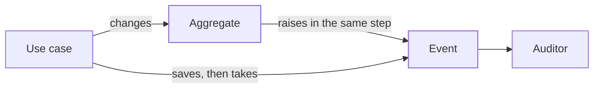

The pages before this one show how ianua is built. This page explains why it is built with domain-driven design and ports and adapters, and the choices made in applying them: where ianua follows the books, where it goes further, and where it departs from them on purpose.

## Why domain-driven design

An identity provider is mostly rules. Who may sign in, with what proof, at what assurance; who may grant a role, and how much; when a session ends, when a link stops working, what a tenant may see of another. Most of the code is not moving data around but deciding whether something is allowed.

Domain-driven design is made for that kind of software. Its central idea is that the rules get their own layer, written in the words of the problem and kept apart from storage and transport. For ianua that gives three things.

- **One copy of each rule.** ianua is reached through the API, the gateway, LDAP, SCIM and background jobs. If "who may grant this role" were checked in each, one would eventually be wrong. In the domain there is one copy, and every way in reaches it.
- **Rules that can be read and tested on their own.** The domain is plain Rust with no database, network or framework. Its tests are pure and fast, and read in the language of the problem: "Stops: Mallory, an admin, makes herself or a friend an owner, or the billing contact who decides what Acme pays. Both are refused."
- **A shared language.** Terms such as tenant, session, delegation, clearance and break-glass mean the same thing in the code, the tests, the docs and the dashboard. A word with two meanings in the code is usually a bug waiting.

## Why ports and adapters

Domain-driven design says where the rules go. Ports and adapters, also called hexagonal architecture, says how the rest connects to them.

The application describes what it needs from the outside world as **ports**: traits such as "store users" or "send mail", written in domain types. Postgres, NATS, Redis, HTTP and LDAP are **adapters** that implement them. Dependencies only point inward: adapters know the application, the application knows the domain, and the domain knows nothing outside itself.

- **The rules cannot depend on the database.** Nothing in the domain or application names Postgres or HTTP, so an infrastructure detail cannot leak into a security decision.
- **Each part can be tested with what it needs.** Use cases are tested against in-memory fakes of their ports; adapters are tested against the real thing.
- **Adapters can change without touching rules.** A new way in, such as LDAP or SCIM, is a new adapter calling the same use cases.

## Where ianua goes beyond the books

### Changes take a proof of who acts

The books say aggregates protect their invariants. ianua adds that every change takes a proof of who is making it: `TenantAuthority`, `OrgControl`, `OperatorAuthority` or `SignedIn`. Only the domain can make a proof, from stored records. A use case asks the `acting` traits for one and cannot build it from the request.

For an identity provider, refusing has to be the default. With proofs, a use case that forgets to ask who is acting has nothing to hand the domain and does not compile. Forgetting a permission check stops being possible.

### Stored rows are checked again on load

The books treat loading an aggregate as rebuilding it. In ianua `reconstitute` runs the aggregate's rules again and refuses a row that breaks one as corrupt, instead of repairing it. A database edited by hand or written by a bug cannot bring a broken state back in.

### Value objects reach the edges

Addresses, tokens, ids and settings are value objects with checked constructors, as the books say. ianua carries them all the way out: ports take these types, never bare strings or UUIDs. An oversized token is refused before it reaches a hasher or a signing key.

### The design is enforced by tests

The layering, the rule that only `acting` makes proofs, typed ports, events raised only by the domain, names that never repeat their folder, no duplicated code and plain-language tests are checked by tests that run with every build. The API has its own: it checks no right, its handler files hold only handlers, and its published contract is a snapshot that fails when it changes. In an open project, a contributor, or an AI assistant helping one, cannot drift from the design without a test saying so.

## Where ianua departs from the books, on purpose

### One crate per layer, not one model per context

The books describe bounded contexts as separate models, each with its own language, translated at their edges. In ianua, contexts such as identity, authorization and agents are modules in one domain crate. They share a common set of types, and depend on each other within fixed layers.

ianua is one product with one database. Separate models would add translation code without catching a real kind of mistake. If a context ever became its own service, it would get its own model then.

### Ports live in the application

Evans places repository interfaces in the domain. In ianua the ports, stores included, live in the application. The domain stays pure rules and proofs, and everything the application needs from outside is in one place.

### Some use cases save two aggregates together

The books advise one aggregate per transaction. A few ianua use cases save two together: publishing a workflow saves the new version and archives the one it replaces. Doing that in two steps would leave a moment with two published versions, or none.

## Events: aggregates record their own

In the books, an aggregate records its own events as it changes. ianua does this. `topic.pause(&control)` changes the topic and raises `TopicPaused` in the same step. The use case saves the aggregate, takes out what it raised and hands that to the auditor. The audit record is evidence, so if it cannot be written the action fails; if the event cannot be broadcast, that is logged and the action stands.

**Why:** ianua once had the application build each event separately from the change, and two things went wrong while building it. Several kinds of change saved with no audit record at all, because the event was never written. And removing a policy rule by a name no rule had removed nothing, while "rule removed" would have been recorded. When the code that makes a change also raises its event, an event can neither be forgotten nor describe something that did not happen. A convention test in the application now fails the build if a use case builds an event itself.

**What stays in the application:** loading, transactions, saving, sending events on, and adding who asked and from where. A few events belong to no aggregate, such as a threat the gateway sees in traffic or a member signing in when nothing they hold changes. The domain builds those in a short list of named functions, each with its reason.

## The cost

This design has more code than a simpler one. Proofs, value objects, ports and fakes mean more types and more files, and a change often touches the domain, the application and an adapter. The convention tests keep that code uniform, which is what makes its size manageable. For software that decides who gets in, the extra code buys rules that are written once, cannot be skipped, and leave a record that can be trusted.

## Read next

- [Domain](/ianua/architecture/domain/): the rules and proofs in detail.
- [Application](/ianua/architecture/application/): use cases and ports.
- [How the code is written](/ianua/code-design/how-the-code-is-written/): the code style the tests enforce.
