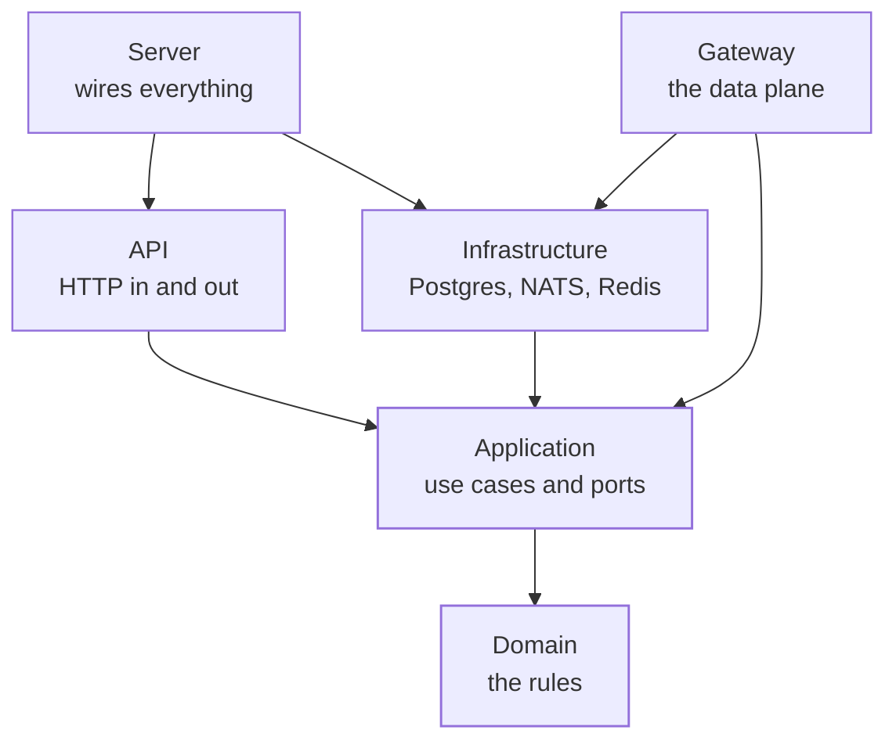
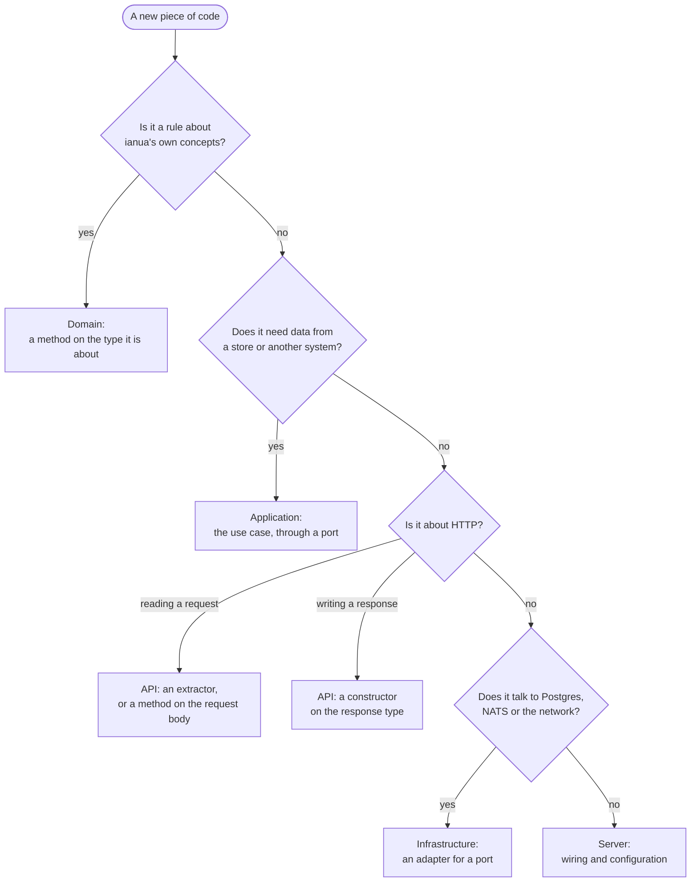
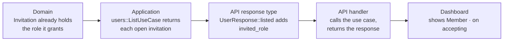

This page is for anyone reading or changing the ianua code. It covers the rules that run through the whole workspace, not one layer at a time; the **Architecture** pages cover each layer in depth.

Each rule comes with where it is checked. Most are enforced by the compiler, by convention tests that read the source, or by CI, so a change that breaks them cannot be merged. A few are held in review.

## The rules at a glance

| Rule | In one line | Checked by |
| --- | --- | --- |
| Dependencies point inwards | The domain knows nothing about the application; the application knows nothing about Postgres or HTTP. | The crate graph, and convention tests in the domain and the application |
| Every piece of code has one home | Rules in the domain, flows in use cases, HTTP at the edge, wiring in the server. | Convention tests in the API, and review |
| Names never repeat where they live | `consumers/create.rs` holds `consumers::CreateUseCase`. | Convention tests in the domain and the application |
| Values are valid by construction | A type that holds a value has already checked it. | The type system |
| No answer means no | When a check cannot run, the request is refused. | Tests that assert the refusal |
| Tenants cannot see each other | Every store call carries the tenant, and Postgres enforces it again. | The type system and row-level security |
| Errors say what went wrong, not where | Errors are domain concepts; HTTP status codes are chosen at the edge. | One mapping in the API |
| The audit record comes first | An action whose audit record cannot be written did not happen. | The event dispatcher |
| Flat, small, named code | Guard clauses, small functions, enums over booleans. | Convention tests, Clippy and review |
| Every change passes the same checks | Format, lint, query cache, unit tests, end-to-end tests. | CI |

The rest of this page takes them one by one.

## Dependencies point inwards

The workspace is built in layers, and each crate may only use the ones inside it.



**Why:** the rules of ianua (what a session is, when a delegation may be granted, what makes a route valid) should not change because the database or the web framework does. Keeping them in a crate that cannot import either makes that a fact rather than a hope.

**How it is held:** the domain crate (`ianua-domain`) depends only on small utility crates (`uuid`, `time`, `thiserror`, `url`, `subtle`, `zeroize` and `async-trait`), with no Tokio, sqlx, Axum or reqwest, so domain code cannot call them. Its `serde` derives sit behind a feature, and event payloads use the domain's own `EventData` instead of `serde_json::Value`. Inside the domain, a convention test checks that each context uses only the contexts below it. The application's convention tests fail the build if its source names an adapter library such as `sqlx`, `axum` or `tokio`. When the application needs something from outside, such as storage, email or the time, it declares a **port**: a trait the infrastructure implements. The server is the only crate that knows both sides and connects them.

## Every piece of code has one home

Most design questions in this codebase come down to "where does this go?" The answer depends on what the code does, not on which file you happen to be in.



The rule this protects most often is that **a handler only orchestrates**: extractors in, the use case call, a response type out. A handler file holds handlers and nothing else, no private helper functions and no request types. The API's convention tests check it, and also that the API checks no right: who may do what is the application's to decide.

An example of getting this wrong, and the fix: the user list once showed an invited person with no role. The first attempt added a helper to the list handler that read the pending invitations and their roles. That puts a store lookup in the HTTP layer, so it was moved:

| Piece | Where it went |
| --- | --- |
| Reading invitations and the roles they grant | The users list use case, which now returns each user with their open invitation |
| Turning that into JSON | A constructor on the response type, `UserResponse::listed` |
| The handler | Calls to the use cases, then the response constructor |

## Names never repeat where they live

A path is read as one phrase, so each word in it says something new.

- **A file never repeats its folder**, nor the folder above it: `executions/rerun.rs`, never `executions/rerun_execution.rs`; `tenant/lifecycle/archive.rs`, never `archive_tenant.rs`.
- **A use case type never repeats its folder's word.** Callers write the folder, so it is `executions::ListUseCase`, `consumers::CreateUseCase` and `users::ListUseCase`. The same goes for its `Ports` and its `Request`.
- **A crowded folder is split into topic folders.** Past about twelve files, a folder groups them, as `identity/users/` does with `joining/`, `records/`, `standing/`, `sessions/` and `credentials/`. The topic folders are private and their parent re-exports what they hold, so callers still write `users::ListSessionsUseCase`.
- **A module is named by its full path**, `crate::...`, never climbed to with `super::`. A test module's `use super::*;` is the one exception: it means the file it tests.

`crates/ianua-audit/src/conventions/app/naming.rs` checks all four; the domain's convention tests check the file names and the import paths. A name that must keep its folder's word, because the short one is a keyword, is taken, or means another type, is listed with the reason.

## Values are valid by construction

A value that has a meaning gets its own type, with a private field and a constructor that checks it. An email address is an `Email`, not a `String`; an upstream address is an `HttpUrl`.

```rust
let email = Email::new("ann@example.com")?; // checked once, here
```

From then on, a function that takes an `Email` cannot be handed something that is not one.

Aggregates, the types that own a set of rules such as `Service`, `Route` or `Delegation`, follow the same idea: their constructors return a `Result`, and every method that changes them either keeps their rules intact or returns an error. Loading one back from the database goes through a separate `reconstitute(Row)` function, which checks the stored row against the rules again and refuses one that breaks them.

**Why:** a check that lives in the constructor cannot be skipped. A check in a handler is skipped by every other way into the code.

**Watch for:** values read from JSON. Deriving `Deserialize` builds the type field by field and bypasses the constructor. Types that have rules deserialize through their constructor instead (`#[serde(try_from = "...")]`), so stored or posted JSON is held to the same rules as code. `HttpUrl`, `GraphQlLimits` and `TerminateConfig` work this way.

## No answer means no

When a decision cannot be made, the answer is no. This applies everywhere, and most visibly in the gateway:

- a missing or failed policy decision refuses the request,
- a signing stage with no key refuses rather than forwarding unsigned,
- masking an answer it cannot read withholds the answer,
- an allow list of countries refuses a caller whose country is unknown,
- the API answers **503** when it cannot check a token, rather than treating the caller as anonymous.

**Why:** an attacker's best moment is the moment a check is not running. Code that "fails open" to keep traffic flowing gives them that moment.

**How it is held:** the refusals are tested themselves, not only the success path: missing token, expired token, wrong audience, unknown subject, a store that cannot be reached. The gateway's end-to-end suite runs these against a real proxy and database.

## Tenants cannot see each other

Every method on a tenant's store takes a `ScopedTenant`. A use case cannot make one from a bare id: every way to get one names where the tenant came from, such as the caller's own resolved tenant or the hostname a request arrived on. So a tenant's data cannot be asked for without naming the tenant. Underneath, each database connection is bound to one tenant, and Postgres row-level security filters every table a second time.

**Why:** one missing `WHERE tenant_id = …` should not be able to leak another tenant's data. Two independent layers mean both have to fail at once.

## Errors say what went wrong, not where

Errors are concepts of the domain: `Validation`, `Conflict`, `NotFound`, `Forbidden`, `InvalidTransition`, `TenantSuspended`. A repository returns a domain error, never a `sqlx::Error`. Data in the database that the code cannot read (an unknown enum value, or a row that breaks the aggregate's rules) is an `Infrastructure` error, not a validation error: it is the system's fault, not the caller's.

The HTTP status is chosen in one place, `crates/ianua-api/src/error/mod.rs`, which maps each kind to a status and writes the message as a sentence.

## The audit record comes first

Use cases report what happened through one port, the `EventDispatcher`. The events come from the aggregates that changed; the use case only takes them out after the save and hands them on.

- If the audit write fails, the whole operation fails. An action nobody can account for did not happen.
- If broadcasting the event to other processes fails, it is logged and the operation succeeds. The change is saved; only the notice to other processes is lost.

## Flat, small, named code

These rules aim at code that can be read top to bottom without keeping a stack of conditions in your head.

- **Return early.** Handle the error cases at the top with guard clauses, often `let … else`; the main path runs flat below them. No `else` after a branch that returns.
- **No `if` directly inside another.** Deeper than one level becomes a `match`, a helper or a combinator chain.
- **Enums instead of booleans.** A function does not take a `bool`; a call `f(x, true)` says nothing about what `true` chose. The domain lists the few that stay, each with its reason.
- **Small functions and files.** A function does one thing at one level of detail. A file holds at most 550 lines of code before its tests.
- **Names say what something returns or guarantees,** not how it works: `effective_backends`, `is_due`, `shows`.
- **Narrow visibility.** `pub(crate)` unless something outside the crate needs it.
- **Documentation on every public item,** with an `# Errors` section on anything that returns a `Result`.
- **Comments explain why,** on the item rather than inside the body. Code that needs a comment inside a function body is rewritten instead.
- **No em dashes** in the source of the domain, the application and the API.

In the domain and the application, convention tests check the nested `if`, the `bool` parameters, the file length, comments inside function bodies, every `allow` saying why, and the em dashes. The rest is held in review and by Clippy.

## Every change passes the same checks

CI runs the same steps on every change, and all of them must pass:

| Step | Command |
| --- | --- |
| Formatting, including import order | `cargo +nightly fmt --all --check` |
| Query cache | `cargo sqlx prepare --workspace --check -- --all-targets` |
| Lints, warnings as errors | `cargo clippy --all-targets --all-features -- -D warnings` |
| Dependency check | `cargo deny check` |
| Unit and integration tests | `cargo nextest run --workspace --exclude ianua-scenarios --no-fail-fast` |
| End-to-end tests | `cargo nextest run -p ianua-scenarios --profile ci-e2e` |

Each layer is tested in its own way:

- **Domain** tests are plain functions with no async runtime, mocks or I/O. If a domain test needs a mock, the design is wrong.
- **Application** tests use in-memory fakes that implement the ports, not a mocking framework.
- **API** tests call the real router over the application's fakes, and the published OpenAPI contract is a snapshot that fails when it changes.
- **Infrastructure** tests run against a real Postgres.
- **End-to-end** tests start the API, the gateway and a database, and drive them over HTTP the way a client would.

Test names describe behaviour, such as `a_route_that_refuses_the_method_leaves_the_request_to_the_next`, and every test in the application and the API says in a doc comment what it shows. When a bug is fixed, the test that shows it comes first.

## One change through every layer

Putting it together, here is how one small feature travelled through the code: showing the role an invited person will get, instead of an empty role field.



1. **Domain:** nothing to change. An `Invitation` already records the role it grants.
2. **Application:** `users::ListUseCase` reads the pending invitations and their roles through ports and returns each user as a `ListedUser` with an `OpenInvitation`. A test with in-memory fakes checks that an invited user carries the role.
3. **API:** the response type gains `invited_role`, filled by a constructor. The handler only calls the use case and the conversion.
4. **Dashboard:** an invited user's role column shows the role and "on accepting" instead of an empty picker.

Nothing in the domain or the application knows the change is for a web page, and the handler knows nothing about invitations.
