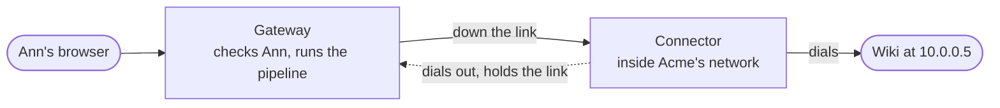

Some apps have no public address. Acme's wiki runs at `10.0.0.5` inside Acme's office network, and nothing from the internet can reach it. A **connector** is a small program Acme runs inside that network. It dials out to the gateway and keeps that connection open. When someone opens the wiki through the gateway, the gateway sends the request down that connection, and the connector passes it on to `10.0.0.5`.

Nothing in Acme's network has to accept a connection from outside. The only traffic that leaves it is the connector dialling out.

## What stays the same

A request that goes through a connector is treated like any other. The route, the pipeline and the sign-in rules run in the gateway first. The headers a client sends to pose as someone are stripped, and the wiki gets the same signed assertion of who is calling as any app behind the gateway. The connector only carries bytes. It decides nothing about who may come in.

## How a connector proves who it is

1. An admin creates the connector in the tenant. They are shown a **one-time code**, good for an hour.
2. The connector starts with that code. It makes its own key, which never leaves its machine, and sends the code with a signing request for that key.
3. ianua checks the code, spends it, and pins the connector's key. It answers with a **certificate** for that key, good for one day.
4. The connector opens its link to the gateway with that certificate.
5. Each day, before the certificate runs out, the connector asks for the next one, for the same key. A request for any other key is refused.

A code that is wrong, already used, expired, or for a revoked connector is refused the same way, so a guesser learns nothing. A certificate copied off a disk is worth one day at most, and only with the key it was made for.

## What the gateway lets in

The gateway takes a link only from a connector it knows:

- The certificate must come from the platform's own connector authority. A link without a certificate, or with one from anywhere else, is refused during the TLS handshake.
- The certificate names one tenant and one connector. That tenant must have that connector, not revoked, and enrolled with the same key. If any of that fails, the link is closed before it carries anything.
- A link for one tenant's connector is only ever used for that tenant's services.

## What a connector may dial

Two lists bound what a connector reaches, and both must allow a target.

- **The scope**, kept in ianua: the networks, such as `10.0.0.0/24`, and the domains, such as `wiki.corp.internal` or `*.corp.internal`, it may be asked to dial. A service can only be pointed at addresses inside it. The gateway checks it again before every connection it opens through the connector.
- **The allowed targets**, set on the connector itself: each `host:port` or `network:port` it may dial. Anything else is refused there, even an address inside the scope. A listed name that resolves to a loopback or link-local address, such as the cloud metadata address, is refused unless that address is listed too.

So someone who can change routes in ianua still cannot make the connector dial what the people running it did not list.

## When things go wrong

| What happens | What a caller sees |
| --- | --- |
| No link from the connector is open | `503` |
| The link drops while a request is on it | `502`, and the link is dropped from use at once |
| The target is outside the scope or the allowed targets | The request is refused, nothing is dialled |
| The app does not answer in time | `504` |

Connectors can keep more than one link open, one to each gateway address their name resolves to, so a gateway restarting does not cut the app off.

## Revoking

Revoking a connector is for good. Its links are closed within seconds, its next request for a certificate is refused, and every service reached through it stops answering until you move it to another connector. A connector whose key may have leaked is replaced, never trusted again. Once nothing uses it, a revoked connector can be deleted.

The gateway notes when it last saw each connector's link, so you can tell a connector that is down from one that was never started.

[Reach a private app through a connector](/ianua/guides/apps/reach-a-private-app/) walks through setting one up.
