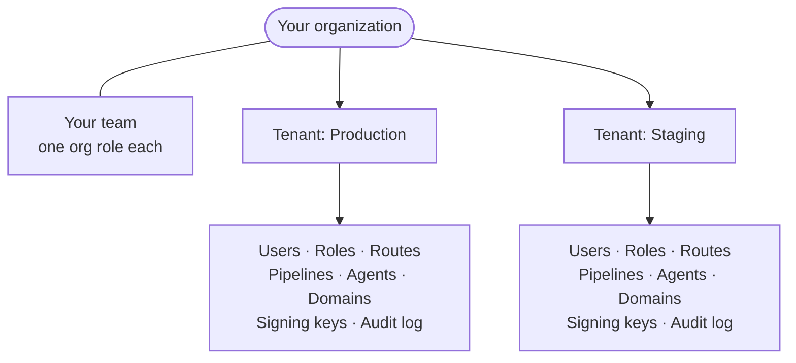
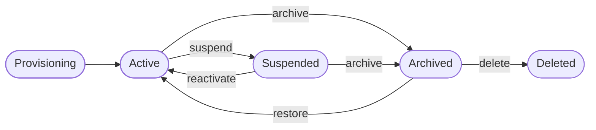

Everything in ianua lives in one of two places: your **organization**, or one of its **tenants**. Getting this split right is the first thing to understand, because every other page builds on it.

## The shape of an installation



### The organization

A self-hosted installation has exactly **one organization**. It is created the first time ianua starts, from the name in your install settings, and there is no way to sign up for another. You can rename it in the dashboard at any time.

The organization holds two things: your **team**, the people who run ianua, and your **tenants**.

### Tenants

A tenant is a separate, self-contained space. Everything that makes up an identity system lives inside one:

- its **users**, their sessions and their sign-in settings;
- its **roles, groups and policies**;
- its **routes, services and pipelines**, the apps behind the gateway;
- its **agents** and everything they were granted;
- its **domains** and certificates;
- its own **signing keys**, so a token issued by one tenant is worthless to another;
- its own **audit records**.

Nothing in one tenant can see or reach anything in another. A user of `Staging` cannot sign in to `Production`, a route in one tenant cannot forward with another's identity, and an agent cannot be granted another tenant's resources.

Common ways to use tenants:

- **One per environment**: `Production`, `Staging`, `Development`.
- **One per product or business unit**, each with its own users and apps.
- **One per customer**, if you run ianua for others.

Your first tenant is created at install, named by `INSTALL_TENANT_NAME` (`Main` by default). Create more in the dashboard under **Tenants**.

## Two kinds of users

This is the distinction people trip over most often:

| | Your team | A tenant's users |
| --- | --- | --- |
| **Who** | The people who run ianua | The people who use your apps |
| **Belong to** | The organization | One tenant |
| **Sign in to** | The ianua dashboard | Your apps, through ianua |
| **Example** | Your platform engineers | Your employees or your customers |

Each team member has one of five organization roles:

| Role | In the organization | Tenants |
| --- | --- | --- |
| **Owner** | Everything, including closing the organization and changing what it pays. | Every tenant, with every ianua permission. |
| **Admin** | Everything an owner does, except closing the organization and changing what it pays. | Every tenant, with every ianua permission. |
| **Member** | Reads the organization, its team and its audit log. | Only the tenants they are given, with the tenant roles they are given there. |
| **Billing** | Runs the subscription and its payment. | None. |
| **Viewer** | Reads the organization, its team, its audit log and its bill. | None. |

A member's tenant roles are ordinary tenant roles, the same roles that tenant's own users can hold, so there is one permission model for both. A billing contact or a viewer signs in to the organization alone, with no tenant. So does a member nobody has given a tenant yet: they can read the organization, their own account and their sessions, and open a tenant once they are given one.

The owner you named at install is the first owner. Invite the rest of your team from **Team** in the dashboard.

## Where a tenant's apps answer

Each tenant's apps are reachable under your apps domain, and on any domain you add to the tenant:

- `<organization>-<tenant>.apps.example.com`, for example `acme-staging.apps.example.com`;
- `<tenant id>.apps.example.com`, a name nobody can guess;
- any domain you add to the tenant, such as `app.example.com`.

The gateway reads the hostname of every request to decide which tenant it belongs to. **How it works** follows that in detail.

## Where a tenant's data lives

You choose this when you create a tenant, and it cannot be changed afterwards:

- **Shared** (the default): the tenant's data lives in the installation's database alongside other tenants', with every row tagged with the tenant it belongs to.
- **Dedicated schema**: the tenant gets a schema of its own inside the same database, so its tables are physically separate from every other tenant's.

Either way, the tenant boundary is enforced the same way, described next.

## How the boundary is held

Two separate layers keep one tenant's data away from another's. Either one alone would stop a mistake; together, a bug has to beat both.

### In the database

Every tenant table carries a row-level security policy, and it is switched on in `FORCE` mode, so it applies to the tables' owner too.

- ianua's services connect to Postgres as an ordinary role, `ianua_app`. It is not a superuser and cannot bypass row-level security. A separate administrator connection is used only to run migrations.
- Before any query, the connection is told which tenant it is working for. Postgres then returns and accepts only that tenant's rows. A query that forgets to filter by tenant gets the right tenant's rows anyway, not everyone's.
- When a connection goes back to the pool, its tenant is cleared, so the next request cannot inherit it.
- At start-up, ianua checks that its role really is confined. In production it refuses to start if the role could bypass row-level security. In other environments it logs a warning.

### In the code

ianua is written in Rust, and the compiler enforces the boundary too.

Every store that holds tenant data refuses a plain tenant id. It takes a `ScopedTenant` instead, and the only ways to get one say where the tenant came from:

```rust
ctx.tenant()                                // the tenant the signed-in caller was resolved to
ScopedTenant::from(&resolved)               // the tenant the request's hostname or path resolved to
ScopedTenant::from_request_host(id)         // the same, in the gateway's own routing table
ScopedTenant::from_verified_credential(id)  // the tenant inside a token ianua signed and verified
ScopedTenant::for_background(id)            // a worker job or event, naming its tenant
```

So a tenant id read from a request body cannot reach a store by accident: the code does not compile until it has gone through one of these. Where a request does name a tenant (switching tenants, transferring a domain, an operator impersonating a user), the use case first checks the caller may act on that tenant, through the tenant registry, the organization that owns it, or the caller's own linked identity, and only then can it touch the tenant's data.

## A tenant's life



| Status | What it means |
| --- | --- |
| **Provisioning** | Being set up: its default roles, its sign-in settings and its signing keys are created. Its users may already sign in while the last steps finish. |
| **Active** | Working normally. |
| **Suspended** | Frozen. Every session is ended, new sign-ins are refused, and the gateway stops serving the tenant's apps. All data is kept, and the tenant can be reactivated. A tenant the platform suspended comes back only through the platform. |
| **Archived** | On its way out. Sessions are ended and its apps stop answering, as when suspended. For 30 days it can still be restored. After that it can be deleted. |
| **Deleted** | Gone. Its sessions are revoked, its data is removed from every table, and a dedicated schema is dropped. This cannot be undone. |

Suspending is the safe "stop everything now" switch: use it during an incident. Archiving and deleting are for tenants you are finished with, and deleting is the only step that removes data. The 30 days mean that someone who archives a tenant by mistake, or with a stolen session, cannot wipe it the same minute.

The gateway follows every change within moments. Suspend a tenant and its apps stop answering; reactivate it and they answer again, without restarting anything.

## What's next

- [Manage your team](/ianua/guides/organizations-and-tenants/manage-your-team/) and [Create and manage tenants](/ianua/guides/organizations-and-tenants/manage-tenants/) walk through doing all of this, in the dashboard and with the API.
- **Users and groups** covers a tenant's users, how they are invited, and how they can be synced from another system.
- **Roles, permissions and policies** explains how "who may do what" is decided inside a tenant.
