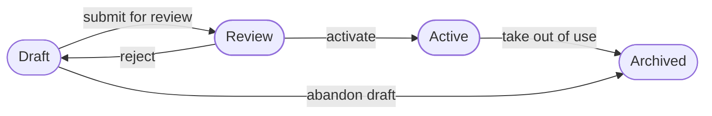

A **permission** is one thing someone may do, such as "view users" or "read orders". A **role** is a named set of permissions. People hold roles, never loose permissions, so you change what a group of people may do by changing one role.

Three things then decide whether a request goes through:

| What decides | Where | Asks |
| --- | --- | --- |
| **The caller's permissions** | The ianua API and dashboard | May this person change this tenant's settings? |
| **A route's policy** | The gateway, per route | May this caller reach this part of my app? |
| **The tenant's policy** | The gateway, every request | Do my own rules, such as "admins only under `/admin`", allow it? |

## Two kinds of permission

### ianua's own

These control ianua itself: managing users, roles, sign-in settings, routes, agents and so on. Each one names an **area** and an **action**, written `idp:<area>:<action>`, for example `idp:users:view` or `idp:routing:create`.

Most areas have a **manage** action. Holding it means holding every action in that area: `idp:routing:manage` includes view, create, update and delete. There is one other link: any permission over users also lets you see roles, because you cannot manage people without seeing what they hold.

### Your app's own

These are for your own application to use. Each one is written `<resource>:<action>`, for example `orders:read` or `invoices:approve`. ianua never gives them a meaning; your app and your routes do.

Before a role can carry one, declare it. In the dashboard, open the tenant and go to **Permissions**, then add a **Resource** (such as `orders`) and the actions it has (`read`, `write`, `admin`). This catches typos: `orders:raed` is refused instead of becoming a permission nobody checks.

An action can **include** others on the same resource. If `admin` includes `write`, and `write` includes `read`, then a role with `orders:admin` also passes anything that asks for `orders:write` or `orders:read`. The gateway works this out on each request, so changing what an action includes changes it for everyone who holds it.

Two more rules:

- `*` stands for "any": `orders:*` is every action on orders, and `*:read` is reading anything.
- A resource cannot be named `idp`, or start with `idp_` or `idp-`. Those names belong to ianua's own permissions, so `routing:view` written as your own permission never counts as `idp:routing:view`.

## The roles a tenant starts with

Every new tenant has two roles:

| Role | Holds | Given to new users |
| --- | --- | --- |
| **Admin** | Every ianua permission | No |
| **Member** | Viewing the tenant's metrics | Yes |

Both are ordinary roles: you can rename them, change them or delete them.

A role marked as a **default** is given to every new user, whether an administrator creates them, they sign themselves up, they arrive through single sign-on, or SCIM creates them. Single sign-on and SCIM connections can each name one more role to add. An **invitation** is different: the person gets exactly the role the invitation names.

You set whether a role is a default through the API (`is_default`).

## Giving people roles

A person can hold a role in three ways:

- **Directly**, by giving it to them.
- **Through a group**: everyone in a group holds the group's roles, and the roles of every group above it.
- **From the start**, as a default role, or the role an invitation, single sign-on connection or SCIM names.

What someone may do is everything all their roles give them, added together.

### You can only hand out what you hold

To give someone a role, you must already hold every permission in it. This applies to every way a role reaches someone:

- giving it to a person directly,
- giving it to a group, or adding someone to a group that has it,
- naming it when you create a user, or in an invitation,
- marking it as a default role,
- making it the role a single sign-on connection or SCIM gives new people,
- moving a deleted role's holders onto another role.

So someone who may create users, but does not hold user management themselves, cannot create an account that has it. And someone who may edit roles, but cannot give refunds, cannot write `orders:refund` into a role and give it to themselves. Anything that would break this is refused with `403`.

For your app's permissions there is one way past the rule: `idp:roles:escalate`. Whoever holds it may give out any of your app's permissions without holding them, which is what an administrator setting up roles needs. The **Admin** role has it. It never applies to ianua's own permissions.

Holding `idp:roles:manage` includes `idp:roles:escalate`. To let someone edit roles without that, give them the separate create, update and delete actions instead.

People in your organization who use the dashboard follow the same model. An **Owner** or an **Admin** holds every ianua permission in every tenant. A **Member** holds the tenant roles they were given for that tenant, and nothing elsewhere. A **Billing** contact or a **Viewer** holds nothing in any tenant. See **Organizations and tenants**.

## Changing and removing roles

Role names are unique within a tenant. When you change a role's permissions, you send its whole new set; anything left out is taken away.

A role that someone holds directly cannot be deleted on its own. Either take it away from them first, or pick a **replacement**: everyone who held the deleted role is moved onto it in one step.

## Route policies

Every route through the gateway says who may use it:

| Policy | Lets in |
| --- | --- |
| **Public** | Anyone |
| **Authenticated** | Any signed-in caller |
| **Require system permission** | Callers holding at least one of the listed ianua permissions |
| **Require custom permission** | Callers holding at least one of the listed permissions of your own |
| **Require scope** | Callers whose token carries at least one of the listed scopes |

The gateway reads a person's roles on every request. If you take a role away, their next request already goes without it, even with a token that has not expired. A token cannot add permissions to itself by listing them. An agent is the exception: it carries the permissions its delegation gave it.

Permissions are matched as described above: `manage` includes its area, an action includes what it is set to include, and `*` matches anything. A route with no policy, or a permission list that is empty, lets nobody in.

## What your app is told

When the gateway lets a signed-in caller through, it adds an `X-Ianua-Assertion` header: a token signed with the tenant's assertion key, valid for 30 seconds. Among other things it carries:

| Claim | Holds |
| --- | --- |
| `sub` | The user's id |
| `tid` | The tenant's id |
| `roles` | The names of the user's roles |
| `permissions` | Every permission the user holds, including what their actions include |

Check the signature with the assertion keys published on your app's own host, at `/.well-known/ianua-assertion-keys.json`, not with the tenant's JWKS. Your app can then decide on `roles` and `permissions` without keeping its own copy of who may do what.

## The tenant's policy

A route policy answers one question for one route. The **tenant's policy** is a list of rules that applies to every request to the tenant's apps, after the route has let it through.

Each rule has **conditions**, all of which must hold, and one **action**.

A rule's conditions can check:

- **the path:** it is exactly a value, or starts with one;
- **the caller:**
  - has, or does not have, a role;
  - is, or is not, in a group;
  - holds one of your app's permissions;
  - has an attribute or sign-in claim with a given value;
- **where it comes from:**
  - the caller's country is, or is not, in a list;
  - the address is, or is not, in a list of ranges;
- **the request:**
  - uses one of these methods;
  - is for one of these hosts;
  - arrives within a time window;
  - is a sensitive operation;
- **the device and risk:** the device is known or unknown; the risk is at least a level.

A rule's action is one of:

- **Let it through.**
- **Refuse it** (`403`, with your reason).
- **Ask for more proof of identity:** a second factor or a hardware key.
- **Require a bound token** (DPoP).
- **Let it through, but record it**, to watch a rule before enforcing it.

A refusal always wins: when any enabled rule that refuses matches, the request is refused, wherever that rule sits in the list. Otherwise the first matching rule that lets it through decides, in order of priority, lowest number first. A rule asking for more proof or a bound token adds that to the request it lets through. When no rule refuses or lets it through, the policy's **fallback** decides. A rule can be switched off without deleting it.

The gateway only knows some things about a request: its path, its method, the caller's roles and the country their address is in. It does not know whether a device is trusted, how risky a request is, or whether an operation is sensitive, and sometimes it cannot tell the country.

When a condition is about something the gateway does not know, the rule's action decides how it counts:

- A rule that **refuses**, **asks for more proof** or **requires a bound token** counts the condition as matching. Nothing shows the request is one the rule would let past, so the gateway errs on the side of refusing.
- A rule that **lets it through** or **records it** counts the condition as not matching. Nothing is granted on a guess.

So a rule that refuses requests from unknown devices refuses every request at the gateway, because the gateway never knows the device. Write gateway rules about what it can see.

:::caution
If the gateway cannot read the tenant's policy, it refuses the request with `503` rather than guessing.
:::

### Putting a policy into service

A tenant's policy has numbered **versions**. At most one is live, and at most one draft is open beside it. The live version goes on deciding requests while the next one is written and reviewed.

A draft starts blank, as a copy of the live version, or as a copy of a past version you want back. Each version moves through these states:

- Only the **Active** version decides requests. A draft, or a version in review, has no effect.
- Only a **Draft** can be edited, so a version under review does not change while someone looks at it.
- **Activating** a version makes it live in place of the live one, which is archived as a past version.
- **Taking the live version out of use** leaves the tenant with no live policy: until another is activated, each route's own policy decides alone.
- Where the tenant has anyone else who may approve, a version is activated by someone other than the person who sent it for review.
- The gateway picks up a change within 5 seconds. Set `PROXY_AUTHORIZATION_TTL_SECS` on the gateway to change that.

Writing rules, starting a draft and submitting it for review need the `idp:policy:update` permission. Activating, rejecting and taking a version out of use need `idp:policy:activate`, because putting rules in front of live traffic deserves more trust than writing them. A move the version's state does not allow answers `409`. Each move is recorded in the audit log.

In the dashboard, open the tenant and go to **Policy** to write rules and move the policy between states.

The API's `simulate` endpoint tries a made-up request against a version of the policy and shows which rule matched and why the others did not. Ask it about the live version to see what is in force now, or about the draft to see what would happen if it went live.

## What's next

- **Users and groups** covers how people join a tenant and how groups bundle roles.
- **Sign in on your app** shows how people sign in on your app's own domain through the gateway.
