To put an app behind the gateway you set up three things in a tenant:

| Thing | Answers | Example |
| --- | --- | --- |
| **Service** | Where is the app? | `shop`, at `http://shop:8080` |
| **Route** | Which requests go to it, and who may send them? | `/admin/*`, admins only |
| **Pipeline** | What checks run before it gets there? | Sign-in check, a rate limit, a firewall |

A request comes in on one of the tenant's **domains**. The gateway picks the **route** it matches, runs that route's **pipeline**, and sends it to the route's **service**:

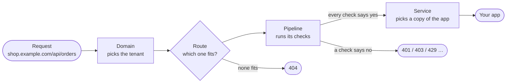

Many routes can share one pipeline and one service. A route always names exactly one of each.

[How it works](/ianua/start/how-it-works/) follows a single request through every step. This page explains each piece and its settings.

## The example: Sam's shop

Sam runs an online shop at `shop.example.com`. It has a public storefront, an API for the mobile app, and an admin area. Sam is also trying out a new version of the shop on a small share of traffic.

Here is what Sam sets up. Each part is explained in the sections below.

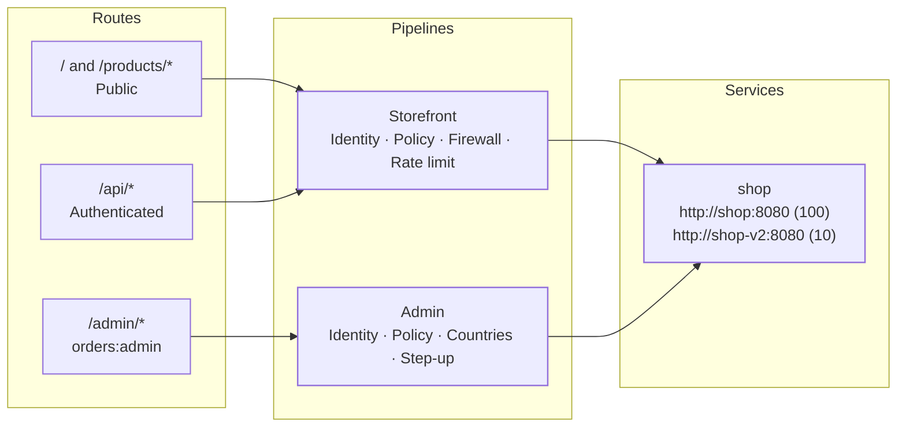

| Request | What happens |
| --- | --- |
| `GET /products/42`, not signed in | Route **`/products/*`**, public. Storefront checks pass. Goes to the shop. |
| `GET /api/orders`, not signed in | Route **`/api/*`** needs a signed-in caller. Refused with `401`. |
| `GET /api/orders`, signed in | Passes. Goes to the shop. |
| `GET /admin/refunds`, signed in, no `orders:admin` | Route **`/admin/*`** needs the permission. Refused with `403`. |
| `GET /admin/refunds`, admin, signed in from a blocked country | The Admin pipeline's country check refuses it: `403`. |
| `GET /admin/refunds`, admin, password only | Step-up asks for a second factor first: `401`. |
| `GET /wishlist` | No route fits. `404`. |

## Services

A service is one app the gateway can send requests to.

### Where it lives

- **Upstream URL**: the app's address, starting with `http://` or `https://`, for example `http://shop:8080`.
- **Extra weighted backends**: more copies of the app, each with a weight. The upstream URL takes part with a weight of 100. To give it a different weight, list it among the backends with the weight you want.
- **Resolve backends from DNS**: for apps whose copies come and go. The gateway looks up a DNS name (an `SRV` or an address record) on a schedule and sends traffic to whatever it finds. Until the first lookup answers, it uses the addresses written above.

Sam's new version runs at `http://shop-v2:8080`. Sam adds it with weight 10:

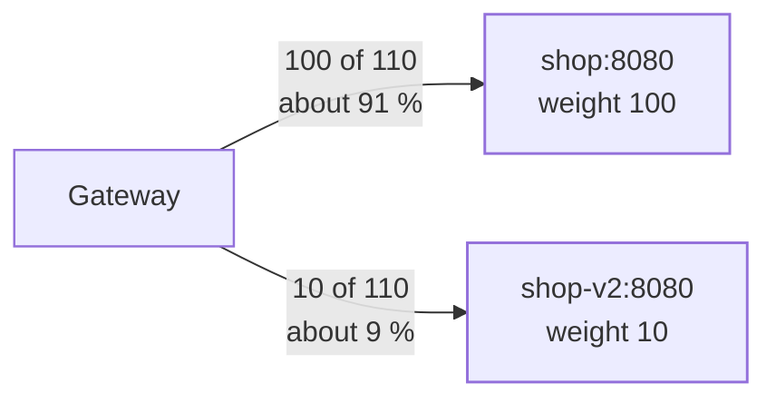

About 1 request in 11 goes to the new version. When Sam is happy with it, they raise its weight to 100 for an even split, then make it the upstream URL and remove the old one.

### How it is reached

- **Timeout**: how long the gateway waits for the app to answer, from 1 to 300 seconds. By default 30.
- **Preserve host header**: send the app the hostname the caller asked for (`shop.example.com`) instead of the app's own address.
- **Balancing**: round robin, the default, or least connections.
- **Sticky sessions**: keep sending the same caller to the same copy of the app. The caller is recognised by their user, their API consumer, a cookie, a header, or their IP address. Sam turns this on by user, so a shopper isn't bounced between the old and new version mid-checkout.
- **Plaintext HTTP/2**: for apps that speak HTTP/2 without TLS, which is what most gRPC services inside a cluster do.
- **TLS to the app**: for an `https://` address, the app's certificate is checked against the public roots, or against the CA bundle you give for a private one. You can also give a client certificate the gateway presents, and the name to check the certificate against. Checking is never switched off.
- **Reach**: directly, or through one of the tenant's **connectors** for an app on a network the gateway can't reach by itself.

### Who it trusts

- **Expected audience**: the name sign-in tokens must carry to be accepted for this app, for example `shop`. A token made for another app is refused, even when it is otherwise valid. Any route that needs a signed-in caller requires the service to have one; the route refuses to save without it.
- **Require client certificate**: only callers presenting a client certificate the tenant trusts get in. A token alone is not enough.

### Health

With **Probe backends for health** on, the gateway calls a health address on every copy of the app (by default `/healthz`) every 10 seconds, waiting up to 5 seconds for each answer. Separately, a circuit breaker notices copies that time out or can't be reached. It is on by default, and the diagram shows its default numbers; you can change them or switch it off.

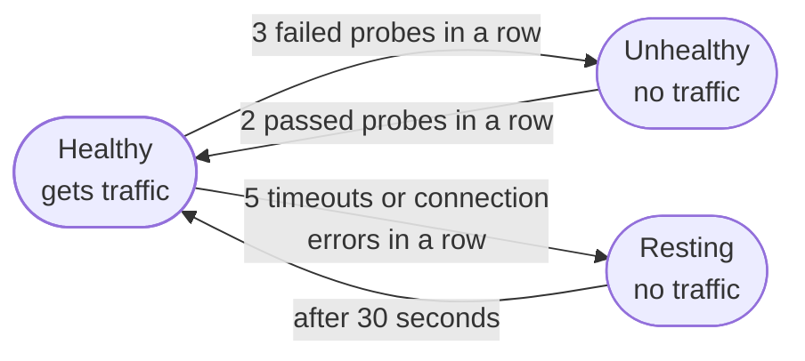

A copy that is **Unhealthy** or **Resting** gets no traffic.

If fewer than half of the copies are healthy, the gateway stops trusting the checks and spreads traffic over all of them again. A health check that marks almost everything as down is more likely wrong than the apps are. Example: Sam's health address breaks in a deploy and both copies fail their probes. Without this rule the whole shop would go dark; with it, shoppers keep being served.

### What can't be an upstream

The gateway never sends requests to:

- **Cloud metadata addresses**, such as `169.254.169.254`, where cloud servers keep their credentials. Always refused, whatever else you allow.
- **Private and internal addresses**, such as `10.0.0.5` or `127.0.0.1`, unless they are inside the networks the operator allowed with `UPSTREAM_NETWORKS`.

This is checked when the service is saved, and again every time a name is looked up, so a name that later starts pointing somewhere internal is still caught. That includes names found through DNS discovery.

### When the app doesn't answer

| The app… | The caller gets |
| --- | --- |
| cannot be reached | `502` |
| has no copy left to send to | `503` |
| takes longer than the timeout | `504` |

By default the gateway doesn't send a failed request again. A service can set **retries**: 2 to 5 tries in all, on the failures you pick (no connection could be opened, or the app answered `502`, `503` or `504`), with a wait that doubles between tries, up to 30 seconds. A `POST` or `PATCH` is sent again only when no connection could be opened, so it never reaches the app twice.

A service can't be deleted while a route still sends traffic to it.

## Routes

A route says which requests go to which service, through which pipeline, and who may send them.

### Which requests it takes

**Path pattern.** Three kinds of pattern work:

| Pattern | Matches | Doesn't match |
| --- | --- | --- |
| `/health` | `/health` | `/health/live` |
| `/users/{id}` | `/users/42` | `/users/42/orders` |
| `/orders/*` | `/orders`, `/orders/`, `/orders/42/items` | `/order` |

Before matching, the gateway cleans up the path: `/orders/../admin` is read as `/admin`, and `/orders//42` as `/orders/42`. A path that tries to climb above `/`, or hides characters by encoding them twice, is refused with `400`.

**Methods.** Which methods the route takes, such as `GET` and `POST`. `HEAD` is not included in `GET`; list it if you want it.

**Headers and cookies.** A route can also ask that a request header or cookie is present, absent, has an exact value, or starts with a value, up to 16 conditions, all of which must hold. Two routes on one path can then send requests to two services by what they carry: a blue/green switch on a header, or a canary pinned by a cookie. Values are never matched by a pattern.

**Domains.** **All domains** answers on every hostname the tenant has, including ones added later. **Specific domains** answers only on the ones you pick, which must be verified domains of the tenant. Sam could put `/admin/*` on `admin.shop.example.com` only, so the admin area isn't reachable from the storefront's address at all.

### When several routes match

Sam's API has two routes:

- `/api/users`, `GET` only, priority 100
- `/api/*`, any method, priority 100

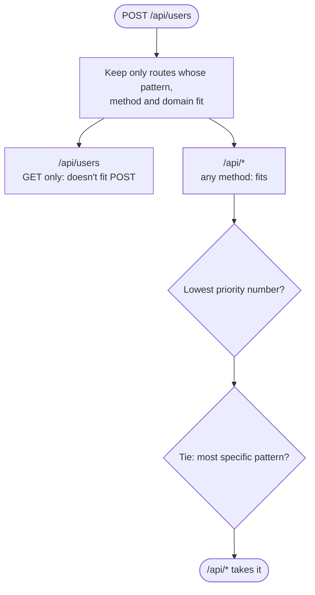

The rules:

1. Only routes whose pattern, method, domain and conditions all fit the request are considered.
2. Of those, the lowest **priority** number wins. A new route has priority 100.
3. If several are tied, the most specific pattern wins: an exact path beats `{id}`, and `{id}` beats `*`.

So with both routes at priority 100:

| Request | Goes to | Why |
| --- | --- | --- |
| `GET /api/users` | `/api/users` | Both fit; tied on priority; the exact path is more specific. |
| `POST /api/users` | `/api/*` | `/api/users` doesn't take `POST`. |
| `GET /api/orders` | `/api/*` | Only `/api/*` fits. |

Priority is for when specificity gives the wrong answer. If Sam gives `/api/*` priority 50, it takes `GET /api/users` too, because 50 beats 100 before specificity is looked at.

No route fits: `404`.

### Who may use it

| Policy | Lets through |
| --- | --- |
| **Public** | Anyone, signed in or not. |
| **Authenticated** | Any signed-in caller: a person, an agent, or an API consumer. |
| **Permission** | Signed-in callers holding at least one of the listed permissions, either ianua's own (`idp:users:view`) or your app's (`orders:read`). See [Roles, permissions and policies](/ianua/concepts/roles-and-permissions/). |
| **Scope** | Callers whose token carries at least one of the listed OAuth scopes. |

Not signed in where it's needed: `401`. Signed in, but without what the route asks for: `403`.

The route's policy is checked by the pipeline's **Policy** stage, together with the tenant's own policy. Both have to say yes.

### What the app receives

**Forwarded path** decides which path the app sees. For Sam's route `/shop/*` and a request for `/shop/cart`:

| Option | The app sees | Notes |
| --- | --- | --- |
| **Keep** | `/shop/cart` | |
| **Strip the matched prefix** | `/cart` | `/shop` on its own becomes `/` |
| **Template** `/v2/{rest}` | `/v2/cart` | `{name}` uses a part captured by the pattern; `{rest}` is what `*` matched |

The app also never sees the caller's token or session cookie, and gets a signed header saying who the caller is. See [What your app receives](/ianua/start/how-it-works/#5-cleaning-up-and-signing).

### Switching it off

A **disabled** route stops taking requests. They get `404`, as if it didn't exist, or go to the next route that fits. A route has to be disabled before it can be deleted.

Route names are unique in a tenant.

## Pipelines

A pipeline is the list of checks a request goes through before it reaches the app. Each route names one pipeline; many routes can share it.

### Its life

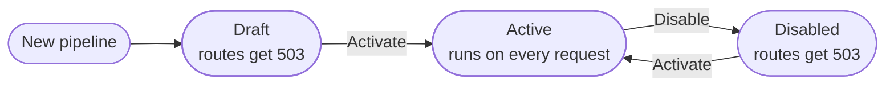

| Status | Routes using it | Can be changed |
| --- | --- | --- |
| **Draft** | get `503` | yes |
| **Active** | run it on every request | no |
| **Disabled** | get `503` | yes |

A pipeline in use can't be changed, so a live check never shifts under a request. Sam wants to add a firewall to the Storefront pipeline without taking the shop offline:

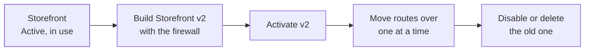

Disabling, changing and activating again also works, but the routes using it refuse traffic in between.

A pipeline can't be deleted while a route uses it.

### Stages

The checks are called **stages**. Every pipeline starts with two that can never be removed, disabled or moved off the top:

1. **Identity**: who is calling? It reads the sign-in token, session cookie, API key or client certificate, and checks it is genuine, unexpired and made for this app.
2. **Policy**: may they use this route? It checks the route's policy, then the tenant's own policy.

New stages go at the end. You can reorder them below Identity and Policy, and switch a stage off without removing it.

A request goes through the stages in order. The first one that refuses ends it; the app never sees the request. Some stages also act on the app's answer on its way back.

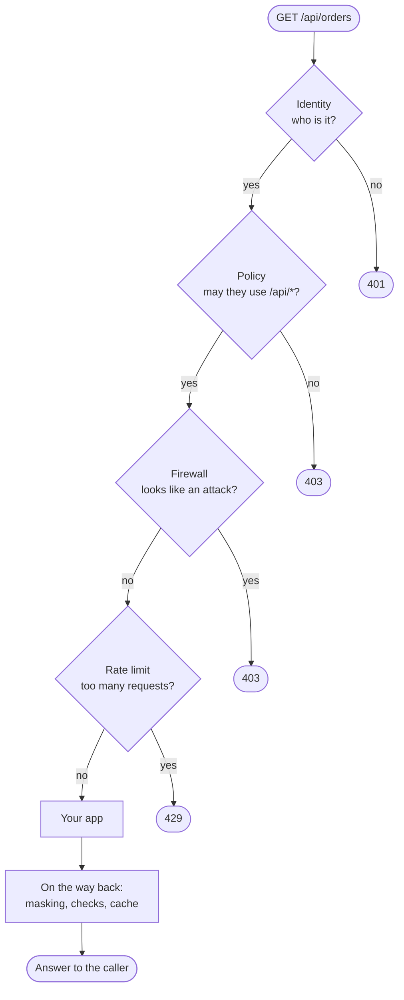

The moment a stage says no, the gateway answers the caller, and the request never reaches the app.

### What the stages can do

**Stopping attacks**

| Stage | What it does | Refuses with |
| --- | --- | --- |
| **Web application firewall** | Scores the path, query, headers and the start of the body for signs of SQL injection, cross-site scripting, path tricks, command injection and prompt injection. Refuses once the score reaches your threshold. Also sets the largest body the route accepts. | `403`, or `413` for a body that's too big |
| **Rate limit** | Allows a number of requests per time window, counted per user, IP address, API key, consumer or the whole tenant. Each rate-limit stage keeps its own count. A request with nothing to count it by, such as an anonymous one on a per-user limit, isn't counted by that stage. | `429` |
| **Countries** | Lets in only callers from the countries you allow, or keeps out the ones you block. With an allow list set, a caller whose country can't be told is kept out. Countries come from the GeoIP database the operator sets with `GEOIP_DB_PATH`, the same one sign-in uses; without it, no country is known. | `403` |
| **Bots** | Recognises automated callers by how they describe themselves (crawlers, scripts, headless browsers), then lets them in, asks them to sign in, or refuses them. | `401` or `403` |
| **Scanner detection** | Watches for callers probing many addresses or failing sign-in often. Slows them down, or blocks them for an hour. | `403` |
| **IP reputation** | Refuses addresses on your own block list, and optionally ones caught by a decoy anywhere on this installation. | `403` |
| **Decoy paths** | Addresses no real user visits, such as `/.env` or `/wp-admin`. Touching one blocks the caller for a while. Checked before any route, for the whole tenant, while the pipeline is active. | `403` |
| **Canary tokens** | Fake credentials you plant. Anyone presenting one is blocked, and a response that would leak one is stopped. | `401`, or `502` on the way back |
| **GraphQL limits** | Refuses GraphQL queries that nest too deep or ask for too much. | `400` |

Two rate limits on Sam's Storefront pipeline, 10 a minute per IP address and 1,000 a minute per user, count separately: a shopper using up one doesn't use up the other.

Every gateway counts on one shared cache server, so a limit of 10 a minute means 10 across all of them. When that count can't be read, the request is refused with `503` rather than counted on one gateway alone. A decoy hit blocks the caller for the whole block after their last hit, each new hit starting the wait again.

**Who gets in**

| Stage | What it does | Refuses with |
| --- | --- | --- |
| **Step-up** | Asks for a stronger sign-in than the route's policy, for example a second factor, before letting the request through. | `401` |
| **Token budget** | For AI apps: allows a number of model tokens per time window and charges what each answer used. A request refused after it was let in, by a later stage, gets back the tokens set aside for it. | `429` |
| **MCP tools** | For agents calling an MCP server: lets through only the tools the agent was granted. | `403` |
| **CORS** | Answers browsers' cross-site checks for the origins you list, and refuses others. | `403` |

**Shaping the request and the answer**

| Stage | What it does |
| --- | --- |
| **Request transform** | Adds or removes headers and query parameters before the request reaches the app. |
| **Response transform** | Adds or removes headers, and removes or renames fields in a JSON answer. |
| **Security headers** | Adds headers that tell browsers to be careful, such as `Strict-Transport-Security`. |
| **Masking** | Hides sensitive fields in JSON answers, by your data classification rules: removes them, replaces them with `***`, or replaces them with a keyed hash. |
| **Request signing** / **Response signing** | Signs the request or the answer with the tenant's assertion key, so the other side can prove it came through the gateway untouched. The other side checks the signature against the tenant's published assertion keys. |
| **Token exchange** | Gives the app a short-lived token of its own for calling another service. |
| **Cache** | Keeps successful `GET` answers for a while and serves them again, only to callers the pipeline would let through. Answers are kept on the shared cache server, filed per caller unless the cache is shared, and an answer larger than the cache's limit is not kept. |
| **Fixed answer** | Answers the request itself with a status and body you set, without calling the app. |
| **Custom** | Runs your own check, compiled to WebAssembly. |

The dashboard offers the most common stages; the rest can be added through the API or the gateway configuration document.

### Rules every pipeline follows

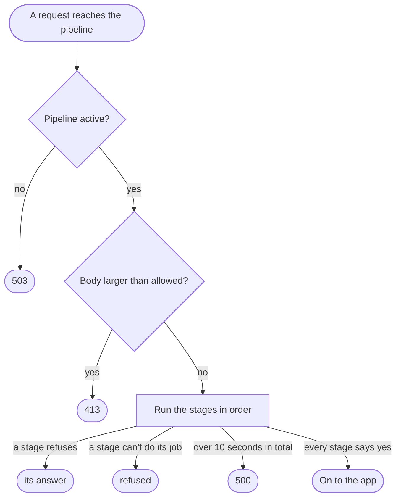

- **No answer means no.** If the pipeline isn't active, a stage fails, or the checks take longer than 10 seconds in total, the request is refused.
- **A stage that can't do its job refuses.** For example, a signing stage with no key to sign with, masking that can't read an answer it should mask, or a transform whose secret can't be found. The gateway never lets traffic through just because a check couldn't run.
- **The body is capped.** By default a request body may be up to 10 MB; a firewall stage sets its own limit. A request declaring a larger body gets `413` before anything is read.
- **Stages see only the start of a body.** Those that need it read up to a limit, and the rest streams straight through to the app, so a huge upload can't tie up the gateway.

## Domains

A domain is a hostname the tenant owns, such as `shop.example.com`. It tells the gateway which tenant a request belongs to.

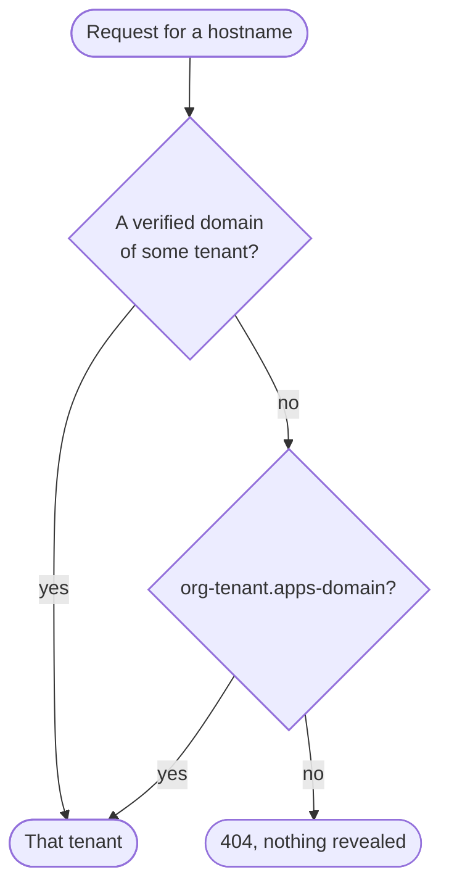

- **Adding one**: you prove you control it with a DNS record, or hand its DNS to ianua. On a self-hosted installation, domains under one the operator vouches for are trusted straight away.
- **Certificates**: once a domain is verified, the gateway gets a TLS certificate for it on its own.
- **With platform addresses enabled**, a tenant gets a random label, such as `k7f3q9.apps.example.com`. Apps use `wiki.k7f3q9.apps.example.com` on nested deployments, or `wiki-k7f3q9.apps.example.com` on self-hosted flat deployments. A tenant cannot register routes under another tenant's label. Without suitable TLS configuration, platform addresses are off and only custom domains are available.

The domain decides the **tenant**. A route's **Specific domains** setting then narrows which of that tenant's hostnames the route answers on.

## TCP and UDP routes

For traffic that isn't HTTP, such as a database or a game server, a **stream route** forwards whole connections.

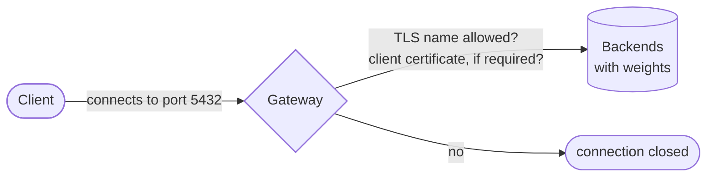

- **Port**: the gateway listens on a port of its own for each stream route, unique on the installation, from 1024 up. The port also has to be opened to the outside where the gateway runs.
- **Protocol**: plain TCP; TLS ended at the gateway; TLS passed through untouched; or UDP.
- **Server names**: with TLS, only accept connections for the names you list.
- **Who may connect**, chosen by name, never implied: **public**, anyone who can reach the port; **mutual TLS**, only callers with a client certificate the tenant trusts (with TLS ended at the gateway); or **tunnel**, where the client opens an HTTPS `CONNECT` to the gateway with the caller's token, and the token is checked again while the tunnel stays open.
- **Backends**: one or more, with weights, under the same address rules as services.

Stream routes don't run a pipeline: the gateway can't read inside the connection. Every connection is still recorded.

## What's next

- **[How it works](/ianua/start/how-it-works/)** follows one request through the gateway.
- **[Roles, permissions and policies](/ianua/concepts/roles-and-permissions/)** explains what a route's permission policy checks.
- **[Sign in on your app](/ianua/guides/apps/sign-in-on-your-app/)** lets people sign in on a service's own domain.
