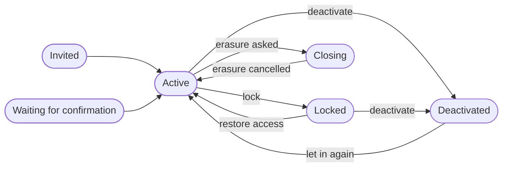

A tenant's **users** are the people who sign in to your apps through ianua. Each one belongs to exactly one tenant. Your own team, the people who run ianua, are separate: see **Organizations and tenants**.

**Groups** put users together so you can give them the same roles at once.

## How people get in

There are seven ways to put a user into a tenant. Use whichever fits how you already manage people; you can use several at once.

| Way in | Who starts it | The account starts as |
| --- | --- | --- |
| **Invitation** | An administrator | Invited, until the person accepts |
| **Created by an administrator** | An administrator | Active, or waiting for email confirmation |
| **Import** | An administrator, from another system's export | Waiting for email confirmation |
| **Sign-up** | The person, if the tenant allows it | Waiting for email confirmation |
| **Single sign-on** | The person, signing in through your identity provider | Active |
| **SCIM** | Your identity provider, on its own schedule | Active, or waiting for email confirmation |
| **Directory (LDAP)** | A tool writing to ianua's directory | Active |

### Invitation

In the dashboard, open the tenant, go to **Users**, choose **Add user**, then **Send Invite**.

The person gets an email with a link. They choose a password that meets the tenant's rules, and their account becomes active with the role you picked. The link works for one day; set `INVITATION_TTL_SECONDS` to change that. You can resend an invitation, which issues a fresh link, or revoke it.

### Created by an administrator

Choose **Add user**, then **Create Member**. You can set a password or let ianua generate one; a generated password is shown once, so pass it on straight away.

- With **Auto-verify email** on, the account is active immediately and the person gets a welcome email.
- With it off, the person gets a link to confirm their address, and cannot sign in until they do.

### Import

To move people over from another system, such as the identity provider the tenant is leaving, an administrator imports its export through the API (`POST .../users/import`), with the password hashes it kept: Argon2id, bcrypt (`$2a$`, `$2b$`, `$2y$`), scrypt in its PHC form, or PBKDF2-SHA256 in its PHC form, as passlib writes it, or as Django writes it. A hash that would cost more to check than one sign-in may spend is refused at import: bcrypt above cost 14, Argon2id above 256 MiB, ten passes or sixteen lanes, scrypt above `ln=17,r=8,p=1` (more lanes are fine with a smaller cost), and PBKDF2 above a million rounds. PBKDF2 hashes of fewer than a thousand rounds are refused as too weak. Each account waits for its holder to follow the link mailed to their address. They then sign in with the password they already have, and that sign-in replaces the old hash with Argon2id.

### Sign-up

Off by default. To allow it, open the tenant's **Settings**, and under **Ways in** turn on **Let people sign themselves up**. Password sign-in must be on as well.

The tenant's sign-in page then shows **Create an account**. A new account cannot sign in until its owner follows the confirmation link, so an address someone typed on another person's behalf never becomes a working account. The form gives the same answer whether or not the address already has an account, so it cannot be used to find out who is registered.

### Single sign-on

When people sign in through an identity provider you connected (OIDC or SAML), ianua finds them by the link between who they are at the provider and their account here. The provider is trusted only for addresses in the email domains bound to its connection, and only for addresses it does not itself call unverified.

The first time someone signs in, an account with their address is linked to them, unless that account holds any of ianua's own permissions: its owner then links it themselves, with a fresh sign-in. If no user has that address, what happens depends on the connection's **just-in-time provisioning** setting. With it on, the user is created on the spot, already active, because the identity provider has just vouched for the address. They get the tenant's default roles plus the connection's own default role, if you set one. With it off, the sign-in is refused.

### SCIM

SCIM lets your identity provider (Okta, Microsoft Entra ID, and others) create, update and remove users and groups itself, so the people in ianua always match the people in your company directory.

Open the tenant, go to **Connections**, and choose **Enable SCIM**. You get a **bearer token**, shown once. The card then shows the path of the tenant's SCIM service; put your API's address in front of it to get the **base URL**:

```
https://<your API host>/scim/v2/organizations/<organization>/tenants/<tenant>
```

Give the base URL and the token to your identity provider. ianua supports users and groups, with filtering by `userName` and `displayName`, and both full replacement and partial updates. The card also shows when your identity provider last connected, so you can see that syncing works.

Three settings, also on that card, shape what SCIM does:

- **Auto-activate** (on by default): new users are active at once. Off, they first confirm their email address.
- **Default role**: a role every SCIM-created user gets, on top of the tenant's default roles.
- **Deactivate on remove** (on by default): when your identity provider removes someone, their account is deactivated and kept. Off, it is deleted.

When your identity provider switches a user off, ianua locks the account and ends its sessions; switching them back on unlocks it.

:::caution
The SCIM token can create, change and remove every user and group in the tenant. Treat it like an administrator's password: store it only in your identity provider, and rotate it if it may have leaked. Rotating makes the old token stop working immediately.
:::

### Directory (LDAP)

ianua includes an LDAP directory, so older apps that only speak LDAP can look people up and check passwords. An app binds as a service account, with that account's secret, and only reads: a service account never writes. A person binds with their password, over a connection that shows their client certificate, issued from a signed-in session that has passed a second factor. A person writes users and groups with their own rights. A user added through LDAP is active straight away.

The directory takes passwords, so it does not take plain connections by accident. In production it needs its own certificate, or the explicit word that TLS is ended in front of it. In that second case no client certificate reaches the directory, so only service accounts can bind.

## An account's life

Every user has one status. Only an **active** account can sign in, whatever way it signs in: with a password, a passkey, a magic link, or single sign-on.



| Status | What it means |
| --- | --- |
| **Invited** | Has an invitation and has not accepted it. Cannot sign in. |
| **Waiting for confirmation** | Exists, but the email address is not confirmed. Cannot sign in until the person follows the link. |
| **Active** | Signs in normally. |
| **Locked** | Blocked by an administrator or by SCIM. Every session ends, and so does every delegation the user gave an agent. **Restore Access** brings the account back. |
| **Deactivated** | Switched off. Sessions and delegations end as with locking, and the account cannot sign in until someone lets it in again. Its data is kept. |
| **Closing** | Waiting to be erased. Cannot sign in, and its sessions end. It becomes active again if the erasure is cancelled. |

Too many wrong passwords is different: the network they came from is held out of the account for a short time (set in the tenant's **Lockout** settings) and then can try again. The person still signs in from anywhere else, and the account's status does not change.

## Passwords

Each tenant sets its own password rules under **Settings**: a minimum length, and whether a password needs an uppercase letter, a lowercase letter, a digit or a special character. By default that is at least 12 characters with an uppercase letter, a lowercase letter and a digit.

The rules apply to every password, however it is set: by the person when they accept an invitation, sign up, change or reset it, or by an administrator creating an account or resetting a password. A generated password always meets them.

When an administrator resets a password, the new one is shown once and every session the user had ends.

## Changing an email address

An administrator can change a user's address. ianua emails a confirmation link to the **new** address, and the old one keeps working until the link is followed. Once it is, the old address gets a notice that the change happened, so a change nobody asked for does not go unnoticed.

Changes from SCIM, or from your directory, take effect at once: your identity provider is the source of truth for those people.

## Custom fields

A tenant can declare its own fields for users, such as a department or an employee number. Open **Users** and choose **Fields**.

Some fields the person can fill in themselves; others only administrators can set. A field marked **sensitive** is hidden from anyone without clearance to read it. A value can only be written to a field the tenant has declared.

## Removing people

There are two ways to remove someone, and they are for different situations.

**Delete Forever** removes the account at once. Its sessions, role assignments and credentials go with it, and every delegation the user gave an agent is revoked first. The audit log keeps its record that the account existed and was deleted.

**Erasure** is for a person exercising their right to be forgotten (GDPR Article 17). Either the person or an administrator can request it. The account is not touched for **30 days**, and during that time the request can be cancelled. After that, ianua removes the account and everything attached to it, as with deleting.

What the audit log records about the erasure names the account only by its id, never its name or address, because audit records are permanent. Records written before the request keep what they recorded; the audit log is sealed and nothing in it can be edited.

## Groups

A group is a set of users that hold the same roles. Give a role to a group, and everyone in the group has it. Change who is in the group, and what they can do changes with it. Groups can also hold service consumers, the machine clients that call your APIs.

Open the tenant and go to **Groups** to create one, add members and give it roles.

### Nesting

A group can sit inside one other group, chosen when it is created. Members of a group get the roles of that group **and of every group above it**. A group that has other groups inside it cannot be deleted until they are moved or removed.

### Granting through a group

A group can only be used to grant what you already hold. To add someone to a group, or give a group a role, you must already have every permission that group would give them, including what it inherits from the groups above it. This stops a group from being used to hand out more than its manager could hand out directly.

Your identity provider, through SCIM, is the exception: it acts with the tenant's full provisioning authority. It decides who is in a group; the roles the group carries are still set only in ianua.

## What's next

- **Roles, permissions and policies** explains what a role holds, and how ianua decides what a signed-in user may do.
- **Sign-in methods** covers passwords, passkeys, magic links, second factors and single sign-on in detail.
