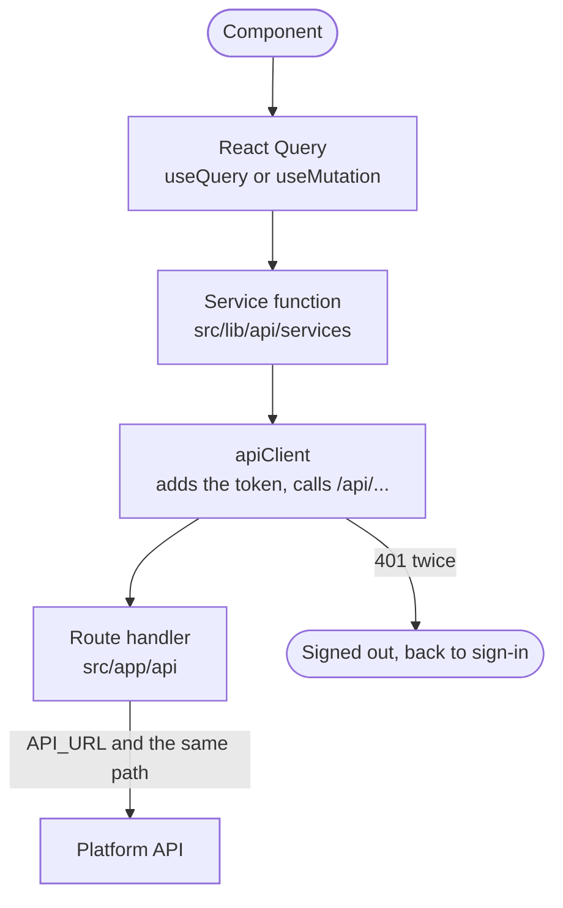

The browser never calls the platform API directly. It calls the dashboard's own `/api/...` routes, and those forward the call. When Ann opens a tenant's Users page, the request goes like this:

## Settings

| Setting | Read by | Meaning |
| --- | --- | --- |
| `NEXT_PUBLIC_API_URL` | The browser (`apiClient`) | Where API calls go. Normally `/api`, so they reach the proxy. It is fixed when the dashboard is built. |
| `API_URL` | The route handlers | The platform API, such as `https://api.example.com/api/v1`. |
| `DEPLOYMENT` | The server | `self_hosted` sends the main address straight to the sign-in page instead of the landing page. |
| `NEXT_PUBLIC_WS_URL` | The browser | Where the notification WebSocket connects. |

## In the browser

The browser's side lives in `src/lib/api`.

| File | What it does |
| --- | --- |
| `client.ts` | The shared axios client. It adds `Authorization: Bearer <token>` from the session store. On a `401` it tries the request once more. If that fails too, it signs the person out and sends them to the right sign-in page. Tokens are not refreshed. |
| `crud.ts` | Small helpers on top of `apiClient`: `getList`, `getById`, `createResource`, `updateResource`, `deleteResource`, and `buildSortParam`, which writes `-field` for a descending sort. |
| `errors.ts` | `getApiErrorMessage(error, fallback)` shows the platform's `message` if there is one, then the error's own message, then the fallback. `deriveErrorMessage(...checks)` gives the first message whose condition holds. |
| `index.ts` | Re-exports every service function and type. Import from `@/lib/api`. |
| `services/*.ts` | One file per area of the API. Each has typed functions, such as `getTenantUsers` or `createRole`. They call the API and turn its snake_case answers into the camelCase types in `src/types`. |

The service files are `activity`, `agent-activity`, `api-keys`, `approvals`, `audit-log`, `auth`, `auth-config`, `classification`, `cloud-accounts`, `connections`, `credentials`, `crypto`, `delegations`, `devices`, `dns-records`, `domains`, `flows`, `gateway-probe`, `gateway-services`, `groups`, `metrics`, `model-providers`, `mtls`, `notifications`, `oauth-clients`, `org-auth-config`, `organizations`, `passkeys`, `pipeline`, `policy`, `pricing`, `reference-data`, `resource-types`, `roles`, `routes`, `runs`, `sign-in-policy`, `signup`, `stream-routes`, `streams`, `team`, `tenant-agents`, `tenant-api-keys`, `tenant-permissions`, `tenant-users`, `tenants`, `tools` and `user-attributes`.

Most query keys are written where they are used, such as `['tenant-users', orgSlug, tenantSlug, ...]`. Shared helpers such as `invalidateAuditLogQueries` live in `src/lib/query-keys.ts`. React Query's defaults are in `src/lib/providers/query-client.ts`: one retry, data fresh for 60 seconds, and no refetch when the window gets focus back or the network returns.

## On the dashboard's server

The server's side lives in `src/app/api`. Its route handlers follow the API's own paths, about 250 `route.ts` files in all. For example, `src/app/api/organizations/[orgSlug]/tenants/[tenantSlug]/users/route.ts` forwards to `${API_URL}/organizations/{org}/tenants/{tenant}/users`.

| File | What it does |
| --- | --- |
| `_utils/proxy.ts` | `createProxyResponse(response)` passes the API's status and JSON body back. A `204` or `205` comes back without a body, and text that is not JSON becomes `{ message }`. `readOptionalRequestBody(request)` reads a body only when there is one. `getForwardedClientHeaders(request)` gives the caller's `user-agent`, `x-forwarded-for` and `x-real-ip`, so the API sees the real caller. |
| `organizations/[orgSlug]/tenants/[tenantSlug]/proxy.ts` | `proxyTenantRequest({ method, actionPath, request, routeContext })` forwards a call for one tenant, and many tenant routes use it. It forwards `Authorization`, `Content-Type` and the caller's headers. Without `API_URL` it answers `500 CONFIG_ERROR`. |
| `v1/[...path]/route.ts` | Forwards every `/api/v1/...` address on the dashboard's host. A tenant's issuer is `<dashboard>/api/v1/organizations/...`, so OIDC discovery, sign-in, tokens and keys, SAML metadata and sign-on, and the single sign-on start and return all pass through here. It forwards `accept`, `authorization`, `content-type`, `cookie`, `user-agent` and `x-forwarded-for`, and keeps the query string. It does not follow redirects. It passes back `location`, `set-cookie` and the caching headers. |
| `gateway-probe/route.ts` | Sends a test request through the gateway for the "Try access" button. It needs the caller's token and the organization and tenant. It sends only to the tenant's verified domains, which it checks with the API using that token. It refuses a host that resolves to a private, loopback or link-local address, and it never follows redirects. |
| The other top-level folders (`login`, `signup`, `password`, `passkey`, `email`, `users`, `timezones`, `locales`, the status pages and more) | Calls for the organization, and public ones. |

### Adding a call

1. Add a typed function to the right file in `src/lib/api/services`, and export it from `index.ts`.
2. Put its request and answer types in `src/types`.
3. Add a route handler under `src/app/api` that forwards to `API_URL` and returns `createProxyResponse(response)`, or reuse one. For a call inside a tenant, use `proxyTenantRequest`.
4. Call it from a component with `useQuery` or `useMutation`. Show errors with `getApiErrorMessage`, and refresh the queries it changes.

A handler for signing in, signing up, passwords, second factors, passkeys, email changes or signing out must pass on the caller's address. These handlers, and `proxyTenantRequest`, add `getForwardedClientHeaders(request)` to the headers they send. That way rate limits, IP allow lists, risk checks and the audit log see who really called. Do the same in any new sign-in handler.

## Reading lists

Every list comes a page at a time. A service sends `after` and `limit`, the API answers `{ items, next_cursor, limit }`, and the service returns `items`, `limit` and `nextCursor`. A proxy route passes the query string on, so `after` reaches the API unchanged. Tables keep the cursors in `useTableQueryState` and draw `DashboardPagination`, which shows the range without a total because the API sends none. `getTenantAgents` follows `next_cursor` to the end, because the agents screen filters by status in the browser and the pickers need every agent.

## Reading an agent's runs

An agent may have thousands of runs, so they come a page at a time.

- `getAgentRuns` sends `after` and `limit` to the agent-runs proxy, which passes the query string on.
- The answer is `{ items, next_cursor, limit }`. The service turns it into a `RunPage` with `nextCursor`.
- Runs come newest first. A page holds summaries only, without the steps or the final answer.
- The screen starts with 20 rows and offers 20, 50 or 100. It keeps the cursors it has seen, so "previous" works. It shows no total, because the API sends none.

`getAgentRun` reads one run with its steps. `RunTraceModal` reads it only while the trace is open, and shows loading, retry and empty states. Starting or stopping a run refreshes both the pages and the cached runs. Moving to another tenant or agent goes back to the first page and closes the trace.

## Live notifications

`src/lib/notifications/realtime-notifications.ts` builds the WebSocket addresses for the organization and the tenant, reads each message and turns it into a toast. `OrganizationNotificationWebSocket` and `TenantNotificationWebSocket` open the sockets (see [Dashboard shell](/ianua/dashboard/components/dashboard-shell/)).
