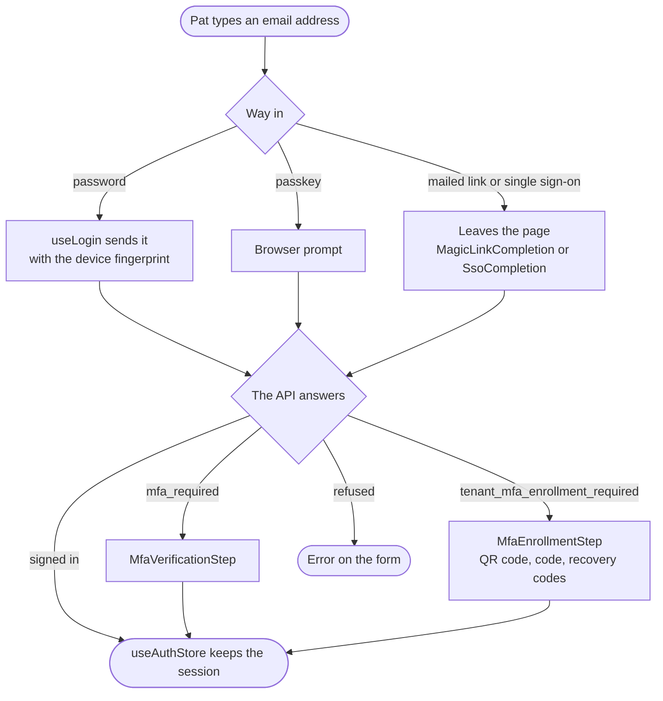

## Two kinds of session

Ann runs the organization. Pat is a user of one of its tenants. They sign in at different places and get different sessions.

|                         | Ann: organization session                                                                  | Pat: tenant session                              |
| ----------------------- | ------------------------------------------------------------------------------------------ | ------------------------------------------------ |
| Who                     | The organization's team: Owners, Admins, Members, Billing contacts and Viewers             | A tenant's own users                             |
| Signs in at             | `/login`                                                                                   | `/organizations/{org}/tenants/{tenant}/login`    |
| Lands on                | `/overview`, then `/tenants/{tenant}/...`                                                  | `/organizations/{org}/tenants/{tenant}/overview` |
| `useAuthStore().access` | `{ role, tenants: [...] }`, `role` being `Owner`, `Admin`, `Member`, `Billing` or `Viewer` | `null`                                           |

The code tells the two apart by `access`: it is `null` only in a tenant session.

## Signing in

`LoginForm` runs every sign-in:



1. Pat types an email address. Then a password, or on a tenant's page a passkey, a mailed link or single sign-on. `useTenantSignInOptions` says which of these the tenant offers.
2. `useLogin` sends what Pat typed, with a device fingerprint kept per browser (`lib/auth/device.ts`).
3. The API may ask for more. `mfa_required` opens `MfaVerificationStep`. `tenant_mfa_enrollment_required` opens `MfaEnrollmentStep`, which shows a QR code, confirms the code and shows recovery codes. `choose_organization` lists the organizations the email belongs to, and picking one signs in again with its slug. `password_change_required` opens `DuePasswordChangeStep` for a new password; when the token went to the mailbox instead, the mailed link lands on `/change-password`.
4. Once Pat is in, `useAuthStore().login(...)` keeps the session and the page moves on. An organization sign-in loads what the member may reach (`withOrgAccess` in `lib/auth/org-session.ts`) before it is stored, because a stored session with no `access` reads as a tenant session everywhere else.

Changes the API wants proven afresh ask for the password again through `ReenteredProofModal`: setting up a second factor, adding a passkey, a new organization email, saving sign-in rules and saving mutual TLS. A `step_up_required` refusal adds a field for a second-factor code.

Passkeys use WebAuthn (`lib/auth/webauthn.ts`) in two ways: the "Sign in with a passkey" button, and the browser offering a passkey from the email field. A mailed link lands on `MagicLinkCompletion`, and single sign-on on `SsoCompletion`. Each trades its one-time token for a session, once.

The text on the sign-in, sign-up, password, verification and status screens comes from `messages/<language>.json` under `auth`. A message the API sends is shown as it came, in English. The dashboard's own fallbacks, form errors and passkey errors are translated. If a password matches people in several tenants, `lib/api/services/auth.ts` throws `MultipleTenantsError`, so the form can say so in Pat's language.

## The session token

The token from sign-in is kept in `useAuthStore().accessToken` and saved in `localStorage` under `ianua-auth`. `apiClient` sends it as `Authorization: Bearer ...`. On a `401` the client tries once more, then signs out and goes to the right sign-in page. Tokens are not refreshed in the background.

Any script running on the page can read `localStorage`. So the dashboard must never load a script it does not ship itself.

## Keeping pages behind sign-in

`DashboardLayout` wraps everything under `src/app/(dashboard)`. It waits for the session store to load, then sends a signed-out visitor to `/login` or to the tenant's sign-in page. `AuthLayout` does the opposite on the sign-in pages: someone already signed in goes to `/overview`.

These checks only make the pages pleasant to use. **The platform decides.** It checks every API call itself, so a hidden page never protects anything.

## Permissions inside a tenant

Every tenant screen checks permissions through one hook:

```ts
const { canView, hasPermission, isLoading } = useTenantPermissions();

canView("Users"); // any permission on Users
hasPermission("Users", "Create"); // this action, or Manage on Users
```

Where the permissions come from:

| Who                                   | Read from                                                                                                              | Then                                                                                                                                                                      |
| ------------------------------------- | ---------------------------------------------------------------------------------------------------------------------- | ------------------------------------------------------------------------------------------------------------------------------------------------------------------------- |
| Pat, a tenant user                    | `GET /organizations/{org}/tenants/{tenant}/me`, which gives `permissions: [{ Users: 'View' }, ...]`                    | Checked against that list.                                                                                                                                                |
| A Member of the organization          | `access.tenants[slug].permissions`, from sign-in or `GET /organizations/{org}/me/access`, such as `idp:audit_log:view` | Turned into the form `AuditLog:View`, then checked the same way. `/me/access` is read again when the Member opens a tenant, so a change applies without signing in again. |
| An Owner or Admin of the organization | Nothing                                                                                                                | Everything is allowed.                                                                                                                                                    |
| A Billing contact or Viewer           | Nothing                                                                                                                | Their role reaches no tenant, so every tenant page shows "No access to this tenant".                                                                                      |

`Manage` on something allows every action on it. `src/types/permission.ts` lists the names of things and actions.

What the answer changes:

- **Coming back.** A page that sends a signed-out person to sign in adds `?next=` with its own address, so they return there. Both sign-in pages accept only a path inside the dashboard (`lib/auth/sign-in-return.ts`).
- **Workflows.** Workflow screens use the `Workflows` resource with the actions `View`, `Create`, `Update`, `Run`, `Approve`, `Delete`, `Manage` and `ConnectAccounts`. Flows use it too. Someone with only `Approve` is told on the list that they can decide approvals but not view workflows.
- **Navigation.** `filterTenantNavItemsByPermission` (`utils/tenant-section-permissions.ts`) hides the sections someone cannot see, in the main sidebar and in `TenantSidebar`.
- **Pages.** If Pat opens a section without its permission, `DashboardLayout` shows "You don't have access to this page". A Member with no role in the tenant sees "No access to this tenant".
- **Actions.** Cards turn off or hide buttons with `hasPermission(resource, action)`. The create and edit pages of routes, services, ports and flows check it too, in `DashboardLayout`.
- **Settings tabs.** Each tab names what it needs: `AuthConfig`, `Mtls`, `Classification` or `TenantSettings`.

Which permission each section needs:

| Section                                    | Needs                                                                                          |
| ------------------------------------------ | ---------------------------------------------------------------------------------------------- |
| Users                                      | `Users`                                                                                        |
| Groups, Roles, Permissions                 | `Roles`                                                                                        |
| Policy                                     | `PolicySet`                                                                                    |
| Domains                                    | `Domains`                                                                                      |
| Connections                                | `Federation`                                                                                   |
| API keys, OAuth clients                    | `ApiKeys`                                                                                      |
| Signals                                    | `Signals`                                                                                      |
| Services, Routes, TCP and UDP routes       | `Routing`                                                                                      |
| Pipelines                                  | `Pipeline`                                                                                     |
| Crypto                                     | `Crypto`                                                                                       |
| Agents, Flows, Tools, Model providers      | `Agents`                                                                                       |
| Overview, Settings, Notifications, Account | Nothing here. Overview hides its numbers without `Metrics:View`, and Settings checks each tab. |

## Permissions in the organization

Organization screens check what `useOrgAccess()` says about the role, from `getOrgRights` in `utils/org-role.ts`. The table mirrors the platform's role rights.

| Role    | Runs the organization | Tenants       | Team  | Subscription | Audit log | Closes it |
| ------- | --------------------- | ------------- | ----- | ------------ | --------- | --------- |
| Owner   | Yes                   | Every one     | Yes   | Changes it   | Yes       | Yes       |
| Admin   | Yes                   | Every one     | Yes   | Reads it     | Yes       | No        |
| Member  | No                    | Those granted | Reads | No           | Yes       | No        |
| Billing | No                    | None          | No    | Changes it   | No        | No        |
| Viewer  | No                    | None          | Reads | Reads it     | Yes       | No        |

An Admin can make Admins, Members and Viewers. Only an Owner can make or act on an Owner or a Billing contact (`getAssignableOrgRoles`).
