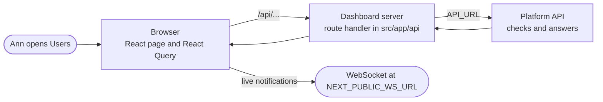

The dashboard is the web app in `dashboard/` where people run ianua. Ann, who owns a company, signs in, opens a tenant, invites Pat and gives Pat a role. Everything she sees comes from the platform API. The dashboard keeps no data of its own.

## The big picture

When Ann opens the Users page, the request takes three steps:



The browser never talks to the API directly. It talks to the dashboard's own `/api/...` routes, and those forward the call. Live notifications are the one exception: the browser opens their WebSocket itself, at `NEXT_PUBLIC_WS_URL`.

## Tools it is built with

| Concern | Choice |
| --- | --- |
| Framework | Next.js (App Router), React 19, TypeScript |
| Styling | Tailwind CSS v4, Material Symbols (a subset of the icon font) |
| Server data | TanStack Query |
| Session state | Zustand, kept for the session |
| Forms | React Hook Form with Zod |
| Languages | next-intl, chosen by a cookie, not the address |
| HTTP | axios |
| Menus and tooltips | `@floating-ui/react` |
| Dates | `date-fns`, `react-day-picker` |
| Deployment | Docker (Next.js standalone output), Helm |

## Folders

```text
dashboard/src/
├── app/             Pages, layouts and API route handlers (see Pages and routes, API layer)
├── components/
│   ├── ui/          Shared building blocks (see UI building blocks)
│   ├── auth/        Sign-in and emailed-link screens
│   ├── landing/     The landing page
│   ├── legal/       Privacy and terms pages
│   ├── help-center/ The Help Center
│   ├── notifications/ The toast stack
│   └── dashboard/   Everything after sign-in
│       ├── *.tsx          Layout, sidebar, page header, WebSockets
│       ├── shared/        Tables, menus, confirm dialogs, pickers
│       ├── overview/      Metric cards and charts
│       ├── team/          The Team page
│       ├── tenants/       The tenant list and the create form
│       ├── settings/      Organization settings
│       └── tenant-detail/ Everything inside one tenant
├── hooks/           React hooks (see State and hooks)
├── lib/             API client and services, providers, sign-in helpers
├── store/           Zustand stores
├── schemas/         Zod form schemas
├── types/           Shared TypeScript types
├── constants/       Option lists, labels and fixed content, the Help Center included
├── utils/           Pure helper functions
├── i18n/            Language setup, request setup, the cookie action
└── assets/          Images, logos, the icon font
dashboard/messages/  One JSON file of interface text per language (en.json, uk.json)
```

## Languages

The language comes from the `ianua-locale` cookie, not from the address. That way both ways into a tenant keep the same paths. If Pat picks Ukrainian, the cookie says `uk` and every page loads `messages/uk.json`. A missing or unknown value falls back to English.

- `src/i18n/request.ts` reads the cookie and loads the messages.
- `src/i18n/config.ts` lists the languages and maps each to the tag the platform stores (`uk` to `uk-UA`).
- `setLocaleCookie` in `src/i18n/actions.ts` saves the choice.
- `messages/en.json` is the source. Every other file must have exactly its keys. `npm run check-messages` checks this.
- Components read text with `useTranslations()` in the browser and `getTranslations()` on the server. The type check refuses a key that is not in `en.json`.
- `LanguageSwitcher` sits in the landing, legal and Help Center headers, on the sign-in pages and in the user menu.
- A signed-in person's choice is saved with `PATCH .../me` and `{ locale }`. `LocaleSync` applies it at their next sign-in. Signing out keeps the cookie.
- Landing, legal and footer text lives in the message files. Constants such as `constants/landing.ts` keep only ids, links and icons. The text for each id is looked up with ``t(`...${id}...`)``. Rich text uses `t.rich` with tags such as `<highlight>`.
- Dashboard text lives under `dashboard.*`. Navigation items, statuses and actions keep English names, because tabs and routes are matched by them. `useNavLabels`, `dashboard.status.<Status>` and `dashboard.actions.labels.<Action>` give the visible words.
- Zod schemas name each error as a `validation.<key>` instead of writing the text. The form shows it through `useFieldError`. A message that is not such a key, such as one from the platform, is shown as it came.
- Headings use Space Grotesk, which has no Cyrillic letters. So every heading font list puts Manrope before the generic fallback.
- To add a language, add it to `LOCALES`, `LOCALE_NATIVE_NAMES` and the platform map in `src/i18n/config.ts`. Then add `messages/<language>.json`.

## Two ways into a tenant

Ann and Pat see the same tenant screens through different addresses:

- Ann is on the organization's team. She opens `/tenants/{tenant}/...`, and the page draws its own section sidebar.
- Pat is a user of the tenant. Pat opens `/organizations/{org}/tenants/{tenant}/...`, and the main sidebar becomes the tenant's navigation.

`useTenantRouteParams()` gives the right `orgSlug` and `tenantSlug` for either address. `getTenantScopedPath` builds links that stay on the same one. See [Pages and routes](/ianua/dashboard/routing/) and [Sessions and permissions](/ianua/dashboard/auth-and-permissions/).

## How a screen is built

Most screens follow one pattern. Here is the tenant Users page:

```text
TenantUsersCard                         (sections/tenant-users-card.tsx)
├── useTenantRouteParams()              which organization and tenant
├── useTenantPermissions()              what the person may do
├── useTableQueryState()                page, size, sort
├── useQuery(getTenantUsers)            the data
├── useMutation(inviteTenantUser, ...)  actions, then a toast, then fresh data
└── DashboardDataCard
    ├── DashboardTabs (status filter)
    ├── TenantUsersTable, with TenantUserActionsMenu (DashboardActionsMenu)
    ├── DashboardPagination
    └── AddTenantUserModal (Modal, React Hook Form, a Zod schema)
```

## Conventions

- **API calls** go through a typed service in `src/lib/api/services`, exported from `@/lib/api`, and a proxy route in `src/app/api`. Components never call `fetch` for platform data.
- **Errors** are shown with `getApiErrorMessage(error, fallback)`. An action's success or failure shows a toast through `useNotification`.
- **Permissions** are checked with `useTenantPermissions()` and `useOrgAccess()`. The platform still decides.
- **Forms** use React Hook Form with a Zod schema from `src/schemas` and controls from `components/ui`.
- **Tables** use `DashboardDataCard`, `DashboardTableShell`, `DashboardPagination` and `useTableQueryState`.
- **Row actions** use `DashboardActionsMenu`, which also shows the confirm dialogs.
- **Styling** is Tailwind with the design tokens (`bg-cardBg`, `text-textGray`, `border-borderGray`, `bg-primary`). Classes are merged with `cn()`.
- **Icons** are Material Symbols ligatures: `<span className="material-symbols-rounded">key</span>`. Every new icon name goes into `ICON_NAMES` in `src/constants/icon-names.ts`. The build makes the font from that list, so a name not in it shows as a blank.
- **Long or reused text** (landing, legal, Help Center, option labels) lives in `src/constants`.
- **Formatting** is Prettier (`npm run format`), ESLint (`npm run lint`) and strict TypeScript (`npm run type-check`).

## Running it locally

```bash
cd dashboard
npm install
cp .env.local.example .env.local   # point API_URL and NEXT_PUBLIC_WS_URL at the platform
npm run dev
```

Before pushing, run `npm run check-messages`, `npm run lint`, `npm run type-check` and `npm run format:check`. CI runs the message check, lint, the type check and the build.
