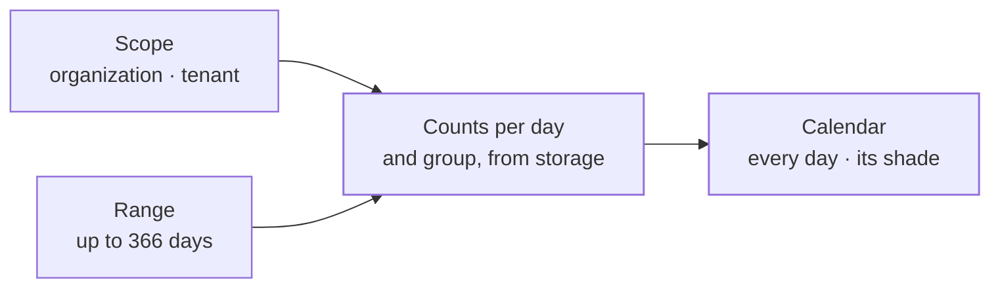

The activity context holds the **activity calendar**: one cell per day, shaded by how much happened that day, in the style of a GitHub contribution graph. It says which days a calendar covers, which group each event falls into, and how busy a day must be for each shade.

It counts nothing itself. Storage counts the audit records per day and group, and hands the counts over. This context checks those counts, fills in the quiet days and grades every day.

Activity is part of the foundation. It uses no other context. It reads the event types every context shares, so it knows which group an event belongs to.

The code is in `crates/ianua-domain/src/domains/activity`:

| Part | What it holds |
|---|---|
| `scope` | Whose activity a calendar counts: an organization or one tenant |
| `range` | The days a calendar covers |
| `category` | The groups events fall into |
| `calendar` | The calendar itself, its days and their shades |

## How the parts fit

## Whose activity

A calendar is counted for one **scope**:

| Scope | What it counts |
|---|---|
| Organization | The organization's own events and those of the tenants its reader reaches |
| Tenant | Only the events of that one tenant |

The calendar holds no rights check of its own. Whoever asks for it names the scope, and the layer above decides who may see it. The app gives a member the calendar of their organization only when they may read its audit log, counted as far as they reach: an owner or admin every tenant, a member the tenants granted to them, a viewer none, and someone in a tenant the tenant's calendar only when they hold the right to view the audit log there.

## The days it covers

A calendar covers a range of whole days, counted in UTC. Both the first and the last day are included.

- The last day may not come before the first. Such a range is refused.
- A range covers at most 366 days, one leap year. A longer one is refused, so a single calendar never makes storage scan years of audit records.
- The usual calendar is the **trailing year**: the 365 days ending on the day asked for, as GitHub shows it.

Storage reads the events from midnight UTC on the first day up to, but not including, midnight UTC after the last day.

## Groups of events

Every event falls into exactly one group. The group comes from the event's type when the event is recorded, and is stored with it, so the calendar never has to work it out again.

| Group | Events from |
|---|---|
| Authentication | Sign-ins, sessions, tokens, second factors, passwords |
| Access | The gateway's decisions, and routing |
| Administration | Roles and permissions, operators, agents, workflows |
| Identity | Accounts, invitations, addresses |
| Provisioning | Organizations and tenants |
| Other | Federation, OAuth, webhooks, messaging, consumers, signals, branding, keys, notifications |

Every kind of event has a group, so none is left out. **Other** is a group like the rest, not a place for errors. The groups always appear in the order of this table. A calendar lists only the groups that had events in its range.

A stored group name the code does not know is never guessed into another group. It is treated as broken storage.

## Shading a day

Each day gets one of five shades, measured against the busiest day in the calendar:

| Shade | Number | The day's events |
|---|---|---|
| None | 0 | No events |
| Light | 1 | Up to a quarter of the busiest day |
| Moderate | 2 | Up to half |
| High | 3 | Up to three quarters |
| Peak | 4 | More than three quarters |

A day with any activity at all is at least Light. So when the busiest day saw 100 events, a day with 1 to 25 is Light, 26 to 50 Moderate, 51 to 75 High, and 76 to 100 Peak.

Quiet days are in the calendar too, with a count of zero and no shade. So there is always one cell for every day of the range, oldest first.

Each day also carries its count for every group the calendar shows, with zero where it had none. To shade the calendar for one group alone, a reader grades those counts against that group's busiest day. No second request is needed.

The calendar also reports its total number of events and the count of its busiest day.

## What storage must send

The counts come from storage, so the calendar checks them before using them. It refuses the whole result, as broken storage, when:

- a count falls on a day outside the range asked for, or
- the same day and group are reported twice.

Storage reports only the days and groups that had events. The calendar fills in the rest with zero.
