The agents context lets an AI agent act for a person, under limits that person set. A person hands the agent part of their authority as a **delegation**. The agent then works in **runs**, where every tool call it makes is checked against that delegation. Anything risky waits for a person to **approve** it.

The model behind an agent is never trusted. It may ask for anything. The rules here decide what actually happens.

The code is in `crates/ianua-domain/src/domains/agents`, in five parts, with their events in `events`:

| Part | What it holds |
|---|---|
| `identity` | The agent itself, its owner and how ownership moves, its keys, its proof of what it is, whether it may act now, its data mark, and agents seen at work that nobody registered |
| `authority` | Delegations, the delegations agents ask people for, capabilities, purpose, task templates, message provenance and relations on resources |
| `execution` | Runs, tool calls, tools, model providers, what model calls cost, and two agents meeting at one path |
| `oversight` | Approvals and agents reviewing other agents |
| `channels` | Each agent's own topic area, and permission for two agents to exchange data |

## How the parts fit

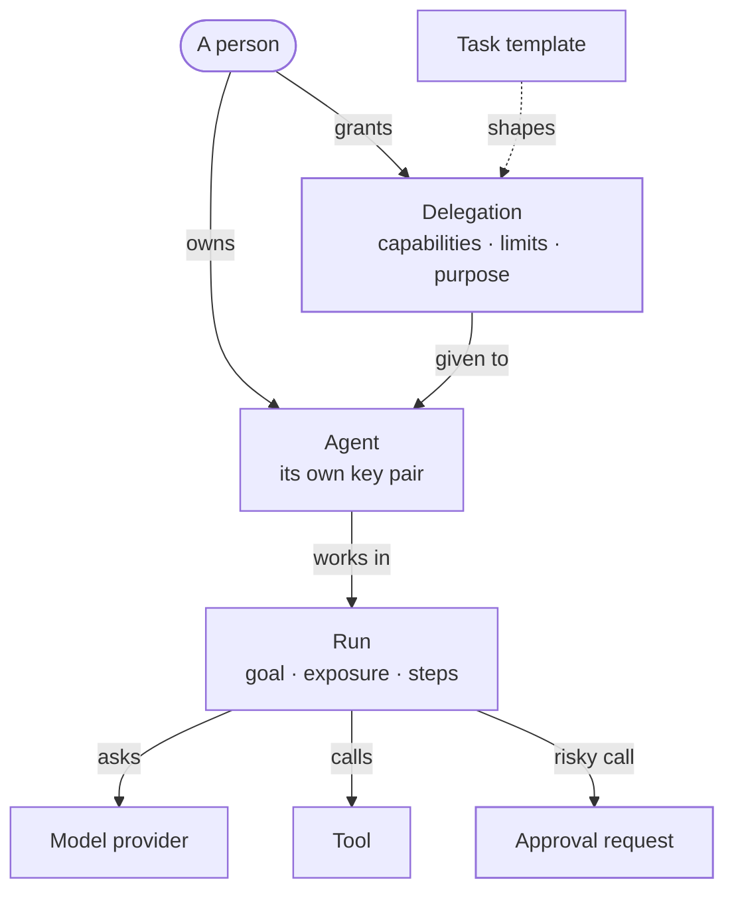

An agent always has an owner: the person who created it. Its name is its own in the tenant: creating a second agent of a name, or renaming one onto a name another agent has, is refused as a conflict (`409`). It signs in as itself with a key pair it made itself. The platform stores only the public key, so a leaked database cannot be used to pose as the agent.

A key stops working the moment its agent is suspended, revoked or owes a re-attestation. Every assertion an agent signs must be at most a minute old, and no more than 30 seconds in the future.

Wherever an agent acts in its own name, it shows proof that it signed in just now with its own key, an `ActingAgent`. Only the key's check (`AgentCredential::signed_in`) makes one, and a key proves no agent but its own. That covers passing part of a delegation on in its own name, widening a child it passed on, minting a task token and filing a review verdict. An agent id alone is never enough: Mallory's agent learns the id of Ann's agent from a log, but cannot pass Ann's delegation on by naming it.

## Who may change an agent

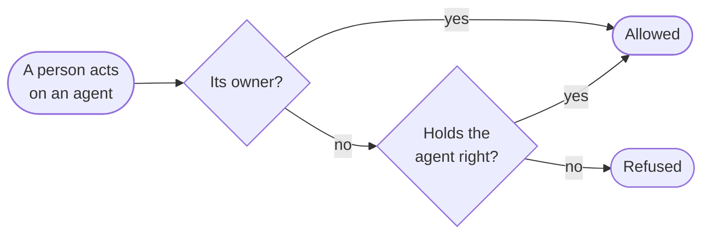

"Its owner" means the same person through any of their accounts. The right each action needs:

| Action | Agent right |
|---|---|
| Create an agent | Create, with no owner rule |
| Read it, its keys or its delegations | View |
| Hand it part of what you hold | Delegate |
| Rename it, suspend or resume it, enrol or rotate a key, set how it attests | Update |
| Revoke it, or revoke one of its keys | Delete |
| Delete it, once it is revoked | Delete |
| Open a channel from it, assign a review of it | Update |
| Close a channel from it | Update, or having opened the channel |
| End a review of it | Update, or having assigned the review. Its owner never may. |
| Order one of its runs stopped | Update, or having started the run |
| Pause or resume one of its runs | Update, or having started the run |
| Give it to another person | Manage, or being its owner |
| Hand on the agent of an owner who left | Manage, with no owner rule |
| Pass on part of a delegation it holds, or widen a child it passed on | Delegate |
| Revoke a delegation given to it | Delegate, or being the delegator |
| Widen a delegation someone else gave it | Manage, with no owner rule |
| Lower its data mark, once it is stopped | Manage, with no owner rule |
| Retire a task template | Delegate, or having proposed it |
| Register or change a tool, connect or change a model provider | Manage, with no owner rule |
| Delete a tool or a model provider, once it is disabled | Manage, with no owner rule |
| Register or dismiss an agent nobody registered | Manage, with no owner rule |

Where the owner rule applies, an agent someone may not act on reads as missing, with `404`, the same as an id that never existed. So does a delegation they neither granted nor have a say over, a run they neither started nor have a say over, a review they did not assign without the right to update agents, a delegation request not made of them without the right to manage agents, and a task template they did not propose without the right to view agents. A right with no owner rule is checked before anything is read, so someone without it is refused with `403` for a real id and a made-up one alike: taking an agent over, lowering a data mark, changing or deleting a tool or a model provider, registering or dismissing a sighting, and approving or denying an action. Sam may only view agents. He names Ann's agent to rename it and then an id he made up, and both answers are the same, so he cannot tell which agents exist.

Sam may only view agents. He cannot enrol his own key for Ann's agent and sign in as it, nor rotate or revoke her agent's key during its nightly run. A key is changed only against the agent it signs in, so Sam cannot name his own agent to pass the owner check on Ann's key. The platform's own monitors may suspend an agent, or revoke its delegation, with no person behind them, for example when it drifts from its purpose. Taking authority back is the safe direction. Giving it back always needs a person.

Each delete has an order. An agent is revoked first, so its keys and delegations are dead before its record goes. A tool or model provider is disabled first, so no run is part way through using it. Sam cannot delete Ann's agent and leave the trail of what it did without a name.

An agent's **data mark** is the most sensitive data it has read. It only rises while the agent works. Once the agent is suspended or revoked and its context is gone, an agent administrator may lower it, never raise it, and gives a reason. Its owner alone may not: Sam's agent read restricted HR records, and he cannot lower its mark to public and point it at a public tool.

**Moving an agent to another owner.** An agent always has a person answerable for it. Its owner, or an agent administrator, offers it to a named person, and nothing moves until that person accepts, signed in themselves. An offer lapses unanswered after 7 days. The new owner must be allowed to create agents, worked out from their own records in the tenant, read alone, without break-glass access: Ann cannot hand Sam, who may only view agents, an agent the tenant never let him make. When an owner has left, only an agent administrator hands the agent on. The agent keeps its status, proof and delegations, and a delegation the old owner granted still names them.

**Agents nobody registered.** An agent may call the tenant's routes with a person's key, or through a client or workload nobody tied to an agent. Such a **sighting** is kept, so an agent administrator registers it as an agent, which puts it under delegations, or dismisses it. A sighting grants nothing: what it did is still allowed or refused by the usual rules.

## Delegations

A delegation can be passed on to a helper agent as a **sub-delegation**. Each one only narrows the one above it:

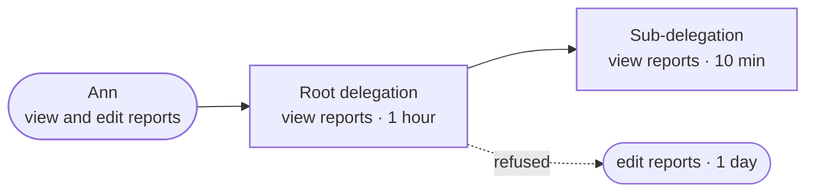

Only a person starts a chain, and only from what they hold. The person and what they hold are one value, `HeldBy`, so a delegation can never be checked against someone else's rights. The domain works that value out itself from the person's sign-in, never from the caller's word:

| Part | What the person may grant from |
|---|---|
| Built-in permissions | Their standing rights, without what a break-glass grant adds |
| Topics | Every topic of the tenant when they hold any messaging permission, otherwise none |
| Resources | Those the relationship graph says they hold. An answer about another person is refused. |
| MCP tools | Someone who may manage agents keeps each asked-for pattern that matches a registered tool. Anyone else hands on, by name, only the registered tools they were given use of. |

Sam was given use of `stripe_charge` and asks to hand his agent `stripe_*`. He hands on `stripe_charge` alone, never `stripe_refund` or a tool registered tomorrow.

A child is passed on by the agent holding the delegation, or by a person speaking for it: its owner, or someone allowed to delegate to agents. Either way the child's delegator is the holding agent, never the person, so the child stays inside its parent and is revoked with it.

A child may ask for its own lifetime, depth, apps, budget, paths, task, approval rule and key binding, each held inside the parent's. It ends no later than its parent. A budget or path limit it leaves out is the parent's own, and children share their parent's budget: Ann's agent may make 100 requests an hour, so once it has passed one helper 60, the next may get at most 40. A delegation that is expired, not only one that is revoked, passes nothing on. A request that names a field the API does not know is refused, so a misspelt limit such as `requires_aproval` is never dropped in silence. The same holds for granting and asking for a delegation, for an agent asking for its own token, for opening an approval and for starting a run. An agent that writes `sender_constraind` is refused, not handed a bearer token anyone who copies it can use.

Someone allowed to delegate to agents who does not own the holding agent passes on only what they hold themselves. Sam grants his agent ledger access. Mallory may delegate to agents but holds no ledger access, so she cannot pass that access from Sam's agent to an agent of hers. Its owner may pass on anything the agent holds, since the agent could pass it on itself. The same holds when a child is widened later.

A delegation someone else granted is widened only by an agent administrator, and only with what both the administrator and the delegator hold now. Bob may delegate to agents but not manage them, so he cannot widen Ann's delegation with ledger access they both hold.

A delegation also answers two questions when it is used. Does its delegator still hold what it grants? Is every delegation it was cut from still live? What the delegator holds is worked out from their account as it stands and the tenant's records (`HeldNow`), never taken from the caller, and leaves out a break-glass grant. A tenant user holds what their roles give. An organization member holds what their organization role and tenant grants give, as when they sign in. Someone who may no longer sign in, or whose organization no longer lets them into the tenant, holds nothing. Ann loses "view reports". From then on her agent's delegation does not count as allowed. Tess, an owner of the organization, delegates through what her role reaches; her agent's runs go on while she stays an owner, and halt before their next step once she leaves.

**Asking for more.** An agent working for Ann may find it needs more than it holds. It asks her, naming what it needs and why. The agent's word is never authority: the request grants nothing until Ann approves it, and lapses unanswered after a day. Only the person asked approves, and approving makes an ordinary delegation from her, checked against what she holds at that moment, never against what the agent asked for. The person asked, or an agent administrator, may refuse it.

**Renewing.** A delegation ends at a set time. Only a delegation a person granted at the top of its chain is renewed, only by that person, and only while it is neither revoked nor expired; an expired one is granted anew. The person must still hold all it grants, and the agent must be the one it was given to and still free to receive authority. It then lives its lifetime again from the renewal. Renewing changes only that delegation's own end, so children passed on from it keep the expiry they were given.

A task token's delegation records the delegations it was minted from and who granted them. Ann revokes her agent's delegation a minute after the agent exchanged a token. The token's delegation is cut from hers, so it ends too, and an approval for its calls still names Ann.

It also records the key the agent signed in with to mint it. A token asked for with `sender_constrained` is bound to that key and to no other key the agent holds. Ann's agent holds two keys, k2 and k3, and signs in with k3: its token works only beside a proof made with k3, so whoever holds k2 cannot use it. Revoking a key ends every token it minted on the next request, at the API and at the gateway, not when the tokens run out. A key rotated since still binds during its grace. A bound token in a delegation a person granted is bound to the agent's one active key, and is refused (`409`) when the agent holds none or more than one; the agent then asks for its own token with the key it means.

## One tool call, start to finish

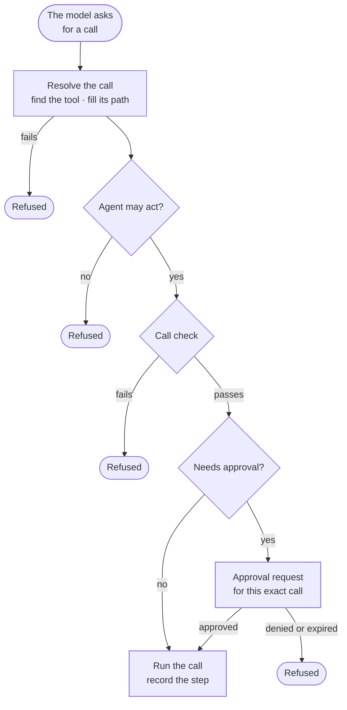

A refused call is recorded as a step with its reason, so anyone can later see exactly what a run tried and what it was allowed to do. The refusals, in the order they are checked:

| Step | Refusal | When |
|---|---|---|
| Resolve | `UnknownTool` | The tool is not the one the call names, or it is disabled. |
| Resolve | `UnfilledPath` | The call's values do not fill the tool's path exactly. |
| Agent | refused | The agent is suspended, revoked or owes a re-attestation. |
| Call check | `NoAuthority` | The run acts under no delegation. |
| Call check | `NotGranted` | The run was not started with this tool. |
| Call check | `OutsidePurpose` | The tool's class, or the class of the path the call goes to, is outside the run's purpose. |
| Call check | `WouldLeak` | The run has read data more sensitive than the tool is cleared for. |

A tool's risk class and data clearance come from the route it calls, the same ones the gateway uses. A value the model puts into a tool's path may not hold `/`, a backslash, `?`, `#`, `;` or `%`, may not be `.` or `..`, may not start or end with a space, and may not end with a dot. So a read tool at `/orders/{id}` cannot be steered to `/admin/roles`, and no encoded form gets through.

Before each model step, the run checks the model provider too. It must be the run's own, still active, and cleared for what the run has read. A run that read restricted HR data does not send it to an outside model cleared for public data.

**Which models work.** A model provider is one of three kinds:

- **Anthropic:** the endpoint `https://api.anthropic.com` (the host only), the model's name and an API key.
- **OpenAI:** the endpoint `https://api.openai.com/v1`, the model's name and an API key.
- **Self-hosted:** any server that speaks OpenAI's Chat Completions, such as vLLM (`http://host:8000/v1`) or Ollama (`http://host:11434/v1`). A key is optional.

An endpoint on a private network works only when the operator allows private model endpoints for a single-tenant install.

**How a model step is asked.** Each step asks for an answer of up to 512 tokens. Models that think or reason before answering are given room for that on top: 16,000 tokens on Anthropic and 25,000 on OpenAI. Each model keeps its own thinking default, because some current models cannot turn thinking off. A self-hosted server is sent the 512-token cap as it is. An answer that stops before the model finished, at its cap or at the end of its context, is never used, and the run fails. If the model declines, or the provider bills a call whose answer cannot be read, those tokens still count toward the run's spend limit, and a run under a spend limit stops when the provider reports no usage.

Whether a call waits for a person is decided in one place:

```rust
/// crates/ianua-domain/src/domains/agents/execution/run/gate.rs
pub(super) fn admission_for(&self, class: ActionClass) -> Admission {
    let every_action = self.approval == ActionApproval::PerAction;
    if every_action || class.is_high_risk() || self.approval_classes.contains(&class) {
        return Admission::NeedsApproval;
    }
    Admission::Proceed
}
```

Deletes, payments, settings and admin actions are high risk, so they always wait. A delegation that asks for approval on every action makes every call wait. So does a call of any class the run was started with on its approval list.

MCP tools carry a risk class too. A purpose that allows only reads refuses `delete_repo` when it was granted as a delete, and a delegation cannot hand `delete_repo` on labelled as a read.

## Who may approve a call

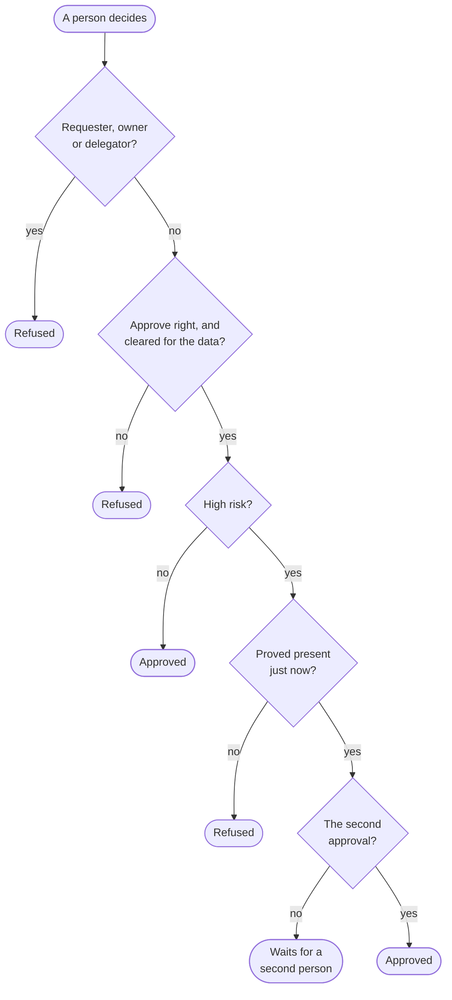

Denying needs the same right and clearance as approving. A person who would rather tell the agent what to do can deny with a reply in words, which the model reads next; the call is refused all the same. A person with the same right and clearance may also revise the held call's arguments. The revised call must use the same tool, pass every check, and take the same class of action, and a new request is opened for it, so an edit approves nothing by itself. An approved call must be made within 15 minutes. A request whose class is unknown counts as high risk. A request a run raised must carry the class of the call the run paused on, so the caller cannot pick a lower one.

An approver's clearance comes from what they hold, never from the caller. Everyone in a tenant is cleared for internal data. Confidential and restricted data need a role, or a live break-glass grant, with the matching data access permission. Restricted covers confidential.

Being present just now is proved with the approver's own account: a right code from their own second factor, spent once, or a sign-in made a moment ago. Mallory holds Bob's session and answers with a code from her own factor. It is refused, so she cannot approve a payment as Bob.

The requester is the person who started the run, or who opened the request by hand. The owner and delegators are worked out from the agent and the delegation the call uses, following parents and the delegations a task token was minted from up to the people at the top. Ann's delegation reaches the agent through a token it minted, and she is still named, so she cannot approve her own delegation's payment.

## Lifecycles

Each status changes only through the moves drawn here. Any other move is refused.

**An agent**

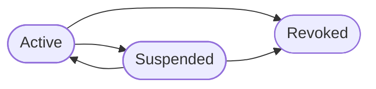

An active agent also owes a **re-attestation** when someone asks for one, or by itself once its last attestation is older than its policy allows. Until it proves what it is again, with an attestation its policy trusts, it may not act. A suspended agent that also owes a re-attestation counts as suspended, because re-attesting alone would not let it act. An agent's `standing` says which applies: `Active`, `MustReattest`, `Suspended` or `Revoked`. Each attestation challenge is spent once.

**How an agent attests**

An agent that runs on its own proves where it runs instead of holding a secret. It asks for a challenge, makes a key pair, and sends an attestation bound to both. The binding is SHA-256 of `ianua-attestation-binding-v1`, a zero byte, the challenge, a zero byte and the DER of the public key it enrols, written in lower-case hex.

- A SPIFFE workload signs `ianua-attestation-proof-v1:` and the binding with its SVID key.
- A TPM quotes with the binding's 32 bytes as qualifying data.
- A GCP VM asks its metadata server for an identity token with the binding as audience and `format=full`.
- An AWS workload signs an `sts:GetCallerIdentity` request with its role's credentials, carrying the binding in the signed header `x-ianua-attestation-binding`, and sends the request's method, URL, headers and body. ianua sends it to AWS, which checks the signature and names the role. The request must go to `sts.amazonaws.com` or `sts.<region>.amazonaws.com` and be signed within five minutes. An AWS agent attests as `aws:<account>:role/<role>`, and only assumed roles count, never an IAM user's keys.
- A Kubernetes workload asks the API server for a token for its own service account with the binding as its only audience: `kubectl create token <service-account> --audience <binding> --duration 10m`, or `POST /api/v1/namespaces/<namespace>/serviceaccounts/<service-account>/token` with `{"apiVersion":"authentication.k8s.io/v1","kind":"TokenRequest","spec":{"audiences":["<binding>"],"expirationSeconds":600}}`. Its service account needs a Role granting `create` on `serviceaccounts/token` for its own name. A projected volume token does not work, because its audience is fixed when the pod starts. The cluster must publish `/.well-known/openid-configuration` and its key set where ianua can read them. Any service account key Kubernetes supports works: RS256 for an RSA key, ES256, ES384 or ES512 for an ECDSA key on P-256, P-384 or P-521.
- A GitHub Actions job with `permissions: id-token: write` asks for a token with the binding as its audience: `curl -H "Authorization: bearer $ACTIONS_ID_TOKEN_REQUEST_TOKEN" "$ACTIONS_ID_TOKEN_REQUEST_URL&audience=<binding>"`, then sends the `value` it gets back, or uses `core.getIDToken('<binding>')`.
- A token from another OIDC issuer counts only if the issuer can make a token for an audience the workload names on each request, such as the `audience` of a token exchange. Its discovery document must name it exactly.
- An Azure managed identity cannot attest. Its tokens are only for audiences registered in Entra ID, never one chosen per request, and the only document Azure signs with a value of the VM's own takes a 10-digit nonce. A policy that trusts it is refused.

A workload token's audience must be the binding and nothing else, and the token may not have been made to live longer than an hour. A workload trust names a method, an issuer and a subject.

A proof made for one key is refused for any other, so a token or quote seen in passing cannot enrol someone else's key. A workload that claimed one agent cannot claim another, so give each AWS agent its own role.

**An agent's key**

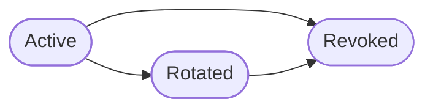

A rotated key still verifies assertions it signed before the rotation, for at most 60 seconds, which covers requests already in flight. A key lives at most a year, and its grace after rotation is between zero and an hour, so a rotation never moves a key's end into the past.

**A delegation**


A delegation lives at most 30 days. A revoked one stays on record so an audit can see what it allowed, and revoking it again changes nothing.

A stored delegation is refused as corrupt when it sits deeper than its own depth limit, when it expires later than its lifetime allows, or when a person, not an agent, is named as having passed on a sub-delegation. A task token's delegation is refused as corrupt when it names no source, the same source twice, itself, or its own agent as the one who granted it, or no key it was minted with, since each would let it escape the revoke that should end it.

**A run**

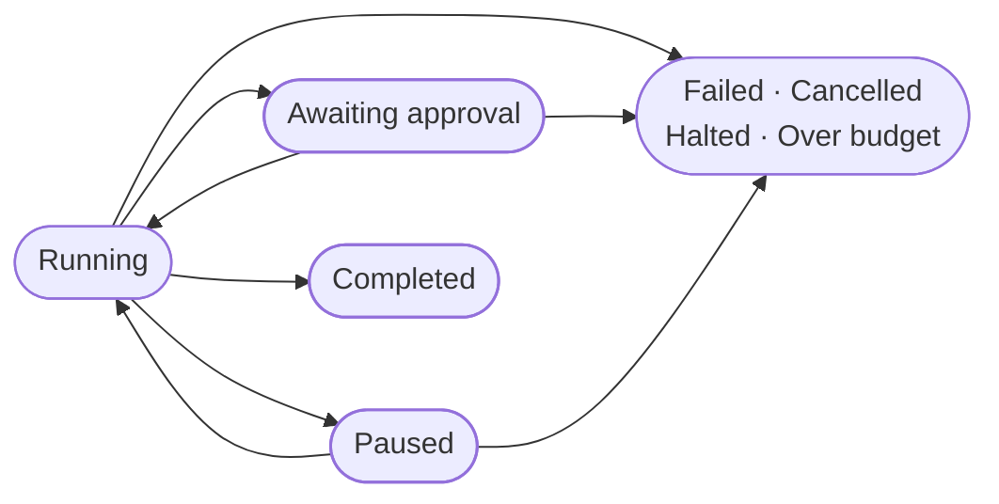

A run's step limit is between 1 and 1,000.

**Reading runs.** The agent's run list and the tenant-wide run inbox return
cursor pages of summaries, newest first. A summary keeps the run's goal,
status, purpose, held call, token use and spend. It does not load the historical
steps or the final answer. Opening one run reads its complete trace and answer.
Both lists accept `status`, `after` and `limit`; the response contains `items`,
`next_cursor` and `limit`. Pass the returned cursor as `after` to continue with
the same status filter. A `null` cursor means there is no next page.

**Handing a run to a worker.** Whenever a run is started, by a person or by a workflow step, resumed, or let go on after a person approved, denied or answered its held call, the job that drives it (`agents.drive_run`) is queued in the same unit of work as the saved run. So a run is never kept started with no job to drive it, even when its announcement is lost. While a drive job waits or runs, asking again adds none (`ianua-app/src/use_cases/agents/runs/driving/job.rs`, `RunDrives::hand_over`).

**Pausing.** The person who started a run, the agent's owner or someone who may update agents can pause it between its steps and resume it later. While paused it takes no step, and an approved call it was about to make stays held, its approval still lapsing on time. Resuming needs the agent to be free to act still: a run paused while its agent was suspended does not go on with authority the agent lost.

**Spend.** A provider reports the tokens each reply took, and the price the tenant set on the provider turns them into spend. A run under a spend limit ends as over budget once it spent the limit. It ends too when a call's cost cannot be told, because the provider reported nothing or has no price, since a limit that cannot be measured is not kept. Its stop records `agents.run_stopped_over_budget`, with what it spent and its limit, which a workflow may start from.

**Asking before spending more.** A run may also name an amount it may spend before a person is asked (`ask_past_micros`), below its spend limit. Ann lets her agent spend one unit unasked and five in all. Once its calls cost one unit, it pauses before its next model call and records `agents.run_held_at_spend`. Whoever may resume the run lets it go on, or stops it. It asks once: after that it spends on to its limit. A call whose cost cannot be told makes it ask too. The model call that passes the amount still finishes, since a call cannot be stopped halfway.

**Answers held to a check.** A run started by a workflow's code step, whose sandbox version holds an agent, does not complete on its model's answer. The answer is recorded as a step, and the version's code checks it in a sandbox of its own, as the workflows page describes. An answer that passes completes the run. One that breaks a rule is recorded as a `check_failed` step with what the check said, and the model reads it, fenced as data, before it answers again. The run gives at most the answers its version allows, from 1 to 3, and a rule broken on the last fails the run. A check that cannot run, or gives back no verdict, fails the run at once. Every try is the same run, so its step limit, spend limit, asking before spending more, approvals and call checks hold across all of them. A run held to a check cannot be completed any other way. A worker that stops after an answer runs its check again when it picks the run up.

Stopping a run takes two steps. A person orders it stopped, and their say is checked then. The worker driving the run applies the order between steps, with no person of its own. The order is kept beside the run, in the run's own tenant, so no other tenant can read or give one for it. An order works only on the run it names, so Sam cannot take Ann's order for one run and stop another. A run that ended another way first keeps how it ended. A stored order dated later than now is refused as corrupt.

**An approval request**

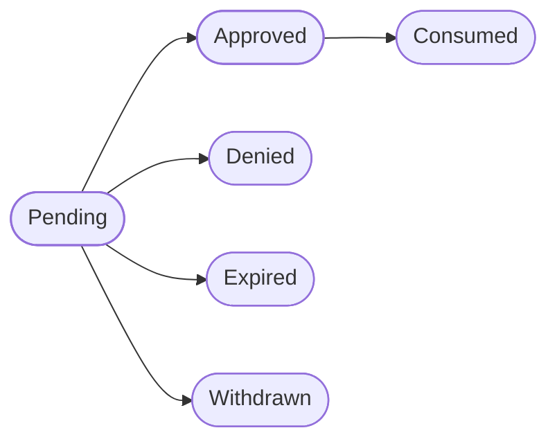

A request waits at most 7 days. Once its time to decide runs out it reads as `Expired` everywhere, in lists and in the inbox, even before anything saved it so. Approving, denying, withdrawing or revising it is refused, and an attempt to decide it saves it as expired. Olga's request ran out last week. It has left Bob's inbox, and he cannot deny it now. `Consumed` means the approved call has run: an approval works once, for the one pause it was given.

`Withdrawn` means the run that raised the request was stopped, so nobody needs to decide it. Only the proof that its own run was cancelled withdraws it, and it records who stopped the run. Ann stops her agent's run while it waits on a payment, and Bob cannot approve that payment later. A request opened by hand is never withdrawn, so one stored as withdrawn is refused as corrupt.

**A task template**

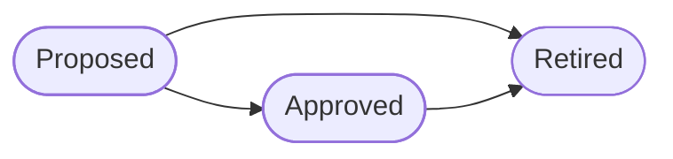

Tools and model providers move between active and disabled, in either direction.

## The rules it keeps

**Delegations**

- **A delegation never grants more than its delegator holds.** Sam holds "view reports". He cannot give his agent "delete reports".
- **A sub-delegation stays inside its parent.** That covers capabilities, resources, MCP tools, paths, apps, data class, lifetime, depth, budget, purpose, task, template, the approval rule and a token bound to a key.
- **A person who does not own the holding agent passes on only what they hold themselves.** Mallory, allowed to delegate to agents, cannot move Sam's agent's ledger access to an agent of hers.
- **Only the agent holding a delegation, or a person with a say over it, passes it on or widens what it passed on.** The agent proves it signed in as itself. Agent B cannot pass on the delegation Ann gave agent A, and Mallory, with no say over Ann's agent, cannot name the parent of a child it passed on to widen that child up to it.
- **Revoking a delegation ends everything cut from it.** That covers the children passed on from it and the task tokens minted from it.
- **Children share their parent's budget.** A parent allowed 100 requests an hour cannot hand ten children 100 each.
- **A task token carries one delegator's authority.** Ann's and Bob's delegations to one agent are never added together in one token.
- **A purpose only narrows.** Ann's agent may reconcile the ledger. It holds delete rights too, but a delete is outside the purpose, so it is refused.

**Task templates**

- **A template needs a second person, who holds every built-in permission it grants.** Ann proposes "monthly reports". She cannot approve it, not even through her organization account. The proposer is always the person signed in, so nobody can name Bob as the proposer of Ann's template and let her approve it herself.
- **Only its proposer, or someone allowed to delegate to agents, retires a template.** Sam may only view agents. He cannot retire the template Ann's team delegates under and leave their agents without new work.
- **A delegation under a template is the overlap of the template and the delegator.** It never reaches past either.

**Runs**

- **A run starts only for an agent that is there and free to act.** An agent the tenant does not have is not found (`404`), and nothing is stored. A suspended or revoked agent, or one that owes a re-attestation, is refused (`403`) before the run is stored or handed to a worker, with or without a delegation.
- **A run takes its limits from its delegation.** A run that calls tools starts only under a live delegation to its own agent, with a purpose inside the delegation's, and keeps the delegation's approval rule. A run under no delegation is given no tool.
- **A delegation backs only the runs its delegator starts.** Owen looks after Ann's agent too, but he cannot start it under Ann's delegation and act with her rights. Nor can the agent itself start a run under the delegation Ann gave it.
- **Who starts a run is proven, never named.** A `RunStarter` is the signed-in person, an agent signed in with its own key, or the person a workflow acts for. So Sam cannot name Bob as the starter and then approve the run's paused write himself.
- **What a run has read limits where it may send it.** Its exposure only rises. Once it has read confidential data, no prompt sends that to a tool or a model cleared below it.

**Approvals**

- **An approval covers one exact call.** Ann approves "delete order 1". If the run swaps it for "delete every order", her approval does not run the new call.
- **One person is never both approvers,** through any of their accounts.
- **A person without data access never sees salaries in a request.** Approvers must be cleared for what the run has read, and their clearance comes from what they hold.
- **A stopped run leaves nothing to approve.** Its pending requests are withdrawn.

**Channels and reviews**

- **Only a person with a say over the sending agent opens a channel.** An agent that could open one could talk to anyone. An object shared through a channel stays within the channel's data class. To someone with no say over it, the sending agent, or a channel they may not close, reads as missing (`404`), the same as an id that never existed.
- **A reviewer must be independent.** Agent R may review agent S only when no person sits at the root of both, and no delegation appears in both their lineages. Otherwise Ann could steer a reviewer she controls to ignore her own agent.
- **A reviewer holds nothing.** An agent holding a delegation is never assigned to review, and a reviewing agent is given no delegation, not even one that grants nothing but names an app. At the gateway, a token that names no permission and no MCP tool reaches no route at all.
- **A reviewer only advises.** Its verdicts come from its assignment, about the agent it reviews. Only a person acts on them.

## Events

The context records events for its changes: agents created, changed, suspended, contained, resumed, revoked and deleted, re-attestations required, ownership offered, offers withdrawn and ownership moved, keys minted, rotated and revoked, data marks lowered, delegations granted, renewed and revoked, delegations asked for, approved and refused, resources and relations given and taken back, task templates proposed, approved and retired, runs started, waiting on approval, paused, paused before spending more, resumed, ordered stopped and finished, held calls revised, approvals requested, granted, signed, denied and withdrawn, tools and model providers registered, changed and deleted, a model provider's key, model or clearance changed, reviewers assigned, verdicts filed and reviews ended, purpose drift, two agents meeting at one path, and agents sighted, registered or dismissed. Channels opened and closed are recorded as messaging events.

Run events carry the run's id, never its goal. A goal can quote data more sensitive than the people notified may see.

Events that happen on every request stay in the audit trail and are kept out of colleagues' notifications: each authorized or denied action, each authorized or denied message, each refused outbound call, each issued task token, each attestation challenge and each model provider test.

Wherever an agent signs in as itself (exchanging for a task token, passing part of a delegation on, asking a person for one, reading evidence or filing a verdict as a reviewer), a sign-in that cannot be the agent's own slip is recorded as `agents.token_attack_refused` and sent to the tenant's administrators as a security alert, so no door can be probed unseen: an assertion presented again after it was spent, one whose signature is not the agent's key's or that names a key the agent never held, and one naming another agent. It names the agent and the kind of attack, never the assertion. Mallory can repeat it on every request, so it is recorded at most once an hour for each agent and kind, and the record says how many attempts it stands for. An assertion that ran out on the way, one made for another endpoint, a key the agent was told to stop using and an agent id the tenant does not have record nothing. Every one of them is refused the same way.

## Purpose drift and meeting points

A delegation's purpose is read once into the classes of action it allows. Under the enforcing setting a token carries them and a request outside them is refused, even one the capabilities allow. A warning setting reports drift without blocking, and off does neither. Channels cover the exchanges ianua can refuse, but two agents may each reach one upstream path. When two agents touch the same path within a short time and at least one of them writes, they have met there, and the meeting is recorded once while it stays recent.

## Uses and used by

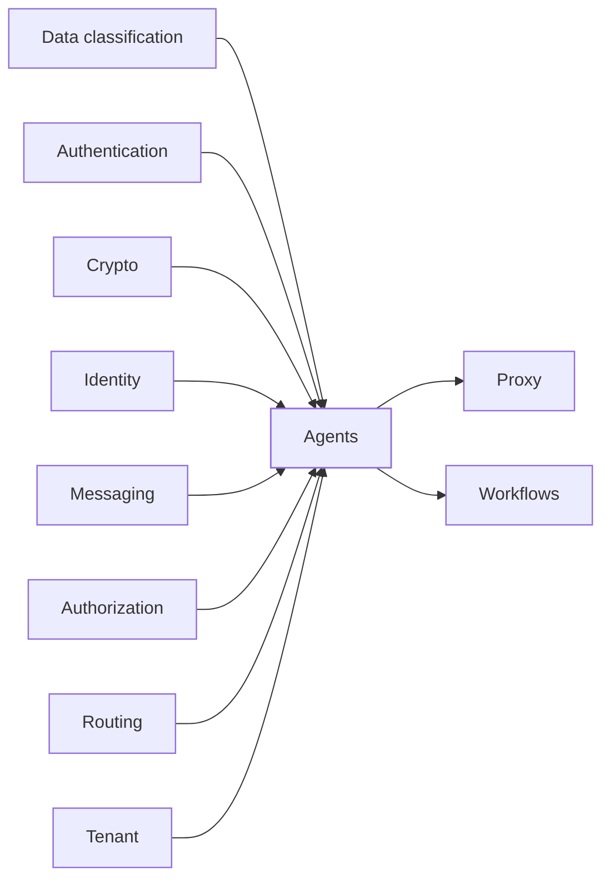

A context only uses contexts below it. Agents builds on the eight on the left, taking an approver's proof of presence from authentication and identity, and is used by the gateway's proxy and by workflows.
