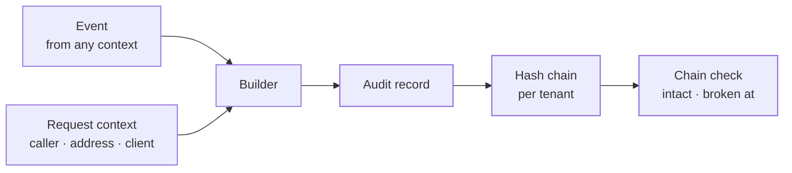

The audit context holds the **audit record**: what happened, who did it, when, from where, and to what. Every significant action writes one. It also holds the result of checking a tenant's **hash chain**, which shows that no record was edited, removed or reordered, the form in which a reviewer reads records as **evidence**, what a **retention purge** removed, and where a tenant's records are **streamed** to.

Audit is part of the foundation. It uses no other context. Every context's events become audit records through it.

The code is in `crates/ianua-domain/src/domains/audit`:

| Part | What it holds |
|---|---|
| `record` | The stored record, where it is filed, and what it affected |
| `builder` | How an event and its request become a record |
| `chain` | The result of checking a tenant's hash chain |
| `walk`, `checkpoint`, `verdict` | A walk of the chain one stretch at a time, how far it is known to hold, and the last verdict the sweep keeps |
| `access` | Who may export which audit log |
| `export` (with `filter`, `state` and `seal`) | An export of an audit log, written in the background, sealed for a tenant, and downloaded once ready |
| `evidence` | A record with its place in the chain, as a reviewer reads it |
| `retention` | What one purge of a tenant's old records removed |
| `streaming` | The places a tenant's records can be streamed to, and which records go |

## How the parts fit

## What a record holds

| Field | What it says |
|---|---|
| Scope | Where the record is filed: the platform, an organization, or a tenant |
| Actor | Who acted |
| Event type | What happened |
| Target | The one thing the action affected, such as a user, a role or a session, or that it affected nothing in particular |
| Address and client | The IP address and User-Agent of the request, when they are known |
| Details | The event's own details |
| Acted through | Whether the actor acted in their own name, an operator acted as a user, a tenant admin acted as one of the tenant's people for support, or a workflow run acted as the person it is for |
| Time | When the event happened, in UTC |

Records are never changed. The app removes them in one way only: once their tenant's retention has ended (see [Retention](#retention)). Any other change or removal shows up in the hash chain. The database also refuses it: a trigger turns down every `UPDATE`, `DELETE` and `TRUNCATE` of an audit record, for the role the app connects as and the tables' owner alike, and lets through only the retention purge's own delete.

## Who the record names

The record names the actor from the request first, because that is the one proven where the request came in:

| The request | The actor recorded |
|---|---|
| Comes from a signed-in caller | That caller, whatever the event says |
| Comes from someone not yet proven, such as a sign-in attempt | The actor the event names, or **anonymous** when it names none |
| Has no request at all, such as a seed or a background job | The actor the event names, or the **system** when it names none |

An attempt nobody proved is never written down as the system. The request context's fields are private, so a request cannot be recorded as the system by leaving out who sent it. Only work with no request at all starts from the system.

When an operator acts as a user, the record says so, naming both the operator and the user they acted as. When a tenant admin acts as one of the tenant's people for support, the record names the admin as the actor, the person they acted as, and the support impersonation that let them. When a workflow's company step acts, the record names the person the run acts for as the actor, and the run it came through.

The audit log shows who each actor acted through as `acted_through`: its kind with the ids it names, or `null` when they acted in their own name. Exports carry it too: a CSV row adds the kind and one id (the run, the support impersonation or the operator), and a JSON export the same object the log shows.

## Where a record is filed

A record is filed where the event belongs, not where the request came from:

| The event belongs to | Filed under |
|---|---|
| A tenant | That tenant, naming the request's organization as owner when it is known |
| An organization, not one of its tenants | That organization alone |
| Neither | The platform |

The request's own tenant is never used to file a record. So an organization's record never shows up in a tenant's log, and a tenant's record is never filed under no tenant.

## The hash chain

The chain is written by the storage layer as each record is kept. Each tenant has its own chain, in the database the tenant lives in. Organization and platform records are not chained: they are kept apart, and the database refuses to change or remove them all the same. Every tenant record holds its place in the chain, from 1, the hash of the record before it, and its own hash, worked out from that hash and every other part of the record: `SHA-256(previous hash ‖ record)`. Records are linked under the tenant's chain lock, so two writers never link to the same record.

Walking a chain and working each hash out again shows that no record was edited, removed or reordered. Each record must sit at the next place, name the record before it, and hash to its own hash. The newest link of each chain is also kept as the chain's **head**, sealed with a keyed hash (HMAC) under a server key the database never holds, in the same step that adds the records. A walk that reaches the end checks the head against the last record, so cutting off the newest records shows too: whoever can write the table cannot seal a head of their own.

The walk reads stored records, so it runs outside the domain. The domain holds its result:

| Result | What it says |
|---|---|
| Intact | Every link worked out again, and how many records were walked |
| Broken | The sequence number of the first record that did not, and how many records were walked before it |

A broken chain always says where it broke. An intact one never names a record.

A chain that is only checked when someone asks proves nothing until someone asks. So a scheduled sweep walks every tenant's chain and keeps its **verdict**: when it was found, how the chain stood, and the last link it verified. The next sweep starts after that link, so a record is hashed again once, not on every sweep. A sweep walks at most 200 stretches of 1,000 records per tenant, and a longer chain is finished on the next sweep from where it paused, so one large tenant never holds the others back. A break raises `tenant.audit_chain_broken`, naming how many records verified and where it broke, the first time a sweep finds it, not again on each sweep that finds the same one. A chain that cannot be read, or a verdict that cannot be kept, is tried again on the next sweep.

A tenant administrator who may view the audit log reads the last verdict on request, with when it was found, instead of walking the chain inside their request. Until the first sweep has walked the chain there is no verdict.

## Exports

A log can hold millions of records, more than one request should read. So a reader asks for an **export** of a tenant's, an organization's or the platform's log, with the list's filter, as CSV or JSON. A background job writes the file in pages, reading the log as it stood when the export was asked for, so every record the filter admits is written. A try that fails leaves the export pending, and the job writes the file again from the start. Once written, the file may be downloaded for 7 days by anyone who may export that log and is shown all of it, and then it is deleted. An export not written within a day is given up.

### Sealed files

Ann hands her tenant's exported log to an outside auditor, who must be able to tell that nobody changed it on the way. So the job takes the SHA-256 of every byte it writes, and a ready export shows it as `sha256`. For a tenant's log the job also signs a **seal** with the tenant's signing key in use: a compact JWS typed `ianua-audit-seal+jwt`, shown as `seal`. Its claims name the tenant's issuer (`iss`), the tenant (`sub`), the export (`jti`), when it was signed (`iat`), and under `audit_export` the file's `format`, `covers_until`, `rows` and `sha256`.

The auditor checks it with nothing from ianua but the tenant's published keys:

1. Take the SHA-256 of the downloaded file, for example with `sha256sum`.
2. Fetch the keys from the `jwks_uri` of the tenant's `/.well-known/openid-configuration`, and check the seal's signature with the key its header names. Accept only the type `ianua-audit-seal+jwt` and the algorithm the key has.
3. Check that `iss` is the tenant's issuer and that `audit_export.sha256` is the digest from step 1.

One byte changed or removed gives another digest, which the seal does not name. A seal is never accepted as a token: only access tokens are. A tenant with no signing key in use gets no file at all, never one without a seal. An organization's or the platform's log has no published key, so its export carries `sha256` and no seal.

Exporting a log is a right of its own, apart from viewing it. Reading entries a page at a time does not hand over every record in one file:

| Log | Asking for an export, and downloading it, needs |
|---|---|
| A tenant's | `audit_log: export` (`idp:audit_log:export`), held through a role given it. Owners and admins of the organization, who reach every tenant with every right, hold it there too. `audit_log: view` alone does not cover it |
| An organization's | `org:audit_log:export`. Every organization role that views the log holds it: owner, admin, member and viewer. The billing contact holds neither. What the file holds is narrowed as below |
| The platform's | Being an operator, since operators hold no finer rights and each may read every record already |

An organization's log holds its own records and those of the tenants its reader reaches. An owner or admin reads every tenant's, a member those granted to them, and a viewer none, so a viewer reads the organization's own records alone. Naming a tenant the reader does not reach reads as a tenant with no records. An export keeps the reach of whoever asked for it, so the file holds only what they were shown. Someone who reaches less than a file holds is told there is no such export, even if it was asked for before they lost a tenant. Max reaches Staging only: his file holds Staging's records and the organization's, and the file Ann the owner asked for is not there for him.

The authority of each scope checks its right and hands out the proof an export needs, naming the log. An export is asked for, found and downloaded only through that proof, so a caller never reaches an export of a log they may not export. Sam reads his tenant's log to answer support tickets, and his key leaks. Whoever holds it may page through the log, but asking for every record at once is refused.

## Retention

Each tenant's compliance settings say how many days its records are kept (see [Tenant](/ianua/domain-contexts/tenant/)). A scheduled purge removes, for every tenant, the records written before that cutoff. A deleted tenant is purged too: its teardown keeps its trail, which still runs out as its settings say. When the retention was shortened, records written before the change keep the longer period, so one change never deletes years of records at the next purge.

Each purge that removed records is itself recorded for the tenant as `tenant.audit_records_purged`, with the cutoff and the count, in the same unit of work as the removal. The record is committed first, so a failure in between leaves records the next purge removes, never records gone with nothing on the trail to say why. So an auditor who finds the oldest record a year old can tell a purge the retention asked for from records gone missing. A purge keeps the chain verifiable: it removes only the oldest stretch of the chain, up to the first record it keeps, and in the same step keeps the hash of the last record it removed as the chain's anchor, sealed under a key the database never holds, which the oldest record left links to. Only the purge's own database role can remove records or move the anchor, so a purge never reads as a break, and a record removed any other way still does.

## Streaming records out

A security team can keep its own copy of every record in the SIEM it runs. A tenant keeps up to five **audit streams**. Each one names a destination:

| Destination | What it names |
|---|---|
| Splunk | An HTTP Event Collector's address and token, and the index, or the one the token is set up with |
| Datadog | The Datadog site and an API key. Records only go to that site's own log intake, never to a host the tenant typed |
| Syslog | A collector's host and port, over TLS only (port 6514 unless told otherwise). There is no plain TCP or UDP |
| HTTPS | Any HTTPS endpoint that takes records as JSON, with an optional header such as `authorization`. The header may not be one the platform sets or one that carries the request: `host`, `content-length`, `content-type`, `content-encoding`, `transfer-encoding`, `connection`, `keep-alive`, `upgrade`, `te`, `trailer`, `expect` and the `proxy-` headers |

A record's details leave out any field named as a secret, as a webhook's do. Every token, key and header value is sealed and never printed. Every address must be on the public internet, so a stream cannot be turned into a way into the platform's own network.

A stream sends every record, or only records of up to 200 named event types, each named once. A worker sends each new tenant record to every stream that wants it. One stream's failure never keeps the record from the others. After ten refusals in a row a stream pauses itself and records `tenant.audit_stream_paused`, so a dead collector is not called forever. An administrator resumes it once it is fixed.

The stream itself belongs to the tenant context. Adding one, or pointing one somewhere else, needs the compliance right and a fresh proof of the person, because it sends the tenant's records out of the platform.

## Records as evidence

What an agent says about its own work is only a claim. What counts is what ianua recorded. A reviewer reads audit records as **evidence**: each with its sequence number in the tenant's chain, its own hash and the hash of the record before it. A review verdict cites these sequence numbers, never the agent's own account. So a verdict can always be checked against the records it names and the records next to them.

A page of evidence comes with the sweep's last verdict on the tenant's chain, the same one the audit log answers, since a record from a chain that does not verify proves nothing. Reading a page never walks the chain itself: an agent with millions of records costs no more to read than one with ten. Before the first sweep the page says the chain is not verified yet, never that it is intact.
