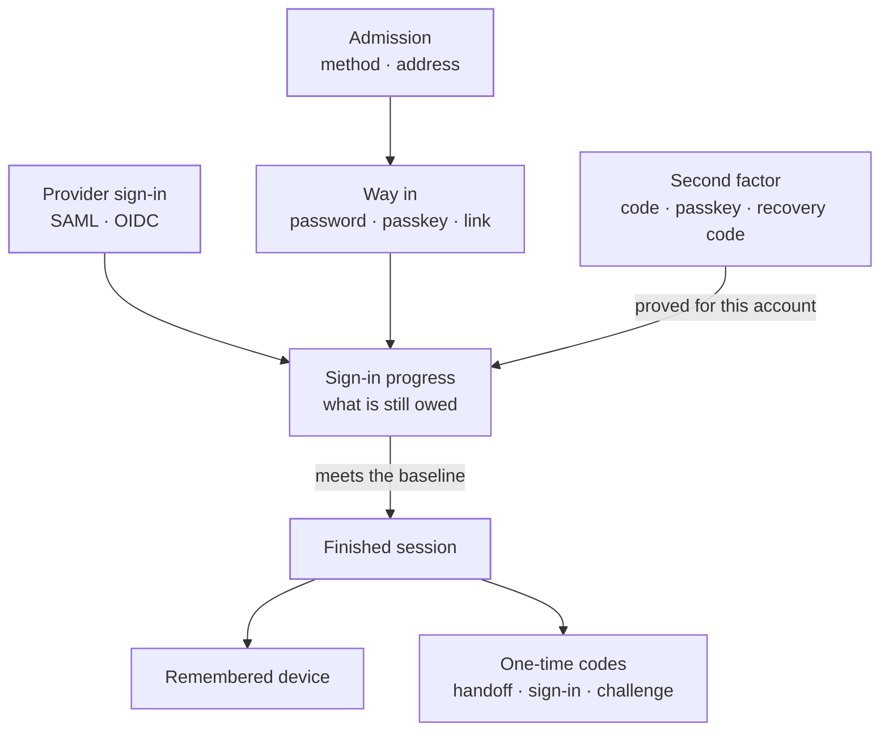
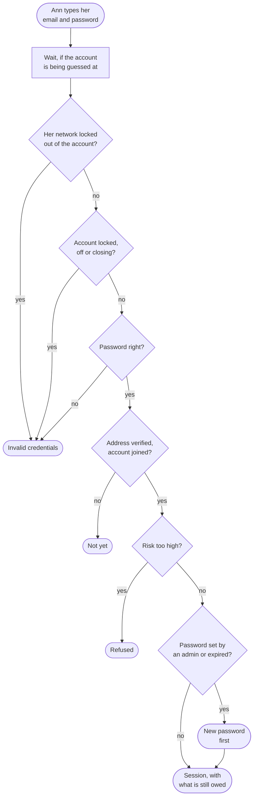
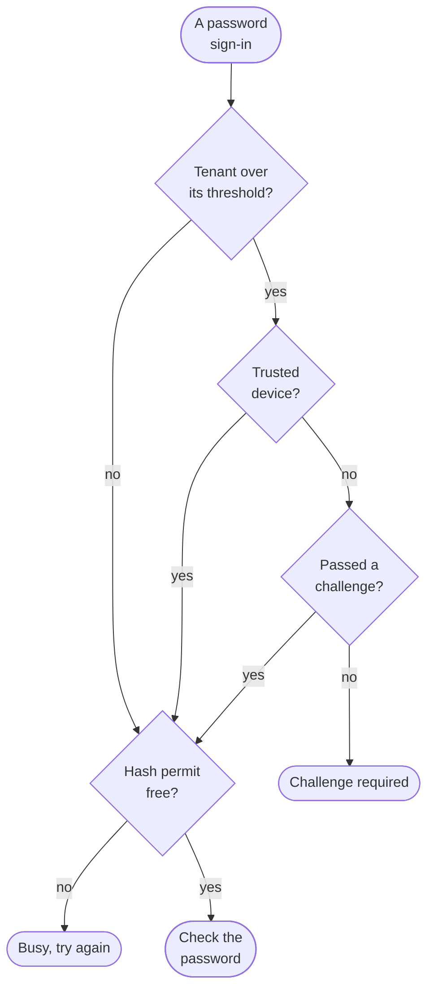
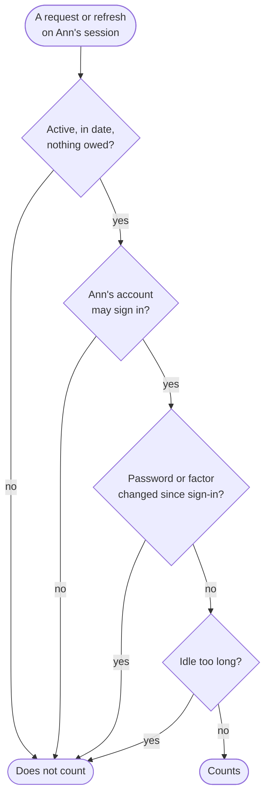
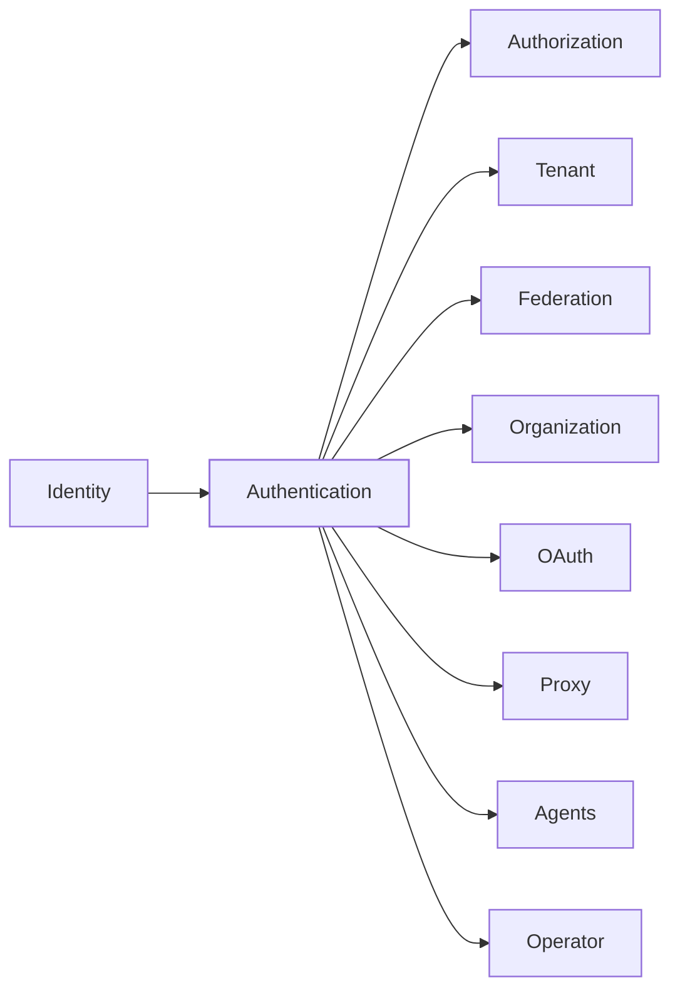

The authentication context decides how a person proves who they are. It holds the **sign-in**, the **session** it opens, the **second factors** and **passkeys** a person holds, the devices they chose to remember, the short-lived codes that carry a sign-in from one place to another, and the **service accounts** applications bind to the directory as.

Its rule is simple: nothing is taken on the caller's word. A session opens only for an account that was just checked. A second factor is recorded only from a code, a passkey, a recovery code or a link that was checked for that same account.

The code is in `crates/ianua-domain/src/domains/authentication`:

| Part | What it holds |
|---|---|
| `admission` | Whether a workspace takes a way of signing in, and from which addresses |
| `operations` | The password sign-in, in two steps |
| `sessions` | The session, how far its sign-in has come, the fresh proof, and the one-time codes |
| `tokens` | Refresh tokens, of which only the hash is kept |
| `keeper` | Who may rename or take away an account's ways in, and end its sessions |
| `mfa` | The second factors (an authenticator app, a mailed code, a texted code), the codes sent for them, which ones a workspace offers, their lock, and what a sign-in still owes |
| `credentials` | Passwords, breached passwords, passkeys and their challenges |
| `recovery` | Recovery codes and password reset requests |
| `risk_engine` | Risk, a network's lockout from an account after failed sign-ins, the wait while an account is guessed at from many networks, the extra proof while it is under attack, the pressure a flood of failures puts on a whole tenant and the challenge it asks for, and when to ask for more proof |
| `device_trust`, `device_status`, `device_change` | Devices a person chose to remember, and how remembering or forgetting one is recorded |
| `ldap_certificate` | Client certificates for writing to the directory |
| `directory_service` | Accounts applications bind to the directory as, what each may do and where |
| `methods`, `sign_in_limits` | The ways in a workspace can turn on, and the ranges its numbers stay in |

## How the parts fit

## Ways in

A workspace turns on the ways its people may sign in: a password, a link mailed to the address, a passkey, SAML or OIDC. It may also set a list of network addresses. Both are checked before any account is looked up. An empty list lets everyone through. Once a list is set, a caller whose address is unknown is refused, so nobody gets past it by hiding their address.

A sign-in ianua checks itself starts from a **way in**. Only three things make one: a password that was checked, a passkey that answered a sign-in challenge, or a sign-in link that was used. A session then opens only for the account that way in was proven for, and only while that account may sign in. A locked, switched off, closing or still-joining account gets no session, whichever way it came in.

A sign-in through a provider counts the provider's second factor only when the tenant trusts that connection to report it. For an account that holds any built-in permission that gives power, such as managing users, no provider's word counts, so a provider someone runs themselves cannot skip an admin's own factor.

## A password sign-in

Every answer costs the same password hash. An unknown address, a wrong password, a locked or switched off account, and a network locked out of the account all read as "invalid credentials". An unknown address can be locked out too, just like a real one. So a stranger learns nothing about which accounts exist, or whether their guesses still count. Only once the password is right does the answer say the address still needs confirming. On a deployment without a mail server no link could confirm it, so the sign-in goes on and the address stays unconfirmed; anything that needs a confirmed address stays refused.

A right password that an admin set, or that is past the tenant's age, opens no session. The sign-in asks for a new password there and then, with a single-use token that lasts a few minutes. The new password must meet the tenant's rules and repeat none of the recent ones, and every refused try counts towards the lock. Once it is set, every earlier session ends and the sign-in goes on, still owing any second factor.

A password past its age was the person's own, so the token comes straight back. A password an admin set is known to that admin too, so the person must also show something only they hold. Someone with a second factor gives a code from it with the new password. Someone without one gets the token by mail instead, and sets the new password from that link. On a deployment without a mail server, someone without a factor cannot finish: the sign-in is refused, and an admin should send an invitation instead of setting a password.

| Why it must change | Person has a factor | No factor, mail set up | No factor, no mail server |
|---|---|---|---|
| Past its age | Token comes back | Token comes back | Token comes back |
| Set by an admin | Token comes back, code from the factor needed | Token is mailed | Refused |

If the service that checks passwords is down, the sign-in fails as unavailable. It does not count as a wrong password, so an outage does not lock people out or send them to reset passwords that work.

Failures are counted per account and network together. Too many from one network lock that network out of the account for a while, and nothing else. Mallory guesses Ann's password twenty times from her laptop. Her network is now locked out of Ann's account, even with the right password. Ann, at the office or on her phone, still signs in with hers.

| | Failures from one network | Counted over | Locked for |
|---|---|---|---|
| A new tenant | 10 | 15 minutes | 15 minutes |

A tenant may choose from 2 to 100 failures, and a lock from 30 seconds to one day. A lock always lifts on its own. Attempts made while locked are still recorded, but do not add to the lock. A right password starts that network's count again. An IPv6 address counts by its `/64` network, so stepping to the next address in the same network does not start a new count. The lockout is recorded with the network it locked and the address it came from, never a password.

Guesses spread over many networks are slowed instead, never locked. Every failure against the account is also counted from all networks together, over the same window. Up to as many failures as one network may make, nothing changes. Each one past that adds a quarter of a second to a wait before the next password for the account is checked, up to 3 seconds. A sign-in from a device Ann trusted does not wait. Any right password from a network that is not locked out gets through once the wait is over, so a crowd of guessers can slow Ann down but never shut her out.

The wait slows a botnet but does not cap it. So once failures against one account come from many networks inside the window, the account counts as under attack for a while. Many is twice the number of failures one network may make: 20 networks under the default of 10. A while is four windows: an hour under the default window of 15 minutes. A botnet that pauses for one window and comes back finds the account still under attack.

While the account is under attack, a right password from a device the person did not trust is not enough on its own. It is answered like any risky sign-in:

| The person has | What the sign-in owes |
|---|---|
| A second factor | That factor (the mailed link while second factors are off and mail is set up) |
| No factor, mail set up | The mailed link that confirms a new device |
| No factor, no mail server | Refused, as any risky sign-in with nothing to prove it is |

So a guessed password alone gains a botnet nothing, and Ann still gets in with her phone or her mail. A device Ann trusted skips both the wait and the extra proof. A wrong password gets the same answer as ever, and a right one gets the answer of a sign-in that owes a factor or a confirmation, so the sign-in page shows nothing new. This holds for organization sign-in and tenant sign-in alike.

A directory bind has no second step to ask for. While the account is under attack, a bind from a network that has failed on the account in the window is refused, right password or not, as invalid credentials. Binds from networks that have not failed still work, so Ann's office keeps reading the directory while a botnet guesses from elsewhere.

The first attempt that finds an account under attack records it once, with how many networks failed but never which ones, and never a password. The account is marked under attack only once that record is written: when it cannot be written, the sign-in fails, and the next sign-in after half a minute records the attack instead, so it is never left marked with nobody told. It is a security alert: the tenant's administrators, or the organization's admins and owners, hear of it at most once an hour.

The same counts hold every other check of a password: a password typed again to prove it is you, a new password a sign-in owes, and a directory bind.

Then the risk is weighed. If Ann signs in from London and then from Tokyo an hour later, faster than any plane, the sign-in is refused. A trip that is fast but possible counts as high risk, which asks for more proof when the tenant asks for it at that risk. Places 100 kilometres apart or closer never count, since address lookups are often that far off. A password found in a known breach also asks for more proof, when the deployment is set to. If the breach or location check cannot be reached, the sign-in goes on, and the missing check is recorded. A password sign-in that goes ahead after such a fast trip, or from a country the person never signed in from before, records `authentication.risky_sign_in`. It names the person, the country and the sign: `fast_travel`, `new_country` or `fast_travel_to_new_country`. A workflow can then ask whether it was them, or sign them out. The countries a person knows are the ones their earlier sign-ins were placed in, so their first placed sign-in is never a new country, and an address that cannot be placed names none. Pat signs in from Berlin, and two days later from São Paulo: the second sign-in goes ahead at low risk and is recorded with `new_country` and `BR`. Colleagues are not told: it records the person's own sign-in.

## When failures flood in

The lockout counts guesses at one account from one network, and the wait slows one account. Someone trying stolen passwords against many accounts from thousands of networks stays under both, and each of their guesses still costs a password hash. So ianua also counts failures across the whole tenant, and checks that count before any password is hashed.

Every wrong password and every unknown address counts against the tenant. A lockout, a refused risk or an unconfirmed address does not count. Failures are counted over a sliding window, five minutes by default (`SIGN_IN_FAILURE_WINDOW_SECONDS`). Once the count reaches the tenant's threshold, its password sign-in is under high pressure. A tenant may set its threshold from 10 to 1,000,000 failures. A tenant that never set one uses 200.

Under high pressure, a sign-in from a device the person trusted goes through as usual. Any other device must bring proof that it passed a challenge, a puzzle the browser solves or a Turnstile check, whichever the deployment uses. A sign-in without one is refused as `challenge_required`, before its password is hashed, and the answer names the challenge to solve. A proof the challenge provider does not pass is refused the same way. The answer is the same for every address, so it tells a guesser nothing about which accounts exist. Refusals at this step do not count as failures.

Nothing gets through without a proof. Which challenge is used is the deployment's choice. With Turnstile set up (`TURNSTILE_SECRET_KEY` and `TURNSTILE_HOSTNAMES`), it is a Turnstile check. Without it, it is the platform's own puzzle: the answer hands the browser a puzzle, sealed by the server, that takes some work to solve (`SIGN_IN_PUZZLE_DIFFICULTY_BITS`, 18 by default; each bit doubles the work). A solved puzzle counts once, and only within its lifetime (`SIGN_IN_PUZZLE_TTL_SECONDS`, 300 by default). A trusted device and single sign-on work either way. If the count cannot be read, the tenant is treated as under high pressure.

Each server also runs only so many password hashes at once. A sign-in that finds every place taken is told the server is busy and to try again in a moment. Nothing is hashed or counted then. Every other step that hashes or checks a password waits for a place the same way: changing or resetting a password, signing up, accepting an invitation, proving who you are again, and binding to the directory.

When a tenant's sign-in comes under pressure, and when it eases again, an event is recorded.

## What a sign-in still owes

A sign-in may need a second factor because the tenant requires one, or because something looked unusual that the tenant's rules ask about: a new device, a new country, raised risk or a breached password.

Someone who set up a second factor uses it at every password sign-in, except on a device they chose to remember. This holds whatever the tenant's rules say about new devices, and while second factors are optional. Pat set up an authenticator app. Mallory steals Pat's password and signs in from her own laptop: she must give Pat's code. Pat, on the laptop she remembered, types her password and goes in. Someone without a factor is asked nothing more for it.

| The person | Tenant requires a factor | Something looked unusual | Nothing looked unusual |
|---|---|---|---|
| Has a factor | Uses it | Uses it | Uses it, unless on a remembered device |
| Has none | Sets one up before going in | Confirms by a mailed link first | Goes in |

A warning sign is never answered by setting up a factor there and then. Whoever stole the password would add their own. So Sam, with no factor, who signs in from a new country, confirms through a link mailed to his verified address. If the tenant also requires a factor, he sets one up after that. While a tenant has second factors switched off, an unusual sign-in is confirmed by a mailed link even for someone who has a factor.

A deployment without a mail server cannot send that link. There, a new device or another warning sign asks someone with a factor to use it. Someone with no factor is refused, and is told to ask an administrator for a new invitation. Setting a factor up there and then would let a stolen password add its own.

There is one exception. The install's setup token and an accepted invitation both prove the person before they ever sign in. So the first sign-in after one of them may set up an authenticator app there and then, even when it looks risky. That first sign-in uses up the exception. Olive installs the platform with no mail server and confirms herself with the setup token. Her first sign-in, from a new laptop, has her set up her authenticator app. Later, Mallory has Olive's password and signs in from her own laptop. She must give Olive's code.

| The person | Mail server set up | No mail server |
|---|---|---|
| Has a factor | Uses it | Uses it |
| Has none | Confirms by a mailed link | Refused, and asks for a new invitation |
| Has none, first sign-in after the setup token or an invitation | Goes in, or sets one up if the tenant requires it | Sets one up before going in, unless the tenant switched factors off |

A person whose accounts in two tenants are linked may switch from one to the other. The switch carries what the first sign-in proved. If that proved no second factor, the new session owes what a sign-in to the other account would owe. Ann signed in to staging with only her password. Her production account has an authenticator app, so the switch asks for its code.

## Assurance levels

Each sign-in reaches a level, from what it proved:

| Proved | Level |
|---|---|
| A password, a mailed link or single sign-on alone | AAL1 |
| A passkey alone, a password, mailed link or single sign-on with an app code or a passkey, or a provider that reported a second factor | AAL2 |
| A hardware key, or a provider that reported one | AAL3 |

A recovery code, a mailed confirmation, and a code mailed or texted for a second factor add nothing to the level. A mailed code proves the mailbox again, which can be read on any device. A texted code can be read by whoever swaps the SIM or takes over the number. A passkey counts as a hardware key only when its maker's attestation was checked when it was registered. Any other passkey may be a copy synced to a phone.

A tenant sets a baseline level. A sign-in is finished only by passing it, so no path hands out a finished session below it. One that falls short is refused, except after a recovery code: then the person sets up a new factor before going in. A tenant cannot turn on only ways in that can never reach its baseline, since then nobody could sign in to change it back.

## A session keeps counting only while it should

A session is checked against the account as it is now, every time it is used or refreshed. If an admin locks Ann's account, Mallory holding her session is out at once, not when it expires. If Ann sets a new password because the old one leaked, every session opened before it ends. Adding or removing a second factor or a passkey does the same. The one session Ann used to make the change stays. For a new password or passkey she proves who she is again just before. A new authenticator app keeps it by the code from the app that confirms it. Removing a factor or a passkey hands her nothing new, so her finished sign-in is enough.

A session ends at a fixed time after sign-in, or after going unused, whichever comes first:

| Setting | Lasts | Ends when unused for |
|---|---|---|
| Standard | 24 hours | 30 minutes |
| Strict | 8 hours | 15 minutes |
| Relaxed | 7 days | never |

A tenant may choose a lifetime from five minutes to 30 days, and an idle time of at least a minute that does not exceed the lifetime. Refreshing gives a new token but never a longer life, and the old session is ended in the same step. The idle time counts from the last refresh: the new session starts as used at that moment. An organization member's session is marked used by the requests it carries instead (see [Organization](/ianua/domain-contexts/organization/)).

A session that still owes a factor can be signed out with its own refresh token. Ann types her password and closes the tab before her code. The token her browser holds ends that session. Mallory, presenting a token of her own, ends nothing.

A tenant sign-in that owes a factor is finished the same way: asking for a code, reading what it still owes, and confirming a new factor each name the waiting sign-in, and the name must be the session the refresh token belongs to. Mallory holds one of Ann's sessions and learnt the id of a sign-in Ann never finished. Confirming her own authenticator on it is refused.

An organization member's session that still owes a factor reaches only the steps that finish it: a code from the authenticator, a recovery code in its place, and setting up the first factor or passkey it owes. Each is sent with that session's own refresh token, and confirming a new factor finishes only the sign-in that token belongs to. Until then the session reads nothing of the organization. Mallory has Ann's password but not her phone: the session she opens can only wait for a code.

A session that ran out, or was ended and not replaced by a refresh, is kept for 90 days and then removed. A session a refresh replaced stays as long as its refresh chain lives, so reuse of an old refresh token is still caught. The record of each sign-in stays in the audit trail.

A session that looks taken over is **suspended**, or frozen. It resumes only on the account's own second factor, proved now: an app code, a code mailed or texted for its factor, a passkey or a hardware key. A recovery code, a mailed link or a provider's word does not resume it. The session then stands at the level of what resumed it. Ann signed in with a hardware key, and Mallory resumes the session with a stolen app code. It drops to AAL2, so actions that need a hardware key still ask.

Each use of a session is held against the last place it was used. The API and the gateway check this on each request a session carries, but only the first time a network is seen for that session in five minutes, so a session used from one place costs at most one read and one write that often, and most requests cost neither. The session freezes only when two of its uses make a journey that no traveller would: faster than 200 km/h over more than 100 km, across a border. Mallory takes Pat's session cookie and uses it from Poznań twenty minutes after Pat used it in Berlin: she is refused, the session freezes, and an `authentication.session_suspended` record names the holder and the reason, `fast travel`. A move inside one country never freezes a session, since carriers route a whole country through one gateway, and neither does a phone moving between networks or an address that cannot be placed at all. Without a location database every address stays unplaced, so no session freezes.

Lifting the freeze wipes the session's last place, so whoever proves the factor decides where the session is. A person with no second factor to lift it with never gets frozen: the session ends and `authentication.session_revoked` is recorded with the reason `suspected_takeover`, so a fresh sign-in is the way back. Both records name the holder and never the token. Each is told to the holder as a safety notice, whatever they chose to hear, and to administrators who hold the right to see it.

## Proving it again

Some changes would let a thief keep an account after the stolen session ends. These ask for a **fresh proof**: the password with a code from the person's factor if they have one, or a passkey sign-in. It counts for ten minutes. Registering a new passkey is not a proof, because whoever registers it chose it.

An account with no password or passkey proves itself another way. Ann signed up through her company's sign-in links and never set a password. A link mailed to her and followed now proves her, with a code from her factor if she has one. An account that has a password or a passkey must use that instead, so Mallory, holding Ann's session and reading her mail, cannot skip Ann's password. A sign-in made now through a provider the account is linked to also proves it, but only when the provider vouched for the person that link names. Mallory's own sign-in at that provider proves nothing about Ann. A second factor the provider reported counts. Without one, the account's own factor answers.

| Change | What it asks for |
|---|---|
| Set up a second factor | A fresh proof |
| Give up a factor setup not yet confirmed | A fresh proof |
| Register a passkey | A fresh proof |
| Get a directory certificate | A fresh proof |
| Get new recovery codes | A right code from the account's own factor |
| Turn off one's own factor | A right code from that factor |
| Reset someone else's factor | The right to update users, holding all the account holds |

Someone who must set up a factor before they are let in has just signed in. For ten minutes, that sign-in lets them set up or give up a factor, and nothing else, so joining under a required factor still works.

Giving up a setup asks for the same proof as starting one. Mallory holds Ann's session while Ann sets up her authenticator app. Without a fresh proof of Ann, she cannot give up Ann's setup each time Ann starts one.

## Taking a way in away

A person's passkeys and remembered devices can be renamed, their remembered devices forgotten, their directory certificates revoked, and their sessions ended. Two kinds of caller may do it. The holder may, from their own finished sign-in, since each step only names or takes away what they hold. Anyone else is an admin acting on the account: they hold all the account holds, and have the right for the step.

| Change | What an admin needs |
|---|---|
| Rename a passkey | The right to update users |
| Rename or forget a remembered device | The right to update users |
| Revoke a directory certificate | The right to update users |
| End a session | The right to deactivate users |

Ending someone's session throws them out, as a lock does, so it asks for the same right as a lock. Mallory, signed in to her own account, cannot sign Ann out or forget Ann's laptop. Sam may edit users but not shut them out, so he cannot end Ann's sessions in the middle of an incident she is handling. No admin may end the sessions of the tenant's last administrator.

## Second factors

A person sets up one of three kinds of second factor:

| Factor | Where the code comes from |
|---|---|
| Authenticator app | The person's own app works it out from a shared seed, which is kept only sealed |
| Mailed code | A fresh code is mailed to the address the account holds when it is sent |
| Texted code | A fresh code is texted to the number confirmed when the factor was set up. A number changed later on the profile is not used, since it was never proved to reach its holder |

A workspace lists which kinds it offers, and a factor is set up only when the workspace's settings offer it. A kind is not offered while second factors are off, when the workspace does not list it, or when it could never reach the workspace's baseline level: a mailed or texted code stays at AAL1, so a workspace that asks for AAL2 cannot offer one. A setup comes into force only once it is confirmed with a right code, from the app or sent to the address or number.

A texted code needs a text message provider on the deployment. Where none is set up, a texted factor cannot be set up, is not listed among the factors a person may choose, and a workspace cannot newly add it to the factors it offers. A texted factor set up earlier fails to send its code; it is never switched to mail.

A second factor is recorded only from a proof made for one account: a right code, a passkey answered just now, a link to the account's own address, or a recovery code that was used up. Mallory has Ann's password but not her code. A right code from Mallory's own app is refused for Ann's sign-in.

An app code is checked against its 30-second step and the step on each side, to allow for clock drift. Too many wrong codes lock the factor for a while, then the lock lifts on its own. Wrong recovery codes count towards the same lock, so a locked factor cannot be guessed past one recovery code at a time. A right one clears it. Each recovery code works once.

**Sent codes.** A mailed or texted code is short, so everything around it guards it. It has six digits, lives at most ten minutes, takes at most five wrong tries, and works once. Every wrong try also counts towards the factor's own lock, and a right one clears it. Only the code's hash is kept, and a new code replaces the one sent before. Another code is sent only after a short wait, so Mallory, holding Ann's password, cannot fill Ann's phone with texts that each cost the tenant a message. No code is sent for an authenticator app, or for a factor that was given up or turned off.

A passkey challenge is kept on the server and works once, for the purpose it was opened for, before it expires. The answer counts only if the passkey belongs to the account the challenge was for and was used after the challenge was spent. Once a passkey's counter has started, it must go up with every sign-in. If it does not, the key may be a copy, and the sign-in is refused. Only a sign-in sets the counter, so a stored passkey with a count but no last use is refused as broken.

An organization's members hold passkeys too, and prove themselves with them the same way. A tenant's passkey names a tenant user and an organization's names a member, so a tenant passkey never signs anyone in to the organization. A member renames only their own passkey, from their own sign-in.

## Remembered devices

A person may remember a device so later sign-ins there skip the second factor. Only a finished sign-in that reached AAL2 can remember one, so a stolen password alone cannot. A device counts only for the person who remembered it, while it stays trusted, and while it was used within its window: 30 days unless set otherwise, from one day to a year. A device remembered before the person last changed how they sign in, such as a new password, stops counting.

A device can also be remembered on an app's own domain, from the gateway's second-factor page. A device counts only where it was remembered: the server digests its secret together with the place, the dashboard or that one app domain, so a secret copied to another domain, another tenant's app or the dashboard matches nothing. Remembering on an app's domain asks what remembering from the dashboard asks: a finished sign-in that reached AAL2, the person's own device, and room under the most devices a person may hold.

A password sign-in from a remembered device names that device on the session it opens, and so does the sign-in whose second-factor step remembered it. Every session a refresh carries on from it names the same device, and the tokens an app's session hands out carry it as `did`, so a device posture check at the gateway knows which device a request comes from (see [Proxy](/ianua/domain-contexts/proxy/#device-posture)). Only the sign-in itself names its device, and only one its holder still trusts: a refreshed session cannot claim one afterwards. A device forgotten later is no longer trusted, so a posture rule asking for a trusted device refuses requests from it, and deleting its record leaves its sessions naming none.

## Short-lived codes

| Code | Longest life | Issued only for |
|---|---|---|
| Handoff to another host | 5 minutes | A finished, live session |
| Sign-in code after single sign-on | 5 minutes | An active session that has not expired |
| Second-factor challenge on an app's host | 15 minutes | An active session that still owes a factor |

Only their hashes are kept. A handoff names the one service and host it may be used on, and works once. The code travels in a redirect, so it can turn up in a proxy log. Mallory finds Ann's spent code there and sends it again while it is still in date. It is refused. A challenge closes after too many wrong codes, and closes for good once it is answered, so a copied challenge cannot be answered a second time. A sign-in code keeps the session's token out of the address bar and is swapped for the session once, so one read later from browser history is of no use.

A stored handoff, challenge, sign-in code or passkey challenge that says it was used at or after the moment it lapsed is refused as broken, and so is a reset that says its link was used once it expired. Nothing takes them after that moment, so such a record is never loaded.

## Password resets and directory certificates

A reset request is made only for an account that may sign in, and only to an address its owner was shown to hold. Its link lives an hour at most. It does nothing once the account's address changed, or the account changed how it signs in after the link was sent, such as a new password. Ann asked for two links and used the second, so the first does nothing.

A mailbox alone does not reset an account that has a second factor. Whatever the tenant's policy, the new password is set only with a right code from that factor as well. Someone following the link is signed out, so there is no session to send a mailed or texted code for. The link stands in for one: while it still works, it can ask for the factor's code to be sent. A link that does not work, or an account whose factor is an app or that has none, sends nothing, and the answer is the same as for a code sent, so it tells nothing about the link or the account. Too many wrong codes lock the factor, as at sign-in.

A link sets one password. The new password must meet the tenant's rules, may not repeat one of the account's recent passwords, and is refused when found in known breaches where the tenant blocks them. Every session the account held ends with the reset.

An LDAP client certificate lives from one day to 397 days. It allows a write only while it is in force, belongs to that account, and the account may still sign in. If Ann's account is locked, her laptop stops writing to the directory as her.

The directory has no sessions, so every bind proves the person again and opens none. A bind needs both the account's password and a certificate in force for that account, presented on the connection. What the account holds is then worked out for the bind, as for a sign-in. Mallory phished Ann's password and binds from her own machine. Without the certificate on Ann's laptop, nothing is bound. The certificate is checked first, so a machine without one never learns whether a guessed password was right. Bob's own password over Ann's certificate binds nothing either.

## Directory service accounts

Applications such as Jira, GitLab or SSSD bind to the tenant's directory as a **service account**, instead of borrowing a person's password. A service account holds no person and no roles. It only reads: bind, search and compare, never add, modify, rename or delete. What it may read is its scope: 1 to 16 base DNs, each named once. Its name is 2 to 64 lowercase letters, digits and hyphens, starting and ending with a letter or digit. Only the hash of its secret is kept.

Making one, changing what it may do, replacing its secret or switching it off needs the right to update the tenant's sign-in settings (`auth_config: update`), and the right to view the tenant's users (`users: view`). Someone who may not view users cannot make an account and read everyone through LDAP.

The directory keeps a bind for the whole connection, so each request is checked again against the account as it is now. Jira's secret leaked and the admin replaced it. The connection Mallory bound with the old secret can do nothing more at its next request. A write by a read-only account, or an entry outside its base DNs, is refused.

## Events

The context records an event when a sign-in link is asked for, a sign-in by passkey or single sign-on starts, a passkey challenge is issued, a sign-in code is exchanged, a sign-in succeeds or fails, an address is locked out, an account comes under attack, a breached password is found, a check could not run, a session is revoked, suspended, resumed or refreshed, a password is changed, a reset is asked for or completed, a passkey registration starts, a passkey is registered, renamed or removed, a factor setup starts, a code is sent for a factor, a factor is set up, turned off, proved or answered wrongly, a person's factors are reset, recovery codes are made or used, a device is remembered or removed, a directory bind succeeds, a directory search runs or is refused, a directory certificate is issued or revoked, a directory service account is made, deleted, binds, searches or is refused, or has its secret, scope or status changed, an app session is handed over or issues a token, when a break-glass grant is given or taken back, and when a tenant's password sign-in comes under pressure or eases.

Signing in and its steps are a person's own activity, so they stay in the audit trail and out of colleagues' notifications. A reset request stays out too, since anyone may send one, and so does a check that could not run, since an outage would post one for every sign-in. Signs of trouble, such as a lockout, a breached password, a wrong second factor or sign-in coming under pressure, still notify. Pressure easing again stays in the audit trail. An account coming under attack is a security alert instead, told at most once an hour.

## Uses and used by

Authentication sits one step above identity and uses only it. It reads the account, its status and its address, and answers identity's questions of who is signed in and who proved it just now. The tenant admits a sign-in and sets its numbers. Federation vouches for provider sign-ins. The organization signs in its own members with the same parts. Authorization, OAuth and the proxy read the level a sign-in reached, and OAuth also its way in and second factor. Agents take a fresh proof or a code from their own second factor from a person who decides an approval request. The operator plane checks an operator's password through the same password hasher.
