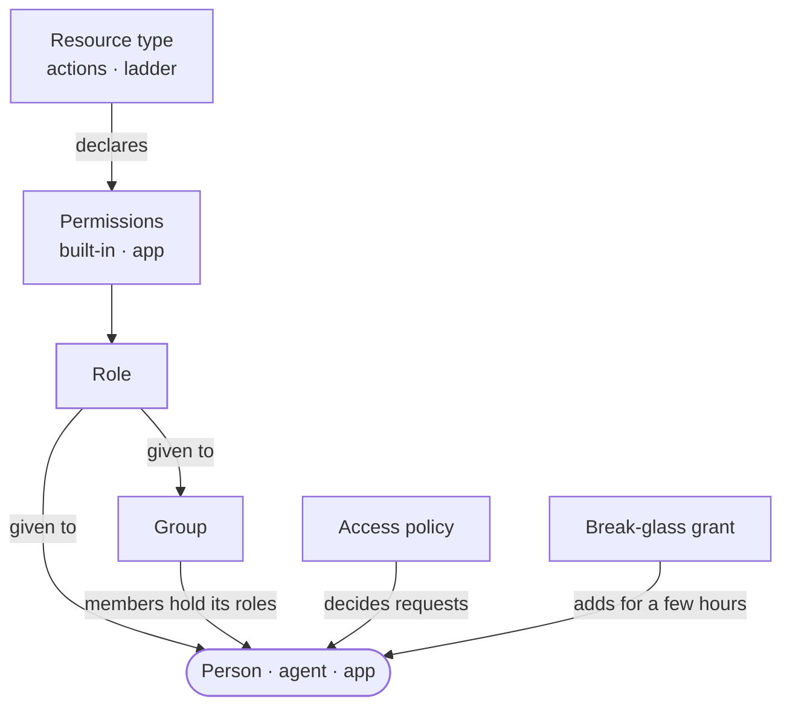
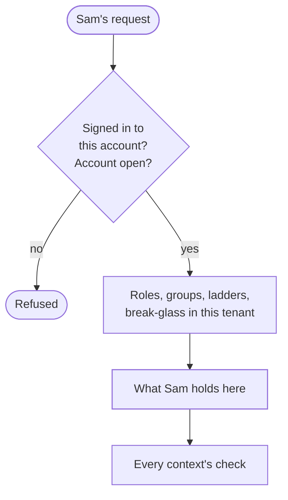
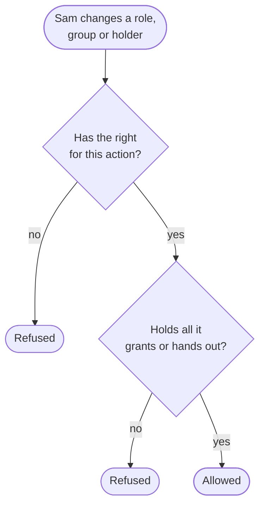
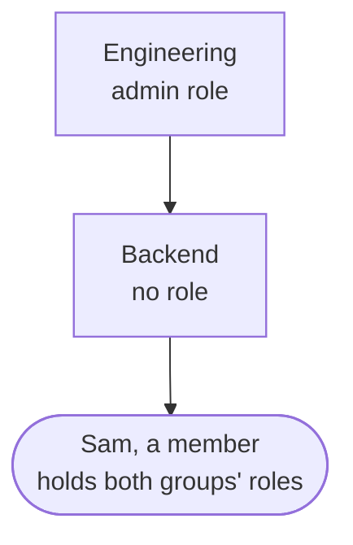
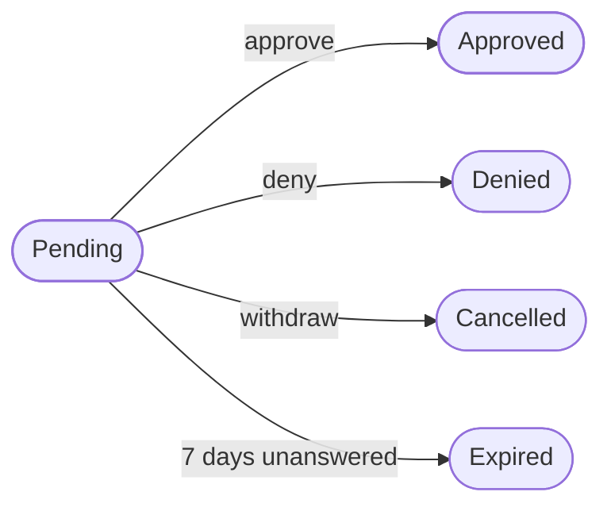
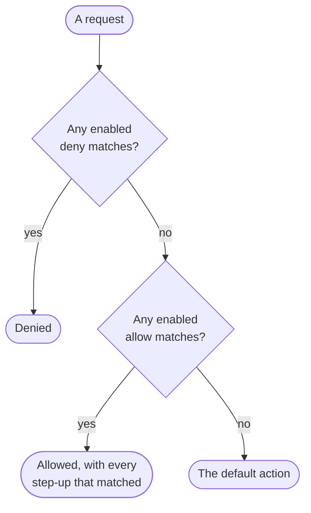
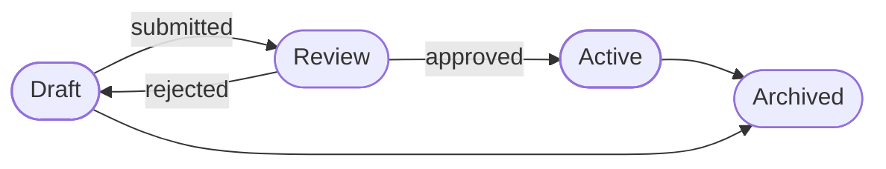
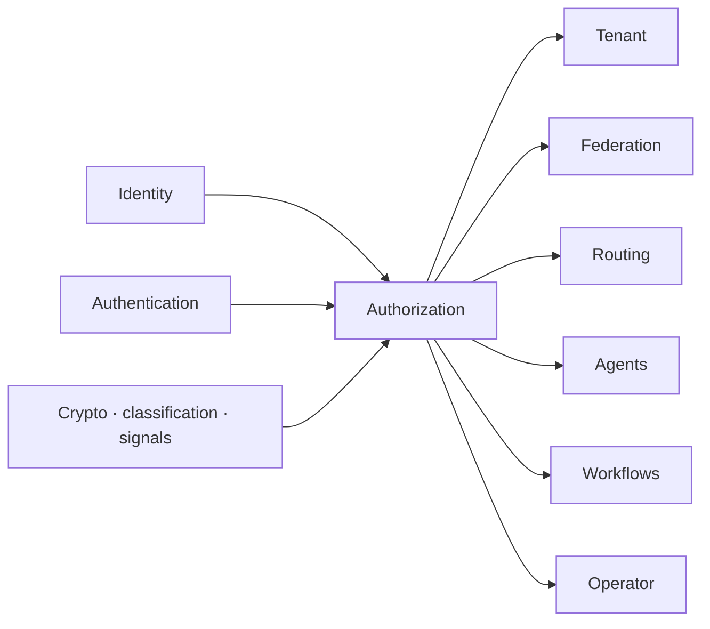

The authorization context decides what someone may do in a tenant. It holds the **roles** that name a set of permissions, the **groups** that share roles among their members, the **resource types** a tenant's own app declares, the **relationships** on single objects of that app and the **access checks** the app asks, the **access policy** the gateway applies to requests and its versions, **access requests** for a role or group for a while, **access reviews** of who keeps them, **separation rules** for roles nobody may hold together, **clearance rules**, and **break-glass** grants for an emergency.

One rule runs through all of it: a person hands out only what they hold. Shaping roles and groups also needs the right for that action, and taking rights away needs as much as giving them.

The code is in `crates/ianua-domain/src/domains/authorization`:

| Part | What it holds |
|---|---|
| `permission` | The built-in permissions and the ones a tenant's app defines |
| `authority` | Who is acting in a tenant, and what they hold there |
| `key_authority` | What an API key may do, from what its maker holds now |
| `inviter` | What the sender of an invitation holds when it is accepted |
| `granter` | What a person acting holds, and the checks on handing it out |
| `role`, `role_assignment`, `role_reassignment` | Roles, giving them to people, agents and apps, and moving every holder of a role onto another |
| `group`, `group_tree` | Groups, their members, and what a place in the tree brings |
| `holding` | Who is given a role or a place in a group, and until when |
| `stewardship` | The check that a tenant keeps an administrator |
| `resource_type` | The tenant's catalogue of what its app protects |
| `relationship`, `access_check` | Who holds what on single objects of the app, and the app's question "may Ann do this?" |
| `policy` | Access rules, their versions and review, and the simulator |
| `access_request`, `request_policy` | Asking for a role or a group for a while, and the longest a tenant allows |
| `access_review`, `review_removals` | Reviews of who keeps a role or a group, and who an overdue one takes it from |
| `separation` | Pairs of roles nobody may hold together |
| `clearance` | Data clearance, and the app permissions that raise it |
| `break_glass` | Short emergency access for one user, and what users may give themselves |
| `support_acting` | What a tenant admin holds while acting as one of the tenant's people for support |
| `directory` | The rule that only a directory the tenant switched on may change its groups |
| `attribute_schema`, `foundation_rights` | The answers to other contexts' rights checks: custom attributes, signing keys, classification rules and signal streams |
| `events` | What the context records |

## How the parts fit

## Permissions

There are two kinds.

| Kind | Example | Who checks it |
|---|---|---|
| Built-in | `idp:users:update` | Ianua itself, for admin work |
| App | `project:write` | The tenant's own app; the gateway can also require one on a route |

Built-in permissions are grouped by area, such as users, roles or the policy. Every area but two has a **manage** action that covers every other action in that area, and nothing outside it. The audit log has a view action and an export action, and neither covers the other: reading entries a page at a time is not taking every record in one file. Data access has two levels, `idp:data:confidential` and `idp:data:restricted`, and restricted covers confidential. Any user permission also lets someone read roles, since a user list shows each person's roles. It does not let them change roles.

An app permission is a resource and an action, each 1 to 64 lowercase letters, digits, `-` or `_`. A `*` stands for any. The resource may not be `idp` or start with `idp-` or `idp_`, so an app permission never looks like a built-in one.

### Data clearance

Everyone acting in a tenant may see its internal data. Personal and financial data needs a role that gives confidential access, and secrets or health records need restricted access. An active break-glass grant can give either for its few hours. Other contexts read this clearance: Sam approves an agent call that reads payroll only if he may see confidential data himself, and nobody clears an app for more than they may see.

A tenant may also say that holding one of its app's permissions, such as `payroll:read`, clears its holder for confidential or restricted data. These are **clearance rules**. A rule never clears for public or internal data, which everyone sees already, and each permission has at most one rule. Adding, changing or removing one needs the right to update data classification, and a clearance of one's own at least as high as each level the change names, before and after. Sam, cleared for internal data, cannot make `notes:read`, which he holds, clear for restricted. The app keeps and edits these rules; no use case reads them yet when it works out someone's clearance.

## Who is acting

Every rule that asks "may this person do it" reads what the person holds. That list is never written by the code handling a request. Authorization works it out from what the tenant stores: the roles given to the person, the groups they are in and the groups above those, what the ladders bring, and any break-glass grant active now. It does this only for the account that is signed in. Sam's request cannot arrive with a list that says "manage users".

A right that does not depend on the record is checked before the record is read. Sam may only view roles. He renames a role, deletes one, or gives one to Bob, naming a real id or one he made up, and is refused with `403` each time, so he cannot use the answers to learn which roles, groups or resource types exist. Where who may act depends on the record itself, a record someone may not act on reads as missing, with `404`, the same as an id that never existed. Mallory neither reviews nor may view roles, so an access review reads as missing to her. Withdrawing an access request finds only your own. Ending a break-glass grant finds nothing unless you are its user or approver, or may update users. Asking for one for someone else finds nobody unless you may update users.

What Sam holds belongs to one tenant. A check made in his own tenant does nothing in Ann's. A member of the organization holds every built-in permission in its tenants if they are an owner, and otherwise what the roles of their tenant grants give. They act from a session opened in that tenant, or through a key they made, which carries only what they hold in that tenant now.

Other ways in are worked out the same way, from records, at the moment of use:

| Who acts | What they hold |
|---|---|
| An API key | The built-in permissions its scopes name that its maker holds now, and no app permissions |
| An operator from the platform | Only what the user they were granted to act as holds, with the operator recorded |
| A tenant admin acting as one of the tenant's people for support | What that person holds now, never more, checked on every use, so the window ending or a lock on the account stops the admin at once |
| The sender of an invitation, when it is accepted | What they hold at that moment |

Sam made a key scoped to "manage roles", then lost that right. The key loses it at once, whatever its scopes say. A key acts only for the person who made it, stops when it expires, and stops when its maker may no longer sign in. Mallory cannot present Ann's key as her own. An inviter who may no longer sign in holds nothing, so an invitation dies with its sender.

Break-glass access counts for using a right during the emergency, never for handing it on. Ann holds "manage policy" and "manage roles" only through a grant: she may edit, approve and archive a policy, rename a role, or rename and describe a resource type. She cannot give herself the admin role to keep after the grant ends, or redraw a ladder. Keys, operators, inviters and support admins acting as someone never carry break-glass access, since it belongs to the person for their emergency.

Every public function that creates or changes a stored record names who makes it, which a convention test enforces. A change nobody makes, such as an approval request running out, is listed with the reason.

## Handing out

A person may put a permission on a role, a group or a key only when they hold it. Holding a manage action lets them hand out any action in its area. A narrow app permission never covers a wider one: `orders:read` does not give out `orders:*`.

There is one exception. Someone with the right to escalate roles may hand out app permissions they do not hold. Ianua gives app permissions no meaning of its own, and the app checks them.

Both steps apply when rights are taken away too. Taking a permission off the admin role gives nobody anything, but it can shut the admins out of their work. So a person changes, deletes or takes back only what they could have given. Changing what a role grants, or whether new users get it, needs the right to update roles and everything the role grants. A new name hands nothing out, so renaming needs only the right to update roles.

Giving a role records who gave it from the proof of who is acting, never from a name the request gives. Sam cannot record a role he gave Bob as given by Ann, or by the system.

| Action | Right it needs |
|---|---|
| Create a role | Create roles, and update users if every new user gets it |
| Add or remove permissions, change whether new users get it | Update roles, and update users to make new users get it |
| Rename a role | Update roles |
| Delete a role | Delete roles |
| Give a role to a person, or take it back | Update users |
| Give a role to an agent, or take it back | Update agents |
| Give a role to an app, or take it back | Update consumers |
| Create a group | Create roles |
| Rename or move a group | Update roles |
| Delete a group | Delete roles |
| Give a group a role or take one off, add or remove a member | Assign roles |
| Declare a resource type | Create roles |
| Rename it, describe it, change its actions or its data class | Update roles |
| Remove a resource type | Delete roles |
| Write or remove a relationship on an object | Assign roles, and everything the relation brings |
| Add or lift a separation rule | Update roles |
| Set the longest access request | Update roles |
| Approve or deny an access request | What giving the role or group by hand needs |
| Start or call off an access review, or suggest keep or remove in one | Assign roles |

A role or a place in a group may be given until a time. From then on it counts for nothing when rights are worked out, whether or not a sweep has cleared it away yet. The sweep records `authorization.role_assignment_expired` or `authorization.group_membership_expired`, by the platform. Like every sweep that looks in each tenant, it walks the tenants 500 at a time in id order, picking up after the last one it saw, so it never holds every tenant at once.

Deleting a role may move all its holders onto another role first. That hands them everything the other role grants, so the person deleting must be able to hand all of it out. Otherwise the right to delete roles alone would give out the admin role by naming it as the replacement.

A role something still hands out stays until that changes: a group that carries it, a pending invitation that offers it, a federation connection that gives it to new accounts or through a group rule, or SCIM giving it to the accounts it creates. Deleting it is refused as a conflict, so nobody accepts an invitation to a role that is gone. The same holds for a group a federation rule puts people in.

Sam may update roles and view users. He cannot take "manage roles" off the admin role, because he does not hold it. Nor can he take the app permission `billing:admin` off it, since the role grants more than he holds. Bob may manage users and holds no role right. He cannot write "manage users" into a new role for Carol, because shaping roles needs a role right.

A role made to go to every new user is given without anyone choosing each person, so whoever sets that must also be allowed to update users.

Three ways give a role with no person checked at that moment:

| Way | Why it is safe |
|---|---|
| A role every new user gets | Whoever made it the default was checked then |
| The role an accepted invitation offers | Accepting checks the role again against what the inviter holds then |
| The default role of a sign-in provider or directory | It may carry no built-in permission that gives power, checked again when given; the metrics overview gives none |

## Groups

Groups form a tree, and each has at most one parent. A member holds the roles of their group and of every group above it. So what joining a group gives is worked out across the whole tree, never from the group alone. Sam may only view users. He cannot add himself to Backend, because joining it brings Engineering's admin role.

The walk up the tree is refused when a group or a role on the way is missing, or the groups loop. A missing role is never read as one that grants nothing. Moving a group under itself or one of its own subgroups is refused. A group with subgroups cannot be deleted until they are moved or deleted.

A group is kept either in the dashboard or by the tenant's directory over SCIM. The directory speaks only while the tenant has it switched on. The groups it creates sit at the top and hold no roles; a person gives them roles or moves them, checked as usual. It adds and removes members, renames and deletes only its own groups, and a group with subgroups stays. It cannot push Sam into the dashboard group "Admins", rename "Admins" to "Interns", or delete it. Once an admin switches SCIM off after its token leaked, the old token changes nothing. A new group placed under another must be created by someone who could hand out all that place brings, so nobody puts a directory group under "Admins" for the directory to fill.

## Keeping an administrator

There is no built-in owner role. An administrator is a person who holds every action on roles and every action on users, through roles given to them or to their groups. "Manage roles" and "manage users" cover that, and so does a role with each action ticked one by one. Agents, apps and organization members acting in the tenant never count.

A change that would leave the tenant with no administrator is refused. The check compares the tenant before and after the change, so a tenant that had none already is not stopped. A change to named people, such as taking a role from Ann, ending her place in a group, or a review taking access from the people it covers, reads only their records and the tenant's count of administrators. A change to a role or a group reaches everyone who holds it, so it is weighed on every record of the tenant, read once. Ann is the only admin. She cannot take the admin role from herself by mistake, delete it, or remove the last group that gives it to her. Shutting out or erasing the last administrator's account is refused in the same way.

## Resource types

A tenant's app declares what it protects once, so `project:write` and `projects:write` do not both end up on roles by a typo. A resource type has a key, such as `project`, and 1 to 64 actions. Each action may bring others: `admin` brings `write`, and `write` brings `read`. This chain is the **ladder**.

The ladder is refused when an action is `*`, is declared twice, brings itself or one not declared, or loops back on itself. The key may not be `*` or `idp`, or start with `idp-` or `idp_`.

A ladder hands out permissions. Sam makes `read` bring `refund`, and everyone holding `orders:read` gains `refund`. So declaring or changing a ladder needs the right to hand out everything it brings that it did not bring before. Taking a rung away harms the same way, so a change also needs the right to hand out everything the old ladder brought that the new one does not. Removing a resource type takes away all its ladder brought, so it needs the same.

Each resource type also says how sensitive its resources' data is: its **data class**, such as `invoice` holding confidential data. When two agents share a resource through a channel, the channel must be opened for at least that class. A resource whose type the tenant never declared counts as restricted, the strictest class. Raising a type's class only makes sharing stricter. Lowering it lets more be shared, so it takes someone cleared for the class the type has now: Sam, who sees internal data only, cannot mark payroll as public.

## Relationships and access checks

A resource type says what can be done to projects in general. A **relationship** says what Ann may do to project 42: she is its `editor`. The relation is one of the type's own actions, never `*`, so its ladder applies: an `editor` may `read` when editing brings reading. An object may also sit under another, such as a document in a folder, and a relation held on the folder counts on the document. A relation is held by one person, agent or app, or by everyone in a group and the groups under it.

The tenant's app writes relationships as its people share and move things. An object's type must be one the tenant declared, its key is 1 to 128 characters, and an object never sits under itself. Writing or removing one needs the right to assign roles and the right to hand out everything the relation brings. Sam may assign roles but does not hold `project:admin`, so he cannot make himself `admin` of project 42, or strip Ann of it. Writing the same fact again changes nothing.

The app then asks **access checks**: may Ann `write` project 42? The answer comes from what Ann holds: an app permission through her roles and groups, widened by the ladder, or a relation on the object or on one above it, at most 8 parents up. It is allow or deny, with the reason. Anything the records do not show is a deny: an undeclared type, an undeclared action, nothing held, or a chain of parents too long to follow. One batch asks 1 to 100 questions. Asking needs the right to view roles, since an answer tells who holds what. Every answer is recorded, and an answer that cannot be recorded is not given.

## Access requests

Ann is on call and needs the production group for two hours. Nobody should hold it day to day. She **asks** for it, with a reason and a length, and someone who could give it by hand approves or denies:

- A request is for the person who asks, for a role or for a place in a group.
- It asks for no longer than the tenant allows, and never more than 30 days. A tenant that set no limit allows the 30 days; one who may update roles can set a shorter one, which holds for requests made from then on.
- Nobody answers their own request, through any of their accounts.
- Only someone who could give it by hand approves or denies it. Sam, who could not give the role, cannot turn every request away either.
- An approved request gives the access from the moment of approval until the length asked runs out, held to the tenant's separation rules like any grant.
- Only the person who asked withdraws it. A request nobody answers within seven days runs out.

## Access reviews

Review responses contain a header with `holder_count`, `pending_count` and `remove_count`; they do not embed holders. The removal count includes explicit removal choices, not unanswered holders. Read the snapshot through `GET .../authorization/access-reviews/{id}/items`, following its `next_cursor` as `after` until it is null. Each page uses the standard `items`, `next_cursor` and `limit` envelope. Each holder has a stable `position`, its identity, when decided its choice and reviewer, and when something is suggested a `suggestion` with its `choice` and `reason`. Decisions change the header counts without changing snapshot positions. Reviewers and callers who may view roles can read both the header and its holder pages; other callers see the review as missing.

Access piles up. Bob joined Finance for a quarter-end and never left. Once a quarter Ann starts a **review** of the Finance group, or of one role, naming 1 to 20 reviewers and a due date. Everyone holding it is listed when the review starts, and a review of something nobody holds is refused. The review also says what happens to a holder nobody decided on: they keep it, or they lose it.

Each reviewer marks each holder keep or remove, and may change a choice while the review is open. Nobody decides on their own access. Starting, completing and calling off a review needs the right to assign roles; a reviewer may also complete it. It completes once everyone is decided or the due date has passed. Completing takes the access away from each holder marked remove, and from those nobody decided on when the review says so, with the completer's own rights, so a review never takes away what its completer could not. A review still open after its due date is completed by the platform as it was left. Calling a review off means nothing it decided takes effect.

While a review is open, someone who may assign roles can put a **suggestion** beside holders: keep or remove, with a one-line reason, such as "no Finance app opened since June". A workflow does this with its `suggest-review` step, for example after an agent read what each holder really used. A suggestion decides nothing: the reviewers still mark every holder, and nobody suggests about their own access. One call suggests for up to 500 holders, each named once and each listed in the review, or nothing is saved. A later suggestion for a holder replaces the earlier one. Each call records `authorization.access_review_suggested`, with how many were suggested and how many of those to remove.

## Separation of duties

Whoever raises a payment should not also approve it. A **separation rule** names two roles nobody in the tenant may hold together. From then on nobody gets the second while holding the first: given straight, through joining a group, through a role added to a group they are in, through a group moved under another, or through an approved access request. The refusal names the rule. Adding or lifting a rule needs the right to update roles, and the two roles must differ. A rule applies to what is given from then on; people who already hold both are found by an access review, not taken out by the rule.

## Access policies

The policy is the tenant's rules for requests. Each rule has conditions, which must all match, and one action.

**Conditions** a rule can check:

| Condition | Matches when |
|---|---|
| Path exactly | The path is this one |
| Path prefix | The path is this one or under it |
| Role is, role is not | The caller holds this role, or does not |
| Group is, group is not | The caller is in this group or a group under it, or is not |
| App permission held | The caller holds this permission of the tenant's app |
| Claim equals | An attribute of the caller, or a claim their sign-in carried, holds this value |
| Country in, country not in | The caller's country is in the list, or is not |
| Source address in, not in | The request comes from an address in one of the ranges, or in none |
| Host in | The request is for one of these hosts |
| Time within | The request arrives inside a time window, in its timezone |
| Device known, device unknown | The device is in the trusted device list, or is not |
| Risk at least | The sign-in's risk is at or above this level |
| Method in | The HTTP method is one of these |
| Sensitive operation | The request is a sensitive operation, such as a password change, a role assignment or a key rotation |

**Actions** a rule can take:

| Action | What happens |
|---|---|
| Allow | The request goes through |
| Deny | The request is refused, with a reason shown to the user |
| Require assurance | A caller below the level is asked to sign in again more strongly |
| Require DPoP | The request needs a DPoP-bound token |
| Audit only | The request is recorded and let through, to watch a rule before enforcing it |

A role or group condition names it by its id, so renaming one never changes who a rule matches. A path prefix ends at a `/`, so `/admin` covers `/admin/users` but not `/administrator`. A list condition names 1 to 250 entries. A time window such as 08:00 to 18:00 in `Europe/Berlin` may run past midnight, and its two ends must differ. A claim is compared exactly, such as `department` being `finance`.

### How a request is decided

A matching deny always wins, wherever it sits in the order. An "allow /health" rule placed first does not skip a later "deny outside the EU". A step-up rule only asks for more, and every one that matches applies. A record-only rule changes nothing, so a rule added to watch traffic never lets through what another refuses. Disabled rules are skipped.

When a fact is not known, such as the country, the rule decides how to read it. A deny or a step-up counts it as matching. An allow or a record-only rule counts it as failing. So "deny unless the device is trusted" refuses a request nobody can vouch for, and "allow from Germany" grants nothing to a request from nowhere known.

The simulator runs a made-up request through the same decision. Ann asks what happens when Alice opens `/admin` from Germany on a new device, and sees which rules matched and why the others did not, before the policy goes live.

### Review

Only a draft is edited. A policy in review, live or archived is never rewritten, and the next version starts as a draft. Rule names are unique within a policy.

### Versions

A tenant keeps one live policy and at most one draft beside it. The live policy goes on deciding requests while the draft is written and reviewed. Approving the draft makes it live, and the policy it replaces is archived as a past version. A new draft starts empty with a fallback action, as a copy of the live version, or as a copy of a past one to bring it back.

Every version keeps its number, counting from 1. Numbers only grow: a draft takes the number after the highest the tenant has used, so a version brought back gets a new number. So a decision names the version and the rule that made it, and a decision record naming version 7 always means one set of rules. An admin asking "why was Bob refused at noon?" searches the tenant's decisions by subject, outcome, policy version or rule.

| Action | Right it needs |
|---|---|
| Start a draft, edit it, send it to review, abandon it | Update the policy |
| Approve, reject, archive the live policy | Activate the policy |

The person who sent a policy to review cannot approve it while someone else could. Sam cannot quietly drop the rule that asks admins for a second factor and put it live alone. A tenant with a single admin still approves its own.

Someone else is another person who may sign in and may activate policies: a user of the tenant, or a member of its organization who holds that right there. Ann is the only admin among the tenant's users, and Owen owns the organization, so Owen approves her policy, not Ann. Bob's locked account approves nothing, so it does not stop Ann approving her own. The users checked must include everyone the roles and groups name; leaving one out is refused rather than read as nobody.

The submitter is whoever is signed in when the policy goes to review, never a name the request gives. Sam cannot send his draft in as Bob and then approve it as the second person. The check compares people, not accounts. Ann sends a policy to review from her tenant account; approving it from her organization account, which signs in with the same address, is still her own approval.

## Break-glass access

Ann is on call and must fix production during an incident. A break-glass grant gives her access she does not normally hold, for a short time.

A grant names what it gives and never gives nothing. It carries a written reason, must end in the future, and lasts at most 24 hours. It cannot be extended; a longer need takes a new grant.

Each tenant has a break-glass policy that says what a user may give themselves with nobody else approving. It starts off, so every grant needs someone else. Changing it needs the right to update users and everything it lets, before and after the change. Sam may update users but only view them otherwise. He cannot let every user give themselves "manage users" for a day, and then give it to himself.

Ann may approve her own grant, up to what her tenant's policy lets. Only Ann approves her own grant: Mallory cannot ask for one in Ann's name and leave a record that Ann gave it to herself. A grant is held to its own tenant's policy, and whoever approves it must be signed in to that tenant. When Bob approves it, he needs the right to update users, and the grant gives no more than he holds outside an emergency. If Ann approves from another of her own accounts, such as her organization account, it is recorded as her own approval, with her own limit.

Ann may end her access early, and Bob, who approved it, may take it back, each from whichever of their accounts they are signed in with. Anyone else needs the right to update users, so Sam cannot cut her off mid-incident.

## Stored records

Every stored record of the context is checked again when it is read. A row that breaks a rule is refused as corrupt, never repaired.

| Record | Refused when it |
|---|---|
| Role | Names a permission twice, or changed before it was created |
| Group | Sits under itself, holds a role twice, has an origin other than dashboard or directory, or changed before it was created |
| Resource type | Has a reserved or `*` key, declares actions a new one could not, or changed before it was created |
| Policy | Has two rules of one name, or is in review with nobody recorded as sending it |
| Break-glass grant | Grants nothing or a permission twice, ends or is revoked before it was granted, lasts over 24 hours, or records its user's own approval as someone else's |
| Break-glass policy | Lets users give themselves a grant of nothing, or a permission twice |
| Access request | Has an answer that does not fit its status, was answered by the person who asked or before it was asked, or asks for more than 30 days |
| Access review | Names no reviewer or one twice, lists a holder twice, is due before it started, or holds a decision by someone not among its reviewers |
| Relationship | Puts an object under itself |
| Separation rule | Keeps one role apart from itself |
| Clearance rules | Clear for public or internal data, or name one permission twice |
| Request limit | Is longer than 30 days |
| Decision record | Is filed under a verdict, a policy version or a rule its basis does not give |

## Events

The context records an event when a role is created, renamed, deleted, its holders moved to another role, or whether new users get it changes, a permission is put on a role or taken off, a role is given or taken back, a group is created, renamed, moved or deleted, a group gets or loses a role, a member is added or removed, a role or a place in a group runs out, a policy draft is started, a policy rule is added, changed, removed, switched on or off or reordered, the fallback action changes, a policy is sent to review, approved, rejected, archived or simulated, the break-glass policy changes, a resource type is declared, changed or removed, a relationship is added or removed, access is asked for, approved, denied, withdrawn or runs out, the longest request changes, an access review is started, suggested for, decided, completed or called off, a separation rule is added or removed, and a clearance rule is added, changed or removed. Break-glass grants and revokes are recorded as authentication events.

The events for creating, deleting and moving the holders of a role, and for declaring, changing and removing a resource type, name the person who acted, through their tenant account or their organization account. Giving and taking back a role names whoever gave or took it. So a change Owen makes as organization owner links to him and not to a tenant user that does not exist.

A simulation changes nothing, and someone writing a rule may run a hundred. So simulations stay in the audit trail and out of colleagues' notifications. So do relationships added or removed, which the app writes as its people share things, each reviewer's decision in a review, and suggestions in a review, which the workflow that makes them tells to whom it chooses. Everything else notifies.

## Uses and used by

Authorization uses identity and authentication. It answers identity's checks on acting on an account, on an invited role and on the custom attribute schema. From authentication it takes the sign-in strength and device trust a policy asks about. It also answers the rights checks of signing keys, classification rules and signal streams, which cannot read permissions themselves, and works out the data clearance that agent and workflow approvers and apps are held to. The tenant, federation, OAuth, organization, operator, routing, notifications, agents, workflows, branding, consumers, messaging and webhooks build on its roles and permissions.
