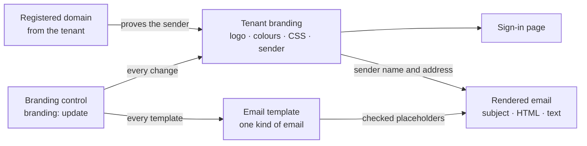
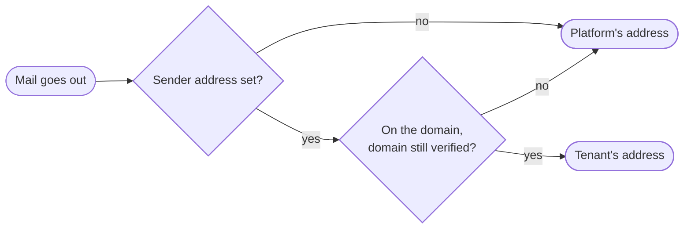

The branding context holds a tenant's **look**: its logo, its colours and its own CSS on the sign-in page, and the name and address its mail is sent under. It also holds the tenant's own versions of the platform's **emails**, such as the password reset or the invitation, written once for every language or again for one, the **mail provider** the tenant's mail goes out through, and the finished email that goes out.

Branding is shown on the page where people type their password, and in the mail that carries their reset and sign-in links. So most of this context is about keeping a tenant's own choices from turning that page or that mail against the people who read it.

Branding sits in the layer above consumers, beside federation, messaging, OAuth, the operator, the organization and routing. It uses the contexts below it: authorization, for the person making a change and the rights they hold, the tenant, for the custom domains it has registered and proved, and identity, for a fresh proof of the person. Every change asks authorization one question: does the person hold the right to update branding (`branding: update`)? The full right (`branding: manage`) covers it.

The code is in `crates/ianua-domain/src/domains/branding`:

| Part | What it holds |
|---|---|
| `config` | The tenant's look: logo, colours, custom CSS, sender name and address |
| `logo` | A logo the tenant uploads, checked for its format, size and dimensions |
| `email_template` | The kinds of email, the placeholders each one gets, and a tenant's own version of one |
| `template_locale` | Which recipients a template is written for, and which template a recipient gets |
| `placeholders` | The checks on what a tenant's own email may contain |
| `mail_provider` | The mail provider a tenant's mail goes out through |
| `renderer` | A finished email: subject, HTML body and text body |
| `control` | The rule for who may change branding |
| `events` | The events recorded when branding or the mail provider changes |

## How the parts fit

## Set or not set

Branding has no lifecycle. Each part of it is either the tenant's own or the platform's:

| Part | When not set |
|---|---|
| Logo | The platform's logo |
| Primary colour (buttons and links) | The platform's colour |
| Background colour of the sign-in page | The platform's colour |
| Custom CSS | No extra styling |
| Sender name | The platform's name |
| Sender address | The platform's address |

A tenant's branding starts with nothing set, so every page shows the platform's look. Making it needs no right, because it decides nothing. Each part can be set and later unset again. The branding counts as **customized** when the logo, either colour or the custom CSS is set. The sender name and address do not count.

An email template works the same way. Its subject, HTML body and text body are each the tenant's own or **inherited** from the platform's. A template counts as customized when any of the three is its own.

## Who may change branding

| Change | Right it needs |
|---|---|
| Set or unset the logo | Update branding |
| Set or unset either colour | Update branding |
| Set or unset the custom CSS | Update branding |
| Set or unset the sender name | Update branding |
| Set the sender address, or go back to the platform's | Update branding |
| Upload a logo | Update branding |
| Write or remove a tenant's own email template | Update branding |
| Send mail through another provider | Update branding, and a fresh proof of the person |

The full branding right covers the update right. The right to view branding changes nothing.

Moving the mail moves the password reset and sign-in links with it. So switching the provider also needs the person to have proved who they are again just now. Mallory, holding Fay's stolen session, cannot point the next reset link at a server of her own.

Sam may only view branding. Without this check, he swaps the logo on the sign-in page for one of his own, or rewrites the password reset mail so it asks people to reply with their password. Each change he tries is refused, and nothing changes.

## The look of the sign-in page

**Logo.** An `https://` address, at most 2,048 bytes, with no user name or password in it. A host that is an IP address in a private or otherwise blocked range is refused.

A tenant may also upload its logo. The platform then keeps and serves the image, and the branding keeps only where it is served. An upload must be a PNG or a JPEG, at most half a mebibyte, with each side between 16 and 4,096 pixels. The format is read from the image's own first bytes, never from a file name or a content type the uploader sends. SVG is not taken, because an SVG can carry script that would run on the sign-in page.

**Colours.** A `#` and then three or six hex digits, such as `#FFF` or `#FF5733`. A colour is stored in upper case, so `#ff5733` reads back as `#FF5733`. Anything else is refused, including a colour name like `red` or a trailing `;`. Eve sets her colour to `#FFF;background:url(x)`. Placed in the page's style sheet, it would load her address. It is refused.

**Custom CSS.** The tenant's CSS is kept in two forms:

| Form | What it is |
|---|---|
| As written | Exactly what the tenant wrote, so they can edit it. Never placed in a page |
| Sanitized | What a sanitizer made of it. The only form a page renders |

Both forms are at most 65,536 bytes and may not be empty. The sanitized form is checked again on its own, so even a careless sanitizer cannot hand a page anything else. It may hold only plain rules, `selectors { property: value; }`:

- No at-rule (such as `@import`), no comment and no escape.
- Selectors use only letters, digits, whitespace and `.`, `#`, `_`, `-`, `:`, `,`, `>`, `+`, `~`, `*`. So no attribute selector and no `(`.
- Properties come from a fixed list of 21: `color`, `background-color`, `border`, `border-color`, `border-width`, `border-style`, `border-radius`, `padding` and its four sides, `margin` and its four sides, `font-size`, `font-weight`, `text-align` and `line-height`.
- Values use only letters, digits, spaces and `#`, `.`, `%`, `,`, `-`, with brackets only for `rgb`, `rgba`, `hsl` and `hsla`. So no `url`, no quote and no `/`.

This stops Eve reading secrets out of the page. She writes one attribute selector per character of a hidden token, each loading a different `url()`, and her server learns the token from the requests. The attribute selector and the `url()` are both refused. So are `content`, which could write "Sign in here" on the page, and `position`, which could draw a fake form over the real one.

## The address mail is sent from

A tenant may send its mail from its own address, but only on a custom domain it has proved it controls:

| Step | What is checked |
|---|---|
| Set the sender address | The person may update branding, the domain is verified, and the address is on that domain. The domain comparison ignores letter case |
| Go back to the platform's address | The person may update branding |

Eve runs a tenant. Without this check she sets `security@bank.com` as her sender, or `noreply@acme.com` before proving she owns `acme.com`, and sends password resets from our servers, signed by us. Both are refused.

Each time mail goes out, the address is checked again against the domain as it is then (`sender_on`). The app's mailer runs this check before the mail is queued (`ianua-app/src/services/branding/mailer.rs`, `sender_of`), and hands the queue the address it answered.

So once a domain fails a later check, the check answers the platform's address, without anyone unsetting the tenant's.

## The provider mail goes out through

By default a tenant's mail goes out through the platform's own mail. A tenant that wants it sent from its own mail account, with its own reputation and logs, names a provider:

| Provider | What it names |
|---|---|
| SMTP | A host on the public internet, a port, a user name and a password. The connection is always encrypted, either with `STARTTLS` before signing in, never skipped when the server does not offer it, or with TLS from the first byte. There is no plain choice |
| SendGrid | An API key |
| Amazon SES | A region, an access key id and its secret |
| Postmark | A server token |
| Mailgun | The sending domain, the US or EU region, and an API key |

Every password, key and token is sealed before it reaches the domain and never prints.

A provider just named is **unverified**. Mail keeps going out through the platform until a test send through the provider worked. A test mail goes only to the person asking, never to an address they type. A failed test leaves the mail with the platform, so a mistyped password never stops people getting their reset links. The platform's own mail is never tested per tenant.

## Kinds of email

Each email the platform sends has a kind, and each kind is given its own set of placeholders. A tenant's own template may use only the placeholders its kind is given:

| Kind | Sent when | Placeholders |
|---|---|---|
| Verification | An address needs verifying after sign-up | `user_name`, `tenant_name`, `action_link`, `expires_at` |
| Magic link | Someone signs in by link | `user_name`, `tenant_name`, `action_link`, `expires_at` |
| Password reset | Someone asks to reset their password | `user_name`, `tenant_name`, `action_link`, `expires_at`, `ip_address` |
| Invitation | An admin invites someone to the tenant | `user_name`, `user_email`, `tenant_name`, `action_link`, `expires_at`, `role_name` |
| Account locked | An account is locked | `user_name`, `tenant_name`, `ip_address` |
| Session suspended | A session is suspended for suspicious activity | `user_name`, `tenant_name`, `ip_address` |
| MFA enrolled | A second factor is set up | `user_name`, `tenant_name` |
| Recovery codes | Recovery codes are made | `user_name`, `tenant_name`, `remaining_codes` |
| Device trusted | A new device is trusted | `user_name`, `tenant_name`, `device_name`, `ip_address` |
| Breached password | A password was found in a breach | `user_name`, `tenant_name`, `action_link` |
| Erasure confirmation | An erasure request was received | `user_name`, `tenant_name`, `erasure_date`, `action_link` |
| Erasure completed | The data was erased | `user_name`, `tenant_name` |
| Welcome | An account is ready from the start | `user_name`, `tenant_name`, `role_name`, `action_link` |
| Activation welcome | An invited or admin-made user finished activating | `user_name`, `organization_name`, `tenant_name`, `action_link` |
| Email change verification | A new address needs verifying | `user_name`, `user_email`, `action_link`, `expires_at` |
| Email changed | The old address is told of the change | `user_email` |
| Email change requested | Someone asked to move the account to another address. The current address is warned, with a link that stops it | `user_name`, `user_email`, `tenant_name`, `action_link`, `expires_at`, `ip_address` |
| Account linked | An outside identity provider can now sign the account in | `user_name`, `tenant_name`, `provider_name`, `ip_address` |
| Sign-in code | A one-time code is mailed, to type back to sign in or to confirm a factor being set up | `user_name`, `tenant_name`, `one_time_code`, `expires_at` |
| Export ready | A person's copy of what is kept about them is ready to download after signing in. The mail carries no download link | `user_name`, `tenant_name`, `expires_at` |
| Impersonation requested | A tenant admin asked to act as the person for support, and why | `user_name`, `tenant_name`, `requester_name`, `reason`, `expires_at` |
| Org verification | An org user's address needs verifying | `user_name`, `organization_name`, `action_link`, `expires_at` |
| Org invitation | Someone is invited to an organization | `user_name`, `user_email`, `organization_name`, `action_link`, `expires_at` |
| Org welcome | An org user's account is ready | `user_name`, `organization_name`, `action_link` |
| Org MFA reset | An owner reset an org user's second factor | `user_name`, `organization_name` |
| Org email change requested | Someone asked to move an org user's account to another address | `user_name`, `user_email`, `organization_name`, `action_link`, `expires_at`, `ip_address` |
| Signup verification | A founder's address needs verifying before the organization is made | `user_name`, `organization_name`, `action_link`, `expires_at` |
| Signup welcome | The organization exists and the founder can sign in | `user_name`, `organization_name`, `action_link` |
| Signup account exists | Someone signed up with an address that already has an account, and is pointed to signing in | `user_name`, `action_link` |
| Activity notice | A notification the person chose to have by mail as well, with its own title and text | `notice_title`, `notice_body` |

Org users belong to no tenant, so their emails have their own kinds, which name the organization instead of the tenant.

**The link.** The platform's own templates get the bare address of the link as `action_url`. A tenant's template never does. It gets `action_link` in its place, a whole link the platform writes in full. The bare address carries a one-time secret. Eve could put it in an image address on her own server, and every reset link would reach her as soon as the mail is opened.

**The code.** A one-time code, `one_time_code`, is a secret too. A tenant's template is held to the same rules for it as for `action_link` below: only in readable text, never in a subject, a tag or an attribute.

## Which template a recipient gets

A tenant writes each email once for every locale, and may write it again for a locale of its own, such as `de-DE`. It keeps one template per email and locale. A recipient gets:

1. the template of their own locale;
2. else one written for another locale of their language, the first by its tag when there are several. So Ann in `de-AT` gets Acme's `de-DE` mail;
3. else the tenant's template for every locale;
4. else the platform's mail.

The domain holds this choice in `template_for`. The app's mailer makes it for every tenant mail before the mail is queued (`ianua-app/src/services/branding/mailer.rs`, `send_to_person`). A recipient who follows the tenant's language gets the tenant's locale. Mail of no tenant always gets the platform's mail. Removing a tenant's template deletes it from its email and locale.

The platform's mail is written in the recipient's language too. The queued mail carries the locale the recipient reads, and the worker renders the platform's subject and bodies in that language when it is shipped: German, Spanish, French, Japanese, Georgian, Ukrainian or Simplified Chinese (for `zh-CN` and `zh-SG`). Any other locale, and mail of no tenant to someone not known yet, gets English. So Ann in `de-AT`, whose tenant wrote no reset mail, gets the platform's reset mail in German. A tenant's own parts are always sent as the tenant wrote them. The translated templates are generated into `crates/ianua-infra/locales/<language>/templates/`.

## What a tenant's own email may hold

A template may hold text and bare placeholders, such as `{{ user_name }}` or `{{user_name}}`, from its kind's set. Each rule below is checked when the template is written:

| Refused | Why |
|---|---|
| Template code other than a bare placeholder: a filter, a lookup, a loop, a `set`, a comment, `{%` or `{#` | Code could take the link apart and send it elsewhere |
| A placeholder the kind is not given, or one never closed | The mail would go out with a gap or stray braces where the value should be |
| `action_link` or `one_time_code` in the subject | Subjects show up in lists, previews and logs, where anyone reading them could use the link |
| `action_link` or `one_time_code` inside a tag, an attribute, a `style` block or a `script` block in the HTML body | It would become part of an address the author chose, and the mail client would send the link there, often without a click |
| `action_link` or `one_time_code` in the text body unless it starts a line or follows a space | Glued to the text before it, it becomes the end of the author's address. A full stop after it is fine |
| A `form`, `textarea`, `input`, `button`, `base`, `meta`, `iframe` or `script` tag in the HTML body, in any letter case | Each can send what the reader sees or clicks to the author's address |
| In an HTML body that writes `action_link` or `one_time_code`: `url(`, `image-set(`, `src(`, `@import`, a backslash, or a `<link>` tag anywhere, and a square bracket anywhere once the body has a `<style>` block (Outlook's `[if mso]` tests aside) | A style can match parts of the link with an attribute selector, such as `a[href*="token=ab"]`, and fetch an image from the author's server for each match, spelling the link out to them |

Eve may edit branding. She wraps `{{ action_link }}` in a form that posts to her site, with a button saying "Confirm". Ann clicks it and her one-time link goes to Eve. The form is refused. So is a `base` tag that moves every relative address to Eve's site, a `meta` refresh that sends the reader there when the mail opens, and a frame that shows Eve's own page next to the link. Tags whose names only start like a refused one, such as `<b>` and `<i>`, are fine.

The parts themselves:

| Part | Rule |
|---|---|
| Subject | A short label, not blank, with no control or invisible characters, so no line breaks |
| HTML body | Not empty, at most 65,536 characters |
| Text body | Not empty, at most 65,536 characters, no control characters except line breaks |

## A finished email

A finished email has a subject, a plain-text body, and an HTML body or none. The text body is for mail clients that do not show HTML.

The bodies carry one-time reset, sign-in and verification links. So a finished email never prints its bodies, only its subject and which bodies it has. A reset mail for Ann printed to a log while debugging shows "Reset your password", not the token in its link.

## What a stored row must satisfy to load

**Tenant branding.** Each field is already a checked type: an `https://` address, a colour, both forms of the CSS, a label and an email address. No two fields can contradict each other, so a row with checked fields always loads.

**An email template.** A stored template is held to every rule a new one is. One that breaks any of them is refused as broken storage, so the mailer never fills it. Eve writes a reset template straight into the database, with a `replace` filter on the link, a form around it, or the link inside an image address on her server. Each is refused when it is read.

**A mail provider.** A row that says the platform's own mail was tested, or that a test came before the provider was named, is refused as broken storage.

## Events

| Event | When |
|---|---|
| `branding.updated` | A tenant's branding changes. It names the part that changed: the branding settings, an uploaded logo and its format, or one email template and its kind. One save records one event, however many settings it changed |
| `branding.mail_provider_changed` | The tenant names another provider. It names the kinds before and after, never the host, account or credentials |
| `branding.mail_provider_tested` | A test mail went through the named provider. It names the kind and whether the mail was delivered or refused, never what the provider answered |

No event carries the contents. If Eve rewrites the password reset email to fool its readers, the record shows which email changed and when, while the text stays in the stored template.
