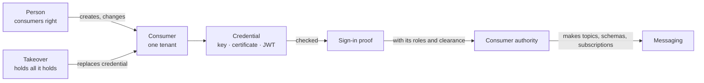
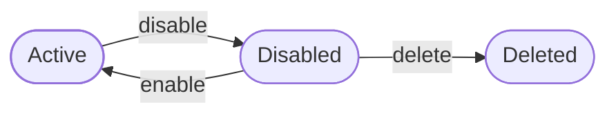

The consumers context holds a tenant's **consumers**: the callers that are not people, such as a partner integration, a backend worker or a cron job. A consumer signs in with an API key, a client certificate or a JWT it signs itself. It has no password and no second factor.

A consumer holds no rights of its own. It is a principal, like a person, so what it may reach comes from the roles it is given. "What may this caller reach" has one answer for every kind of caller.

Consumers sit in their own layer, above tenant and below the contexts that build on them. It uses authorization, for the rights a person needs to change a consumer and for the roles a consumer holds when it acts, and data classification, for the levels a consumer is cleared for. Messaging uses it in turn: a consumer makes topics, schemas and subscriptions of its own with what its roles give it.

The code is in `crates/ianua-domain/src/domains/consumers`:

| Part | What it holds |
|---|---|
| `consumer` | A consumer, its status and how it is created, changed and loaded |
| `credential` | How a consumer signs in, and which tokens it accepts |
| `credentials` | The credential in use and the one it replaced, each with when it stops working |
| `quota` | How many requests a consumer may send in a period |
| `sign_in` | The proof that a consumer signed in with its own credential |
| `control` | The rule for who may create and change consumers |
| `takeover` | The rule for who may replace a consumer's credential |
| `authority` | What a consumer holds when it acts, worked out from the tenant's records |
| `events` | The events a consumer change records |

## How the parts fit

## A consumer

Each consumer has an id, a name, an optional description, a credential with its expiry, a status, a **quota** and a **clearance**: the most sensitive data it may receive (public, internal, confidential or restricted). Right after its credential is replaced it may also hold the old credential for a short overlap (see [Replacing a credential](#replacing-a-credential)). It also records who created it: the account of the person who did, read from what they signed in with, never a name the caller wrote.

The name and description are checked labels: not blank, with no control characters and no invisible characters.

## A consumer's life

A new consumer starts **active**. Disabling it and enabling it again swap the two states. Disabling a consumer that is already disabled, or enabling one that is already active, is refused, so a repeat click does not count as a change.

Only a disabled consumer can be deleted. So its credential is refused, and the services relying on it are seen to fail, before it is gone. Sam deletes "billing-sync" in one slip. Without that order, the payroll run that calls it would stop with nobody having seen it coming.

A disabled consumer may not act:

- It does not sign in, even with its own key, certificate or token.
- It gets no authority to act with, so it makes nothing in messaging.
- It trusts no token, even one from the issuer it names.
- No person may subscribe it to a topic.

Ann disables "billing-sync" after its key leaks. Mallory sends a request with the leaked key to make a topic. The key does not sign a disabled consumer in. A request that signed in just before Ann acted gets no authority either, so the topic is not made.

## How a consumer signs in

| Credential | What is kept |
|---|---|
| API key | A visible prefix, such as `ick_3f7kq2mna9b4c`, and a keyed hash of the full key |
| Client certificate | The certificate's SHA-256 fingerprint |
| JWT | The issuer (`iss`) and subject (`sub`) its tokens carry, and the `https` address where it publishes its keys |

The platform makes every API key itself. An admin asks for one when creating the consumer or replacing its credential, and the answer shows the key once, as `api_key`. It reads `ick_<id>_<secret>`. Only the prefix and a keyed hash of the whole key are kept, under a key the platform keeps for consumer keys alone, so the key cannot be shown again: a lost key is replaced. No client can choose a key or send a hash of its own, since only the platform can make the hash the gateway checks.

When a credential is named in a log, only a short hint is shown: the key's prefix, the certificate's `sha256:` fingerprint, or the JWT subject. The hint never holds the secret.

| Value | Rule |
|---|---|
| Certificate fingerprint | 32 bytes, read as `sha256:<hex>`, colon-separated pairs or plain hex, in either case. Two fingerprints are compared by their bytes, never by how they were written |
| JWT issuer | An absolute `http` or `https` URL, up to 4096 bytes |
| JWT subject | Not empty, up to 512 bytes, with no control or invisible characters |

## Proving a consumer signed in

A request that names "billing-sync" does not act as it on that word alone. The consumer first checks the credential the request carried, and only that check gives a **sign-in proof**. The proof names one consumer and answers one request.

| Credential | Signs in when |
|---|---|
| API key | The consumer is active and the key's hash is that of a working key it holds |
| Client certificate | The consumer is active, and the certificate's fingerprint is that of a working certificate it holds, once the gateway checked the connection holds the certificate's key |
| JWT | The consumer accepts the token (below), and the token's subject is the one a working credential names |

A credential **works** until its expiry. After a replacement, the old credential works too, until its overlap ends or it expires, whichever comes first. Never more than two credentials work at once.

A credential of the wrong kind is refused too: a consumer that signs in by certificate does not sign in with its old API key. A key or certificate that does not match is refused with the same words as one of the wrong kind, so a caller learns nothing about what it guessed.

Mallory guesses a key for "payment-processor". The hash does not match, and she gets no proof. "cron-job" signs in with its own key and hands that proof over as "billing-sync". The proof names "cron-job", so it gives no authority as "billing-sync".

## Which tokens a consumer accepts

A consumer that signs in with a JWT accepts a token only when all of these hold:

- the consumer is active,
- the token's issuer is the one the consumer names,
- that issuer is not the tenant's own.

The sign-in check takes a token's issuer and subject only once the gateway has checked its signature against the keys the consumer publishes, with the algorithm each key names. To sign in, the token's subject must also be the consumer's own. A token from the right issuer for another of its subjects, such as `payroll-sync`, does not sign in "billing-sync".

A consumer that signs in with a key or a certificate accepts no token at all.

**The tenant's own issuer is never a consumer's.** The tenant's issuer signs tokens for people. If a consumer trusted it, Ann's access token would be read as the consumer's, and Ann would act with the machine's roles. So a JWT credential that names the tenant's issuer is refused when the consumer is created and when its credential is replaced.

That check alone is not enough, because a tenant can change its issuer later. "billing-sync" is set up to trust `https://login.acme.com`. Later the tenant makes that address its own custom issuer, so Ann's access token carries it. The check that reads a token is given the tenant's issuer of that moment and makes the issuer check again, so Ann's token is refused as the consumer's.

**A token from another issuer is refused.** Mallory runs her own issuer at `https://mallory.example.com` and sends a token naming the consumer's subject. The consumer names another issuer, so the token is refused.

## Who may do what

Each change names the person who makes it and needs a consumers right. The right counts whether it comes from the person's roles or from an active break-glass grant.

| Change | Right needed |
|---|---|
| Create a consumer | `consumers: create` |
| Disable or enable it | `consumers: update` |
| Rename it, or change its description | `consumers: update` |
| Change its clearance | `consumers: manage`, and a data clearance at least as high |
| Change its quota | `consumers: manage` |
| Replace its credential | `consumers: update`, and everything the consumer holds (see below) |
| Stop the old credential before its overlap ends | `consumers: update` |
| Change when its credential expires | `consumers: manage` |
| Delete it, once disabled | `consumers: delete` |

`consumers: manage` covers every consumers right. The create right does not cover update: Sam may create consumers but may not change one that exists.

A later expiry keeps a credential working that would have stopped, much as issuing it again would, and a larger quota lets a consumer send more than its contract paid for. So both need the full right. Sam may update consumers, but he cannot keep a contractor's key working for years. Stopping the old credential early only takes access away, so the update right is enough.

A new consumer holds no role, so creating one needs only the create right, and a clearance no higher than the person's own.

## Clearing a consumer for data

A consumer's clearance decides which topics it may subscribe to. Raising it opens topics it could not reach before, as granting a role would. So:

- Changing it needs `consumers: manage`, not just update.
- No one clears a consumer above what they may see themselves, when they create it or change it.

A person's own clearance comes from what they hold. Everyone in a tenant sees internal data. `data: confidential` raises it to confidential, and `data: restricted` to restricted, which covers confidential. An active break-glass grant that gives one of these counts.

| Attempt | Result |
|---|---|
| Sam may update consumers. He clears "billing-sync" for restricted data so it can subscribe to salaries | Refused |
| Ann manages consumers but may see only internal data. She clears "payment-processor" for restricted data | Refused |
| Ann manages consumers and holds `data: restricted`. She clears "payment-processor" for restricted data | Allowed |

These checks stop someone who may only view consumers from doing harm:

- Sam turns "billing-sync" back on after Ann disabled it because its key leaked.
- Sam disables "payment-processor" and every payment stops.
- Sam renames "payment-processor" to pass it off as another service.
- Sam creates a consumer with a key he holds, ready for someone to give it roles.

Each one is refused, and the consumer stays as it was.

## Taking over a consumer

Whoever sets a consumer's credential can sign in as it and act with every role it holds. So replacing the credential hands all of that over, and needs what handing it out would need. The person must:

- hold `consumers: update`,
- hold every right the consumer's roles give it, as standing rights. A break-glass grant does not count here. An app-defined right the consumer holds also passes when the person may escalate roles,
- act with rights worked out in the consumer's own tenant.

What the consumer holds is read from the tenant's records, never taken from the caller. The takeover is worked out for one consumer and passes for no other.

| Attempt | Result |
|---|---|
| Sam may update consumers, but "billing-sync" holds an admin role he does not. He swaps its key for his own to sign in as it | Refused |
| Sam holds everything "billing-sync" holds, but may only view consumers | Refused |
| Sam's rights were worked out in Globex, and he takes over a consumer of Acme | Refused |
| Sam is cleared to take over "cron-job", which holds nothing, and uses that on "billing-sync" | Refused |
| Sam may update consumers and holds everything "billing-sync" holds | Allowed |

The new credential must also pass the issuer check above: a JWT credential may not name the tenant's own issuer.

## Replacing a credential

A partner integration cannot switch to a new API key the instant an admin replaces it. Its deploy takes minutes or hours. So a replacement may keep the old credential working for an **overlap**:

- The overlap is at most seven days. A longer one would leave a leaked key working long after it was replaced.
- An old credential that has already expired is not kept, whatever the overlap says.
- A credential kept from an earlier replacement is dropped, so only two ever work at once.
- The new credential may not be the one in use, and its expiry must lie in the future.

Once every caller has moved over, an admin can stop the old credential before its overlap runs out.

Each credential also carries its own expiry, set when it is issued, so a key handed to a contractor for a month stops working without anyone remembering it. An expiry that has already passed is refused.

## Quota

A rate limit on a route guards it against bursts from anyone. A **quota** is the consumer's own allowance, such as the 10,000 calls a day a partner's contract pays for. A consumer is either unlimited, where route rate limits still apply, or allowed 1 to 1,000,000,000 requests per minute, hour, day or month, counted in calendar periods in UTC. A quota of zero is refused: it would refuse every request while reading as a limit, so disable the consumer instead.

The gateway counts the consumer's requests in the current period and asks the quota before forwarding. Once the period's allowance is spent, requests are refused until the next period.

A tunnel counts once, when it opens. While it stays open the gateway checks its key again every so often, and those checks are not counted, so a database tunnel held open all day does not spend the allowance on being asked about. Each check still refuses a key that stopped working or a consumer that was disabled, and the tunnel closes.

## What a consumer holds when it acts

A consumer acts only with its sign-in proof. What it holds is worked out from the tenant's records: the roles it is given, directly or through a group it is in or one above it. It is never written by the caller, so no service can act in another consumer's name or add a right of its own. A consumer has no break-glass grants; it holds only what its roles give.

A right counts when a role gives it as it is or through a wider right, such as a `manage` right in the same area. A consumer nobody gave a role holds nothing. It also carries the clearance stored on the consumer, and nothing raises it on the way.

Working this out is refused when:

| Case | Why |
|---|---|
| The sign-in proof names another consumer | One consumer's sign-in never acts for another |
| The consumer is disabled | A disabled consumer may not act |
| The records name a role or group that is not there | Treated as broken storage |

In messaging, a consumer makes things of its own. Before it makes a topic, a schema or a subscription of its own, its roles must give `messaging: create`. "billing-sync", given only the right to publish, cannot make topics or subscribe to whatever it likes.

A person with `messaging: create` may also subscribe a consumer, as long as it is active. Either way, a topic classed above the consumer's clearance takes no subscription for it, whoever makes the subscription.

## Loading a stored consumer

A stored consumer is refused as broken when it says it changed before it was created, when it keeps an old credential that is the current one, or when the old credential's overlap ends before the consumer was made or more than seven days after its last change. An unknown quota period is refused as broken too.

A credential in use names one consumer of the tenant. Saving a consumer whose key, certificate or token subject another consumer of the tenant uses now is refused as a conflict, so a sign-in never has to pick between two. A credential a rotation still keeps working is found only when no consumer uses it now.

## Events

| Event | Type |
|---|---|
| Created | `consumers.consumer_created` |
| Disabled | `consumers.consumer_disabled` |
| Enabled | `consumers.consumer_enabled` |
| Renamed, with both names | `consumers.consumer_renamed` |
| Description changed or cleared | `consumers.description_changed` |
| Clearance changed | `consumers.clearance_changed` |
| Credential replaced, with when the old one stops | `consumers.credential_rotated` |
| Old credential stopped before its overlap ran out | `consumers.credential_overlap_ended` |
| Credential expiry changed, with both expiries | `consumers.credential_expiry_changed` |
| Quota changed | `consumers.quota_changed` |
| Deleted | `consumers.consumer_deleted` |

A change that leaves the value as it was, such as setting the clearance, quota or description it already has, records nothing.

Each event names the tenant and the consumer, with the consumer's name as it was at that time, so the audit log can link to it.
