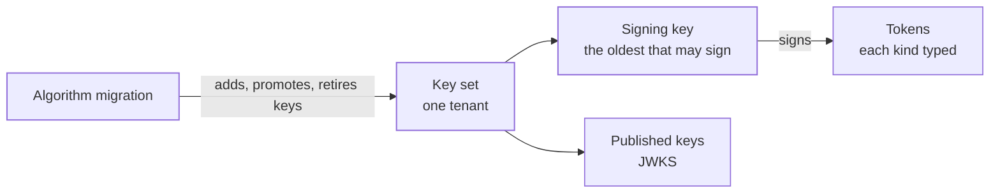
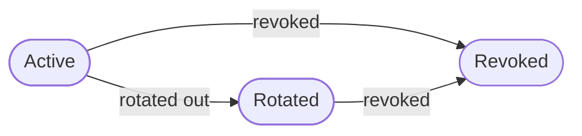
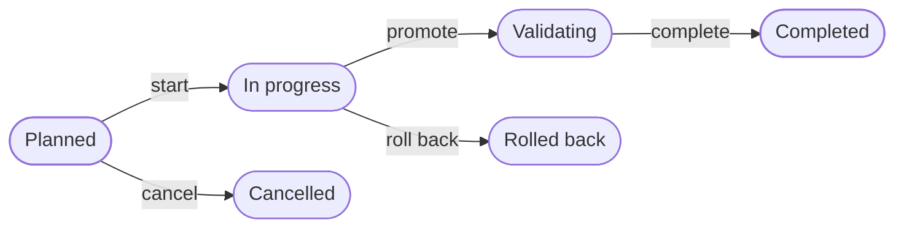

The crypto context holds a tenant's **signing keys**: the keys that sign every token the tenant issues, and that every relying party checks those tokens against. It decides which key signs, which keys are published, how a key is rotated out and revoked, and how a tenant moves from one signing algorithm to another without downtime. It also names the **kinds of token** the keys sign, so one kind can never pass for another.

Crypto is part of the foundation. It uses no other context. Where a change needs a right, crypto names the rule and authorization answers it.

The code is in `crates/ianua-domain/src/domains/crypto`:

| Part | What it holds |
|---|---|
| `signing_key` | A key, the tenant's set of keys, and the algorithms they use |
| `key_status` | Where a key stands: active, rotated or revoked |
| `rotation` | The platform rotating a tenant's signing key on a schedule, by age |
| `algorithm_migration`, `migration_status` | Moving the tenant to another signing algorithm, step by step |
| `jwt_type` | The kinds of token the keys sign, and which one counts as a credential |
| `jwk` | The public fields of a key as it is published |
| `control` | The rule for who may change the keys |

## How the parts fit

## A signing key

Each key has an id (its `kid`), an algorithm, a public half and a private half. The algorithms are:

| Algorithm | What it is |
|---|---|
| RS256 | RSA with SHA-256. Widely supported, with larger keys |
| ES256 | ECDSA on P-256 with SHA-256. Smaller keys and faster signing |
| EdDSA | Ed25519. The fastest, with the smallest keys |

The private half is held as a secret. With the built-in signer it is the key itself; with a key service it names where the key lives. Either way it never prints, so it cannot end up in a log line, an error or a crash report. Storage seals it with the platform's secret sealer before writing it and opens it as it reads it, so the database never holds it in clear. A private half that does not open is treated as broken storage.

A key id is any non-empty ASCII text up to 128 characters, as the JWK standard allows. Within one tenant's set each id names one key. A set that would hold two keys with the same id is refused, because revoking one would leave its twin signing. A stored set with two such keys is refused as broken.

## A key's life

A key may also have an expiry. A key **signs** only while it is active and not past that expiry. An expired key stops signing at once, whether or not anything has rotated it yet.

**Which key signs.** The oldest key that may sign. Two keys are active at once only during an algorithm migration, where the old key keeps signing until the new one is promoted. Choosing by age keeps that true whatever order the keys are stored in. When no key may sign, nothing signs. An expired key never carries on.

**Which keys are published.** The published key list (the JWKS) holds the keys a verifier may still accept:

| Key | Published |
|---|---|
| Active, no expiry | Yes |
| Active with an expiry | Until the grace period after that expiry ends |
| Rotated | Until the grace period after the rotation ends |
| Revoked | Never |

A key stops signing when it is rotated out or expires. It stays published for the grace period after that, so tokens it signed just before have time to run out, and no longer. This is judged from the clock, not from whether a job has since rotated or revoked the key. So a key a failed job left behind is not published forever.

## Changing the keys

| Step | What it does |
|---|---|
| Rotate | Every active key moves to rotated and stays published for the grace period. The new key signs from then on |
| Add a key | Publishes a new key beside the current one without rotating it. An algorithm migration uses this |
| Rotate one key out | Stops one key signing but keeps it published for the grace period, as promoting a migration does to the old key |
| Revoke | Takes one key out for good. Tokens it signed no longer verify |
| Revoke after grace | Revokes every rotated key whose grace period is over. The clock does this, not a person |

Each change by a person needs the right to update keys (`crypto: update`). The keys decide whose tokens every relying party believes. Sam may only view the keys. Without this check, he revokes the key that signs and every relying party stops believing the tenant's tokens.

Two more rules protect the tenant from being left with nothing:

- A new key may not reuse an id the set already holds. Nothing is rotated then.
- The only key that can sign right now cannot be revoked or rotated out. A key that is active but past its expiry signs nothing, so it does not count as another signer.

The tenant's first key is made by the platform as it provisions the tenant. Any later key joins the set only through one of the changes above, or through rotation by age.

## Rotation by age

A key that signs for years gives a thief who copies it years of tokens every relying party believes. So the platform also rotates each tenant's key on a schedule, with nobody asking. The schedule names the longest age a key may sign for, and the overlap a rotated key stays published for. The overlap must be shorter than the longest age, so a rotated key is gone before the next rotation and at most two keys are ever published.

A background job rotates every signing key older than the longest age and records `crypto.key_rotated` for each tenant. A key that is not due is left alone, so a job that runs twice rotates once. A tenant in the middle of an algorithm migration is skipped: the migration decides which key signs until it ends. The platform rotates the key, so no person's right is asked.

## Moving to another algorithm

A tenant can move from one signing algorithm to another without downtime:

| Step | What happens |
|---|---|
| Plan | Names the key signing now and the algorithm to move to. The old algorithm is read from that key, so the record cannot claim a change the keys do not make. Moving to the algorithm already in use is refused |
| Start | Names the new key, already made and published. It must use the new algorithm, and it may not be the old key |
| Promote | The new key becomes the one that signs. The old key stays published so its tokens still verify |
| Complete | The old key is revoked. The new key is the only one signing |
| Roll back | Undoes a started migration, with a reason. The old key still signs, and the new key is revoked |
| Cancel | Calls off a migration that is only planned |

A migration can be rolled back only before it is promoted. Once the new key signs, the old one is rotated out, and going back is a new migration. Every step needs the same right as any other key change.

The migration records each step. It does not change the keys itself; the app changes the keys in step with it, through the key set. Starting a migration makes the new key and publishes it beside the old one.

A stored migration is refused as broken when it moves to the algorithm it starts from, moves onto the key it moves away from, changed before it was planned, or has a target key that contradicts its step: one that has started without a target key, or has a target key without having started.

## Kinds of token

The tenant's signing key signs the tokens the platform issues to callers. What the gateway hands an upstream, the assertion, the exchanged token and message signatures, is signed with the tenant's assertion keys, which only the gateway holds. Either way, each kind of token carries its own `typ` header, and only one kind is accepted as a credential:

| Kind | `typ` | What it is |
|---|---|---|
| Access | `at+jwt` | Access and task tokens a caller presents. The only kind accepted as a credential |
| Upstream assertion | `ianua-assertion+jwt` | The gateway's statement to an upstream about who is calling |
| Exchanged token | `ianua-exchanged+jwt` | A narrowed token the gateway makes for one upstream's audience, lasting at most 5 minutes |
| Message signature | `ianua-signature+jwt` | A signature over a request or response the gateway relayed |
| Message provenance | `ianua-provenance+jwt` | Who wrote a message the agent relay forwarded |
| Proof of possession | `dpop+jwt` | Proves the holder has the key a task token is bound to |
| App session | `ianua-app-session+jwt` | A person's session on one app's host, accepted only from that host's cookie |
| ID token | `JWT` | Tells a client who signed in. Never a credential |
| Security event | `secevent+jwt` | An event sent to a signals receiver |
| Logout token | `logout+jwt` | Posted to an app's server when a person signs out. Typed apart from an ID token, so neither can pass for the other |

Without this, someone could copy a token the gateway sent to an upstream off the wire and present it as an access token. A token with no `typ` is refused too, because every token the platform signs has one. The comparison ignores letter case and an `application/` prefix, as the JWT standard allows.

## Published key fields

Each published key carries the public fields its algorithm needs, as the JWK standard lays them out: the modulus and exponent for RSA, the curve and two coordinates for P-256, and the curve and public key for Ed25519. Its `alg` is RS256, ES256 or EdDSA.

## Events

The context records an event when a key is created, rotated or revoked, and when an algorithm migration is planned, started, promoted, completed, rolled back or cancelled.
