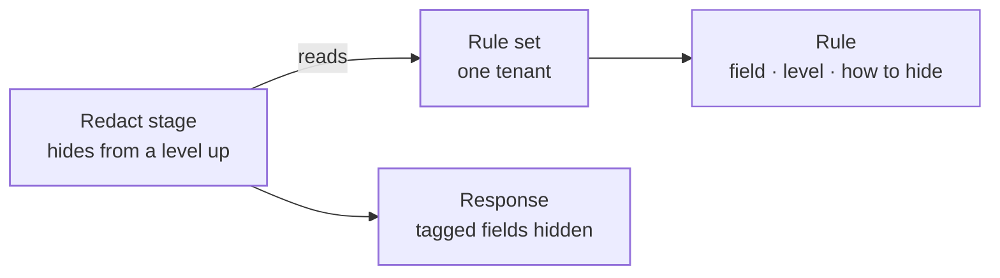

The data classification context says **how sensitive data is**, on four levels from public to restricted. It also holds a tenant's **classification rules**: which fields in its API responses are sensitive, and how the gateway hides each one before the response reaches the caller.

Data classification is part of the foundation. It uses no other context. Where a change needs a right, it names the rule and authorization answers it. Several contexts above it carry a level: routes, gateway stages, messaging, consumers, agents and workflows use it to decide what may be shown and where data may go.

The code is in `crates/ianua-domain/src/domains/data_classification`:

| Part | What it holds |
|---|---|
| `level` | The four levels of sensitivity |
| `classification` | A tenant's rules, one per field, and how each field is hidden |
| `control` | The rule for who may change the rules |
| `events` | What adding, changing and removing a rule records |

The use cases are in `crates/ianua-app/src/use_cases/data_classification`. The rule set is served under `/api/v1/organizations/{org_slug}/tenants/{tenant_slug}/classification`: `GET` returns it, `POST .../rules` adds a rule, `PUT .../rules/{id}` changes one and `DELETE .../rules/{id}` removes one.

| Call | Answers |
|---|---|
| `GET` before the first rule | `200` with an empty `rules` list and a `null` `id` |
| `POST .../rules` | `201` with the rule and its `id`. `409` when the field already has a rule |
| `PUT .../rules/{id}` | `204`. `404` when no rule has this id. `422` for `Encrypt` |
| `DELETE .../rules/{id}` | `204`. `404` when no rule has this id |

## How the parts fit

## Levels

| Level | What it covers |
|---|---|
| Public | Data anyone may see |
| Internal | Data for people inside the tenant only |
| Confidential | Personal or financial data |
| Restricted | Secrets and health records |

The levels are ordered, from least to most sensitive, so "this level or higher" always means the same thing. A level a caller sends that is not one of these four names is refused. A stored level that is not one of them is treated as broken storage, never guessed.

## Classification rules

A rule gives one response field a level and a way to hide it. The field is named by its path, with dots between the parts, such as `user.ssn` or `billing.card_number`. A path:

- is not empty, is ASCII, at most 256 characters and at most 10 parts deep,
- has no empty part, so `user..email` is refused, and no dot at the start or end,
- has parts that start with a letter or `_` and go on with letters, digits or `_`.

A tenant keeps its rules in one **rule set**. The set is made with the first rule. Until then, reading it returns no rules and no id, not an error. Each field has at most one rule. Adding a second rule for a field that already has one is refused, because only the first rule for a field would ever apply. Ann tags `user.ssn` as public, then adds a restricted rule for it. Without this check, the list shows the field as restricted while the gateway still sends it in the clear.

**Changing a rule** sets its level and how its field is hidden in place, keeping its id and its field (`ChangeClassificationRuleUseCase`, in `change_classification_rule.rs`). Removing the rule and adding a new one would leave a moment where the field goes out in the clear. A change to Encrypt is refused, as a new rule asking for it is.

Removing a rule means the field reaches callers unhidden from then on. Adding, changing and removing a rule record `proxy.classification_rule_added`, `proxy.classification_rule_changed` and `proxy.classification_rule_removed`. The change records the level and the way of hiding before and after.

A stored rule set is refused as broken when it has two rules for one field, two rules under one id, or changed before it was created. Two rules under one id matter because removing that id would also take out a rule nobody meant to remove.

## How a field is hidden

| Way | What the caller gets |
|---|---|
| Remove | The field is left out of the response |
| Mask | The value is replaced with `***` |
| Hash | The value is replaced with a keyed hash |
| Encrypt | Treated as Mask |

**Encrypt** has no keys behind it. A new rule that asks for it is refused, and the gateway masks any field an older rule tags this way, instead of sending it in the clear.

**Hash** is keyed: an HMAC-SHA256 under a key the platform derives for this alone, mixed with the tenant. A plain SHA-256 of a social security number is undone in seconds by hashing every number there is, and without the key nobody can do that. One value gives the same hash every time within a tenant, so your app can still match records on it, and a different hash in another tenant, so two tenants cannot compare hashes to find a customer they share. The digest is `HmacRedactionDigest` in `ianua-infra/src/crypto/seals/digests.rs`.

The gateway's **Redact** stage does the hiding. It names the tenant's rule set and the lowest level it hides. A Redact or Data classify stage that names another tenant's rule set, or any rule set before the tenant has classified a field, is refused when it is added, changed or imported in a gateway document: it could hide nothing. Mallory, an admin in another company, copies Bob's rule set id into her stage. Without this check the stage would be saved and look as though it protects the data. Every field whose rule is at that level or higher is hidden in the way its rule says. Fields below that level, and fields with no rule, pass through as they are. The elements of a list share the list's path, so a rule for `users.ssn` covers the `ssn` of every user in `users`. The stage lives in the gateway crate, `crates/ianua-zero/src/pipeline/stages/response/redact.rs`.

The gateway keeps each tenant's rule set in memory for up to 30 seconds. Adding, changing or removing a rule drops it on every gateway at once, so a field marked restricted is hidden from the next answer on. When the cache server cannot be reached, the gateway reads the rules from the database on every answer instead.

## Who may see which level

A person's **clearance** is the most sensitive level they may see. It comes from what they hold in the tenant, never from what a request says:

| They hold | Their clearance |
|---|---|
| Nothing extra | Internal: everyone acting in the tenant sees internal data |
| `data: confidential` | Confidential |
| `data: restricted` | Restricted, which covers confidential too |

These rights come from a role or from an active break-glass grant. The tenant's first admin role holds `data: restricted`.

A tenant can also let one of its own app permissions clear its holders. A **clearance rule** says that holding, say, `payroll:read` clears for confidential data. A clearance rule only raises a clearance, and only to confidential or restricted, since everyone sees internal data already. Each permission has at most one rule. Nobody writes, changes or removes a rule for more than they are cleared for themselves. Sam, cleared for internal data, cannot make `notes:read` clear for restricted data. Clearance rules live in the authorization context (`crates/ianua-domain/src/domains/authorization/clearance.rs`) and are served under `/api/v1/organizations/{org_slug}/tenants/{tenant_slug}/authorization/clearance-rules`. Reading them needs `classification: view`, and changing them `classification: update`. Adding, changing and removing a rule record `authorization.clearance_rule_added`, `authorization.clearance_rule_changed` and `authorization.clearance_rule_removed`. The rules are kept and served now, but nothing reads them yet: the approvals and consumer checks below use the clearance from the table above, and the gateway that is being rebuilt does not apply them yet.

Other contexts read the clearance where a person lets data through:

- An agent or workflow approver may approve a step only when their clearance reaches the data the step touches. Sam may see internal data only. Without this check, he approves an agent call that reads payroll and sees the salaries in the approval.
- A person may give a messaging consumer a clearance no higher than their own. Mallory holds `data: confidential`. Without this check, she clears a consumer she controls for restricted data and reads health records through it.

## Who may change the rules

Making a rule set and adding, changing or removing a rule each need the right to update classification (`classification: update`, or `classification: manage`, which covers it). The rules decide what the gateway hides, so they are guarded like any other security setting. Sam may only view the rules. Without this check, he removes the rule that masks `user.ssn`, and every response carries it in the clear.
